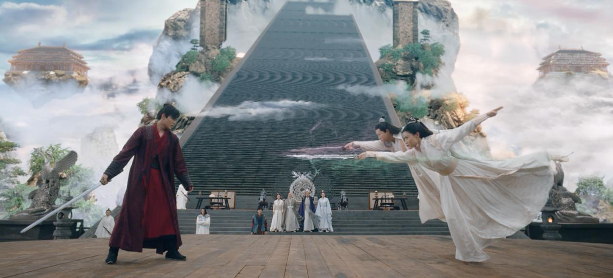

# 第六章　論武大會，群雄畢至

---

### 一、聖武晨曦，萬人空巷

晨光初破，金陽萬道。

當天邊第一抹朝霞染紅了天武城那高達百丈的巍峨黑玄石城牆時，整座號稱滄瀾中樞的天下第一雄城，已然陷入了一種近乎沸騰的喧囂與狂熱之中！

人潮如海，蹄聲如雷。

自四方城門湧入的各路江湖豪客、各大名門真傳、世家名宿，宛如百川歸海般，瘋狂匯聚向城池正中央那座名震大陸的武道聖地——**【聖武廣場】**。

這是一座佔地足有方圓十里的宏偉道場。

地面通體以堅硬無比的萬載九天玄金巨石打磨鋪砌，石面之上密密麻麻刻滿了歷代武皇加持的加固陣紋，縱是先天真氣狂轟濫炸，亦難以在上面留下半寸刀痕。

道場正中央，拔地而起一座高達十丈、方圓千步的巨大青石主擂台，四周更分佈著甲、乙、丙、丁四座巨大的副擂台，如眾星拱月般環伺左右。

而在廣場的最外圍，十二尊高達百丈、形態各異的巨大石雕頂天立地，皆是滄瀾界歷史上名震千古的極道武者法相——有的握重刀指天長嘯，有的撫長劍若雪中傲梅，有的負手踏雲俯瞰眾生。石雕之上散發出的淡淡遠古武道意志，歷經千年風雨洗禮，依舊讓踏入此地的每一個人感到神魂微顫、熱血沸騰！

觀禮席如層層梯田般向上延伸，此刻早已坐得密密麻麻，數以十萬計的武者揮舞著各自宗門的戰旗，酒香、汗水與衝天的氣血交織在一起，爆發出的聲浪直衝九霄雲外！

---

### 二、震天鐘響，武極威儀

「咚————！」

辰時三刻，一聲沉渾雄渾到了極致、宛如遠古蠻荒巨獸自深淵復甦般的宏大鐘鳴，驟然撕裂了滿場的喧囂！

那聲音並非來自凡銅，而是懸掛在聖武廣場正北高樓之上的武道至寶——**【九幽震天鐘】**！

鐘聲九響，餘音嫋嫋，穿透雲層，甚至讓整座天武城的大地都跟著發出輕微的共鳴。

原本嘈雜如沸水般的十萬觀眾席，在這一刻驟然安靜了下來。

「踏。」

一聲並不響亮、卻精準落入在場每一個人耳中的腳步聲自北面高台響起。

只見主觀禮台中央的金絲蟠龍寶座前，一位身著一襲深紫色太極武袍、身形巍峨如崇山峻嶺的高大老者緩步踱出。

老者鬚髮皆白，雙眉如兩柄倒插天穹的雪白鋼刀，不怒自威。他的雙眸開闔之間，隱隱有虛空生電、法則扭曲的實質異象，周身沒有半點外溢的氣血罡風，但僅憑其隨意站立的姿態，便讓整座廣場所凝聚的十萬武者氣場，被硬生生一人壓制！

武極殿首座大長老——**楚烈天**！

當世為數不多的傳奇強者之一，實打實邁入【武皇初期】的霸主級巨擘！

楚烈天負手立於高台邊緣，鷹隼般的目光平靜地俯瞰著全場，聲音不大，卻在每一位武者的心海深處轟然炸響：

「十年論武，又是一度大爭之春。」

「老夫楚烈天，奉武極殿三位隱世殿主法旨，主持本屆『天下論武大會』！」

「自百年前天屠武神遠遁極北，天地有鎖，我滄瀾界前路多舛。然而……武者之魂，重在逆天爭鋒，強者之心，重在百折不撓！前路縱有巨鎖，亦當以手中之刀、胸中之劍，生生砸出一個朗朗乾坤！」

楚烈天這一番話，字字如金石交擊，瞬間點燃了在場所有年輕熱血武者的心頭戰火！

「好！」

「楚長老大氣魄！」

「武者當爭，天下為先！」十萬豪客齊齊振臂高呼，聲震四野。

楚烈天抬起右手，在半空中輕輕一按，滿場再度肅靜。

「規矩一如往昔：凡年不過三十、修為達通脈巔峰以上者，皆可登台爭鋒！」

「大會分初選、分組與決擂。最終榮登『滄瀾天驕榜』前三甲者，除可獲賜傳世神兵與造化天丹外，更可得入我武極殿【演武秘閣】閉關三月，親自參悟歷代武皇甚至遠古武神留下的開天真意！」

「現在……天武大擂，開！」

---

### 三、群雄逐鹿，各顯神通

「轟隆隆隆！」

伴隨著一聲巨響，聖武主擂台四周的玄金防禦光幕沖天而起，甲、乙、丙、丁四座副擂台的閘門同時大開！

「中州奔雷門，趙天雷登台！」

「北地玄冰世家，韓霜兒討教高招！」

「狂刀門張豹在此，誰敢上前領死？！」

剎那間，數十道散發著強橫氣血與元素異能的年輕身影，宛如捕食的獵豹般自四方掠上高台，拳風呼嘯，刀光裂空！

這是一場極致野性、極致純粹的硬碰硬對決。

在甲字號擂台上，一名身形宛若鐵塔般的重甲武者，雙拳覆蓋著尺許厚的剛猛玄鐵罡氣，拳出如狂風暴雨，每一拳砸出都引發一連串刺耳的氣爆雷音，硬生生將對手的地階長槍砸得寸寸彎曲！

而在乙字號擂台上，則上演著一場截然不同的異能爭鳴——

一名身著冰藍色羅裙的世家少女，足尖輕點地面，方圓三十丈內的青石板瞬間凝結出一層深達半尺的萬載玄冰！漫天冰晶化作鋒利無比的旋風飛刃，將迎面撲來的三位宗師門徒生生逼得手忙腳亂、護體真氣寸寸開裂！

血肉的碰撞！

真氣的咆哮！

異能的轟鳴！

不同於青玄界修仙者動輒祭起飛劍符籙於千丈之外盤旋牽扯的縹緲從容，滄瀾界的戰鬥狠辣凶悍到了骨子裡。

在這裡，十步之內人盡敵國，哪怕是微小的一個身位誤判，便會引來對手如同狂風驟雨般的連環重擊；每一次格擋，皆是骨肉與精鐵的沉重硬撼！

圍觀的江湖客們看得目不暇接，叫好聲、嘶吼聲響徹雲霄。

---

### 四、散修席畔，酒暖觀棋

與各大名門那裝潢奢華、侍從如雲的貴賓包廂不同。

在西側觀禮席最偏僻的一個散修角落裡，一襲月白色暗紋長袍的顧淵正悠然自得地盤膝而坐。

他的面前並無錦緞桌案，僅有一方長條青石。石上放著一壺自臨泉別苑帶來的溫熱燒刀子，以及一碟晶瑩脆嫩的青筍乾果。

顧淵一手握著那柄青竹折扇，在膝頭隨意打著節拍，另一手端著粗陶酒盅，神色從容淡然，宛如一位超然於俗世棋局之外的觀棋帝師。

然而，在那看似懶散平靜的雙眸深處，一抹極其深邃的金色神紋正悄然流轉。

【破妄真視】。

在他的視界之中，眼前這喧囂狂暴的百派混戰，完全褪去了表層那刺目的光影與煙塵，化作了一條條清晰可辨的氣血脈絡與法則線條——

甲字號擂台那重甲巨漢的拳罡固然霸烈，但氣血過度淤積於雙臂，真氣下行走陽關穴時存在一瞬的凝滯，若是攻其右肋三寸，三招必敗；

乙字號擂台那玄冰少女的元素異能純度頗高，但心念過急，冰寒真氣未曾與體內十二正經完全融匯，久戰之下肉身鼎爐必遭寒氣反噬；

丙字號擂台的霸刀弟子……

顧淵一邊品著微辛的烈酒，一邊在識海之中運轉萬界混沌星脈，以極高的維度飛速推演、吸收著滄瀾武道百家之長的精髓。

昨夜初融的那縷狂雷刀意，此刻正宛如一枚火種般在體內生根發芽，引導著他更深層次地理解這座世界對人體潛能的極致運用。

「天下武道，殊途同歸。」

顧淵心中暗讚一聲：

「青玄道門長於『靈』，而滄瀾武學極於『力』。若能將這萬家武意與仙道周天融會貫通……這條前無古人的仙武之路，威能將遠超想像。」

---

### 五、暗潮湧動，裁判微瀾

就在滿場戰鬥如火如荼之時。

主觀禮台西側的裁判席角落，氣氛卻透著一股隱秘的森然。

十餘名身著武極殿黑金戰甲的裁判長老正緊張地核對著各擂台晉級的生死契書。

然而，在最末端的一處案几後方，一位頜下留著短鬚、面容陰鷙的裁判長老，身軀卻在不易察覺地微微緊繃。

他的袖袍之下，正死死捏著一枚散發著極其微弱紫金龍氣的皇家暗令，眼角餘光不動聲色地瞥向了北面看台上一處被重重錦繡帷幔遮擋的尊貴行宮——大乾皇朝三皇子府的駐地。

趁著周圍長老起身為擂台決戰喝彩的間隙，那短鬚長老右手閃電般一拂，自袖中取出一張早已用特殊墨汁浸泡過的暗黃色對戰羊皮卷，指尖真氣微動，以迅雷不及掩耳之勢，將甲字號擂台原本排定的抽籤玉牌，悄然調換了方位！

調換完畢，長老的嘴角勾起了一抹殘忍陰險的冷笑，目光隱晦地掠過東南天際，隨即若無其事地將玉牌遞交給了登台執事。

這一切做得神不知鬼不覺，連端坐高台中央的楚烈天都未曾察覺。

然而，百丈之外、散修席角落裡的顧淵，手中正欲遞向唇邊的酒盅，卻在此刻微微一頓。

破妄金瞳穿透了漫天沙塵與人海，精準無比地捕捉到了那一抹稍縱即逝的紫金暗光與陰暗煞氣。

「大乾皇室的爪牙麼……」

顧淵放下酒盅，神色玩味：

「看來這所謂的天下大會，背後早已被皇朝奪嫡的黑手滲透得千瘡百孔了。」

正思索間！

「轟————！」

一陣狂暴徹骨、森寒到了極點的狂風，毫無預兆地自天武城極西方向的天穹之上轟然灌入聖武廣場！

那不是尋常的秋風。

那是……由千千萬萬道純粹到了極致、鋒銳到了極點的凌厲劍氣所匯聚而成的——**通天劍罡風暴**！

天色，驟然暗了下來。

廣場上原本懸掛的數百面名門大旗在狂風中劇烈扯動，獵獵作響；

而更令人駭然失色的是——

在場十萬武者腰間鞘中的百萬柄鐵劍、寶刃、重鋒，在這一刻，竟然像是感受到了至高無上的劍中帝皇降臨一般，齊齊自發劇烈顫抖起來，爆發出排山倒海般低沉敬畏的——

**萬劍錚鳴！！**

「錚錚錚錚錚————！」

滿場嘩然！所有正在激戰的擂台戛然而止！

楚烈天霍然站起身來，雙眸精光暴漲！

而在西側散修席畔，顧淵嘴角噙著一抹笑意，緩緩抬起頭，望向那漫天飄雪的西方天穹：

「來了。」

---

**（第二十二章完）**
