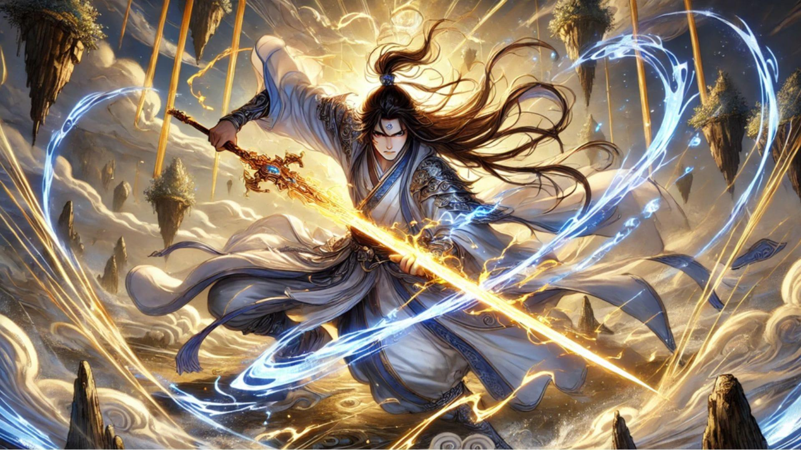

# 第九章　星河撞雪，實戰試錯

---

### 一、玄冰天池，雙雄立足

主擂台之上，寒霧繚繞如煙。

原本堅硬如鐵的九天玄金石面，此刻已完全被一層泛著幽幽藍光的萬載玄冰死死封凍。

三十丈的距離，兩道身影一東一西，凌空隔著風雪靜靜佇立。

洛寒衣單手握著斷星古劍，一襲雪白束袖長袍在凌冽的冰風中獵獵作響。她身上的氣息已然完全內斂，但周圍三丈之內的虛空，卻因為那股極致的鋒銳劍意而呈現出一種水波般的劇烈扭曲。

對面，顧淵負手而立，手中青竹折扇合攏在右掌之中。一襲月白暗紋長袍纖塵不染，神情平靜淡然，宛如立於自家庭院賞雪，感受不到半分如臨大敵的緊張。

然而，整座聖武廣場的十萬武者，此刻卻連一口大氣都不敢喘！

高台中央，楚烈天面容前所未有的凝重，雙手猛然一按：

「啟陣！」

「轟隆隆隆！」

伴隨著一聲驚天動地的轟鳴，八根高達數十丈的青銅陣柱自擂台四周拔地而起，一道厚達丈許、流轉著繁複古樸神紋的淡金色光幕沖天而起，將整座千步主擂台徹底封閉在內！

這是武極殿最高規格的——**【九天玄極護法大陣】**！

尋常情況下，唯有兩尊大宗師巔峰強者進行生死搏殺時，才會動用此陣。

如今，為了兩個年輕一輩的天驕交鋒，楚烈天竟親自開啟了護山陣法！

光幕之內，洛寒衣緩緩抬起清冷美眸。

「我這一劍，名為斷星。」

洛寒衣那清脆冰冷的嗓音，在死寂的陣法光幕內清晰響起：

「劍出，即分生死。閣下……小心了！」

顧淵微微一笑，折扇在胸前輕輕一橫，神態自若：

「洛姑娘儘管出劍。」

---

### 二、斷星出鞘，劍域籠罩

「鏗————！！！」

話音落下的千分之一剎那，一聲足以讓在場所有劍客神魂劇痛的刺耳長鳴，轟然引爆！

洛寒衣體內的【先天劍骨】在這一刻毫無保留地全面催動！

她背後那柄被粗白布包裹了整整三年的古劍，在這一瞬間——**徹底完全出鞘！**

「嗤啦！」

外層包裹的白布瞬間化作漫天齲粉！

一柄通體呈深邃銀藍之色、劍身表面佈滿了如天外星辰運轉般奇異凹凸古紋的長劍，展露出了它沉睡三千年的絕世鋒芒！

劍身長三尺三寸，劍脊極厚，兩側開鋒處薄如蟬翼，整柄劍宛若由一整塊從九天銀河深處墜落的星隕寒鐵雕琢而成，散發出一種古老、蒼涼、卻又狂暴到了極點的毀滅氣息！

正是傳世神兵——**【斷星古劍】**！

「轟————！」

隨著神劍完全出鞘，整座主擂台方圓五十丈之內的空氣，瞬間被一股實質化的天地元氣狂潮所吞沒！

那不是真氣！

那是……半步武王境強者方能觸碰的至高領域——**【斷星劍域】**！

漫天飛舞的六角雪花在這一刻瞬間化作了億萬枚薄如蟬翼的星辰劍氣！劍氣呼嘯旋轉，宛如一場席捲天地的銀藍色星辰風暴！

洛寒衣一劍斬出！

沒有花哨的試探，沒有任何招式留手！

那一劍斬出的剎那，整座擂台的光線驟然一暗，彷彿白晝被生生撕開了一道黑夜的裂口，一道長達百丈、宛如銀河倒懸般的極寒星屑劍罡，帶著粉碎虛空的恐怖威能，朝著顧淵當頭暴斬而落！

劍罡未至，地面那厚達三寸的玄冰便已被那股極致的鋒銳撕裂開了一道深達數丈的巨大鴻溝！

---

### 三、硬撼劍芒，衝突瓶頸

看台之上，十萬武者齊齊失聲尖叫！

這一劍的威能，已然完全跨越了大宗師的界限，直逼真正的武王一擊！

然而，面對這毀天滅地般的百丈星河劍芒，顧淵的眼中，非但沒有半點退意，反而爆發出一抹前所未有的灼熱神采！

「來得好！」

一聲清朗長笑自顧淵口中長嘯而起！

面對這等至剛至純的異界頂尖劍道，顧淵並沒有動用任何仙家法寶，甚至連身後的青竹折扇都隨手收起！

他要驗證的，正是自己昨夜初創的仙武之路！

「嗡！」

顧淵長袖猛然一振，體內萬界混沌星脈驟然轟鳴運轉，昨夜融合的那縷純陽剛勁瞬間灌注進整條右臂之中！

他的右臂肌膚在這一瞬間驟然化為了一種內斂深邃的暗金琉璃之色，皮膚之下，氣血如怒海翻騰，肌肉纖維緊密壓縮如萬載玄鐵！

一步踏空，顧淵身化殘影，右掌悍然迎著那道從天而降的百丈劍芒，直攖其鋒，正面拍出！

「轟隆隆隆————！！！」

拳掌與劍芒對撞的一剎那，一聲宛如兩顆星辰在半空對撞的恐怖巨響，在九天玄極護法大陣之內轟然炸裂！

狂暴至極的衝擊波化作肉眼可見的白色氣浪瘋狂肆虐，大陣的淡金光幕被震得劇烈波盪，發出不堪重負的刺耳嘎吱聲！

**然而！**

就在顧淵的肉身硬撼住那道百丈劍芒、並下意識催動體內的混沌星脈試圖將其吞噬煉化的同一瞬間——

異變突起！

「嘶……」

顧淵的眉峰，極其罕見地猛然一蹙！

痛！

一股前所未有的銳利刺痛，宛如千萬根淬了極寒之毒的鋼針，順著他的右掌掌心，狠狠扎進了他的右臂經絡之中！

洛寒衣的斷星劍罡，絕非尋常武道真氣！那是歷經了太古星隕寒煞與先天劍骨二十載極致打磨而成的毀滅性物質，其剛猛霸烈、鋒銳破壞力，達到了一種近乎偏執的極端！

當顧淵體內那靈動縹緲的青玄仙道金丹靈力，在未經調和的情況下，直接與這股剛烈至極的劍罡硬碰之時——

兩座截然不同的世界力量，在顧淵的經脈深處爆發了劇烈無比的排斥與衝突！

「噗嗤！」

顧淵只覺右臂經脈一陣劇烈痙攣，體內翻騰的氣血猛然倒捲逆流，喉頭竟然微微泛起了一絲極其微弱的腥甜！

他腳下的冰面承受不住這股可怕的內耗衝擊，雙足在冰層上生生向後倒滑了半步，踩碎了一大片玄冰！

實戰試錯！

這是顧淵踏入滄瀾界以來，第一次在正面交鋒中遭遇修煉瓶頸！

「原來如此……」

顧淵心中微凜，腦海中的帝師宿慧在電光火石之間飛速運轉：

「異界武道之極致，霸烈如狂雷地煞；而仙家真元靈動空靈，兩者若無轉化樞紐強行硬融，反倒會引發體內靈力與氣血的劇烈相衝！」

「天下沒有隨手可成的無敵之法，想要真正仙武同修，單憑一味強壓，走不通！」

---

### 四、乾坤借法，百招搏殺

心念電轉不過千分之一瞬！

對面的洛寒衣，乃是身經百戰的絕頂劍修，戰鬥本能敏銳到了毫釐之境！

捕捉到顧淵身形倒退半步、氣息微滯的瞬間，洛寒衣美眸中精光暴漲，身形如影隨形，手中斷星古劍在虛空中挽出漫天冰蓮！

「碎星式！破！」

漫天劍氣化作一場狂風暴雨，連綿不絕，招招直指顧淵周身三十六處死穴！

快！

狠！

絕！

換做尋常大宗師，此刻在經脈受創之下，早已被這如狂潮般的劍域切成碎塊！

然而，顧淵的神色卻在這一瞬間徹底平靜了下來。

遭遇瓶頸？

那便在生死搏殺之中，當場破開這層瓶頸！

「呼……」

顧淵深吸一口氣，眼眸深處的破妄真視徹底催動到了極限！

金色的道紋在雙瞳之中劇烈旋轉，整座擂台上的漫天劍影，在這一刻驟然變慢了十倍！

顧淵不再試圖以肉身蠻力去強行吞噬那股剛烈劍罡，而是身形一晃，步伐踏動九宮天罡之位，雙手在身前畫出了一道道玄奧至極的太極陰陽圓弧！

「以實擊虛，以柔克剛；借力化力，袖裡乾坤！」

顧淵的身法在這一刻飄逸如仙！

洛寒衣一劍自左側刺來，顧淵掌緣微斜，混沌星脈化為柔韌氣旋，順著劍脊輕輕一引，那道足以崩山的恐怖劍芒，竟然被顧淵借力打力，生生引偏了半寸，轟在腳下的冰面之上，激起沖天冰柱！

洛寒衣長劍反撩，直取咽喉！

顧淵右袖一甩，寬大的月白袖袍宛如一片無邊無際的幽深天幕，在毫釐之間將那道劍尖的寒芒裹入袖風之中，凌空一抖，將剛猛的力道盡數卸入大地！

「砰！砰！砰！砰！」

兩道白衣身影，在千步主擂台之上展開了一場近乎窒息的極速攻防！

洛寒衣攻勢如雷霆星雨，每一劍皆帶著冰封百里的極致殺機；

而顧淵則防禦得如清風拂柳、深潭映月，任憑狂風暴雨呼嘯，他自在一丈方圓之內從容周旋！

十招！三十招！五十招！八十招！

整座主擂台已被兩人的交手撕裂得面目全非，厚達數丈的玄金地面被切出縱橫交錯的巨大深淵，冰屑與碎石化作漫天齲粉！

台下十萬武者早已看得目瞪口呆，甚至連歡呼都發不出來，一個個手腳冰涼、大汗淋漓！

「八十招了……」

楚烈天雙手死死扣著護欄，眼皮狂跳：

「洛寒衣的斷星劍域全開，竟然……竟然連那年輕人的衣角都未能劃破分毫？！」

---

### 五、平分秋色，星脈同頻

戰至第九十九招！

洛寒衣的氣血已然催動到了二十載人生的極致巔峰，額前滲出了一層晶瑩的細汗，清冷的容顏上浮現出一抹因為極致興奮而泛起的潮紅！

「最後一劍！」

洛寒衣一聲清冽長嘯，整個人在半空中與斷星古劍合二為一！

天地失色！

一道長達百丈、宛若自域外星空轟然墜落的銀藍色星辰彗星，帶著焚盡一切的毀滅光芒，撕裂空間，朝著顧淵撞擊而來！

而此時此刻，經過整整百招實戰試錯的顧淵，嘴角終於露出了一抹通透釋然的笑意。

「剛柔相濟，陰陽合一……這才是真正的仙武之道！」

顧淵長笑一聲，右手成掌，體內的混沌星脈與青玄金丹在這一刻達到了前所未有的完美平衡！

暗金色的純陽氣血與青色的無瑕真元交織在一起，在他掌心之中凝聚成了一尊緩緩旋轉的太極陰陽無極神印！

「破！」

顧淵一步踏前，掌印如遮天神山，正面轟出！

「轟隆隆隆隆隆——————！！！」

整座聖武廣場劇烈震顫！

刺目的白光吞噬了一切視線，防禦光幕發出痛苦的呻吟，恐怖的衝擊波甚至將陣法光幕頂端撕開了一道三丈長的裂口！

待到漫天冰霧與狂暴氣浪漸漸散去之時——

十萬道目光迫不及待地望向主擂台中央。

只見在殘破不堪的擂台兩端。

洛寒衣單手橫劍於胸前，長發微亂，胸口微微起伏，雪白雲靴在冰面上犁出了整整十丈長的深深溝壑，嘴角隱隱帶著一抹殷紅；

而在對面。

顧淵身姿依舊筆挺如松，月白長袍的右袖下擺微微撕裂了一道寸許長的小口，雙足同樣在冰面上滑退了整整十丈，掌心之中最後一縷星辰寒芒無聲化為青煙。

平手！

整整一百零八招狂暴交鋒，兩大天驕……竟然戰成了絕對的平分秋色！

「譁————！」

短暫的死寂之後，聖武廣場徹底爆發出了掀翻天穹的狂暴歡呼與吶喊！

然而，站在擂台兩端的二人，卻並未理會滿場的狂歡。

洛寒衣緊緊握著手中的斷星古劍，長劍在此刻發出一種極其溫柔、極其歡愉的奇異共鳴；

而在顧淵體內，原本因法則排斥而隱隱作痛的混沌星脈，在方才那最後一記硬撼的剎那，竟然與斷星古劍內部的那縷遠古器魂……

產生了一種玄妙到了極點的——**跨界同頻共振！**

洛寒衣抬起那雙滿是震撼與倔強的清眸，深深望向十丈外的青年，長睫微顫，心潮翻湧：

他……竟然真的接下了自己的斷星劍域！

---

**（第二十五章完）**
