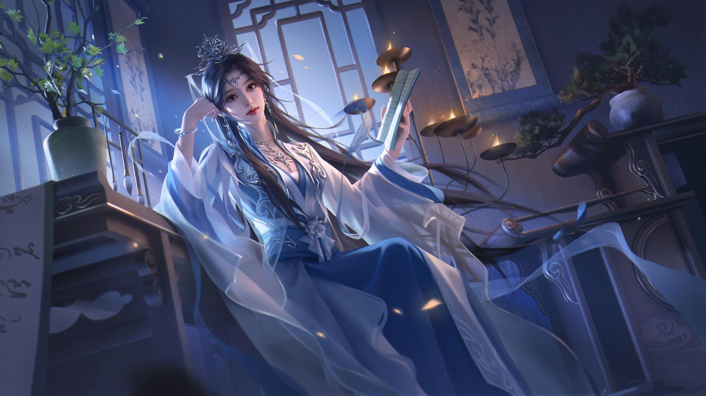

# 第十一章　凶宿伏誅，古仙封魔

天武城，中央聖武演武場。

隨著洛寒衣那道勝雪白衣飄然退下擂台，滿場數萬名武者猶沉浸在方才那場驚心動魄的交鋒中無法自拔。微風吹過破碎的青石擂台，捲起漫天碎屑與森白霜氣，四週一片竊竊私語，敬畏、驚駭、困惑的目光，如同潮水般在負手而立的顧淵身上來回交織。

「一掌引散斷星劍域……這位青袍公子，當真只是過客？」
「天劍山大師姐那是何等天驕，竟然甘願承他指點情面，定下三日後百兵神宮之約！」
「深不可測，此人絕對有隱世宗師乃至武王級別的底蘊！」

觀禮台正席之上，武極殿大長老楚烈天虎目微瞇，厚重如山岳般的罡氣在周身悄然隱退，望著顧淵的目光中多出了幾分鄭重與思索。方才顧淵化解劍氣時那種返璞歸真、宛若天地律動的靈動身法，即便以他武皇巔峰的見識，竟也無法完全辨認出究竟出自天下哪一個武道聖地。

顧淵神色平靜，對周遭潮水般的目光渾若不覺。他隨意拂了拂青衫衣袖，正欲走下擂台殘垣。

然而，就在滿場心神鬆懈、幾名在先前比武中受傷的天驕正被宗門長老攙扶著走下台階的剎那——

「桀桀桀桀……天劍山的傲丫頭走得快，但這口玄煞靈魄槍，合該老夫收下了！」

一聲如梟鳥啼血般的淒厲陰笑，陡然自裁判席正下方的青石地縫中撕裂而出！

剎那間，黑風暴起，腥臭滔天！

一道枯瘦如鬼魅的血色身影自地底破土激射，雙爪漆黑如墨，指尖暴漲出尺許長的幽綠磷火，帶著令人作嘔的濃重血腥與腐蝕真罡，竟是直接無視了演武場的防護大陣，快若閃電地抓向那名重傷倒地的烈陽少主腰間神兵！

那恐怖的血煞威壓轟然爆發，所過之處，石板瞬間化為烏黑膿水，赫然是一位浸淫黑道多年的武王級凶宿！

「血煞老魔？！」
「該死！這魔頭不是早在二十年前就被朝廷神捕司通緝墜崖了嗎？他竟敢潛伏進天下論武大會！」
「少主小心！」

烈陽門的護法長老大驚失色，想要拔刀救援，但在那股濃烈的血煞領域壓迫下，體內罡氣竟如同被寒冰凍結般運轉滯澀，連半步都挪動不得！眼看著那帶著幽綠屍毒的魔爪就要洞穿天驕胸膛、奪走神兵——

電光石火之間，一道冷冽淡漠的聲音，在虛空之中悄然響起：

「魑魅魍魎，也配在此放肆。」

眾人甚至未曾看清顧淵是何時動的身。
只見原本正欲步下擂台的青衫青年，步伐微頓，甚至連頭都未曾回轉，僅僅是右手袍袖一揚，修長食指在虛空中隨意一叩！

嗡！

一縷純澈無暇、猶如初升旭日般的純陽真罡，自他指尖迸發而出。
那不是尋常的武道烈火罡氣，而是融合了萬界樓混沌星脈與青雲仙家道蘊的至正至陽之力！

沒有驚天動地的轟鳴，只有一聲極其清脆悅耳的「叮」響。

那洞穿虛空、威勢滔天的幽綠魔爪，在觸碰到這縷金紅光芒的剎那，如同滾湯潑雪般劇烈消融！血煞老魔手中暗藏的本命魔刃「化血鉤」，更是發出一聲哀鳴，當場寸寸崩碎成齏粉！

「什麼？！純陽……噗！」
血煞老魔如遭五雷轟頂，眼中暴露出無比驚恐的駭然之色。他那足以腐蝕真罡的九幽血煞，在這縷看似微弱的光芒面前，竟連半息都支撐不住，霸道凌厲的純陽道韻順著指風倒灌而入，瞬間將他體內運轉的邪功經脈震得寸寸斷裂！

還未等老魔發出第二聲慘叫，半空之中傳來一聲雷霆暴喝：

「妖魔孽障，膽敢在我天武城行兇！」

轟隆！

楚烈天魁梧如天神般的身軀已然橫跨百丈虛空凌空踏至，武極殿鎮派絕學「大荒裂天掌」化作一方十丈大小的金剛巨印，帶著鎮壓山河的狂暴罡勁，結結實實地轟擊在血煞老魔的天靈之上！

砰——！

大地劇烈震顫，青石崩碎如雨。
這位銷聲匿跡二十年、甫一現身便企圖趁亂逞兇的黑道武王，連顧淵的一記指風都未曾挨過，便被楚烈天緊隨而至的雷霆怒火徹底碾成了肉泥！

漫天塵埃落定。
全場死寂無聲。

楚烈天收掌而立，周身霸烈的罡氣緩緩收斂。他先是冷冷掃了一眼地上的碎肉，隨即目光落在老魔濺灑在青石坑窪中的血液上，濃眉頓時緊緊擰在了一起。

那黑紅色的污血在接觸到空氣的瞬間，並未凝固，反倒散發出一絲絲陰冷刺骨的黑色煙氣，隱隱帶著尖銳刺耳的冤魂嚎叫。

「這是……九幽魔煞？」
楚烈天神色微凜，眼底閃過一絲凝重至極的陰霾。作為武極殿大長老，他對這股沉寂了千年的氣息再熟悉不過——那是來自滄瀾界禁域深處、唯有古老魔網侵蝕方會誕生的污穢魔氣！

這血煞老魔銷聲匿跡二十載，再度出世竟已暗中沾染了魔煞，莫非……九幽深淵的天地封印，當真出現了裂痕？

壓下心頭驚濤，楚烈天深吸一口氣，整了整衣袍，轉過身快步走到顧淵面前。
在數萬名宗師天驕震撼莫名的注視下，這位威震滄瀾南域的武皇巔峰名宿，竟是神色莊重，對著青衫青年深深躬身抱拳：

「武極殿楚烈天，多謝顧先生出手截殺魔頭！若非先生那一指純陽真罡破其魔刃、震斷其邪脈，烈陽門天驕性命難保，我演武場亦將蒙羞。先生大義，楚某銘記於心！」

言辭懇切，姿態極低。
方才那一指，外人或許只看到顧淵擊碎魔刃，但身為頂尖武皇的楚烈天卻看得分明——那道指芒中蘊含的純陽真意，宏大浩瀚，至高至純，隱隱對天地間一切陰邪魔物有著天然的克制！眼前這名神祕莫測的青年，實力絕非表面上的年輕宗師那麼簡單！

顧淵收回手指，負手淡然一笑：「楚長老客氣了。除魔衛道，本是同道分內之事。倒是此魔身上所負之氣息陰寒邪異，似與尋常武道有異，楚長老還需多加留心。」

楚烈天神色一凜，低聲道：「先生法眼如炬。此事牽涉極廣，楚某定會徹查到底。三日後百兵神宮之會，神兵出世，天下矚目，先生若肯賞光蒞臨，楚某定當掃榻以待！」

「百兵神宮……顧某自會前往。」顧淵微微頷首。

短暫寒暄後，顧淵在滿場敬畏莫名的目光注視下，白袍微動，飄然步出席位，消失在繁華天武城的街巷深處。

論武大會的第一階段，就此落下帷幕。
然而，一場悄然席捲整個滄瀾界的暗流，卻已在天武城的繁華表象下無聲湧動。

……

---

與此同時。
遙遠浩瀚的虛空彼端，【青玄界】。

東華洲，青雲觀。

與滄瀾界剛猛熾烈、武道爭雄的喧囂截然不同，這座坐落於靈脈之巔的古老仙門，此刻正籠罩在飄渺出塵的雲海紫氣之中。仙鶴長鳴，松柏常青，晨鐘暮鼓在層巒疊嶂間悠悠迴盪。

然而，在青雲觀最深處的禁地——九天藏經閣內，氣氛卻顯得格外靜謐與肅穆。

閣樓高達萬丈，內部由無數懸浮在半空的紫玉書架所構成，星輝流轉，靈光溢目。這裡封存著青雲觀自開派以來數萬載搜集而來的諸天孤本與遠古秘辛。

藏經閣最核心的靜室之中，一襲素白如雪的月華長裙曳地。

沈玄清盤坐於寒玉雲床之上，三千青絲僅用一根碧玉簪隨意挽起，肌膚勝雪，容顏絕世。她神情清冷尊貴，宛若九天之上俯瞰人間的月中仙子，周身隱隱縈繞著深不可測的元嬰期圓滿道韻。

自從半月前柳清虛破關踏入金丹、以雷霆手段肅清東華魔道餘孽並威震各大宗門後，沈玄清便將宗門俗務盡數交由掌門處置，自己則全心沉浸於這座遠古秘閣之中。

此刻，懸浮在沈玄清面前的，是一卷泛黃殘破、散發著滄桑洪荒氣息的遠古帛書——《太素天變錄》。

這是青雲開派祖師親手傳承下來的唯一孤本，記載著萬古之前古仙界崩滅時的天地劇變。過去數千年來，青雲觀歷代元嬰長老皆以為這不過是一部神話志怪雜錄，未曾深究。

然而此刻，沈玄清那雙清澈深邃的鳳眸之中，卻倒映出一幅令人心悸的泛黃星圖。

古卷殘頁之上，以古老的仙篆刻畫著一張猙獰可怖的巨網——那黑網無邊無際，每一根絲線皆由億萬扭曲的魔煞符文交織而成，將數以千計的星辰世界死死纏繞、汲取吞噬！

而在巨網的正中央，赫然標記著古仙界崩解時的八十一處「魔煞天樞節點」！

「這張網……」

沈玄清玉指微顫，輕輕撫過古卷上的墨跡。

就在她的神識觸及古卷星圖的剎那，沈玄清元嬰深處——那道當初在清虛秘境中被顧淵以仙體交泰、徹底同化淨化的大劫核心殘印，陡然劇烈震顫起來！

嗡！

一陣溫熱滾燙的灼燒感自丹田升騰而起，沈玄清絕美的玉容泛起一抹淡淡的紅暈，但她的眼神卻在瞬間變得凌厲無比。

她清晰地感應到，古卷上標註的第二處魔煞節點座標，其空間波動的頻率與天地法則的排列，竟然與顧淵當日踏入萬界門、跨界離去時虛空中殘留的星力印記完全吻合！

「滄瀾界……竟是萬古魔網鎖定的第二處樞紐節點？！」

沈玄清心神劇震，猛然站起身來。
月華長裙在微風中獵獵作響，她胸口微微起伏，素來泰山崩於前而色不變的太上仙尊，此刻眼中滿是難以置信的震撼。

原來，當初降臨青玄界的幽冥魔劫，根本不是什麼孤立的偶然天災！
那是一場早已佈局了萬載、企圖將諸天萬界同時拖入永夜深淵的萬古陰謀！萬界樓的破碎、青玄界的天地傾覆、乃至顧淵如今正在經歷的滄瀾風雲，全都被這張無形而恐怖的巨網死死捆綁在一起！

「若真如此……當初開派祖師為何會在此立道？」

沈玄清眸光一凝，似乎想到了什麼。她身形一晃，化作一道皎潔如月的遁光，直接穿透重重禁制，直落青雲後山地底數千丈的祖靈脈核心！

……

地底深淵，靈氣如海。

青雲觀的立派根基——那尊高達百丈、通體由太乙精金鑄造的【鎮靈九華鼎】，此刻正沉浮在浩瀚的祖靈脈靈泉之中，吞吐著無盡靈霧。

沈玄清飄然落在古鼎龐大的基座之旁。
過往萬年，青雲門人都以為九華鼎只是用來鎮壓地脈靈力、防止靈氣潰散的尋常鎮山之寶。

但此刻，沈玄清以元嬰圓滿的神識混合體內那一縷大劫同化印記，凝結成一柄神念之劍，猛然刺入古鼎下方被萬年靈泥覆蓋的地底岩層！

轟隆隆！

地底深處傳來沉悶的轟鳴，覆蓋在岩壁上的萬年泥封寸寸脫落，露出了隱藏在基座正下方、一座方圓數百丈的宏大陣盤！

那陣盤通體由遠古星辰隕鐵鍛造，上面銘刻著繁複奧妙至極的古仙符文。九道粗壯如真龍的鎖鏈自陣盤核心延伸而出，深深刺入虛空斷層，死死鎖住了一方散發著微弱金光的陣眼石碑！

石碑之上，四個古拙蒼勁的太古仙文若隱若現：

【九天封魔】！

「九天封魔大陣……」

沈玄清倒吸一口涼氣，玉手輕掩朱唇，美眸中泛起滔天波瀾。

這不是散修門派所能擁有的手筆！
青雲觀的開派祖師，根本不是典籍記載中遊歷至此的得道散仙，而是古仙界抗擊萬古浩劫時，奉命在此建立封魔陣眼、鎮壓大劫通道的先驅遺脈！

這座九華鼎，鎮壓的從來都不是什麼祖靈脈，而是通往那張諸天魔網核心的九天封魔樞紐！

「原來如此……萬載傳承，真相竟隱匿於此……」

沈玄清久久佇立在幽暗的地底靈淵之中，玉容神色莊嚴肅穆。

一陣溫柔的清風吹拂過她的耳畔，引動眉心處那枚淡淡的紅顏錨點微微泛光。那是與遠在另一個世界的顧淵冥冥相連的本源牽絆。

在這一刻，沈玄清眼中原先的一絲擔憂與迷茫盡數消散，取而代之的，是身為太上仙尊、身為道侶的堅毅與果決。

顧淵在滄瀾界孤身破局、尋找大劫碎片，而她沈玄清，也絕不會只在後方坐享其成！

「顧淵……」

沈玄清抬起晶瑩剔透的玉容，鳳眸透過地脈深處的層層岩石與虛空屏障，望向無垠星海深處，紅唇微啟，輕聲低語：

「大劫將至，諸天同悲。你在異界尋求武道變革，我便在青玄界為你解開這萬古封魔全圖……」

「待你歸來之日，青玄天地，必將為你鑄就最堅實的後盾！」

素手一揮，沈玄清指尖凝聚出一枚青玉法簡，將九天封魔陣的所有符文細節盡數拓印其中。

青玄界與滄瀾界，仙道與武道，在這一刻，因萬古大劫的宿命與兩顆緊緊相繫的心，悄然共振！
