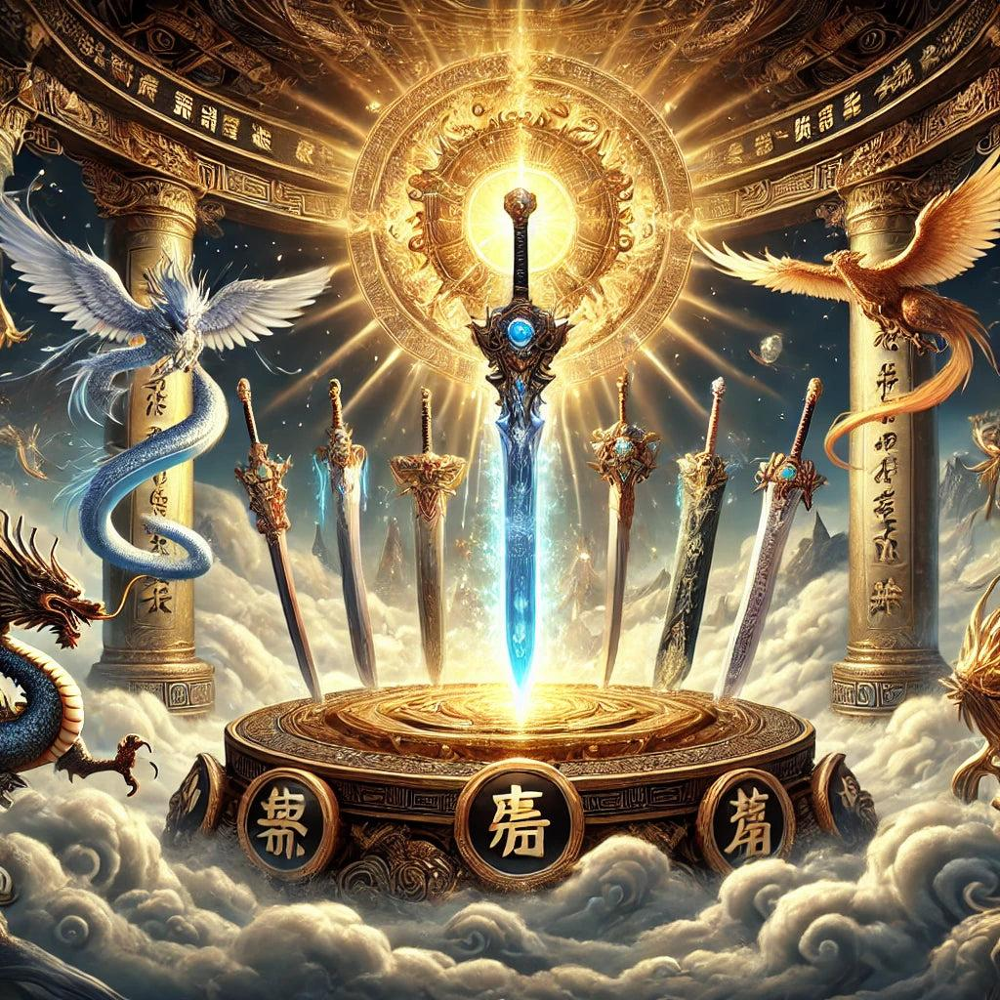

# 第十二章　千峰器海，萬兵同鳴

滄瀾界南嶺，素有「南天造化、十萬熔爐」之稱。

放眼望去，千里赤色山脈連綿起伏，赤褐色的巨石如刀劈斧削般嶙峋崢嶸。天穹之上，地火升騰的暗紅色熱浪將漫天流雲染成滾滾赤霞，空氣中瀰漫著濃烈的硫磺焦炭與冷卻淬火的刺鼻氣味。大地深處，隱隱傳來地底熔岩奔騰的轟鳴，與千百座鍛造火穴中沉悶如雷的金鐵撞擊之聲遙相呼應，令初入此地的武者無不感到氣血翻騰、胸口窒悶。

天地之間，充斥著至剛至猛的庚金銳氣與地心炎煞。尋常後天武者若在此地駐足半日，便會被這無孔不入的燥熱火毒侵蝕經脈；然而對於修習金火屬性功法、或是醉心於器道鍛造的大師而言，這裡無疑是諸天間難得一見的造化洞天。

此地，便是名震五域的天下器道聖地——百兵神宮。

與天武城的金戈鐵馬、莊嚴肅穆不同，百兵神宮乃是依託南嶺一座方圓百里的太古活火山口營建而成。萬載之前，百兵神宮的開派祖師聯合數位通天徹地的上古大能，施展神鬼莫測的大神通，將整座暴虐噴湧的火山熔爐生生削平削平，布下七十二重鎮嶽御火神陣，化作了一處氣勢恢宏的露天「千峰器海」。

只見赤褐色的峭壁懸崖、環形環繞的山峰岩壁之上，密密麻麻插滿了數萬年來歷代神匠大師親手鍛造的兵刃。古樸沉重的厚背狂刀、寒芒吞吐的青鋒玄劍、撕裂雲霄的破陣長槍，乃至奇門遁甲的飛輪、重斧與短刺，星羅棋佈，層層疊疊，如同一片由金屬與意志生長而成的鋼鐵狂林。

山風自火山口的萬丈深淵呼嘯掠過，吹拂過萬千鋒芒。刃口與風聲相互激盪，摩擦出高低起伏、清脆雄渾的錚鳴金石之響。這聲音匯聚在一處，宛如一曲永不休止的洪荒戰歌，在赤紅的天地間掀起磅礴的金屬狂潮。

此刻，百兵神宮的山門天階之下，早已是各方豪雄雲集，人聲鼎沸。

三百年方才開啟一次的「神兵試煉天池」，乃是名震整個滄瀾界的第一盛事。相傳天池之中孕育著神宮歷代老祖以地心神髓淬煉的通靈神兵，凡是有緣者，皆有機會在天池之中引得神兵認主，從此一飛沖天。因此，南域乃至五大聖地的使團、各方皇室的頂級戰將、隱世不出的武道宗師，乃至無數渴望一戰成名的年輕天驕，皆風塵僕僕地匯聚於這赤紅天梯之下。

「踏、踏。」

在一片喧囂與燥熱的人潮之中，一陣從容清緩的腳步聲顯得格外突兀。

只見赤褐色的天階之上，顧淵一襲淡青長衫，纖塵不染，手中輕搖一柄溫潤的青玉折扇，步履悠閒得宛如在自家後花園踏青賞景。周遭那足以將凡鐵烤至滾燙的熾烈地火熱浪，在掠至他身前三尺之地時，便如同春風化雨般悄然消弭於無形，連他飄逸的衣袂與鬢角髮絲都未曾紊亂半分。

而在顧淵的身旁，正大步流星、神色亢奮地陪同著一尊身形魁梧宛如鐵塔般的雄壯漢子。

那正是百兵神宮當代宮主——「段百狂」。

身為名震天下的九品鑄兵大宗師、一身修為高達武皇中期的蓋世強者，段百狂整個人便如同一柄剛從地心熔爐中拔出的淬火巨刃。他赤裸著精壯如澆築玄鐵的上半身，一塊塊虯結暴起的肌肉宛如盤根錯節的古樹老根，其上佈滿了古老火煞淬體留下的暗金色神秘符紋，散發著令人心悸的熾熱高溫。在他那寬闊如門板的脊背之上，赫然負著一柄長達七尺、通體泛著暗紅血光、重達數萬斤的巨闕狂錘！

沿途所有前來參會的各宗掌門、豪門宿老見到段百狂大步走來，無不神色劇變，慌忙畢恭畢敬地退避到天階兩側，躬身抱拳行禮：

「見過段宮主！」
「段老前輩安好！」

然而，這位脾氣素來以暴烈如火、剛猛霸道著稱的神宮之主，此刻對周圍那些成名強者的敬畏招呼根本不屑一顧，一張滿是如鋼針般虯髯的虯首，始終側向身旁那位儒雅飄逸的青衫青年，神態言辭之中，透著一股難得一見的豪爽、客氣，乃至隱隱的敬佩。

「哈哈哈！顧先生能賞光親臨我百兵神宮，老段我這破火山簡直是蓬蓽生輝啊！」

段百狂聲如洪鐘大呂，蒲扇般佈滿厚厚老繭的大手狠狠在自己胸膛上拍得砰砰作響，爽朗大笑震得周圍天階碎石撲簌顫抖：

「昨夜天武城那邊以八百里加急飛符傳來快報，說先生在聖武演武場上，連身子都未曾轉動，僅憑隨手一記純陽指風，便生生震碎了血煞老魔那柄浸淫百年的本命化血鉤！楚烈天那老匹夫在親筆信裡把你誇得天上少有、地上難尋，直說先生乃是謫仙下凡！娘的，老夫看了信，整宿都沒睡著，手癢得恨不得立刻拎著狂錘去找先生討教兩招！」

顧淵手中青玉折扇輕輕一收，聞言側過頭來，唇角泛起一抹溫和而深邃的淡笑：

「楚長老實在是過譽了。顧某不過是恰逢其會，見那魔頭心術不正、氣息污濁，順手拂去一粒微塵罷了，何足掛齒。」

說著，顧淵深邃的目光緩緩掃過兩側峭壁上密密麻麻的刀劍兵海，感受著空氣中激盪的那股剛烈與造化之氣，由衷讚許道：

「倒是段宮主這千峰器海，氣象萬千。百萬兵戈同聚千峰，引地火淬其形，借天風養其鋒，殺伐之中自有一股造化萬物的厚重底蘊。天下器道之盛，今日顧某方算真正得見。」

「先生果然是識貨的行家！」

段百狂聽得心花怒放，那雙銅鈴大眼中精光暴射，只覺得顧淵這番話簡直說到了他心坎裡去。他伸手抹了一把絡腮鬍，嘿嘿大笑道：

「先生說得太對了！俗人只道兵者為凶器，專司殺伐屠戮；可老夫這千峰之上的兵器，皆是我百兵神宮歷代先輩引地心靈火、耗盡畢生心血所鑄。每一柄神兵出爐，皆是逆奪天地造化之舉！不過嘛……這滿山懸崖上的傢伙，大多只是尋常玄鐵通靈之物，真正通靈通神的大傢伙，可全都在前頭的天池劍塚深處沉睡著呢！」

正說笑攀談間，天階後方的人群之中，忽然傳來一陣驚呼騷動。

呼——！

突兀之間，天地間那股令人窒息的滾滾熔岩熱浪，竟如同被一柄無形的萬丈冰刃迎面劈開！

一陣徹骨冰寒的風雪呼嘯而至，赤紅燥熱的山道上，竟在轉瞬之間凝結出一層晶瑩剔透的森白冰霜。那冰霜以驚人的速度蔓延，生生在漫天硫磺熱浪中撕開了一道寬達十丈的極寒通道！

周圍原本擠擠挨挨的武者們紛紛打著寒顫，面帶驚艷與敬畏地向兩側退開。

只見風雪通道之中，天劍山使團一行七人正御氣拾階而上。為首之人，正是先前在天武城演武場上與顧淵平分秋色、名震天下的天劍山首徒——洛寒衣。

今日的洛寒衣，依舊是一襲勝雪白衣，長裙纖塵不染，宛如傲立於極北萬丈冰原上的寒梅。三千青絲被一根銀色劍簪利落地束於腦後，露出修長白皙如天鵝般的玉頸。她絕美精緻的五官清冷出塵，如霜似雪的雙眸平靜無波，背後緊緊負著那柄通體森白、名震五域的斷星古劍。

整個人行走在天地熔爐之中，卻宛如一柄剛剛出鞘、寒意凌霄的極致利刃，鋒芒畢露，拒人於千里之外。

然而，當洛寒衣那雙如秋水冰潭般的清眸掠過退避的人群，驟然落在前方那一襲青衫身影上時，她原本古井無波的眼底，卻微不可察地泛起了一層細微的漣漪。

甚至連那孤傲清冷的腳步，都在那一瞬間出現了極其短暫的停滯。

洛寒衣纖長微翹的睫毛輕輕顫動了一下。自昨日演武場那一戰之後，這個看似儒雅淡泊、實則深不可測的青衫男子，便如同一道揮之不去的印記，深深烙印在她的心湖之中。他輕描淡寫化解自己至強劍域的身姿、他指點自己真氣運轉時那深邃如星空的眼眸……無一不在動搖著她多年來唯劍獨尊的冰封道心。

她本可以放慢腳步，避開與他的直接碰面。

但身為頂級劍修的傲骨，終究讓她沒有選擇繞行。洛寒衣深吸了一口冰涼的空氣，握著劍穗的玉指微微收緊，神情平靜如常地徑直向前邁步，走到了顧淵的身側。

擦肩而過的剎那，微風捲起她如雪的衣袂，一縷極淡、極純的冷梅冷香，悄然鑽入顧淵的鼻翼，將周遭燥熱的硫磺氣息一滌而空。

洛寒衣停下了腳步。

她並未完全轉身，只是微微側著絕美清麗的側顏，露出一截如凝脂般的下頜。她清冷空靈、如碎冰撞玉般的嗓音壓得極低，清晰無比地傳入顧淵耳畔：

「右肩之竅……寒衣昨夜已依照你的指點，逆行行氣三轉。」

說到此處，洛寒衣的長睫再度輕顫了一下，聲音中多出了一絲極其細微的起伏：

「鬱結三年的滯澀……確實消融了大半。但斷星古劍近來不知為何，劍魂異動頻繁，戾氣日盛。三日之約未改，待天池試煉結束，洛寒衣必會在劍道巔峰，再度領教顧先生的高招。」

少女的語氣依舊維持著天之驕女的驕傲與清冽，彷彿只是在陳述一場純粹的劍道約定。

然而，顧淵何等敏銳。

他微微側目，清晰地捕捉到了少女那雙看似冰冷的眸子深處，那一抹隱藏得極深的認真與動搖；甚至在那瑩白如玉的耳垂之上，不知是因為山道火煞的烘烤，還是因為少女心中隱秘的羞惱，竟悄悄染上了一抹極其誘人的薄紅。

顧淵手中青玉折扇輕輕一收，扇尖在掌心隨意一點，眼中浮現出一抹似笑非笑的促狹：

「劍乃通靈之物，心急則劍躁。洛姑娘一心唯求劍道登頂，卻不知過剛易折。氣海通了固然是好事，但今夜若是再強行以寒煞衝擊琵琶骨……當心右肩又會隱隱作痛。到那時，可莫要怪顧某未曾提醒。」

這帶著幾分親暱與點撥的調侃話語，讓洛寒衣原本緊繃的玉軀猛然一僵。

一股異樣的酥麻與溫熱之感，彷彿順著顧淵的嗓音，直接落在了她昨夜隱隱作痛的右肩處。洛寒衣貝齒輕咬下唇，雪白修長的玉頸上浮現出一層淡淡的粉暈。她有些慌亂地避開顧淵那雙洞察一切的深邃眼眸，飛快地挺直了如出鞘古劍般孤傲的脊樑。

「不勞先生費心，寒衣自有分寸。」

冷冷丟下這句話後，少女彷彿多停留一瞬便會徹底破功一般，蓮步輕移，帶著一陣清冽的香風與天劍山弟子大步向著前方天梯行去，白衣翻飛，飄然若仙。

看著洛寒衣那看似孤傲凌厲、實則落荒而逃般的纖細背影，顧淵眼中那一抹笑意更濃了幾分。

「嘖嘖嘖！怪哉，當真是千古奇聞！」

一旁的段百狂摸著那滿臉扎人的鋼針絡腮鬍，瞪著一雙銅鈴大眼，神情曖昧而又震驚地怪叫起來：

「天劍山這柄名震南域的九天冰霜神劍，老夫認識她師尊三十年，看著這小丫頭長大，何曾見過她正眼瞧過同輩武者半眼？平日裡哪怕是皇子王孫跟她搭話，她都拔劍相向！今日居然主動同先生耳語……嘿嘿，顧先生，你這手段，當真比老夫爐子裡的三昧真火還要霸道啊！」

「段宮主說笑了。」顧淵神色如常地展開折扇，輕輕搖了搖，淡然道，「洛姑娘劍心純粹，心無雜念，唯求極致之道，天下間如她這般至純的劍修，確實少見。」

「哈哈，那是自然！能入得先生法眼的女子，豈能是凡俗之輩？」

段百狂豪爽一笑，蒲扇般的大手往前一引：

「走走走！先生，天池已然開啟，且隨老夫去瞧瞧，今年我這百兵熔爐之中，究竟有哪幾柄傳世神兵，能有幸得遇明主！」

……

穿過百兵神宮那重重疊疊、由數千名精悍鑄兵弟子鎮守的護山大陣，眾人終於抵達了千峰器海的最核心禁地——【萬兵熔爐天池】。

踏入天池區域的瞬間，哪怕是顧淵，眼中也閃過了一絲微不可察的讚許。

這是一處足有數千丈之寬廣的浩瀚火山口巨坑。四周峭壁皆被削磨得光滑如鏡，通體呈現出深邃沉鬱的暗紫色。而在這巨型火山口的邊緣，巍然聳立著整整七十二座高達百丈的黑耀玄晶巨柱！

每一座巨柱表面，皆以玄鐵精金銘刻著繁複至極的上古御火神紋與聚靈陣法。一道道肉眼可見的赤金色火柱自地底被巨柱抽取而出，在半空之中交織成一張籠罩整座天池的巨大火網，死死壓制著地心熔岩的狂暴戾氣。

然而，最令人嘆為觀止的，乃是火山口中央那一汪不可思議的靈液天池。

那裡並沒有滾燙翻滾的岩漿，取而代之的，是一汪深不見底、散發著奇異異香的雙色靈泉！靈泉一半呈現出如深海般的幽藍之色，那是匯聚萬年地脈玄陰之水而成的「九幽洗劍寒魄液」；另一半則流淌著如融化黃金般的暗金色澤，乃是天地至純的「地火真金髓」！

一陰一陽，水火交融，陰陽太極在池中緩緩旋轉，滋養著整座百兵神宮的器道氣運。

而在那浩瀚的雙色靈液之上，赫然靜靜懸浮著數百件吞吐著各色神華的傳世名器！

有的神兵赤紅如血，刀氣吞吐之間隱隱化作一頭浴火狂嘯的烈焰神凰；有的長槍通體覆蓋著青色雷紋，劈啪作響間激盪出數丈長的破滅雷弧；更有古樸玄奇的重劍、流光溢彩的短匕、鋒芒畢露的銀鉤……每一柄神兵之內，皆孕育著一縷或狂暴、或高傲、或冷冽的器靈意念，彼此爭奇鬥艷，激盪出沖霄的庚金殺芒！

圍聚在天池白玉觀景台四周的數千名宗門強者、聖地天驕與王侯將相，無不呼吸粗重，死死盯著池中浮沉的神兵，眼中閃爍著掩飾不住的狂熱與貪婪。

對於刀口舔血的武者而言，一柄與自身契合的頂級通靈神兵，無異於第二條性命與破境的通天階梯！

「肅靜！」

段百狂縱身一躍，魁梧如神魔般的身軀轟然落於天池正前方的白玉高台之上，聲震九霄，如滾雷炸響：

「神兵通靈，非有德居之，非強求所能獲！天池乃天地造化之所，凡我滄瀾武者，皆可上前引導自體真罡武意！若能引動池中神兵發出共鳴、主動投懷而來，那便合該是爾等的本命機緣，我百兵神宮絕不干涉分毫！」

段百狂的話音剛落，觀景台上幾位早已按捺不住的頂級大宗派天驕與護法長老，便紛紛飛掠而出。

「烈陽門長老赤雲子，前來一試！」

只見一名鬚髮皆赤的紅袍老者暴喝一聲，渾身狂暴灼熱的烈陽真罡催動到極致，化作一條十丈大小的火蟒虛影，直奔天池中央一柄通體赤紅、散發著滔天焚山之威的「炎龍破天戟」席捲而去！

「給我起！」赤雲子面目猙獰，全力催動神識試圖強行烙印兵魂。

然而，那柄沉浮於金液之中的炎龍破天戟僅僅是在池面上微微晃動了半寸，隨即戟身猛然一震，發出一聲暴虐高亢的龍吟咆哮！

轟！

一道排山倒海般的赤炎狂潮自戟刃中狂轟而出，化作一隻巨大的火焰龍爪，硬生生將赤雲子的護體罡氣拍得粉碎！赤雲子慘叫一聲，面如死灰地倒飛出數十丈，狼狽不堪地跌落在玉石台階上，連吐三大口鮮血。

「神兵有靈，豈容這般蠻橫強取？」

隨後，又有數名來自各大世家的名宿與年輕俊傑上前嘗試。有的試圖以水屬性溫和罡氣溝通碧水劍，有的以快劍真意牽引疾風刃。然而絕大多數人甚至連神兵的三尺範圍都無法靠近，便被神兵散發出的本源煞氣震退，甚至有人當場被反噬得神識受創、經脈逆流。

「哼，一幫急功近利、心浮氣躁之輩。眼中只有神兵之威，心中全無敬畏之念，也配問鼎靈兵？」

觀景台邊緣，洛寒衣抱劍而立，俏臉上覆蓋著萬載不化的寒霜，眼神淡漠無比地掃過那些狼狽敗退的身影，脣角勾起一抹極其清冷的譏誚。

對她而言，唯有純粹至極的劍心，方配與神兵同甘共苦。

不過……

洛寒衣下意識地將手掌輕輕按在背後的斷星古劍之上。不知為何，自踏入這天池範圍以來，這柄伴隨她多年的古劍，深處那股莫名的燥熱與微顫變得越發頻繁，彷彿在畏懼著什麼，又彷彿在急切地渴望著什麼。

就在滿場武者為天池神兵的暴烈而束手無策之際，高台之上的段百狂卻將目光投向了安靜立於人群前方的青衫青年。

段百狂眼中透著一股難以掩飾的灼熱期待與探究之色，放聲大笑道：

「顧先生！你看這幫不成器的小子折騰了半天，連個響動都沒鬧出來！老夫知曉先生乃世外高人，今日既來了我神宮天池，何不上前隨手一試？老夫倒是好奇得緊，以先生這般超凡脫俗、深不可測的無上道韻，究竟能喚醒我神宮池中哪一尊眼高於頂的靈兵？！」

段百狂這一嗓子，頓時將全場數千道目光瞬間引爆！

無數正在調息療傷的長老、各大聖地的執事，以及那些心高氣傲的宗門少主，紛紛順著段百狂的視線看了過去。

「這青衫公子是何方神聖？居然能讓段宮主如此推崇？！」
「看他一襲儒衫，連兵刃都未曾佩戴，周身毫無半點武皇強者的剛猛威壓，莫非是中州來的哪位世家名士？」
「能在段宮主面前被稱為『先生』，絕非尋常之輩……快看，天劍山的洛仙子居然也在看他！」

人群後方，洛寒衣原本抱胸的雙手悄然放了下來，一雙清澈空靈的美眸驟然凝結，一眨不眨地凝視著顧淵的身影，連呼吸都在不知不覺間屏住了。

她比在場任何人都清楚，眼前這個看似溫潤如玉的青年體內，隱藏著何等令人戰慄的浩瀚底蘊！

「既然段宮主相邀，顧某便上前一觀。」

在滿場聚焦的目光注視下，顧淵從容一笑，並未推辭。

他將青玉折扇隨意插在腰間，長身而起，青衫在滾熱的山風中獵獵作響。步履從容悠然，神態閒適淡雅，一步一步，順著潔白的漢白玉石階，緩緩走向那翻滾著雙色靈液的萬兵天池邊緣。

三步。

兩步。

一步。

沒有驚天動地的罡氣爆發，沒有刺破蒼穹的武道意境，甚至沒有哪怕一絲真元外溢的微風。顧淵就這樣簡簡單單地停下了腳步，負手立於天池邊緣的石磯之上，居高臨下地俯瞰著池中那數百件傲慢沉浮的通靈神兵。

這青衫青年要做什麼？

連本命武意都不曾釋放，難道想憑肉眼看穿神兵不成？

觀禮台上眾人面面相覷，心中疑竇叢生。

然而，唯有顧淵自己知道，就在他駐足凝望天池的剎那，在他紫府識海的最深處，那一尊自踏入滄瀾界以來便始終沉寂運轉的萬界樓乾坤道台，悄然發出了一絲微弱至極、卻凌駕於諸天萬界所有規則之上的本源律動。

萬界樓，鑄諸天神物，煉萬界乾坤。

它是宇宙初開時造化之力的源頭，是一切金鐵、符文、器魂與大道的至高熔爐！縱然如今萬界樓殘破，道台僅僅修復了微不足道的一角，但那至高至尊、萬器之祖的無上因果位階，又豈是滄瀾界凡間一個宗門的天池神兵所能揣度？！

嗡——！

一聲極其微弱、彷彿源自時空盡頭的鐘鳴之音，在冥冥之中驟然響徹天地。

下一剎那。

整個原本喧囂沸騰的世界，彷彿在這一瞬間被按下了靜止符號！

風停了。

火熄了。

連觀景台上數千名強者粗重的呼吸聲，都在這一刻徹底凝固！

緊接著——異變暴起！

轟隆隆——！！！

整座平靜流淌的萬兵熔爐天池，在顧淵眼中那一抹星芒亮起的瞬間，如同被一柄無形的九天神錘狠狠砸中！

方圓千丈的天池靈液瘋狂暴退，掀起了高達數百丈的驚濤駭浪！那幽藍與暗金雙色的造化靈泉不再緩緩運轉，而是以顧淵腳下的石磯為中心，化作了一道接連天地的恐怖雙色漩渦！

池中原本孤傲不可一世的數百件傳世神兵，在那股無上始祖氣息降臨的剎那，通體神華劇烈崩潰！

那一柄先前將烈陽門長老震得吐血倒飛的炎龍破天戟，此刻發出的不再是狂傲的龍吟，而是一聲近乎哀鳴的劇烈悲咽，整個戟身瘋狂顫抖；那柄雷光爍爍的青雷長槍、那對傲視人間的秋水雙劍……數百件傲立於滄瀾界頂點的名器，其體內的器靈意念在這一瞬徹底崩潰瓦解！

然而，這仅仅只是開始！

更令所有人神魂欲裂、亡魂皆冒的極致奇觀，在這一刻轰然爆發！

錚——！

錚——！錚——！錚——！

不是一柄，不是十柄，不是千柄！

伴隨著一聲響徹整座南嶺山脈的浩瀚金鐵鳴響，天池四周、火山口絕壁之上、乃至那連綿百里、插滿了數萬年來歷代神匠作品的千峰器海——整整數以十萬計的古刀、殘劍、巨鉞、長戟、奇門兵刃，在同一時刻，爆發出了驚天動地的金石悲鳴！

千峰震顫！萬刃齊鳴！

在滿場數千名武者驚恐欲絕、眼珠子幾乎瞪裂的注視下——

千峰懸崖峭壁之上，數萬柄早已沉寂了數百上千年的神兵古刃，竟然同時自堅硬的岩石之中強行拔出半寸！

刀尖向下！

劍鋒俯首！

戟尖低垂！

漫山遍野、無窮無盡的森寒刀芒與金鐵鋒芒，無論品階高低，無論是殘破古刃還是傳世名兵，在這一瞬間，無一例外地向著白玉石階上那一襲迎風而立的青衫身影，深深地彎下了它們高傲的鋒芒！

萬兵傾斜，如臣朝君！

如凡人叩拜真仙，如萬國臣民恭迎無上帝皇！

「萬……萬兵朝宗？！」

觀景高台之上，段百狂整個人如遭九天神雷劈中，猛然自石椅上彈跳而起！

他那張剛毅狂猛的面孔扭曲到了極致，一雙原本威嚴的銅鈴大眼此刻瞪得幾乎要裂開眼角，那隻原本端在手中的千年精鋼茶盞，在他失控的狂暴掌力下被硬生生捏成了一縷肉眼不可見的細微齏粉！

「這……這不可能！這絕不可能！」

這位見慣了大風大浪、名震天下的九品鑄兵大宗師，此刻雙腿竟有些發軟，整個人顫抖得如同秋風中的落葉，聲嘶力竭地失態狂吼：

「器性孤傲，寧折不彎！哪怕是上古神話武神臨世，也只能以絕世武力強行鎮壓兵氣，絕不可能讓萬兵發自靈魂本源地俯首叩拜！這不是武力……這是器道天道！這究竟是何等至高無上的神聖道韻？！」

觀禮台上，數千名宗門強者早已嚇得面無血色，更有心智稍弱的年輕弟子，在那股鋪天蓋地的萬兵臣服威壓之下，雙腿一軟，身不由己地撲通撲通跪倒了一大片！

而在這片震撼寰宇的金屬朝拜狂潮之中，站在後方的洛寒衣，身軀更是劇烈顫抖！

錚——！！！

一聲前所未有、清亮高亢到了極致的劍吟之聲，猛然自她背後的斷星古劍中瘋狂撕裂而出！

那柄自她踏入劍道以來便與她性命相交、從未屈服於任何人的極品名劍，此刻竟在劍鞘內劇烈衝撞，劍身吞吐出數十丈長的璀璨星芒，瘋狂地拉扯著洛寒衣的身形，若非她死死運轉全身真罡、咬破舌尖以無上劍意強行按住劍柄，這柄傲骨天成的斷星古劍，便要當場脫鞘而出，飛奔到那個青衫男子的腳下俯首稱臣！

洛寒衣美眸圓睜，死死盯著前方那道在萬千神兵朝拜下神色自若、衣袂飄飄的青衫背影。

山風吹拂著她額前凌亂的青絲，冷汗無聲地自她雪白晶瑩的額角滑落。

她的胸口劇烈起伏，原本冰封如萬載玄冰的心湖，在這一刻掀起了顛覆認知的滔天駭浪：

「不是凡間宗師……他絕非滄瀾界中人……」
「顧淵……你到底是什麼人？！」

震撼、敬畏、恐懼，乃至一種連她自己都未曾察覺的、源自靈魂深處的悸動與渴望，如同藤蔓般瘋狂瘋長，將這位天下第一女劍仙的心神徹底吞噬。

然而。

就在這萬兵同鳴、天地色變、數千人沉浸在極致震撼的這一刻。

沒有任何人察覺到，在千峰器海地底三千丈的最深處——在那流淌著無邊地心熔岩的幽冥深淵地幔之中。

一座銘刻著星辰運轉軌跡、沉寂了整整三千年的太古鑄兵星盤祭壇周圍，厚重的封印岩層，忽有一道觸目驚心的暗紅血色裂隙，悄然無聲地撕裂開來！

咕嘟……咕嘟……

冰冷邪惡的黑色血水自地脈深處滲透而出，與沸騰的熔岩相互交融，化作一股令人作嘔的腐蝕黑煙。

轟隆隆……

一聲低沉、沙啞、彷彿自九幽煉獄跨越萬載時空而來的太古魔煞咆哮，在無人知曉的地底最深處，幽幽回盪：

「器道始祖的氣息……嘿嘿嘿……萬載的沉睡，終於……要結束了……」
