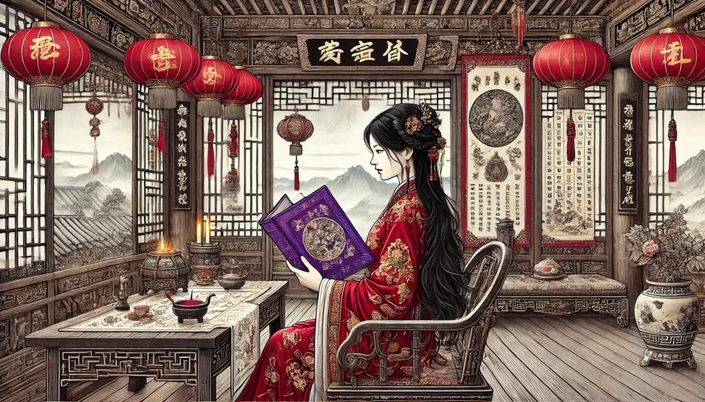

# 第十七章　商盟崛起，萬界重聚

青玄界，東華洲第一大商業仙城——落霞仙城。

萬寶閣總舵天字號議事大殿中，古老的龍涎檀香自青銅瑞獸爐中裊裊升起，殿內氣氛卻森嚴肅穆到了極致，連一根銀針落地的聲響都能清晰可聞。

數十名來自中天道洲、平日裡呼風喚雨的頂級仙商巨賈，此刻面色慘白如紙，冷汗順著下頜滴落在昂貴的冰玉地磚之上，正戰戰兢兢地齊齊跪伏在下首。而在大殿正上方那尊象徵著至高權柄的紫檀金鳳椅上，一襲緋紅暗金留仙長裙的慕容玥優雅斜倚，身姿婀娜曼妙到了極致。

那張明艷動人、顛倒眾生的絕美玉容之上，神情清冷孤傲，纖如蔥白的晶瑩玉指，正漫不經心地撥弄著一柄完全由萬年純陽金晶鍛造而成的算盤。

「啪嗒、啪嗒。」

清脆悅耳的金鐵交擊之音，在落針可聞的大殿中迴盪，宛如一記記奪命的喪鐘，狠狠敲打在在場每一位商界巨擘的心坎之上。

「慕容閣主……老朽……老朽代表中天商會認輸了！」

一名修為已達元嬰初期的商會大掌櫃渾身發抖，以頭搶地，顫聲苦苦哀求：

「中天三萬商號願將在東華洲境內購置的所有上古靈脈、玄鐵礦脈、乃至七成店鋪商埠，盡數拱手無償轉讓給萬寶閣！只求……只求慕容閣主高抬貴手、網開一面，解了我等商隊跨洲跨界的靈石結算封鎖，給老朽身後數十萬依附的修士一條生路啊！」

「網開一面？」

慕容玥纖細精緻的秀眉微微上挑，緋紅薄唇勾起一抹極其明艷、卻又透著無盡上位者威嚴與商道霸權的冷冽笑意：

「當初你們中天商會聯手三大仙門斷我萬寶閣靈砂退路、在中洲邊境截殺我萬寶閣商隊之時，何曾想過對我慕容玥網開一面？」

玉手輕輕一合，金算盤發出一聲清脆定音的脆響！

慕容玥豁然站起身來，一襲緋紅留仙長裙在靈風中獵獵作響，傲人的曲線展露無遺，鳳眸之中流光溢彩，字字如洪鐘大呂、霸氣絕倫：

「商道如天道，弱肉強食，過期不候！今日這東華，乃至未來的天下十九洲，商道規矩，只能由我慕容玥說了算！」

「傳本閣主法旨：自今日起，徹底吞併中天商會東華殘部，整合十九洲商道資源，正式成立——【東華萬界商盟】！」

「凡入商盟者，享青雲仙宗之最高庇護，行諸天萬界流轉之無上財貨！若有陽奉陰違、暗通敵修者，廢除修為，逐出東華，永世不入商籍！」

「謹遵盟主法旨！萬界商盟，千秋鼎盛！」

下首上百名東華洲與中天道洲的頂尖掌櫃、世家家主齊齊拜服於地，山呼海嘯之聲震得整座議事大殿嗡嗡作響。

……

片刻後，喧鬧退去，大殿重新恢復了死一般的幽靜。

方才在大殿之上殺伐果決、手腕雷厲風行的絕美商界女帝，在內室門扉合攏的剎那，整個人卻如卸下了千鈞重擔般，長長地吐出一口如蘭幽氣。

她卸下了那一層端莊冷傲的威嚴偽裝，蓮步輕移，走到內室的一張溫潤暖玉案几前。

慕容玥伸出纖纖玉指，輕輕撫過案几上一隻通體以深海紫金鍛造、表面銘刻著重重封印禁制的古老寶匣。

啪嗒。

伴隨著禁制解開，寶匣緩緩開啟。

然而，裡面盛放的並非價值連城的極品仙晶，亦非天地靈藥，而是數枚散發著奇異淡藍色微光、表面銘刻著微小如蛛網般星際電路拓撲的未知星紋晶石，以及幾件線條流暢至極、絕非任何修仙宗門煉器手法所能打造的奇異合金構件！

「這批動用了上萬暗影死士、自西陵空間裂隙禁區中秘密截獲的黑貨……究竟來自哪一個未知的界域文明？」

慕容玥秀眉微蹙，眼中閃動著頂級商人的敏銳與探究，但隨即，那一抹精明便被深藏在眸底最深處的落寞與相思所取代。

她纖細的手指撫摸著冰冷的奇異晶石，低聲喃喃自語，語氣中滿是掩飾不住的眷戀與幽怨：

「顧郎……你踏入萬界門一走便是數月，連半點音訊都未曾傳回……你在那方陌生的高武世界，可還吃得慣、住得慣？可有……可有受傷？」

話音未落！

嗡——！

一聲極其微弱、卻直接在靈魂最深處引發劇烈震顫的溫熱之意，毫無預兆地自慕容玥光潔晶瑩的眉心正中央驟然爆發！

那是……當初在青虛秘境之中，顧淵以萬界樓主宰權限，與她性命雙修、深深烙印在她神魂命脈深處的——【紅顏時空錨點】！

與此同時。

遙遠的青雲仙山之巔。

通天峰掌門大殿之內，一身雪白羽衣道袍、手按歷代掌門至高玉印的柳清虛；

以及青雲後山萬丈玄冰禁地之中、正凝神以神識拓印遠古殘卷《太素天變錄》的太上仙尊沈玄清；

兩女原本平靜如止水的心湖，在同一時刻如遭重擊！她們光潔的眉心處，那一道深邃玄奧的時空印記，同時綻放出了如夢似幻的混沌星光！

緊接著，一道溫柔清朗、熟悉得讓她們靈魂戰慄的神念傳音，在三位絕代佳人的識海深處悠然響起：

「清虛、玄清、玥兒……滄瀾界投影陣眼已固，萬界門啟，速來二層一敘。」

是顧淵！

是她們朝思暮想、牽腸掛肚了整整數月的男人！

「顧郎！」
「師弟！」

沒有半點猶豫，三女身形一晃，識海神魂深處的時空印記全面激發！

……

嗡——！

浩瀚虛空之上，超越諸天維度的一片神聖維度。

萬界樓第二層樞紐大殿。

巨大的乾坤道台巍峨矗立於大殿正中，萬道混沌氣流宛如垂落九天的璀璨星河瀑布，將這座雄偉神殿映襯得恢弘縹緲、氣象萬千。

虛空之中，三道刺破維度的時空光柱轟然降臨在大殿石階之上。

光華散去，三位風華絕代、冠絕青玄的絕美身影翩然凝實。

柳清虛身披雪白羽衣道袍，腰束素色絲帶，頂門之上那一枚圓融無暇的九品天道金丹光華流轉，清麗絕俗之中，更添一派仙宗執牛耳者的莊嚴尊貴；

沈玄清一襲月華長裙拖曳在地，三千青絲如瀑，面容絕美清冷得宛如九天玄女下凡，周身隱隱縈繞著元嬰期大圓滿的至高仙意，神聖不可侵犯；

而慕容玥則是一襲緋紅暗金長裙，身段婀娜修長，成熟嫵媚到了極致，眉宇間那股威震商界的霸氣，在看清大殿正中央那道身影的剎那，瞬間融化成了一汪春水。

只見在乾坤道台之上，一襲淡青長衫的顧淵，正負手而立，唇角含笑，目光無比溫柔深情地注視著她們。

「顧郎——！」

慕容玥再也無法維持身為商盟盟主的端莊與矜持，發出一聲帶著哭腔的嬌呼。一陣醉人的幽香掠過，整個人宛若乳燕投懷般狂撲進了顧淵的懷抱！

她纖細白皙的玉臂死死環抱住青年的脖頸，修長柔軟的嬌軀緊緊貼著顧淵的胸膛，小腦袋埋在顧淵的肩窩處，貪婪地呼吸著他身上那股乾淨出塵的青竹草木與混沌氣息。

淚水不知不覺打濕了顧淵的青衫，慕容玥紅著眼眶，又是委屈又是心疼地輕輕捶打著他的胸口：

「你這狠心沒良心的人！一走便是數月，連一封飛劍傳書都沒有……你知不知道玥兒在青玄每天都在擔心你！想你想得連靈石都數不明白了！」

「傻丫頭，我這不是平安回來了嗎？」

顧淵胸腔微震，發出一陣寵溺的低笑。他長臂一攬，將懷中柔軟溫香的嬌軀緊緊扣在懷裡，低頭在她光潔的額頭上深深印下一吻。

站在三步之外的柳清虛，這位如今威震東華的大掌門，望著顧淵的眼眸中早已泛起了盈盈淚光。她用力抿著紅唇，手指緊緊絞著道袍的衣角，極力維持著掌門的端莊，但那劇烈起伏的胸口與微顫的睫毛，卻徹底出賣了她內心翻江倒海的思念。

「師弟……」柳清虛嗓音微微有些哽咽，「你平安……便好。」

顧淵騰出右手，輕輕握住了柳清虛微涼柔嫩的玉手，將這位清麗絕倫的師姐一把拉入懷中，溫柔地揉了揉她的秀髮：「清虛，辛苦你了。聽聞你已破境金丹大圓滿，將青雲打理得井井有條，我為你驕傲。」

感受著青年掌心傳來的熟悉溫度，柳清虛嬌軀一顫，原本強撐的掌門威嚴寸寸瓦解，將臉頰輕輕貼在顧淵寬闊的肩膀上，長長地舒了一口氣。

而在身側，沈玄清款步走上前來。

這位名震青玄的太上仙尊，清冷的鳳眸自上而下細細打量著顧淵。在看清顧淵神魂飽滿、氣血剛猛如太古蠻龍、修為更是深不可測之時，那張萬載如玄冰般冰封的絕美玉容上，悄然綻放出一抹傾倒眾生的溫柔笑意：

「氣息凝練，神骨初成，看來你在那方滄瀾高武世界……收穫甚豐。」

顧淵抬起頭，迎著沈玄清那雙滿含關切的深邃鳳眸，左擁右抱之中，依然從容一笑：

「讓玄清師姐、清虛與玥兒擔憂了。滄瀾界武道繁榮，今日我剛剛徹底收復並修復了昔日神工鑄兵殿的下界投影陣眼，萬界樓第二層時空徹底穩固，這才得以將你們瞬間召喚入樓。」

四人圍坐在乾坤道台中央由萬載溫玉雕琢而成的雲床之上，久別重逢的喜悅與溫馨在整座神殿內久久流淌。

短暫的溫存之後，三女紛紛正色，向顧淵展示著各自在青玄界的驚人成果與佈局。

柳清虛纖指掐訣，一尊璀璨純澈、散發著至高天道意志的九品金丹懸浮於頭頂，將青雲仙宗徹底確立為東華第一仙門的盛況細細道來；

慕容玥則將紫金寶匣呈上，將成立「東華萬界商盟」的宏偉藍圖展現於顧淵眼前，並鄭重交出了那批自西陵禁區查獲的奇異星晶與科技構件；

而沈玄清，神色則顯得格外凝重肅穆。她玉手一揮，將《太素天變錄》的殘篇拓本、以及青雲地底【九天封魔大陣】的樞紐陣圖徐徐鋪展在雲床之上：

「顧淵，這是我在青雲禁閣中查出的萬古真相——我們當初遭遇的九幽魔劫，根本不是什麼偶然的天災，而是一張由太古魔尊佈局了萬載、企圖吞噬諸天萬界的萬古魔網！」

「而你如今身處的滄瀾界……正是魔網鎖定的第二處核心樞紐節點！」

沈玄清眸光凌厲，玉指點在陣圖正中，冷靜分析道：

「青玄界的魔網節點當初被你以純陽仙體徹底同化拔除；但滄瀾界天地法則以金鐵剛猛為主，肉身氣血極重。要想徹底撕開那方世界的魔網節點，單憑純陽道法猶嫌不足，必須藉助至剛至陽的天子真龍血脈，引動仙武合一，方能破局！」

「至剛至陽的天子真龍血脈……」

顧淵聞言目光微凜，隨即將那一枚雕刻著【翊】字的三爪金蟒暗令、以及在百兵神宮繳獲的數件通靈名器取出，將滄瀾界高武體系、大乾皇朝內亂奪嫡、三皇子姬凌翊暗中勾結九幽魔修的陰謀原原本本地告知了三女。

沒有多餘的廢話，更無半點拖泥帶水。

一位仙宗大掌門、一位太上仙尊、一位商盟女帝，與一位執掌萬界的青年，四顆超越凡俗的智慧大腦在極短的時間內碰撞激盪，短短半個時辰，便將青玄與滄瀾兩大世界的全局戰略與利益脈絡，梳理得一清二楚！

看著眼前這三位不僅容顏冠絕諸天、更是在大後方替自己撐起整片青玄天地的獨立道侶，顧淵胸中湧起無盡的深情與豪氣。

得妻如此，夫復何求？

「大局已定，魔網之秘我已知曉。」

顧淵袍袖微揚，唇角揚起一抹壞壞的輕笑，深邃的目光緩緩掃過身旁的三位絕代佳人：

「不過……正事談完了。數月未見，難道三位娘子，便只想與為夫聊這天地大劫不成？」

聽到「娘子」二字，原本正經端坐的三女，嬌軀齊齊一震！

慕容玥最先反應過來，美眸中水波流轉，嬌媚得幾乎要滴出水來。她順勢軟軟地依偎進顧淵懷中，伸出雪白修長的手臂環住顧淵的脖子，呵氣如蘭：

「顧郎……玥兒方才便說了，玥兒想你想得骨頭都疼了……」

話音未落，她纖細的玉指已然輕輕扯開了自己腰間那條緋紅留仙長裙的暗金繫帶。

伴隨著一聲極其細微的絲帛滑落聲，華貴如火的長裙順著她圓潤香滑的香肩悄然滑落，露出裡面那一抹繡著金線海棠的月白抹胸，以及大片白皙晶瑩如凝脂般的雪肌，曲線玲瓏起伏，誘惑到了極致。

「玥兒……你……」

身旁的柳清虛見狀，俏臉刷地一下紅到了耳根。

這位平日裡在通天峰上不苟言笑、受萬仙朝拜的清麗掌門，此刻在顧淵灼熱的目光注視下，只覺得渾身發燙。然而，當顧淵伸出長臂將她攬入懷中、低頭輕輕吻上她嬌豔欲滴的櫻唇時，柳清虛所有的羞澀在瞬間化作了無盡的溫柔與順從。

「唔……師弟……」

一聲嬌柔甜膩的嚶嚀自柳清虛唇間溢出。她長長的睫毛劇烈顫動著，眼眸半閉，主動伸出玉臂抱住了顧淵的腰身，任由身上那件象徵著掌門尊嚴的雪白道袍，被青年溫柔而霸道地寸寸褪去。

而在雲床另一側，沈玄清靜靜盤坐。

這位修為已達元嬰圓滿的太上仙尊，冰肌玉骨，聖潔高貴宛若不染凡塵的月中真仙。

然而，當顧淵轉過身來，大手握住她那隻柔若無骨、冰涼如寒玉般的纖纖玉手時，沈玄清那孤傲如雪山般的鳳眸深處，亦悄然泛起了一層唯有身為道侶方能得見的極致春水。

「顧淵……」

沈玄清輕喚了一聲，玉容浮現出一抹顛倒眾生的淡淡紅暈。

她沒有閃躲，任由青年將自己攬入懷中。當那一層如月華般清冷的素白長裙飄然落地之時，這位名震天下的第一仙尊，終於徹底卸下了仙尊的枷鎖，將自己毫無保留地展現在了心愛男子的眼前。

嗡——！

乾坤道台之上，溫潤如春水般的混沌星芒轟然瀰漫，化作一圈朦朧純淨的星辰光幕，將整座大殿隔絕成了一處唯美神聖的極致洞天。

雲床之上，紅燭帳暖，春意無邊。

緋紅、雪白、素月三色羅裳在星光中凌亂交織。

慕容玥熱情似火，嬌媚入骨，修長如玉的雙腿如藤蔓般緊緊纏繞，在每一次歡愉的撞擊中發出令人心魂俱醉的甜膩啼鳴；

柳清虛清麗如蓮，嬌羞動人，雪白的肌膚上泛起誘人的粉霞，在青年的溫柔撫慰下宛如初綻的花蕊，眼眸迷離，低吟婉轉；

沈玄清端莊聖潔，卻在靈肉交融的至高境界中展現出令人瘋狂的銷魂反差，鳳眸含春，玉頸高仰，與顧淵神魂共鳴，青絲凌亂地散落於白玉枕上。

陰陽合璧，乾坤交泰！

這不僅僅是人間極致的情愛纏綿，更是諸天萬界最至高無上的大道雙修！

顧淵體內那融合了滄瀾界十萬熔爐、神工鑄兵殿投影的至剛至陽仙武造化，順著每一次深入的交合，如奔騰的星河般源源不絕地渡入三女體內，洗練著她們的經脈與金丹元嬰；

而三女體內那積攢了數月的青玄界天道功德、元嬰極致本源、以及萬寶商盟統御十九洲的磅礴氣運，亦化作純淨至極的九天甘霖，反哺衝刷著顧淵的混沌星脈！

「轟——！！！」

不知過了多久，伴隨著四人心神相融、達至極樂巔峰的剎那——

萬界樓核心的最深處，那一尊乾坤道台猛然爆發出震撼諸天維度的劇烈轟鳴！

虛空之中，一行行璀璨至極、宛若恆星燃燒般的純金大字，如流星暴雨般轟然刷屏而下：

【叮！獲得青玄界天道功德、元嬰大圓滿本源、以及東華商盟磅礴氣運全面反哺！】
【叮！檢測到四位命定核心道侶完成神魂乾坤大交泰，陰陽本源共振度達到極限！】
【萬界樓主體獲得里程碑式的質變修復！】
【當前萬界樓修復進度暴漲：15/10000 ➔ 30/10000（0.30%）！】
【恭喜樓主，成功解鎖萬界樓被動至高神能——【諸天穿梭特權】！】
【特權說明：樓主從此可隨時在已完全錨定的世界（青玄、滄瀾）中自由返還本體，界門開啟延遲徹底清零！】

修復進度，直接由 15/10000 再次翻倍，達到了整整 30/10000！

更解鎖了無冷卻、無延遲的自由穿梭特權！

……

數個時辰之後。

乾坤道台周圍的漫天星光漸漸內斂，大殿重歸靜謐。

雲床之上，三位絕色佳人面色紅潤嬌艷，眉宇間滿是承恩之後的疲憊與慵懶，肌膚晶瑩如玉，氣息比先前更是渾厚精純了數成。

她們穿戴整齊，依依不捨地並肩立於青玄界門之前。

「顧郎，皇都之行凶險萬分，奪嫡牽涉魔網，萬事切記小心。」柳清虛替顧淵整理好長衫衣領，眼眸溫柔如水，輕聲叮囑。

慕容玥嬌嗔地白了他一眼，玉手悄悄在他腰間輕擰了一下，揚了揚雪白的下巴，傲嬌中帶著無盡深情：

「去吧！待你在皇都把那些阻礙通通踏平，玥兒便將萬界商盟的分舵開遍整座大乾皇朝！賺光天下武者的靈石！」

沈玄清則凝視著顧淵，鳳眸深邃明亮，清冷開口：

「放心前往皇都。青玄大後方有我們坐鎮，萬無一失。」

顧淵朗笑一聲，上前在三女微紅的嬌靨上一一輕吻，豪情萬丈：

「好！待我踏破承天京，斬滅魔煞，再與諸位娘子共飲神釀！」

目送著三位傾城紅顏依依不捨地穿過界門重返青玄界後，顧淵緩緩轉過身來。

大殿之內，青衫飄動。

顧淵深邃的眸子之中，那一抹溫存與繾綣在瞬間斂去，取而代之的，是一種俯瞰蒼生、如絕世神鋒出鞘般的凌厲寒芒！

「大乾皇朝……承天京。」

顧淵身形一閃，一步邁入了懸浮在大殿另一側的二號萬界大門！

轟！

時空變幻，乾坤倒轉！

監國長公主姬明月，三皇子姬凌翊……

顧某，來了！
