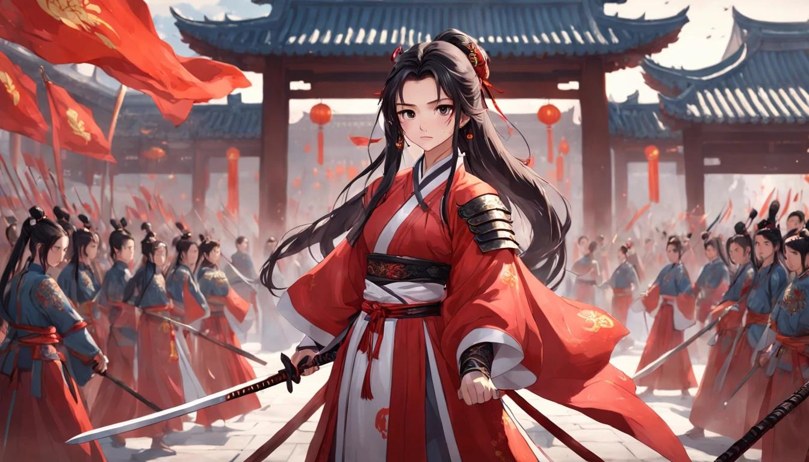

# 第十八章　承天雄京，深宮暗流

滄瀾界中原，大乾皇朝都城——承天京。

如果說天武城是南域群雄逐鹿、金戈鐵馬的武道聖地，那麼這座雄踞中原腹地整整三千年的承天京，便是這方高武天地至高無上的皇權中樞與億萬文明的璀璨心臟。

整座皇城方圓縱橫八百里，浩瀚磅礴得宛如一片由金鐵與巨石構建而成的獨立國度。

外城城牆高達逾百丈，通體由自深海地脈中開採而出的萬年玄武岩、融合了億萬斤黑耀精鐵混合澆築而成。遠遠望去，那連綿不絕的墨黑色城垣在深秋的蒼茫天地間蜿蜒盤旋，宛如一條通體披掛重鎧、橫臥在廣袤平原之上的太古黑龍！

城樓之上，箭塔林立，刀槍如林。

數十尊通體由九品精金鍛造、銘刻著古老破甲符文的「誅神破靈重弩」，在暗紅色的烽火台邊散發著森然刺骨的凶煞寒芒；而在九天之上的罡風雲海深處，更有一艘艘長達百丈、通體覆蓋著青色雷甲的「巡天雷舟」在轟鳴聲中緩緩巡弋，將森嚴冷酷的威壓籠罩在整座大地的每一寸角落。

在無盡高天之上，隱隱有一道肉眼清晰可見的浩瀚紫金色真龍氣運，宛如倒扣的九天玉碗，將整座皇都八百里疆域死死庇護在其中，將外界的一切狂風暴雨與荒野凶煞隔絕在外。

然而，在這巍峨雄壯、震懾萬民的皇權盛景之下，深秋那肅殺淒厲的蕭瑟秋風，卻吹得城樓上高懸的玄黑龍旗獵獵作響。空氣中若有若無地瀰漫著一股山雨欲來的沉悶與壓抑，彷彿整座龐大的帝國機器，都在這平靜的表象下隱隱發出不堪重負的齒輪哀鳴。

自皇都正南方那條寬達數十丈、完全由極品白玉石鋪就的「正陽大道」盡頭，兩道從容出塵的身影，正迎著秋風踏步而來。

顧淵一襲淡青長衫，身姿挺拔如松，手中輕搖著一柄溫潤古雅的青玉折扇，步履悠閒自若，唇角噙著一抹若有若無的淺笑，宛如一位入京遊學的世家貴公子；

而在他的身側半步之地，洛寒衣依舊是一襲勝雪白衣，長裙在秋風中如弱柳般輕輕飄曳，青絲束於銀簪之下，那一柄名震五域的斷星古劍斜負背後。自從歷經了百兵神宮那一場生死與共的血戰之後，這位原本冷若冰霜、拒人於千里之外的天劍女劍仙，身上那股凌厲逼人的殺氣悄然斂去了許多，那雙清冷深邃的鳳眸在側目看向身旁的青衫青年時，眼底總會不經意間流露出一抹極其動人的溫柔與眷戀。

自南嶺啟程以來，洛寒衣奉天劍山山主法旨，攜神宮密信前往皇都面聖，一路上自然而然便與顧淵結伴同行。

數日長途跋涉，兩人朝夕相處，踏遍名山大川。在顧淵那博大精深的諸天見解與潤物細無聲的點撥之下，洛寒衣體內的太古星光劍意愈發圓融通透；而對於身側這個屢屢創造神蹟、深不可測的男人，洛寒衣的那顆冰封道心，更是早已沉淪得毫無保留。

「顧先生，前方便是這承天京正南門面——『正陽門』了。」

洛寒衣微微側過絕美出塵的玉容，目光掃過前方那巍峨如天塹般的城門樓，纖唇微動，以傳音入密之法向顧淵低語，嗓音清脆空靈如碎玉敲冰，卻透著幾分凝重：

「大乾皇朝立國三千年，皇室姬家底蘊深不可測，歷代帝尊皆有武皇巔峰修為，更有鎮國天王與上古陣法護佑社稷。但近半年來，當代老帝尊姬無極因急於突破至傳說中的武神之境，在深宮禁地修煉皇室絕學『天子驚神訣』時突遭走火入魔，經脈寸斷，長年纏綿病榻，已整整五月未曾臨朝聽政。」

「老皇帝重病不起，皇子與權臣自然便坐不住了。」顧淵輕搖折扇，深邃的目光望向皇宮深處那一團隱隱翻滾的紫金氣運，隨意笑問道，「如今這大乾朝堂，可是已經分崩離析了？」

「正是。」

洛寒衣輕輕頷首，絕美的面容上多了一抹冷意：

「當今天下，朝局主要被撕裂為兩大陣營。其一，乃是老帝尊的嫡長女——監國長公主姬明月。這位長公主天賦異稟，天生覺醒了姬家萬載罕見的『九劫真龍異能血脈』，智勇雙全，手腕鐵血！老帝尊病重前，親手將象徵兵權的三十萬天策黑甲軍兵符交予她手，封其為『監國帝女』。她在朝中手段雷厲風行，力主肅清吏治、抗擊外辱，在民間與軍中素有『鐵血女帝』之威名。」

說到這裡，洛寒衣的語氣微沉，眼底掠過一絲冰冷的厭惡與殺意：

「而另一派，則是以三皇子姬凌翊為首的奪嫡勢力。此人表面上溫潤如玉、禮賢下士，拉攏了朝中過半的王公勳貴與數大武道世家；實則心狠手辣、狼子野心！甚至……在百兵神宮地底伏擊我們的那幫九幽魔修死士身上，我們搜出的正是他的隨身暗令！如今承天京內暗流洶湧，奪嫡之爭已然到了圖窮匕見、不可收拾的境地。」

「姬凌翊……九幽魔煞。」

顧淵指尖在青玉折扇的扇骨上輕輕摩挲，眼底深處掠過一抹冰冷的戲謔：

「一個被九幽魔網當作提線木偶卻猶自沾沾自喜的跳樑小丑罷了。此番入京，顧某倒真想親眼瞧瞧，這位三殿下究竟長了幾顆膽子，敢把這萬里山河拱手賣與邪魔。」

說話之間，二人已然穿過了漫長的正陽大道，行至這座雄偉古老的正陽門下。

城門之下，人潮湧動，氣象森嚴。

尋常的過路商賈、遊俠與百姓，皆在大批面色凶悍的披甲守衛喝斥下，自兩側狹窄的小型側門排起數里長龍，一一接受嚴苛繁瑣的搜身與引氣盤查。

而位於城門正中央的，則是一道寬達十丈、以整塊整塊溫潤如玉的漢白玉雕琢而成的通天御道——「天武御道」！

此道乃大乾開國始祖所立，唯有皇室宗親、巡天重臣，或是持有五大武道聖地與頂級古老宗門親筆拜帖的至高使者，方有資格昂首踏階而入！

正當顧淵與洛寒衣神色自若、出示了百兵神宮與天劍山的黃金拜帖，正欲邁步登上白玉天階之時——

「慢著——！！！」

一聲充滿了跋扈、陰冷與暴虐的粗鄙暴喝，驟然在城門守將的高台席位之上如滾雷般轟然炸響！

踏！踏！踏！

伴隨著沉重刺耳的玄鐵戰靴踏地之聲，一名身高足有八尺、身披暗黑玄鐵重甲的魁梧壯漢大步按刀而出！

此人面容兇戾，一雙三角眼透著殘忍嗜血的光芒，在他那厚重的胸甲正中央，赫然以極其囂張的暗金色絲線，精準刺繡著一條唯有三皇子府親信死士方能配備的三爪金蟒戰紋！一身狂暴兇悍的氣血真罡滾滾外溢，赫然是一位實力達到了宗師巔峰、半隻腳跨入大宗師門檻的百戰統領！

這名禁衛統領斜著一雙陰鷙的三角眼，先是放肆地在白衣勝雪、宛若九天仙女般的洛寒衣身上貪婪地掃了一圈，隨即目光落在了一旁青衫磊落、悠然自若的顧淵身上。

他的嘴角咧開一道極其刻薄與挑釁的獰笑：

「天劍山大師姐洛仙子的威名，我等自然認得，洛仙子的拜帖自然有效。但是……」

壯漢將手中長達五尺的闊刃雁翎刀猛然往地上一頓，沉重刀鞘將白玉石板砸出一蓬碎屑，抬起粗糙的手指，極其侮辱地直指顧淵的鼻尖：

「你身邊這個小白臉，算個什麼東西？！看他一襲儒雅青衫，面生得緊，身上連我大乾戶部簽發的宗師引氣牒文都沒有！形跡如此可疑，豈能輕縱？！」

「近來承天京全城一級戒嚴，長公主府與三殿下皆有嚴令，嚴防邊陲魔修奸細潛入皇都作亂！來人啊——給本統領將這個來歷不明的狂徒拿下，打入天牢昭獄，嚴刑拷打，審清來歷！」

嘩啦啦——！

伴隨著將領一聲令下，兩側幽暗深邃的城牆甬道陰影處，甲冑撞擊之聲大作！

數十名全副武裝、面目冷酷的黑蟒衛精銳死士如潮水般暴湧而出！只見一柄柄長達丈二、以深海精鋼鍛造、通體泛著破除真罡幽藍血槽的破罡長槍齊刷刷壓下，化作一座森然無比的死亡槍陣，泛著令人窒息的殺伐鋒芒，直逼顧淵周身各大死穴！

周圍原本正在排隊進城的數千名江湖武者與達官貴人見狀，無不大驚失色，紛紛尖叫著向後瘋狂暴退：

「天吶！是三皇子姬凌翊麾下的近衛私軍——『黑蟒衛』！」
「那位將領正是黑蟒衛統領趙虎！此人乃是三殿下身邊的一條惡犬，素來心狠手辣、跋扈專橫！」
「這幫傢伙分明是看那天劍山仙子身旁的青衫公子生得俊美出塵、氣質非凡，故意尋釁刁難，想在天劍山使者面前立威啊！」

人群退避，滿場皆驚。

「趙虎！你好大的狗膽！」

就在槍陣壓下的剎那，一聲宛如九天玄冰碎裂般的清冷嬌叱，驟然在正陽門前回盪！

洛寒衣那張絕美精緻的玉容之上，在瞬間覆蓋上了一層萬載難化的恐怖寒霜！那一雙如星辰般的清眸之中，殺意暴漲，手中的斷星古劍發出一聲刺破雲霄的凌厲清鳴，森白如雪的極致劍罡自她周身轟然爆發，將四周的空氣瞬間凍結成肉眼可見的冰霜白霧！

少女猛然向前邁出一步，橫劍護在顧淵身前，眼神如刀鋒般直逼趙虎咽喉：

「顧先生乃百兵神宮至高貴客，更是我天劍山的大恩人！此番隨我入京面聖，你區區一個皇子府的守門走狗，也敢在此狂吠、揚言拿人？你信不信本姑娘一劍斬了你的狗頭？！」

狂暴的半步武王劍意排山倒海般席捲而開，直逼得那數十名黑蟒衛禁衛連連後退，臉色發白。

然而，那黑蟒衛統領趙虎非但沒有收斂，反而仰天發出一陣更加肆無忌憚的張狂大笑：

「哈哈哈哈！洛仙子，你莫要拿天劍山的名頭來壓本統領！」

趙虎眼中兇光畢露，握緊了雁翎刀柄，獰笑道：

「這裡不是你南域天劍山，這裡是承天京！是皇城天子腳下！在我們三殿下的地盤上，天王老子來了，只要沒有牒文，也得乖乖按我黑蟒衛的規矩跪下辦事！洛仙子若是膽敢在正陽門前拔劍拒捕，那便是與反賊同罪！兄弟們，給我動手，格殺勿論！」

「殺——！」

數十名黑蟒衛死士暴喝一聲，體內真氣瘋狂運轉，數十柄泛著刺鼻破罡血煞的精鋼長槍撕裂空氣，帶著淒厲的尖嘯之聲，朝著顧淵與洛寒衣狠狠攢刺而去！

「找死！」洛寒衣美眸含煞，玉指發力，長劍即將奪鞘而出！

然而——

就在那漫天槍尖距離二人胸膛尚餘三尺之地的剎那！

一隻溫熱、修長、如玉石般乾淨的大手，卻悄無聲息地按在了洛寒衣握劍的素手手背之上。

顧淵的指尖溫潤微熱，帶著一種令人心醉的安寧力量。

洛寒衣嬌軀一顫，轉過頭來，只見身旁的青衫男子神態悠閒，甚至連眼皮都未曾抬一下。

「洛姑娘，殺雞焉用牛刀。這等仗勢欺人的污濁家奴，莫要髒了你的名劍。」

顧淵淡淡一笑，語氣清淡如風。

隨後，他在無數道駭然驚恐的目光注視下，連半步都未曾後退，僅僅是將右手探入寬大的青衫袍袖之中，漫不經心地摸出了一枚黑沉沉、非金非鐵、巴掌大小的奇異古樸令牌。

接著，顧淵手腕隨意一甩，宛如扔出一塊頑石般，將那枚黑沉沉的令牌，朝著那氣焰滔天的趙虎面門隨手擲了過去！

嗤！

令牌破空而出，沒有耀眼奪目的華麗真氣，亦無驚天動地的呼嘯轟鳴。

但在那枚小小的令牌離開顧淵掌心三寸的剎那——

整座正陽門前的虛空，卻詭異至極地泛起了一層肉眼可見的暗紅色狂暴漣漪！

緊接著——

「轟——！！！」

一聲宛若十萬神兵齊齊拔出地脈、整座千峰器海地底熔爐轟然引爆的浩瀚神威，自那枚小巧玲瓏的黑色令牌之上，驟然炸裂開來！

至剛！

至猛！

至尊至聖的器道始祖之威，夾雜著百兵神宮萬載沉澱的恐怖地煞極炎，化作一道肉眼可見的滔天狂瀾，橫掃方圓百丈天地！

砰！砰！砰！砰！砰！

衝殺在最前方的數十名黑蟒衛精銳，手中那足以刺穿宗師護體真罡的深海精鋼破罡長槍，在觸碰到這股氣浪的千分之一剎那，連哀鳴都未曾發出，整柄精鋼長槍便宛如遇到了九天神火的殘蠟般，自槍尖至槍尾寸寸化作赤紅滾燙的鐵水鐵屑，崩碎飛濺！

「噗哇——！！！」

首當其衝的黑蟒衛統領趙虎，更是如遭太古不周山迎面狂暴撞擊！

他胸口那一面厚達三寸、由九品玄鐵千錘百煉而成、更刻有三重防護符文的重型胸甲，在與令牌相隔尚有半尺的虛空之中，便發出不堪重負的刺耳碎裂聲，當場凹陷塌陷成一個深達半尺的巨大坑洞！

恐怖至極的沛然莫御神力順著他的胸骨直貫四肢百骸！

卡嚓！卡嚓！

一陣令人毛骨悚然的骨骼爆碎聲響徹全場！

趙虎整個人被一股不可抗拒的無上天威硬生生壓得雙膝重重砸穿了白玉御道！

轟隆！

整座堅固無比的漢白玉御道地磚寸寸龜裂粉碎，化作一個方圓丈許的深坑！

趙虎雙膝深深陷在碎石深坑之中，一口夾雜著內臟碎塊的烏黑鮮血狂噴出數尺之高，整個人如同一條死狗般趴伏在地上，渾身骨骼經脈劇烈抽搐顫抖，任憑他如何瘋狂催動宗師真罡，那一顆高傲狂妄的頭顱，卻連抬起哪怕半寸都根本無法做到！

而在他頭頂上方三寸之地。

那一枚黑沉沉的玄金古樸令牌，正裹挾著一圈淡淡的赤紅神華，神聖無比地靜靜懸浮於虛空之中。

令牌表面，四個流轉著太古炎煞古韻的蒼勁大篆，宛如天道符旨般傲視九天：

【百兵天令】！

如宮主親臨！

如十萬神兵巡世！

「百……百兵神宮……最高天令？！」

趴在碎石坑中的趙虎死死盯著頭頂上方那四個金光大篆，眼珠子幾乎要自眼眶中生生瞪裂而出，牙齒瘋狂打顫，聲音尖銳得宛如被閹割的太監：

「這……這不可能！這令牌乃是百兵神宮開派三千年來、唯有宮主與隱世太上長老方能佩戴的至高神物……見令如見段百狂宮主本尊！哪怕是皇室親王見了，亦要躬身禮讓三分……你……你究竟是什麼人？！」

極致的恐懼與絕望，如潮水般瞬間吞噬了趙虎的神智！

他得罪的，根本不是什麼沒有背景的江湖白丁，而是一位手持天下第一器道聖地至高令符的滔天大人物！

在一片死寂無聲的震撼之中。

顧淵負手邁動長腿，步履從容悠然，青衫在蕭瑟的秋風中輕輕擺動。

他一步一步走到宛如死狗般跪伏在地的趙虎面前，居高臨下地俯視著這位滿臉鮮血、狼狽不堪的黑蟒衛統領，嗓音溫和平靜，卻透著一股令人靈魂戰慄的極致森寒：

「大乾黑蟒衛，好大的威風。」

顧淵收回手掌，懸浮半空的玄金天令發出一聲清越的輕鳴，化作一道黑芒倒飛而回，穩穩落入他的袖中。

青衫青年甚至連多看地上的趙虎一眼都未曾再看，只是抬起深邃的眸子，望向前方的承天京深宮方向，淡淡吐出一句話：

「回去轉告姬凌翊——這承天京的城門雖然很高，但還攔不住顧某的路。」

「他在百兵神宮欠下的血債……洗乾淨脖子，等著顧某去取。」

言罷，顧淵轉過身，朝著身旁震撼未消的洛寒衣微微一笑：

「洛姑娘，走吧。莫要耽誤了你入宮面聖的正事。」

洛寒衣美眸異彩連連，心中所有的憋悶在這一刻化作了無盡的暢快與驕傲。少女嫣然一笑，脆生生應道：「好！」

在數百名癱軟在地的黑蟒衛、以及上千名目瞪口呆的江湖豪客注視之下，那一襲出塵淡雅的青衫與勝雪如仙的白衣，並肩邁過巍峨的城門樓闕，步履從容地踏入了這座大乾皇朝的心臟腹地。

全場死寂！

數息之後，整座正陽門外爆發出震耳欲聾的倒吸冷氣之聲與驚天譁然！

談笑之間，隨手一擲令牌便生生震碎數十柄破罡神槍、重創宗師巔峰強者、逼得三皇子姬凌翊麾下的得力心腹如野狗般下跪求饒！

這位神祕莫測的青衫公子，究竟是何方神聖？！

承天京這一池早已暗流翻湧、奪嫡慘烈的深水，今日，注定要被這條自九天之外降臨的過江猛龍，掀起驚濤駭浪了！

……

而此時此刻。

剛剛踏入正陽門內御道的顧淵，腳步卻忽然極其微妙地停頓了半步。

在漫天繁華的車水馬龍與高聳入雲的殿宇陰影之下，顧淵眼眸深處，兩枚金色星輪再次悄然無聲地飛速旋轉——【破妄真視】，穿透了重重繁華宮闕，穿透了千丈厚重的白玉青磚，筆直地透視進了這座古老帝都最核心的地脈深處！

下一剎那。

顧淵的眉頭微不可察地皺了起來，瞳孔深處掠過一抹冰冷至極的寒意。

只見在承天京千丈地底之下，那一條綿延萬里、匯聚了大乾皇朝三千年國祚社稷的浩瀚紫金氣運真龍命脈之上……

一縷肉眼難辨、卻散發著無盡腐蝕、冤孽與死寂氣息的漆黑魔氣，正化作一條生滿了骨刺的太古魔蟲，如跗骨之疽般，正悄無聲息地大口啃噬著皇道真龍逆鱗處的心脈精血！

氣運蒙塵，魔煞鎖京！

這座看似固若金湯、威壓四海的大乾帝都，其內部腐朽崩壞的程度……遠比他預想的，還要危在旦夕！
