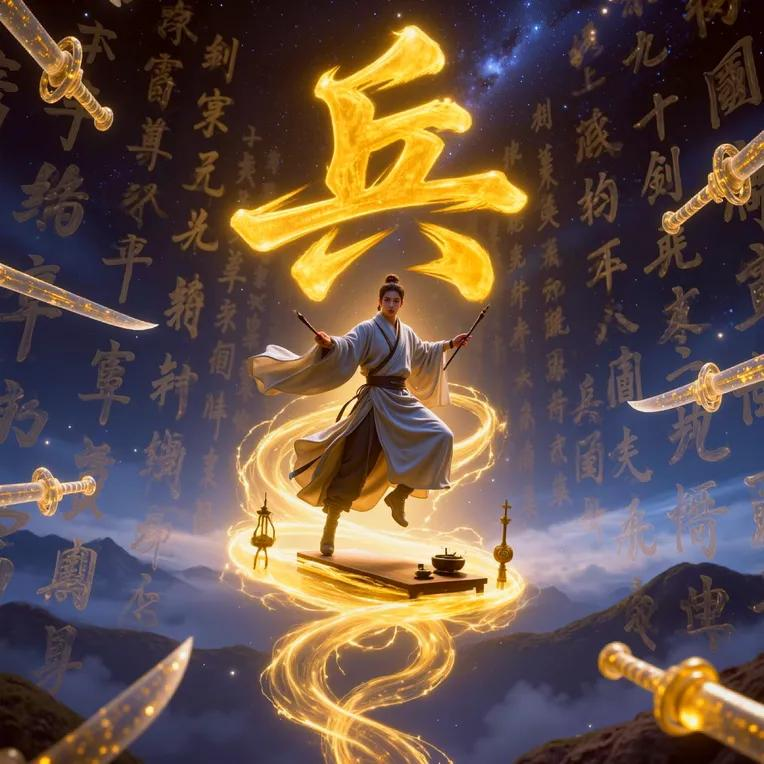

# 第三十五章　演武殿啟，九曜星圖

大戰落幕，黑雲散盡，歷經三千年沉痾與血火洗禮的滄瀾大地，終於迎來了真正意義上的安定與復甦。

天地枷鎖碎裂後的短短兩日之間，整座東南數萬里山河彷彿換了一重人間。昔日寸草不生的九幽平原上，新生的青草已漫過馬蹄，清冽的靈泉自崩裂的山壁間潺潺湧出；黑石長城內外，硝煙逐漸散去，取而代之的是此起彼伏的號子聲與打鐵聲。

在監國女帝姬明月與剛晉升半步武神的老劍皇劍無塵的聯手統籌之下，大乾三十萬天策玄甲軍與五大聖地、天下百宗聯軍有條不紊地展開了戰後清理、撫卹英烈、修復邊關與安撫流民的龐大工程。姬明月換回了一襲暗紅描金的監國宮袍，端坐中軍大帳之中，批閱如山軍報時依舊是那個冷峻果決、令行禁止的鐵血帝女；唯有在無人注意的隙縫裡，偶爾抬眸望向帳外極北群峰的方向，鳳眸深處才會掠過一抹極淡、極溫柔的牽掛。

至於身處風暴最中心的顧淵，在謝絕了各大聖地與皇室連番設宴的盛情邀約之後，便悄然離開了喧囂鼎沸的大營。

他獨自一人行至九幽平原外圍數十里處的一座無名翠谷。谷中飛瀑垂練，古松蒼翠，山風拂過時帶著新雨後泥土與靈草交織的淡雅清香，遠離塵世紛擾。

顧淵尋了一塊臨溪而立、被流水沖刷得光潔溫潤的巨大青石，拂袖盤膝而坐。他雙眸微闔，胸口起伏平緩綿長，眉心處一縷極淡的混沌玄黃道韻悄然流轉。

心神微動之間，一縷純粹凝練的樓主神識便已悄然抽離肉身，穿破滄瀾界的空間壁壘，跨過無盡虛空星海，飄然回歸至那座凌駕於諸天萬界維度之上的至高神殿——【萬界樓】！

嗡——！

伴隨著一陣空靈悠遠的空間漣漪散開，顧淵的身形自璀璨星輝中凝實，穩穩落在了萬界樓主殿那光可鑑人的白玉地磚之上。

才剛踏入大殿，甚至還未及細細打量這座古樓的新氣象，一陣清脆悅耳、宛如九天仙樂玉珠落盤般的歡快嬌笑聲，便伴隨著一縷淡雅馨香迎面撲來！

「主人！您終於回來啦——！」

只見大殿半空之中，一團柔和的粉色流光如歸巢乳燕般輕盈掠至。器靈靈素今日似乎心情極佳，身著一襲流雲織錦般的淡粉色流光羽衣，寬大的袖擺在靈風中翻飛似蝶，頭上扎著兩隻俏皮可愛的雙丸子頭，其上各綴著一顆細小的星辰靈珠，隨著她歡快的動作一晃一晃。

小丫頭赤著一雙瑩白如玉的玲瓏小足，如同一隻無憂無慮的精靈般圍著顧淵足足轉了兩大圈。她那張粉雕玉琢的俏臉上洋溢著毫無掩飾的興奮、激動與崇拜，一雙水靈靈的大眼睛笑成了彎彎的月牙兒：

「太厲害了！主人竟然真的在滄瀾界斬滅了那張討厭的九幽魔網，把第二塊大劫核心碎片完整奪回來了！主人您不知道，就在您一劍斬開魔網、碎片歸位的那一剎那，整座萬界樓沉寂了萬年的地脈靈樞一下子全沸騰了起來！連人家原本迷迷糊糊的許多上古記憶，都一下子清明了好大一塊呢！」

靈素一邊說著，一邊像邀功似地挺起小胸脯，眉飛色舞地指著大殿四周：「您快瞧瞧周圍！原本那些塌得七零八落的玉柱廊橋、灰撲撲的星穹穹頂，現在全都自己長回來、亮起來了！」

顧淵環目四望，唇角不由得勾起一抹由衷的溫潤笑意。

的確，昔日他初入萬界樓時，整座宏偉古殿處處殘垣斷壁，廊柱開裂，穹頂晦暗無光，彷彿一座隨時會在虛空風暴中崩解的垂死遺跡。可此刻放眼望去，四方白玉長廊完好無損、瑩潤生輝，無數細密的太古金紋順著樑柱蜿蜒流淌，穹頂之上原本破碎的星河已連綿成片，垂落下如煙似霧的精純混沌靈氣，讓整座古樓重新煥發出了一種尊貴、巍峨、統御諸天萬界的始祖氣象。

顧淵微微一笑，抬起修長的手掌，溫和地揉了揉靈素那兩顆軟乎乎的丸子頭之間的小腦袋，惹得小器靈舒服得瞇起眼睛，像隻被順毛的小貓般輕哼一聲。

「這陣子辛苦你守著古樓了。」顧淵語氣從容而溫和，隨即收回手，步履沉穩地向大殿正中央那座宏偉的【乾坤道台】行去。

來到道台近前，顧淵的目光微微一凝。

此刻的乾坤道台，早已徹徹底底褪去了初遇時的斑駁風化與殘破衰敗。整座九階白玉高台通體流淌著溫潤無瑕的混沌清光，台面之上密密麻麻的萬界法則道紋如活水般緩緩運轉，發出低沉而充滿生命力的道音共鳴。

而在乾坤道台最核心的虛空正中央，兩塊散發著截然不同大道氣息的結晶碎片，正安靜而又莊嚴地懸浮於半空之中——

左側那塊源自【青玄界】的第一塊大劫核心碎片，形如青玉蓮瓣，通體澄澈無瑕，流轉著溫潤綿長、生生不息的仙道造化神輝，隱隱有清越道音與靈山松濤之韻迴盪其間；

右側那塊剛自【滄瀾界】九幽地宮奪回、曾受老武神燕驚鴻以三千年不屈英魂日夜溫養的第二塊核心碎片，卻呈現出極為璀璨奪目的赤金琉璃之色，內部燃燒著一簇剛烈霸道、永不熄滅的金剛純陽神火，隱約間似有無數神兵齊鳴、太古真龍咆哮之勢！

一溫一烈，一仙一武，一柔一剛。

這兩塊本該屬於兩種完全不同世界文明、法則彼此排斥的核心碎片，此刻竟在乾坤道台的居中調和下完美咬合在了一起，首尾相銜，宛如一對在無盡太極清氣中緩緩旋轉的陰陽雙魚！隨著它們每一次玄妙的輪轉，便有源源不斷的精純混沌玄黃氣流自虛無維度垂落而下，如百川歸海般滋養著整座萬界樓的每一寸骨骼與脈絡。

顧淵負手靜望著這對陰陽交泰的核心碎片，心頭亦生出幾分深沉的感慨。他體內的混沌星脈與道台遙相呼應，每一次呼吸都能清晰感受到這座萬古神殿重新甦醒的脈動。

緊接著，顧淵的視線越過乾坤道台，落在了大殿最深處的正後方。

在那裡，原本終年籠罩著厚重太古石門與無數道漆黑封印鎖鏈、連他這任樓主都無法窺探分毫的第三層核心樞紐門扉——

此刻，那些斑駁腐朽的封印鎖鏈已然寸寸斷裂消散！兩扇高達十丈、通體由太初玄玉與星辰神金鑄造而成的巍峨巨門，已然向兩側徹徹底底地洞開，自門後綻放出照亮三千維度時空的璀璨純金神芒！

巨門之上的巍峨門楣正中央，四個筆走龍蛇、彷彿蘊含著開天闢地以來一切武道與法術真意的太古金篆大字，正熠熠生輝，震懾神魂：

【萬法演武】！

「主人，快來看看！這就是萬界樓融合第二塊大劫核心碎片後，剛剛重啟的第三核心樞紐設施——【萬法演武殿】！」

靈素見顧淵望過去，立刻興奮地飛上前來，小手輕輕拉住顧淵寬大的青衫長袖，雀躍地拽著他一步步踏上白玉階梯，朝著那扇金光萬丈的宏偉殿門走去。

一步跨過流淌著金色星紋的門檻。

空間法則在身前無聲流轉，下一瞬，顧淵只覺眼前豁然開朗，心神亦為之劇烈一震！

這座【萬法演武殿】的內部空間，竟遠比從主殿外觀看起來浩瀚了何止萬倍！

放眼望去，整座殿堂縱橫足有萬丈方圓，無邊無際。腳下是一片漆黑如墨、光潔如鏡、彷彿能倒映出世間萬物本源破綻的不知名界外玄石平台；抬首仰望，沒有尋常宮殿的樑柱瓦頂，取而代之的是一片深邃無垠、由億萬顆真實星辰軌跡流轉交織而成的虛擬太古星空！

整座殿內空曠肅穆，沒有半張凡俗桌椅器物，唯有分列於玄石平台四面八方、如遠古神魔劍林般拔地而起的——整整三千座通體由混沌太初神鐵鑄造、高達百丈的巨大推演道碑！

每一座道碑之上，都密密麻麻地銘刻著無數自諸天萬界匯聚而來的玄奧修煉印記、刀光劍意、陣法星圖與功法符文。當顧淵的目光掠過那些碑面時，竟彷彿聽見了遠古劍仙拔劍長吟、太古武神赤手撕天、星海法師引動元素潮汐的遙遠回音，浩瀚得令人心潮澎湃！

「主人，這便是萬界樓昔日威震諸天萬界、連無上大能都夢寐以求的至高推演樞紐！」

靈素鬆開顧淵的衣袖，飄在半空中轉過身來，神氣十足地昂起精巧的小下巴，雙手叉腰，宛如一位極為稱職的小管家般，字字清晰、神色認真地為顧淵介紹道：

「萬界樓之所以能統御諸天、容納百川，靠的不只是跨界通道與寶庫收藏，更在於這座【萬法演武殿】！只要主人您將任何對手殘留的一縷氣息、一件神兵、乃至半頁殘缺不全的功法殘卷輸入演武殿中，這些太初演武道碑便能以超越時空限制的速度，為您完美模擬出該境界、該招式的一切變化、所有破綻與最優破解軌跡！」

說到此處，小器靈的眼中閃爍起極為驕傲的星芒，又補充道：

「而且呀，這還只是演武殿最基礎的本事呢！更重要的是，主人您日後行走諸天，先後修煉了青玄界的修真仙道與滄瀾界的高武鍛體，將來還會接觸魔法、神話、乃至更多未知維度的超凡文明！不同世界的力量體系在底層法則上天生互相排斥，尋常修士強行兼修，輕則經脈寸斷，重則道基崩毀、走火入魔。」

「但有了這座萬法演武殿就不一樣了！日後主人無論要推演仙武融合，還是熔煉諸天萬界的無上神通，演武殿都能先在虛擬道台之中替您進行千萬次、億萬次的無損推演與實戰對練，讓您在現實中修行水到渠成，絕無半點走火入魔之虞！」

顧淵負手立於萬丈玄石殿心，靜靜聽完靈素的解說，原本平靜如古潭的眼眸深處，亦忍不住泛起一絲灼熱的讚嘆與精芒。

他比任何人都清楚，這座萬法演武殿對他而言究竟意味著什麼！

他在九幽絕境之中，憑藉著剛融合第二塊碎片的爆發與一往無前的氣勢，強行將青玄仙道與滄瀾高武熔為一爐，斬出開天一劍；可大戰過後他細細內視己身，早已隱約察覺這兩種文明力量的融合尚顯粗疏，許多行氣關竅仍存在微弱排斥。如今萬法演武殿恰好重啟，無異於替他徹底打通了日後橫壓諸天、萬法歸一的無上通途！

懷著幾分親身驗證的興致，顧淵緩緩邁步上前，來到大殿正中央那一尊最為巍峨高大、宛如太古天柱般的中央主推演道碑之前。

他伸出修長如玉的右手，掌心輕輕貼合在了那冰涼沉重、卻又隱隱透著溫熱脈動的太初神鐵碑面之上。

「嗡——！」

就在掌心觸及道碑的同一剎那！

整座高達百丈的主道碑驟然爆發出耀眼奪目的淡金光輝，億萬道密密麻麻的太古推演符文如水銀瀉地般自顧淵掌心湧入，卻沒有半點侵略感，反而像一面極為澄澈的太古神鏡，瞬間照見了他體內混沌星脈與丹田金丹的一切運轉細節！

只一瞬間，道碑漆黑如鏡的碑面之上，金光流轉如瀑布傾瀉，竟憑空演化出了一道栩栩如生的微縮光影——正是顧淵方才在九幽絕壁上空所施展的「混沌武仙法相」！

不僅如此，光影旁側更以無數細密如星砂般的金篆線條，將他當時激發法相時每一條經脈的靈力走向、每一處武道氣血的爆發節點、仙武雙力交會時的每一次細微震盪，都絲毫不差地清晰拆解、顯現了出來！

緊接著，道碑微微一震，七道醒目的赤紅光點驟然在光影的肩井、壇中、氣海等七處關鍵關竅亮起，隨即數以萬計的金色算紋飛速重組、推演、刪繁就簡——

短短十餘息之間，七條更加圓融流暢的全新行氣路徑便已自動生成，宛如醍醐灌頂般直接反饋進了顧淵的紫府識海！

顧淵雙眸微亮，順著道碑反饋的玄妙軌跡在體內微微一轉。只聽體內混沌星脈發出一聲極為愉悅清越的輕鳴，先前那七處原本晦澀滯澀、容易洩氣的真氣轉折關竅竟在剎那間豁然貫通，運轉速度陡然加快，連那尊無上法相的凝實度與威能，都在這短短片刻的初步校準之下，憑空再次提升了整整三成！

當然，顧淵心中亦極為清醒——這還只是初撫道碑、理順最表層滯澀的初步收穫；若想真正將仙道之廣與武道之銳徹底揉碎重鑄、淬煉出毫無虛浮破綻的完美戰身，還需日後抽足整段時間，正式登台與演武殿凝出的強敵虛影反覆拆招磨礪方能大成。

「果然是一尊堪稱逆天的大道推演神機。」顧淵收回手掌，眸中難掩欣慰與讚賞，「有此殿在，日後無論面對何等界域的陌生法則，顧某皆有底氣窺其全貌、為我所用。」

靈素正得意洋洋地準備再向顧淵炫耀幾句演武殿的隱藏妙用，然而，就在主僕二人剛轉身走出萬法演武殿、重新回到主殿乾坤道台之際——

「嗡——！！！」

毫無預兆地，一聲尖銳清越、彷彿跨越了萬古歲月長河的沉悶金鳴，驟然自乾坤道台正中央轟然炸響！

顧淵腳步倏地一頓，雙眸瞬間鎖定道台中央！

只見懸浮在道台右側的那第二塊源自滄瀾界的核心碎片，此刻竟然不受控制地劇烈震顫起來！碎片表層原本覆蓋著的那一層極為晦澀古樸、曾由老武神燕驚鴻耗盡心血加持封印了整整三千年的太古禁制紋路，在萬界樓本源復甦與第一塊青玄碎片的共鳴溫養之下，此刻發出一連串細密的「咔嚓」碎裂聲，竟如春雪融化般徹徹底底化解消散！

封印解開的同一微秒——

「咻——！」

一道刺目欲裂、帶著無比神聖而又威嚴熾熱氣息的純金色流光，猛然自那第二塊核心碎片的最核心處激射而出，如同一柄刺破永夜的神矛，筆直貫穿了整座萬界樓大殿的萬丈穹頂！

「主、主人！天機閣有異動！核心碎片裡面藏著燕驚鴻前輩當年留下的高維坐標印記，它自行激發渾天星盤了！！」靈素小臉一肅，連忙抬手指向大殿另一側的【天機閣】方向。

「嘩啦啦——！！！」

整個萬界樓的穹頂星海瞬間沸騰！

天機閣深處，那座原本緩緩流轉、記錄著諸天萬界無盡坐標的巨大【渾天星盤】驟然發出震耳欲聾的沉悶轟鳴！無數重由太古星銅鑄造而成的玄奧星環瘋狂轉動，指針在浩瀚無垠的星圖刻度之上飛速跳躍、鎖定、穿透了一重又一重璀璨星系、無盡虛空風暴與冰冷的宇宙塵埃！

一息、兩息、三息……

最終，伴隨著一聲響徹主殿的清脆定音「鏗——！」，渾天星盤上最核心的九道紫金指針同時鎖死，無比精準地定格在了遙遠星海深處、一處正散發著無盡神聖輝煌光輝與炙熱太陽真火的極為古老而龐大的星系之上！

「轟——！」

一道宏大浩瀚到難以言喻的立體璀璨星光自穹頂垂落，直接將整座萬界樓主殿化作了一片浩瀚無邊的微縮星海！

一幅無比宏偉壯麗、疆域與氣息甚至比青玄界與滄瀾界加起來還要浩瀚百倍的遠古星圖，就這樣在顧淵與靈素面前徐徐展開！

顧淵負手而立，仰首凝望著眼前這幅令人靈魂震撼的宏大畫卷，連呼吸都不由得微緩了半拍。

只見在那幅璀璨星圖的正中央，竟非尋常世界的單日單月，而是整整九顆巨大無比、燃燒著熊熊金色神焰、宛如九輪恆星烈陽般的神聖天體，正按照某種玄奧至極的太古神陣軌跡，環繞著一座浩瀚無垠、通體沐浴在神聖金輝之中的無邊大陸緩緩運轉！

順著星圖投影的細微脈絡向那座金色大陸望去，雲海仙霧之間，隱隱可見一座座高聳入雲、直插九天星穹的宏偉神霄帝宮，以及矗立在萬丈神山之巔、沐浴在永恆神火之中俯瞰眾生的遠古神祇圖騰！哪怕只是隔著億萬里虛空的星圖投影，一股蒼茫、神聖、威壓諸天萬靈的高等神話氣息，依然撲面而來，令整個大殿的空氣都微微發燙！

下一瞬，星圖最頂端的無盡金輝緩緩收束凝聚，化作四行泛著威嚴古意、宛如天道親手刻寫的恢弘大道金字，在顧淵眼前赫然顯現：

【鎖定世界編號 03：【九曜神域】！】
【文明等級：高等神話玄幻文明！】
【世界特性：太陽神祇道統、神霄雷帝宮、神血純陽血脈、天地長生路！】
【下一塊萬界樓大劫核心碎片位置——已精確標記！】

九曜神域！

高等神話玄幻文明！

望著星圖之中那九顆照耀無盡寰宇、威嚴不可直視的璀璨烈陽星辰，又讀過那四行金字之中的「太陽神祇道統、神霄雷帝宮、神血純陽血脈、天地長生路」，顧淵那雙向來古井無波的漆黑眼眸深處，終於徹底燃起了一股前所未有的熾熱精芒！

一切原本散落在滄瀾迷霧中的線索，在此刻如拼圖般轟然合龍！

方才在九幽絕壁之巔，黑天魔皇臨死前那句嘶聲力竭的瘋狂咆哮——「大人救我！！九曜神域……不會放過你的——！！！」——以及在它神魂徹底灰飛煙滅的最後一微秒，悄然撕裂空間裂隙、遁入遙遠星海深處的那一縷微弱深紅星火……

原來，一切的幕後黑手與源頭，果然直指這方名為【九曜神域】的全新宏大舞台！

滄瀾界那張困鎖了天下三千年的九幽魔網，不過是九曜神域某位高高在上的「神使」或幕後大能，隨手投放在下界的一枚收割氣血的棋子罷了；而老武神燕驚鴻當年苦守深淵三千載，拼死藏匿下第二塊大劫核心碎片，恐怕也早已察覺了來自九曜神域的威脅，才刻意在碎片之中留下了直指九曜的坐標印記！

那裡，有著遠比青玄凡塵、滄瀾江湖更為浩大、也更為殘酷的諸神爭霸與神權傾軋；有著無數修士求而不得的真正天地長生之路；更隱藏著萬界樓昔年遭遇未知大劫、崩毀沉寂的最核心太古隱秘！

「九曜神域……太陽神祇……神霄雷帝宮……」

顧淵輕輕摩挲著腰間玉佩，望著那九輪烈日緩緩轉動的壯麗星圖，臉上沒有半分面對未知高等文明的怯意，唇角反而緩緩勾起了一抹極為從容、深邃而又霸氣內斂的弧度：

「看來，這諸天萬界的征途，比顧某原本想像中還要精彩得多。既然九曜神域有人把黑手伸進了滄瀾，又握著我萬界樓的下一塊核心碎片……日後這筆帳，顧某遲早會親自登門，一筆一筆跟他們算個清楚。」

一旁的靈素望著自家主人這副運籌帷幄、絲毫不懼漫天神魔的風雅氣度，大眼睛亮晶晶的，滿是信服地重重點了點小腦袋：「嗯！等主人把修為與古樓再打磨一番，咱們就去九曜神域把碎片拿回來！」

顧淵收回望向浩瀚星圖的目光，眼底那股屬於諸天執棋者的銳利鋒芒悄然斂去，重新化作溫潤如玉的從容微笑。他轉頭看向身旁歡呼雀躍的靈素，輕聲吩咐道：

「九曜神域層次極高，不可貿然輕進。靈素，替我備好穩固的回歸法陣與跨界接引印。在正式啟程探索更遙遠的諸天之前，滄瀾界與青玄界，都還有最後一樁極重要的因果，需要圓滿定錨、給出一個交代。」

「好嘞！主人放心，靈素這就去把乾坤法陣調到最穩當的狀態！」小器靈俏皮地敬了個不倫不類的禮，化作一抹粉色流光歡快地掠向道台樞紐。

顧淵微微頷首，心念微轉之間，那一縷盤旋於萬界樓主殿的神識便如歸川之水般飄然退出，跨越無盡虛空，瞬息重歸滄瀾界翠谷青石上的肉身之中。

微風拂面，山泉叮咚。

青石之上，顧淵緩緩睜開雙眸，眼底那一抹深邃的星河幻影悄然消散，只餘一片清澈溫柔。他長身而起，拂了拂青衫下擺沾染的幾片落葉，抬首望向極北天際雲霧深處那座高聳入雲、終年白雪皚皚的孤絕神峰——天劍山，凌霄雪峰。

他知道，在承天京處理完戰後大局的姬明月已在籌謀大乾新政，與他有著心照不宣的江山之約；而此刻，在那座極北萬丈雪峰之上，一間青竹草廬前的紅泥小火爐，想必已然溫好了清冽的雪梨靈酒。

那一襲常年勝雪的白衣，與那柄剛剛重獲新生、名震天下的斷星神劍，此刻，正靜靜等候著它的主人赴約。
