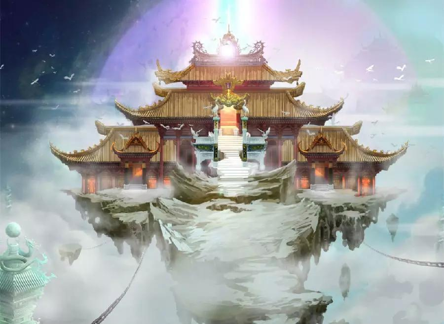

# 第十章　祭天之壇

九曜祭天壇，不在太微玉京城內。

它位於太微玉京正北三百里外的一座獨立浮空神島之上，由九條貫穿雲海的星辰鎖鏈與太微玉京、九曜天宮遙遙相連。遠遠望去，整座神島宛如一尊倒扣的巨碗，碗底朝天，化作一片方圓十里的白玉高台；高台正中，矗立著九根高達千丈的通天祭柱，柱身銘刻著密密麻麻的太古祈願神文。

顧淵與洛寒衣沿著最外側的雲道靠近時，正逢日中——日曜烈陽的光芒正盛，九道粗大的星光光柱從天穹垂落，精準地注入九根通天祭柱的頂端。

而在高台之下、無盡雲海的最深處，卻有另一股浩瀚無邊的氣息，正逆流而上。

顧淵停在距離神島十里外的一處觀雲亭中，沒有再往前走。祭天壇外圍設有極其森嚴的九系聯合結界，每隔百步便有一隊四階神將領銜的巡邏隊，若無九曜神王或至少三位神君聯署的敕令，任何外來者踏入三里之內便會立刻觸發殺陣。

不過，對顧淵而言，十里已經足夠。

破妄真視，無聲開啟。

世界在他眼中褪去了白玉與金光的表象，化作一片令人震撼的法則奇觀——

他終於看清了九曜神域這座龐大信仰機器的心臟。

在高台正下方那片翻騰的雲海深處，存在著數十個大小不一的透明「空間漏斗」。每一個漏斗的另一端，都連通著九曜神域下轄的某一個下界小世界。無數細如牛毛、閃爍著各色微光的絲線，正源源不斷地從那些漏斗中湧出，匯聚成一條橫貫天地、浩瀚如星河的願力洪流，自下而上地灌入九曜祭天壇的底座之中！

那便是下界億萬眾生的祈禱、供奉與祭祀。

有農人祈求風調雨順的質樸暖黃，有海客祈求風平浪靜的清澈淡藍，有慈母祈求稚子安康的柔和銀白，也有戰士祈求凱旋的熾烈赤紅……純粹的願力如百川歸海，美得令人屏息。

然而，與這些純粹願力緊緊纏繞在一起的，是同樣龐大、同樣源源不斷的灰黑色絲線。

貪婪、嫉妒、恐懼、怨毒、絕望。

它們像附骨之疽般黏附在願力絲線上，隨著洪流一同湧入祭天壇。按照九曜神域流傳數萬年的說法，祭天壇本該是一座巨大的「篩濾之器」，將純粹願力分流至九大神系，再將雜質排淨。

可顧淵透過破妄真視，看到的卻是另一番景象。

祭天壇的底座，根本沒有「淨化」這些灰黑絲線。

高台內部的陣紋早已在五萬年的歲月與神戰創傷中變得殘缺不全。當願力洪流沖入壇心時，九根通天祭柱只是粗暴地按照神性屬性，將洪流硬生生劈成九股，連同大部分未經處理的灰黑濁念一起，直接抽送向九曜天宮與各系聖地；而剩下那些實在太過沉重、抽不上去的濃稠濁泥，則沿著太微玉京的星辰鎖鏈一路倒灌回流，順著浮城基座一層層沉降下去——最終，落進了「泥巷」。

「原來如此。」顧淵輕聲自語。

「怎麼了？」洛寒衣立在他身側，順著他的目光望向那座金碧輝煌的巨壇。

「祭天壇不是淨化池，它只是一座漏水的水閘。」顧淵緩緩道，「它把下界所有的祈禱連同七情六慾一起抽上來，好的壞的全塞給神明，塞不下的就倒進泥巷。五萬年來，九曜諸神一直在喝這口越來越渾的井水，卻從來沒人低頭看過井底。」

說到這裡，顧淵的眉心忽然微微一跳。

破妄真視的視線，穿透了祭天壇那層繁複的九曜星辰陣紋，落向了整座神島最底層、最幽深的地脈核心處。

在那裡——

在九曜神域現存所有陣紋的下方，掩埋著另一套截然不同的陣法。

那套陣法極其古老，古樸得不帶半點神域華麗的星辰氣息，反而透出一股與青玄界古仙遺址、與萬界樓太初石基極其相似的蒼茫道韻！它像是一枚巨大的「鎖扣」，死死釘在祭天壇正下方的虛空節點之上。原本，這枚鎖扣似乎還兼有某種「疏導、淨化」的至高權能，可此刻，鎖扣的表面佈滿了觸目驚心的裂痕，數道陰冷、晦暗、帶著極致「飢餓感」的無形細絲，正如同水蛭般緊緊吸附在裂痕邊緣，貪婪地吮吸著從裂縫中滲出的純淨願力！

那股氣息，與議政廳外影月神格深處的那片黑暗，同出一源。

只是更加龐大，更加冰冷，更加令人靈魂發顫。

顧淵緩緩閉上雙眼，收回破妄真視，眼底閃過一抹罕見的凝重。

無名者沒有騙他。

真正把刀架在九曜脖子上的東西，確實不在黑市裡，而在祭天壇下面。

「我們走。」顧淵轉身道，「這裡不宜久留，巡邏隊的氣息已經掃過來了。」

洛寒衣點頭，兩人悄無聲息地退入雲霧，沿著原路返回太微玉京。

---

回到雲闕客舍時，已近子夜。

太陰清輝如水，將整座浮空都城浸在一片靜謐的銀白之中。經過連日來的波折，洛寒衣回房靜坐溫養斷星古劍的器魂，顧淵則獨自留在客舍頂層的露台上，手裡拿著那枚記錄神域線索的玉簡，正對照著今日在祭天壇底座看見的那套古老鎖扣陣紋，反覆推演。

那套陣紋，和青玄界古仙殘念曾提過的「諸天七界封魔鎖鏈」，究竟有沒有關聯？

正思忖間，腰間的樓主玉佩忽然傳來一陣溫潤而急促的震動。

不是警訊，也不是古樓深處那種令人不安的異動，而是——「萬界門時空錨點」被熟悉之人觸發的共鳴。

顧淵動作一頓，抬起頭。

「主人！」靈素清脆又帶著驚喜的聲音在玉佩中響起，「三號門那邊有跨界信號接入！是明月姐姐！她透過樓主玉佩留下的次級錨點，已經踏入太微玉京外城了！」

顧淵眼底瞬間漾開一抹溫潤的笑意。

「把我的位置引導給她。」

「已經引導過去啦！明月姐姐說她不喜歡坐客舍的升降台，自己走雲道上來，估計一盞茶就到！」

靈素話音剛落，不過半盞茶的工夫，露台外的玉階上，便傳來了一陣沉穩、從容、帶著獨特節奏感的腳步聲。

沒有刻意放輕，也沒有半分客居異界的拘謹，彷彿這座高懸九天之上的神域浮城，不過是她大乾皇城裡的一座御花園。

露台的雕花木門被輕輕推開。

夜風吹拂而入，帶著一縷顧淵極為熟悉的、冷冽而尊貴的龍涎幽香。

來人一襲暗紅描金的玄鳥紋長袍，外罩一件墨色星紋披風，長髮以一支簡約的紫金鳳釵鬆鬆挽起，並未戴那頂沉重的九鳳步搖。即便如此，當她站在九曜星輝之下時，那張絕美而帶著侵略性的玉容、狹長銳利的鳳眸，以及舉手投足間渾然天成的皇極威儀，依然讓周遭的星光都彷彿黯淡了幾分。

更讓顧淵微微一怔的，是她周身流轉的氣息。

在滄瀾界時，姬明月的紫霄真龍血脈是內斂於皇道龍氣之中的；可此刻身處九曜神域，在她白皙如玉的頸側與手背肌膚之下，竟隱約有一道道極其細微的淡金色龍紋在緩緩流動，宛如活物呼吸。一股天然的、不弱於神域高階神裔甚至隱隱凌駕其上的尊貴威壓，正不受控制地自她體內散發出來。

連她自己似乎都察覺到了這份奇異的變化。

姬明月站在門檻邊，鳳眸靜靜凝視著露台中央那道青衫挺拔的身影，看了足足三息。

然後，這位在滄瀾界令百官俯首、十萬天策禁衛為之死戰的大乾監國女帝，唇角緩緩勾起一抹極淡、卻足以融化萬年冰雪的弧度。

「顧樓主，」她嗓音清冷磁性，帶著幾分久別重逢後的從容調侃，「才分開不到半月，怎麼把自己弄得一身風塵？看來這神域的茶，不太好喝。」

顧淵失笑，收起玉簡，迎上前去。

他沒有說什麼客套的寒暄，只是自然地伸出手，替她解下肩頭沾染了高空寒露的墨色披風，順手將她微涼的柔夷握進掌心。

「茶確實不如青玄的靈霧茶，也不如大乾御茶房的紫筍。」顧淵低頭看著她，眼底滿是柔和，「大乾朝堂剛穩，你怎麼親自過來了？」

姬明月沒有抽回手，反倒順勢往前靠了半步，任由他的體溫驅散跨界帶來的寒意，鳳眸微微瞇起：「大乾有天策府與老丞相暫理日常，半年內翻不了天。倒是太史令那幾個老頑固，前幾日把皇室秘庫最底層那卷《紫霄天龍殘圖》的夾層破開了——裡頭除了九曜入口坐標，還藏著一段太祖親筆留下的血脈感應秘法。」

她抬起另一隻手，攤開掌心。一縷紫金色的雷龍虛影在她掌心輕輕游動，與天穹之上某處隱約遙相呼應。

「從踏入三號星門那一刻起，我體內的紫霄真龍血脈就一直在沸騰。」姬明月看著掌心的金色龍紋，語氣冷靜卻難掩一絲棋逢對手的興奮，「像是在召喚我，又像是在向我求救。太微玉京的守門神官看見我身上的氣息，連通行神符都沒敢要，直接躬身放行，口稱『不知哪位天曜上族貴人駕臨』。」

「天曜上族？」顧淵眼神微動。

「嗯。」姬明月隨手揮散掌心雷龍，走到露台邊緣，憑欄遠眺太微玉京的萬家神燈，暗紅金袍在夜風中獵獵微動，「看來大乾太祖的來歷，比我原本猜想的還要深。既已來到這裡，本宮總得親眼看看，究竟是什麼東西在等著我。」

她轉過身，背靠著白玉欄杆，鳳眸在銀白月輝下熠熠生輝，定定望著顧淵：

「好了，我的事說完了。顧樓主，這幾日你在這座神域都城裡，都查出了些什麼？別告訴本宮，你只是在這裡喝茶看風景。」

顧淵看著她這副熟稔而強勢的模樣，心頭湧起一股難以言喻的踏實感。

在陌生的神話世界裡，面對腐朽的九曜神權、深不可測的棋算者、虎視眈眈的天行者，還有藏在祭天壇下那股令人靈魂發顫的冰冷飢餓——即便有洛寒衣在側，許多朝堂權謀與制度死結，仍需要一個同樣習慣執棋俯瞰天下的人來共鳴。

而姬明月，正是那個能與他平起平坐、一眼看穿全局的同行者。

顧淵拉過兩張竹椅，又取出一壺早年存在萬界樓裡的大乾御貢紫筍茶，以周天真氣溫熱，親手斟了兩盞，遞給她一盞。

「坐吧。」顧淵溫聲道，「說來話長，今夜星色正好，我慢慢說給你聽。」

---

夜風習習，九曜高懸。

兩人並肩坐在露台的竹椅上，手捧溫熱的茶盞，彷彿不是身處危機四伏的諸天高等神域，而是回到了大乾皇宮的攬月水榭。

顧淵沒有半分隱瞞，將踏入九曜神域以來的所有見聞，條分縷析地娓娓道來——

從太微玉京五層結構與浮城底部的「泥巷」，到蒼律神官當眾失控與洛寒衣一劍洗開日曜焦渣；從昊天神皇在無燈偏殿裡的七千年無奈，到神王議政廳上赤炎神君逼宮、神皇當眾撕開濁泥遮羞布；從昨夜十七處神殿同時爆發、破妄真視看穿的三層濁泥因果鏈，再到今夜天行者核心交易站裡，金面樞密算者的神格黑市拍賣與棋算者「無名」的現身。

最後，他提到了今日在九曜祭天壇底座看見的那套古老鎖扣，以及吸附在裂縫邊緣、帶著極致飢餓感的無形觸鬚。

姬明月一直安靜地聽著，沒有中途打斷一次。

她修長的手指輕輕摩挲著溫熱的茶盞邊緣，鳳眸隨著顧淵的敘述時而微瞇，時而冷冽，時而浮現出一絲瞭然的譏誚。

直到顧淵說完，她才輕輕吹散茶面上的熱氣，淺啜一口，緩緩開口：

「原來如此。這九曜神域看著高高在上，說穿了，不過是一座快要爛透了的皇朝。」

顧淵挑眉看她：「哦？女帝陛下有何高見？」

「高見談不上，只是看慣了朝堂上的爛帳。」姬明月冷笑一聲，語氣裡透著大乾統治者特有的銳利與清醒，「天下萬民納糧賦稅，朝廷開倉放糧、修渠治水，這是君民互濟。可若一個朝廷只知收稅，卻嫌百姓的怨言髒了龍袍，把所有民怨全堵在暗渠裡不准人提，還逼著大小官員裝作天下太平——不出百年，這皇朝必從根子裡爛穿。」

她抬起鳳眸，看向夜空中那九顆巨大而冰冷的星辰：

「九曜諸神，不過是把賦稅換成了『信仰願力』，把民怨換成了『信仰濁泥』。他們享盡了萬界供奉，卻連眾生的喜怒哀樂都不肯直視，還立下什麼『神明不得有七情六慾』的規矩。可笑至極。」

顧淵靜靜聽著，眼中滿是欣賞。

神域諸神困了五萬年的死結，到了這位人間女帝眼裡，不過三言兩語便剝得乾乾淨淨。這正是跨文明視角的威力——帝王同樣是以萬民願力為支撐的存在，只是載體從神格換成了皇位，所以她比任何神明都更懂得「水能載舟，亦能覆舟」的道理。

「更何況，」姬明月放下茶盞，神色轉冷，「這座爛透的皇朝裡，還混進了賣國的鹽商、看戲的幕僚，以及趁火打劫的北狄蠻夷。」

她精準地用大乾的政治格局，對應了天行者、棋算者與諸天蝕者。

「那依陛下看，」顧淵含笑問道，「我們接下來該先動哪一步棋？」

姬明月沒有立刻回答。她側過頭，看著顧淵在星光下顯得格外溫潤沉靜的側臉，忽然伸出手，輕輕覆在他擱在扶手上的手背上。

她的指尖微涼，卻帶著一種不容置疑的力量與溫度。

「棋要一步一步下，急不得。」姬明月的聲音罕見地放軟了幾分，帶著幾分只有在他面前才會流露的私密與依戀，「你這幾日為了救那位金曜老神尊，動用了混沌本源，臉色比在青玄時還清減了些。今晚，不談那幾個老神仙的爛帳了。」

顧淵微怔，隨即反手握住她的柔夷，將她微涼的手指包在自己溫熱的掌心裡。

「不談爛帳，談什麼？」

「談談你，談談我。」姬明月唇角微揚，鳳眸中威嚴盡斂，只餘下一片深沉如夜海般的柔情，「在陌生的神域裡，四面都是算計與暗流，連星辰都長得不一樣。方才走上雲道的時候，我還在想——若這片天穹之下沒有你，便是奪回了什麼真龍神座，又有什麼意思？」

顧淵心頭一暖，輕輕將她拉近了些。

姬明月順勢靠進他懷裡，將下巴輕輕抵在他的肩頭，長髮如瀑般垂落，龍涎幽香縈繞在兩人呼吸之間。她沒有要求更多，顧淵也沒有急切。在這座高懸九天之上的陌生浮城裡，兩個同樣背負著沉重責任的靈魂，只是這樣安靜地依偎在星光下，感受著彼此真實的心跳與體溫，便已足夠驅散所有的孤寒與疲憊。

許久，姬明月在他肩頭輕輕開口，聲音帶著幾分慵懶與鄭重：

「對了，臨行前，太史令讓我把另一段密文背了下來。」

「什麼密文？」

「關於九曜祭天壇的。」姬明月抬起眼，鳳眸在夜色中微亮，「大乾太祖當年離開神域時，曾留下過一句警示：『九曜祭壇之下，鎮非神物，乃太古鎖鏈之樞。若見暗影噬壇、影月無聲，則大劫將起，真龍當歸紫薇，不可坐視。』」

顧淵的目光驟然一凝！

九曜祭壇之下，鎮非神物，乃太古鎖鏈之樞！

這與他今日以破妄真視在祭天壇底座看見的那套古老鎖扣，以及「暗影噬壇、影月無聲」，竟分毫不差地印證了！

「看來，」顧淵輕輕撫過她的長髮，低聲道，「明天晚上，我們得帶上寒衣，去祭天壇的暗道裡走一遭了。」

姬明月在他懷裡輕笑一聲，鳳眸微彎，既帶著帝王的鋒芒，又帶著道侶的默契：

「求之不得。我也想親眼看看，是什麼東西，敢動我大乾太祖留下的這片天。」

夜色漸深，太陰銀輝靜靜灑在露台之上，將相依的兩道身影拉得很長。

遠處，九曜祭天壇的九根通天祭柱在雲海中巍然矗立，神光依舊璀璨，卻無人察覺，在那片光芒照不到的底座陰影裡，一縷極其隱晦的暗紫色霧氣，正悄然滑入鎖扣的裂縫之中。

（第九十八章　完）
