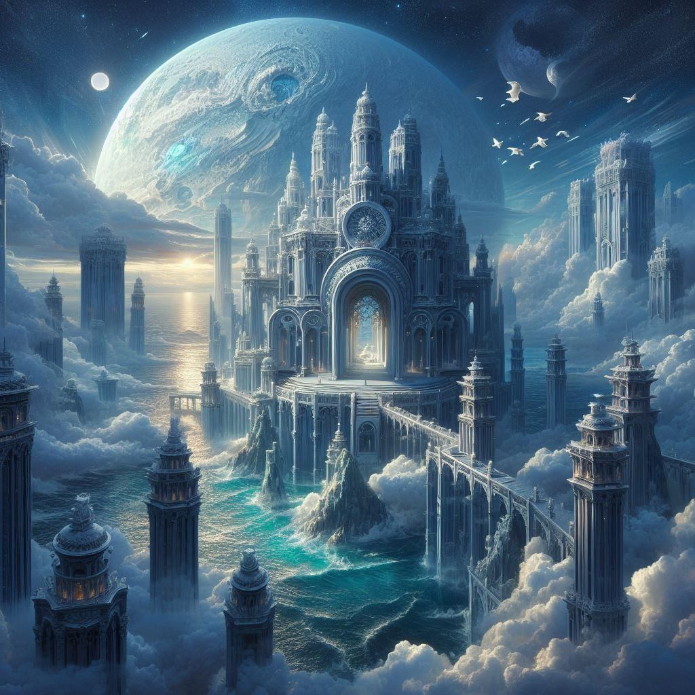

# 第十四章　月華洗滌

翌晨辰時，廣寒月宮依舊浸在一片靜謐如水的銀輝之中。

顧淵推開聽潮閣的木窗，望見庭院外幾株千年古月桂正無聲飄落細碎的銀白花瓣。沒過多久，一道清聖纖秀的月白身影便出現在玉階盡頭——羲凰並未帶隨從，獨自前來相迎。

「先生昨夜可還安好？」她微微頷首，語氣平和而溫潤，「神域月華偏寒，不知外界修士是否習慣。」

「清靜得很好，比太微玉京舒心多了。」顧淵步出聽潮閣，微笑還禮，「有勞少宮主親自引路。」

兩人沿著一條蜿蜒穿過月桂林的白玉長廊前行，先往玄月殿拜見太陰宮主玄月神母。

一路上，顧淵注意到，偶爾迎面走來的太陰月衛與年輕神女，在看見羲凰時都會停下腳步、垂眸行禮，眼中滿是發自肺腑的敬愛與依賴。與太微玉京裡那些神裔面對高階神明時暗藏畏懼的神情截然不同，太陰神宮的上下之間，有一種近乎水乳交融的溫柔秩序。

只是，越是看見這些年輕神女眼中的依賴，顧淵便越能體會到，壓在羲凰雙肩上的擔子究竟有多重。

約莫一盞茶後，兩人抵達了廣寒月宮最深處的玄月殿。

---

玄月殿極大，卻空曠得近乎冷清。

大殿四壁以整塊冰冷的玄玉砌成，殿心懸浮著一輪縮小了千倍的太陰月影，緩緩轉動，灑下如霜般的清輝。玄月神母依舊穿著那襲在神王議政廳上見過的銀白長裙，端坐於殿上玉座，雙手交疊於膝，神色清冷如千年寒玉。

見羲凰領著顧淵步入殿中，玄月神母的目光先在愛徒身上停留了一瞬，隨即平靜地落在了顧淵身上。

「弟子羲凰，見過師尊。」羲凰恭敬行禮，直起身道，「這位便是萬界樓主顧淵先生。昨夜弟子已將赤陽偏殿之事稟報師尊，今日特引先生來見過師尊，隨後便往太陰神格池觀禮。」

「外界之客顧淵，見過太陰宮主。」顧淵從容拱手，不卑不亢。

玄月神母靜靜看了顧淵足足五息，才緩緩開口，嗓音清冷而平穩，聽不出喜怒：「神王議政廳上，本宮見過先生。先生有雙能看透神格的眼睛，連赤炎神火裡的焦渣都能一眼點破。」

「宮主過譽，只是旁觀者清罷了。」顧淵微笑道。

「旁觀者清……」玄月神母極輕地重複了這四個字，眼底閃過一抹極為隱晦的複雜之色，「先生是外界之人，不受九曜法則約束，自然看得清。只是——看得清，未必改得了。」

她轉頭看向羲凰，語氣放緩了半分，卻依舊帶著難以捉摸的距離感：「羲凰，神格池乃太陰神宮核心禁地，從未對外人開放過。你當真決定帶顧先生去看？」

「是，師尊。」羲凰迎上師尊的目光，語氣溫柔卻堅定無比，「太陰神系五萬年來的洗滌之法，已經快走到盡頭了。弟子想讓顧先生親眼看看，或許……外界的視角能給我們指一條不同的路。」

玄月神母沉默了。

她望著自己的弟子，那張常年如玉雕般毫無波瀾的絕美臉龐上，眉心微不可察地蹙了一下。

就在那一瞬，顧淵的破妄真視無聲掠過玄月神母的神格——

和他在神王議政廳上看見的一模一樣。玄月神母的五階太陰神格表面光潔無瑕，可在那層光潔之下，卻覆蓋著一層極其厚重、由她自己親手銘刻的太陰冰封神紋！她不是沒有受過濁泥侵蝕，也不是不知道這套制度的死結；恰恰相反，她在數千年前便已看穿了真相，卻選擇用最徹底的自我封閉，將自己的情感、懷疑與恐懼連同神格深處的隱患一起死死凍住。

她在用「沉默」，替整個太陰神宮維持著表面的安寧。

良久，玄月神母緩緩垂下眼眸，揮了揮素白長袖。

「既是你自己的決定，去吧。」她淡淡道，「只是記住，太陰神格池的規矩不可廢，洗滌之禮亦不可停。九曜神域如今風雨飄搖，太陰神系……經不起額外的動盪。」

說罷，她竟不再看顧淵，也不再多言，重新閉上了雙眼，宛如一尊徹底隔絕於紅塵之外的月玉雕像。

羲凰眼中閃過一絲極淡的落寞，隨即迅速斂去，恭敬地向師尊行了一禮：「弟子謹記師尊教誨。」

轉身步出玄月殿時，長廊上的月風似乎比方才更冷了幾分。

「師尊她……」走出數十丈後，羲凰輕聲開口，像是替師尊解釋，又像是在說服自己，「師尊一向如此。她背負著整個太陰神系的存亡，比我更早見過諸神黃昏後的動盪，所以她最怕的，便是秩序崩潰。」

「宮主心裡什麼都明白。」顧淵平靜地說，「只是她選擇了沉默。」

羲凰腳步微微一頓，側頭看了顧淵一眼，沒有接話，只是輕輕嘆了口氣。

「走吧，顧先生。前面便是太陰神格池了。」

---

太陰神格池，位於廣寒月宮最核心的「冰輪谷」深處。

當兩人穿過兩重白玉月門，真正踏入這座禁地時，顧淵即便早有心理準備，眸光依然微微一凝。

這不是一座尋常的水池。

在巨大的圓形玉殿中央，是一口方圓百丈、深不見底的銀白色神池。池中流淌的並非凡水，而是高度凝練的液態太陰月華，散發著如夢似幻的銀藍微光。在神池正上方，九條由星光編織而成的光帶直通穹頂，連接著九曜祭天壇分流過來的太陰一脈信仰通道。

池心中央，靜靜燃燒著一朵高達三丈、通體冰藍的蓮花狀火焰——【太陰神火】。

此刻，距離月圓之夜的正式大儀雖還有兩日，但每日例行的小型信仰洗滌，卻從未停歇過。

顧淵站在池畔，看見一道道柔和的銀色絲線正從穹頂光帶中垂落入池——那是下界數十個小世界裡，億萬太陰信徒此刻正在發出的祈禱願力。

它們本該如月光般純淨。

可當這些願力絲線浸入液態月華的瞬間，顧淵便清楚地看見，每一道銀色絲線的尾端，都死死拖著一團濃稠、灰黑、不斷扭曲蠕動的陰暗物質！

那些灰黑物質落入池水的剎那，清澈如鏡的太陰月華立刻發出陣陣「滋滋」的悲鳴，池水表面翻湧起一片片渾濁的灰泡。與此同時，無數細碎、雜亂、令人心神撕裂的眾生雜念，竟如潮水般在神池上空迴盪起來——

『月神娘娘，求您救救我兒子的命……為什麼死的是他不是隔壁那戶惡人……』

『求太陰庇佑今夜海浪平息……若能平安歸港，我願獻上十年壽元……』

『她奪走了我的一切，月神啊，讓她在夢裡永世不得安寧吧……』

善念與惡念交織，祈求與怨毒共生，病痛的哀嚎與嫉妒的詛咒混為一團！

在太微玉京的泥巷裡，那些是被稀釋、沉澱過後的冰冷淤泥；而在太陰神格池裡，這是剛剛從億萬活人心中湧出、滾燙、鮮活、充滿尖刺的信仰濁泥！

「太陰神火只能將濁泥從純淨願力中剝離出來，」羲凰立在池畔，月白衣袂在池風中輕輕飄動，嗓音清冷而沉重，「卻無法憑空消滅它們。剝離下來的濁泥若留在池中，不出三月，整座太陰神格池便會徹底污穢，所有太陰神系的後輩神官都會在吸納願力時神格崩潰。」

「所以，必須有人將這些剝離出來的濁泥……接過去。」

話音未落，羲凰並未停步，而是赤足踏上了池心那條延伸向太陰神火的白玉長橋。

「少宮主！」顧淵眉頭微蹙，「今日不是例行大儀，你何必現在——」

「例行大儀是清理整月積蓄，」羲凰回眸看了他一眼，唇角帶著一抹極淡、卻讓人心頭發緊的溫柔笑意，「但若每日不先行分擔，待到月圓之夜，這池裡的濁泥便會溢出去，順著潮汐反噬下界。先生不是想看太陰神系的洗滌之法嗎？請在池畔看清便是。」

說罷，她已步至池心蓮台之上，面向那朵三丈高的冰藍太陰神火，緩緩閉上雙眼，雙手於胸前結出一道古老的太陰印訣。

「嗡——！」

一聲清越而悲涼的月鳴驟然響起！

池中那朵冰藍色的太陰神火驟然大盛，化作漫天銀藍流火，如銀河倒卷般席捲整座神池！翻湧在池水表面的大片灰黑色濁泥，在神火的牽引下被硬生生從純淨月華中剝離出來，化作數十條猙獰扭曲的灰黑長蛇，發出無聲的尖嘯！

下一刻，令人屏息的一幕發生了。

那些被剝離出來的灰黑濁泥長蛇，並沒有被神火焚成灰燼，也沒有被排向虛空——

它們全數調轉方向，如百川歸海般，筆直衝向了蓮台之上那道單薄的月白身影！

「嗤——！」

濃稠的灰黑濁泥瞬間將羲凰清聖如玉的身軀徹底包裹！

顧淵站在池畔，雙目微縮，破妄真視毫不保留地映照出神池中央的一切——

他清清楚楚地看見，當那些滾燙、充滿怨毒與苦痛的濁泥湧入羲凰體內的瞬間，她身後那輪原本就佈滿裂紋的五階太陰神格，發出了一聲極其細微、卻令人靈魂發顫的「咔嚓」脆響！

一道新的、細如髮絲的裂紋，在她神格的邊緣緩緩延展開來。

神格之內，冰藍色的太陰神火拚命燃燒，試圖用她自身的神性本源去包裹、稀釋、鎮壓這些源源不斷湧入的七情六慾。每鎮壓一分，她的神性便黯淡一分；每煉化一絲，那些眾生的痛苦、恐懼與怨恨便如無數根冰針，狠狠扎進她身為神明最脆弱的神魂深處！

月白神袍的領口與袖緣處，那一道道藏在玉膚之下的裂紋銀光，此刻再也藏不住了，在她的頸側與手背上明滅閃爍，宛如一尊即將碎裂的絕世白瓷。

然而，站在蓮台之上的羲凰，從始至終沒有發出一聲痛呼。

她的脊背依舊挺得筆直，指尖的太陰印訣沒有晃動分毫，甚至連眉頭都只是極其克制地微微蹙起。

足足過了一盞茶的工夫。

神池中翻騰的灰黑濁泥終於被她盡數吸入體內，強行封壓進了那輪遍體鱗傷的神格之中。太陰神格池重新恢復了清澈如鏡的銀藍光澤，水面平靜無波，彷彿方才那場觸目驚心的污穢從未存在過。

下界數十個小世界裡，千萬名信徒的夢境在這一刻歸於安寧。

而蓮台之上，羲凰緩緩散去印訣，睜開雙眼。

她的臉色蒼白得近乎透明，鬢邊那兩道天然的銀色月華紋路黯淡了許多，額角滲出一層極細密的冷汗。她站在那裡，靜靜調息了十餘息，直到胸口翻湧的劇痛被強行壓下，才一步步走下白玉長橋，回到顧淵面前。

「顧先生，」她的聲音比方才輕了許多，帶著一絲極力掩飾的微顫，卻依舊維持著太陰少宮主的端莊與從容，「這便是太陰神系五萬年來的『月華洗滌』。」

「日曜神系以神火強焚，留下一身焦渣，越燒越躁；金曜神系以律法強鎮，逼出更多怨恨；水曜神系將濁泥分散倒回下界，治標不治本。」

她望著身後那池重新歸於清澈的太陰月華，眼底那層淡淡的月光，透出無盡的悲憫與孤寂：

「唯有太陰神系，不願讓濁泥再傷及下界眾生，便只能由執掌神火者以自身神格為容器，代眾生受過，日復一日，以自身神性去磨、去化、去扛。」

「我師尊扛了兩萬年，最後不得不自封神格退居玄月殿；我接手了三千年，神格裂了一千兩百年。」

她轉過頭，清澈的目光靜靜望著顧淵，像是在等待一場審判：

「現在，先生親眼看見了。你說……我錯了嗎？」

---

玉殿之中，靜得只能聽見池水輕拍玉岸的聲音。

顧淵看著眼前這位臉色蒼白如雪、頸側還殘留著未曾褪盡的裂紋銀光、卻依然挺直脊背望著自己的神女，沉默了很久。

他沒有立刻回答「錯了」，也沒有說一句廉價的安慰。

他只是看著她，緩緩問道：

「剛才那些聲音——那個求救兒子的母親，那個在海上恐懼風浪的船夫，那個在怨恨裡詛咒別人的女子……你都聽見了嗎？」

羲凰微微一怔，隨即輕聲道：「聽見了。三千年來，每天都在聽。」

「那你聽見的時候，心裡是什麼感覺？」顧淵問。

羲凰垂下眼眸，沉默片刻，如實道：「悲憫。想替他們抹去這些苦痛。可太陰古訓說，神明若動凡心，便會被七情六慾反噬，神格將徹底墮落。所以我不敢同悲，不敢同怒，只能在聽見的那一刻，把自己的心封起來，只把那些污穢裝進神格裡，用神火硬燒。」

「這就是問題所在。」

顧淵的聲音依然平靜，卻在空曠的玉殿中激起一陣低沉的迴響。

「少宮主，你並不是太慈悲了。恰恰相反——」

他抬起眼，目光清澈而銳利地直視著她：

「你根本沒有碰過他們。」

羲凰嬌軀微震，清聖的眼眸中第一次湧起了一絲近乎錯愕的波瀾：「你說什麼？」

「你以為你在替他們承擔苦難，」顧淵一步一步走到池畔，望著那池平靜無波的銀藍月華，「可你把他們的悲傷、恐懼、怨恨全都當成『必須被隔離、被消滅的污穢』，像把垃圾塞進箱子裡一樣，死死塞進自己的神格裡，卻從來不敢真正去理解它們，更不敢讓自己有任何一點像活人一樣的情緒。」

「你不是在救度眾生。你只是把自己當成了一隻越來越大、也越來越脆的垃圾桶——一邊對自己說『神明不該有七情六慾』，一邊拼命吞下全天下的七情六慾。」

「少宮主，這不是慈悲。」顧淵轉回頭，看著她微顫的清眸，一字一句道：

「這叫慢性自殺。」

羲凰的臉色瞬間又白了一分。

三千年來，從來沒有任何人敢用這樣直接、甚至近乎殘酷的話語，去剖析她引以為傲的神道與慈悲！

她張了張嘴，胸口那股被強行壓下去的神格劇痛似乎在這一刻翻湧上來，一股三千年來從未有過的情緒——不是平靜，不是慈悲，而是真實的、灼人的**憤怒與動搖**——猛地衝上了她的眉梢！

「顧先生，」她的聲音第一次失去了往日的溫潤，帶著一絲清冷的鋒芒，「你既非神明，又未曾身負千萬生靈之託，憑什麼站在岸上，如此輕易地否定太陰神系五萬年的堅守？！」

顧淵沒有退讓，也沒有動怒。

他只是靜靜看著她眼中那簇第一次跳動起來的、不再是冰冷月光而是帶著真實溫度的火焰，緩緩說道：

「因為我站在岸上，才看得見你正在往下沉。明日我再去羲凰神殿拜訪——少宮主今日剛剛洗滌過神池，先回去調息吧。我們這場話，還沒說完。」

說罷，他向著神色劇烈震盪的羲凰拱手一禮，從容轉身，步出了這座清冷而沉重的太陰神格池。

玉殿之內，只剩下羲凰一人立於池畔。

她緊緊攥著藏在廣袖中的素手，指節微微發白，胸口起伏不定。

三千年來，她第一次生氣了。

可奇怪的是，在生氣的那一瞬間，她神格深處那道剛剛裂開的新傷，那股原本冰冷刺骨的疼痛，竟然……莫名地減輕了一絲。

（第一百零二章　完）
