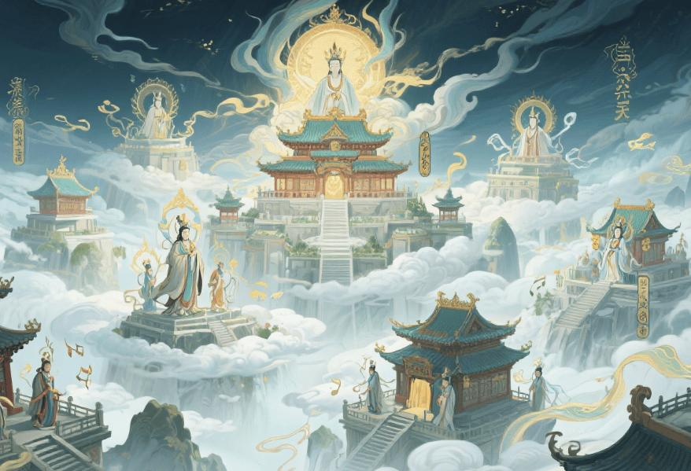

# 第三十五章　九系新章

## 一

神皇祭天壇之戰後的三日，是九曜神域自開闢以來最忙碌、卻也最令人感到久違安心的三天。

沒有血流成河的殺戮清洗，沒有成王敗寇的抄家滅族。

太微玉京上空的九曜星輝，在經歷了昊天神皇混元神格最後那場浩瀚光雨的洗滌之後，徹底褪去了數萬年來長久籠罩在天幕上的那層暗沉與混濁，變得澄澈明淨，宛如一塊被清水擦洗過的水晶。

這三日裡，太微玉京下層市集與「泥巷」的神裔們小心翼翼地推開了緊閉許久的木門。他們先是茫然地仰望著清朗無雲的天空，隨即驚喜地發現，往日裡總是從浮城底座縫隙裡緩緩滲下、令人胸悶作嘔的灰黑色濁泥腥臭氣味，竟然一日比一日淡薄！

在各個城邦的小神殿祭壇旁，神官們第一次沒有像往常那樣催促信徒壓抑情緒、只許獻上無瑕的祈禱詞。依照臨時治理機制緊急傳下的太陰試行章程，神殿外牆掛上了新的木牌——生老病死、憂懼悲歡，皆許如實訴說。而那些原本在痛苦裡掙扎的信眾在真正哭過一場、說出心底恐懼之後，升騰而起的願力反而變得前所未有地純淨平和，化作一道道溫暖微芒，靜靜滋潤著神域地脈。

與下層的生機形成對比的，是這三日裡九曜天宮偏殿晝夜不熄的燈火。

自祭天壇歸來後，顧淵、姬明月、羲凰、赫拉迪雅，連同玄水神君、金曜神君金峰、木曜代表青霖、土曜厚土老者，已經在議事偏殿裡整整磋商了兩天兩夜。柳清虛與洛寒衣並不熱衷神域權謀政務，一個留在廣寒月宮外廊替太陰神格池做最後的陣紋收尾，一個在天宮外飛簷上安靜擦拭斷星古劍，替裡面這群人穩住外圍氣場。

偏殿之內，氣氛遠不像外間傳聞的那般一團和氣——恰恰相反，每一條章程的字句落筆，都在經歷著九大星曜神系最真實的利益交鋒。

「九系各自享有平等的基本議席——這一點，本君可以認。」

長案一側，身披赤金袍服的赤炎神君雖然氣色還帶著大戰後的疲態，神情卻已經重新恢復了一方神系之主的沉凝與銳利。他伸出手指重重按在眼前那卷尚未定稿的《九曜新章》草案上，沉聲開口：

「但諸位莫要忘了！我日曜神系下轄一千二百座下界位面，信眾億萬，邊境巡防的精銳軍團占了九曜四成之多！木曜、土曜加起來也不及日曜一系的三分之一資源！若事無大小皆是一系一票、完全平起平坐，豈不是讓小神系聯手綁住大神系的手腳，到頭來誰也不敢去守外圍星門？！」

「赤炎神君說得沒錯。」

坐在長案主位右側、執掌硃砂筆的姬明月並沒有絲毫動怒，反而平靜地點了點頭，語氣清冷而條理分明，「所以朕在草案第一條下方，已經寫得清清楚楚——**基本議席平等，只是政治與法理制度上的平等，並不代表各神系既有的資源、信眾與軍備底蘊完全平均分配。**」

她將卷宗推向長案中央，鳳眸冷靜地掃過在座每一位神君：

「日常政務與神系內部事務，各系依自身資源自主料理，議會無權干預；凡涉及某神系核心資源分配、信仰版圖重劃或跨界開戰這等觸及神系主權之重大議案，則不能只靠過半數強壓——必須採取更高門檻，至少需獲九系之中三分之二以上議席贊同，且當事神系擁有一次覆議申辯之權。」

玄水神君撫鬚思忖片刻，眼神微亮：「這倒公允。既不讓大系借勢欺壓小系，也防住了小系聯手無理掠奪大系資源。」

「至於神王之位——」姬明月筆尖微頓，看了一眼坐在一旁安靜品茶的顧淵，隨即看向全場，「舊神權時代那種終身執掌、甚至妄圖世襲、把大權集於一身的神王專制，必須徹底終結。但九曜這麼大，不能連一個居中協調的總頭人也沒有。」

「因此，新法之後，**『神王』之位改為由九系議會共推的最高協調者，任期有限，不可世襲，專司跨神系調停、緊急危機召集與對外代表諸天之職——但神王本人，絕對不得兼任三大核心機構的任何主管之職，亦不得單方面修改制度或調動他系私兵！**」

「三大機構？」一直沉默不語的金峰神君眉頭緊鎖，「哪三大機構？」

「治理、監督、執行，三權分離。」

接過話頭的，是坐在姬明月身旁的羲凰。經歷過祭天壇那一戰，這位太陰少宮主不僅神格愈發圓潤穩固，周身氣韻更添了一股讓人無法忽視的清正威嚴。她抬手一揮，三枚不同顏色的光印在長案上空浮現出來：

「其一，**【九系議會】**——由九系代表共同組成，專司制定神域政策、修訂律條與審議跨界大事，**但議會只立規矩，不許直接干預個別神官或祭壇的具體調查**。」

「其二，**【信仰監督院】**——獨立於任何單一神系之外，只負責稽核各大神殿祭壇的願力純度、帳目流向與神格損耗異常。**監督院有權查帳、有權彈劾，但不得私自豢養軍隊，更不得自行發動軍事鎮壓**，以免重演昔日監軍亂政的禍端。」

「其三，**【信仰疏導署】**——全面推廣太陰新法，專門執行下界願力疏導、情緒轉化與神格療癒治理，讓神明真正懂得與眾生共情而不再靠自傷或暴虐焚燒維生。**疏導署雖掌實務執行，卻必須每季接受議會與監督院的公開稽核，絕不許成為第二個黑箱祭壇**。」

赫拉迪雅雙臂抱胸坐在戰神座椅上，聽完這套三權分立的架構，冷笑一聲補了一句：「說白了，就是定規矩的管不著查帳的，查帳的動不了刀兵，拿刀的又搶不走帳本——誰也別想再學過去的日曜或熒惑神殿，關起門來幹那些拿人命填坑的勾當！」

長案另一側，一直顯得緊張拘謹的木曜青年代表青霖連忙點頭附和：「我木曜一系昔日許多前輩，正是為了稀釋濁泥耗盡生機。如今有疏導署統一立規，又有監督院公開稽核帳目，往後我木曜與太陰聯手推動願力淨化，才算真正有章法可循。」

金曜神君金峰卻仍皺著眉頭，語氣沉凝地追問道：「制度固然嚴密，可本君有一事不得不問——若日後真有某個神系暗中私設血祭，監督院查出實據卻無兵可調，而議會表決又一時扯皮拖延，該當如何？」

「很簡單，」姬明月不疾不徐地接話，指尖點在草案附則的最後一行，「監督院無權私自出兵，卻有權持憑實證與議會緊急令符，當即向協調者與熒惑防務部申請執法調兵；凡證據確鑿且涉及濁泥滋生者，防務部必須在三息之內響應，事後再由九系議會共同覆核功過。這樣既不會讓監督院變成第二個軍閥，也不會叫查出來的毒瘤拖到天亮才動手。」

金峰神君聽罷，沉默良久，終究緩緩點頭，不再提出異議。連一向圓滑深沉的水曜神君也笑瞇瞇地拱了拱手，表示水曜一系絕無異辭——心中卻自然已在盤算如何在這套新秩序下重新調整水曜那幾條隱秘商道。

赤炎神君盯著案頭那三枚各司其職、互為制衡的光印，沉默了足足一盞茶的工夫。

他心裡很清楚，這套規矩一旦落地，日曜神系過去那種靠掌握五票暗樁就能強行壓死九曜的時代便徹底結束了，他自己爭了一輩子的至高世襲夢也徹底碎了。但另一方面，只要日曜神系保住了龐大的信眾資源與軍備實力，在三分之二表決門檻與「最高協調者」的角逐裡，日曜依然是九曜最強大、最不容小覷的一極。

「……好。」赤炎神君終於緩緩吐出一口濁氣，目光深深看了顧淵與姬明月一眼，將那份妥協與未消的野心一併藏回眼底，「三權分立，九系共治。這個《九曜新章》，日曜神系……簽了。」

---

## 二

三日後的清晨，九曜天宮議政大殿，鐘鳴九響。

這是自五萬年前遠古神戰紀結束以來，這座神權中樞第一次在沒有任何刀兵脅迫、沒有任何強權專制的情況下，召開屬於整個神域的新生大典。

中央九十九級白玉台階頂端，那張曾經象徵無上專制的九曜神王御座，已經換成了一座簡樸莊重的星辰圓台——日後唯有由九系共推選出的「最高協調者」召開緊急危機議會時才會啟用，平日裡空置以示公器非一人之私產。

台階之下，重新佈置了九張完全等高、圍成一圈的星曜法座。

顧淵並未坐上九系任何一張法座，只是作為這場變革的見證者，一襲白衣從容地站在圓殿東側的觀禮席前。在他身旁，洛寒衣抱劍靜立，柳清虛負手而立，連太陰宮主玄月神母也難得地踏出玄月殿，靜靜站在觀禮席的陰影裡，微笑注視著這一切。

大殿正中，姬明月身著暗金雲紋帝袍，身後紫金真龍虛影內斂如水，清越沉穩的嗓音迴盪在每一根盤神鐵柱之間。隨著她逐條宣讀完《九曜新章》的最終定本，羲凰接過第一枚象徵執掌「信仰疏導署」的白玉印信，赫拉迪雅接掌臨時護衛防務並配合各系建立獨立的「信仰監督院」稽查輪值。

九大星曜神系的首領與代表依次上前，將一縷本命神火印入天宮正中的星辰法碑之上！

哪怕連角落裡經歷過清洗、如今由幾位溫和派長老臨時接管的羅睺神系代表，以及向來冷漠超然的計都神系灰影，都在這股浩蕩的新生大勢之下，鄭重按下了認同的烙印！

九色法光在石碑之上交匯成一道貫穿蒼穹的明亮光柱。

大典散場之後，各系神君陸續步出議政大殿。赤炎神君站在殿外長階的陰影裡，抬頭看著那道不再由單一星辰主宰、而是九系平分秋色的光柱，眼底神色明滅不定。雖然失去了原本唾手可得的獨裁王座，但他身後那十餘名日曜神將依然氣勢沉雄。走在一旁的金曜神君金峰壓低聲音道：「神君，往後這九系議會裡，太陰、熒惑與那個天曜女帝顯然同氣連枝，日曜一系的日子恐怕不好過了。」

赤炎神君冷哼一聲，目光卻投向遠處高天之上那顆依舊熾熱耀眼的日曜星辰：「不好過？那群外來者能替九曜立下規矩，卻不能替九曜永遠養著這億萬信眾。日曜轄下的千二百界域還在我們手裡，三分之二表決門檻也不是替他們一家立的。退一步海闊天空——等這陣風頭過去，議會裡的帳，咱們慢慢算。」

話雖如此，但至少從今日起，那座囚禁了九曜神域五萬年的死水牢籠，終於被真正鑿開了一個透氣的天窗。

---

## 三

是夜。廣寒月宮。

白日裡九曜天宮的鐘鳴、法碑禮讚與各方神君之間的客套應酬，終於隨著夜幕降臨而漸漸遠去。

九天之上的太陰銀月，散發出億萬載未曾有過的溫潤柔光。在太陰疏導新法正式被寫入《九曜新章》、並由信仰疏導署開始向各神域下界推廣之後，廣寒宮地脈裡那股沉澱了數千年的冰冷死寂與沉重哀嘆，竟在不知不覺間散得乾乾淨淨。

月桂古林在夜風裡輕輕沙沙作響，清香悠遠，再沒有半點濁泥腐氣。

顧淵負手立於羲凰神殿後方的「觀星懸台」之上——幾天前他就是在這裡用破妄真視替羲凰拆解神格裂紋，而今再站回同一塊白玉高台，腳下那片雲海之外的太微玉京燈火，竟比當時看起來安穩溫暖了十倍不止。

夜風拂過他寬大的青白長袍，身後傳來極輕微的環珮輕響。

羲凰款步走來。

今夜的太陰神女，褪去了白日裡在九曜天宮大殿上接受各方神君行禮時的那襲莊嚴法衣與禮冠，換上了一襲薄如蟬翼、宛如月水織就的銀白流光紗裙。三千青絲僅用一根素雅的白玉簪輕輕挽起，幾縷墨髮隨風垂落在白皙如玉的耳際與肩頭；眉心那枚曾經佈滿裂紋的弦月靈紋，此刻不僅圓潤完整，更透出一層令人心醉的柔潤清輝。

她手中捧著一隻托盤，上面放著兩盞剛用冰輪谷清泉沏好的太陰月露新茶，行至顧淵身側，雙手遞上一盞。

「大典忙了一整天，怎麼一個人躲到這高處吹風？」她的嗓音清甜甘冽，宛如深山寒泉擊碎美玉，眼角彎出一道極溫柔的弧度。

顧淵接過溫熱的茶盞，目光望向遠處平靜祥和的太微玉京，溫和一笑：「在看這座城。比我剛跨過三號星門那一天，多了許多活生生的煙火氣。」

羲凰立於他身側，與他並肩憑欄而立，任由夜風輕輕吹拂著薄紗羅裙，美眸倒映著漫天璀璨星輝。沉默了片刻，她的神色忽然變得有些悠遠，卻透著徹底的釋然：

「白日裡從九曜天宮回來的時候，我繞去玄月殿看了一眼師尊。」

「宮主怎麼說？」顧淵側頭問。

「她把最後半截自封的太陰冰壁解開了。」羲凰輕聲說著，唇角泛起一抹極為動人的暖意，「她坐了兩萬年不敢開口的死局，如今看著三權分離的新章立起來，居然笑著跟清霜討了一壺桂花釀。那是她親手埋在月桂古林底下的陳釀，埋了足足八千年，從沒想過還有打開的一天。」

「我們師徒倆坐在玄月殿外頭的小石桌旁，沒談什麼太陰古訓，也沒有提半句三權制度。」羲凰看著杯中微晃的茶水，眼裡滿是柔暖的懷念，「她只幫我倒了一杯酒，跟我說，『羲凰，這三千年我把所有神系的體面都壓在你一個小丫頭肩上，對不起你。以後這廣寒月宮，你不用再像我當年那樣整天把自己關在神池裡了——去看看你想看的人，去過你自己想要的日子吧』。」

說完這話，羲凰轉過身，背靠著白玉欄杆，靜靜凝視著身邊這個白衣青年。

清澈如水的眸子裡，翻湧著與月圓之夜截然不同的情感波瀾——

「顧淵，」她聲音輕輕的，卻字字無比清晰，「自我三千年前覺醒太陰神格的那一天起，我就被告知，神明是這片天地的守護者，更是這方天地的祭品。哪怕上一次在月圓之夜，我走進神殿找你、選擇去觸碰七情六慾……說到底，當時我的心裡還是裝著一半『為了學會怎麼拯救眾生、為了不讓自己碎掉』的執念。」

顧淵握著茶盞的手微微一頓，安靜地看著她。

羲凰向前邁出半步，距離他近到能看見自己映在他眼底的清晰輪廓。她伸出微涼而纖細的手指，輕輕替他撫平被夜風吹皺的一角衣領，眼底月光柔和得幾乎能化開冰雪：

「直到這場大戰結束，直到神皇以身補天、直到今日九系新章正式寫定、信仰疏導署也交到了我手裡……所有該扛的責任都已經落到了實處，再也不需要我用燃燒自己去換任何東西了。」

她深深吸了一口氣，白皙如滿月的臉頰在星輝下悄然泛起一抹極動人的淡霞，說出了那句在心裡琢磨了整整三天的話：

「這一次，沒有什麼使命，沒有什麼神格危機，也不是為了替誰承擔什麼。」

「我只是突然發現——過去三千年裡，我從來沒有真正為自己活過哪怕一個夜晚。」

「顧淵，」這位高潔清聖了三千年的太陰少宮主抬起清亮的眸子，毫無掩飾、卻又帶著幾分神女獨有的羞澀與鄭重望著他，「不再是為了眾生，只是為了我自己……今夜，我想要這樣陪在你身邊。」

顧淵聽著這番話，心中最柔軟的那一處彷彿被一縷極溫潤的月華輕輕擊中。

相比於月圓之夜那場帶著「試探新路、癒合傷痕」的深沉交付，今夜的羲凰，才真正完成了她三千年生命裡最徹底的一次重塑——她不再是一尊只能靠拯救他人來證明存在價值的神像，而是一個真正擁有獨立靈魂、敢於坦率說出「我想要」的女子。

顧淵將手中的茶盞輕輕放在身旁的白玉欄台上，伸出手，溫柔而堅定地握住了她微涼的素手，將她輕輕帶進自己懷裡。

「能被已經不需要任何人救贖的太陰神女選中，」顧淵低頭抵著她的額頭，嗓音低沉而溫柔得能化開萬載寒霜，「是顧某的榮幸。」

羲凰展顏一笑。

那笑容裡再無半分三千年的清苦與愧疚，如同萬載冰川在春風中剎那消融，美得令九天星河都為之黯然失色。她主動仰起臉，雙臂輕輕環住顧淵的頸項，主動將自己微涼而柔軟的紅唇，輕輕貼上了他的唇畔。

---

## 四

神殿深處，太陰寢宮。

與月圓之夜那次敞開穹頂天窗、任由萬丈星河傾瀉而下的莊重儀式不同，今夜的太陰寢宮裡，淡銀色的輕紗羅帳微微垂落，殿角只燃著兩盞散發暖光的月露清燈，將整座寢殿烘托得靜謐、私密而又格外溫存。

太陰玄冰雕琢而成的寬大玉榻上早已鋪滿了厚實溫暖的月絲錦衾，在兩人逐漸升溫的呼吸與擁抱之間，空氣裡悄然漫開一縷極清雅的月桂甜香。

唇齒相依，呼吸交纏。

已經歷過一次靈肉交融的羲凰，今夜不再像最初那樣緊繃生澀。她微閉著雙眸，順從而熱烈地迎合著顧淵的深吻，素手穿過他的黑髮，指尖因為情動而微微收緊，喉間溢出一聲聲極輕、極柔婉的細碎低吟。

銀白流光紗裙的繫帶在她自己的手指與顧淵指尖的交錯輕挑下，如月水般層層褪去，滑落榻角。

在柔和溫暖的燈影與透過窗欞灑進來的皎潔月華映照下，羲凰那具完美得近乎天道造物的神女仙軀，再次毫無保留地展現在顧淵眼前——

肌膚勝雪，溫潤如最上等的羊脂寒玉；圓潤削薄的香肩與精緻鎖骨之上，曾經那幾道觸目驚心的神格裂紋早已癒合得不見半分痕跡，只留下一片細膩無瑕的冰肌玉骨；胸前峰巒傲然挺立，隨著她略顯急促的呼吸微微起伏；纖細柔韌的柳腰之下，是飽滿流暢的曲線與修長筆直的雪白雙腿，每一寸肌膚都散發著純淨神聖的太陰氣息，卻又因為徹底卸下了神明的枷鎖、只為眼前男子而動情，從耳根到肩頭皆泛起了一層誘人至極的淡粉霞彩。

顧淵沒有半點急切，他像是在對待世間最珍稀的瑰寶一般，俯下身，先是用雙手溫柔地捧住她的臉龐，將吻一點一點地落下——吻過她額心圓潤無瑕的弦月靈紋，吻過她輕顫如蝶翼的長睫，吻過她昔日曾滿是傷痕、如今卻光潔溫熱的鎖骨，最後帶著無限疼惜與珍重，一路向下撫慰。

「唔……顧淵……」

羲凰仰面躺在素白錦衾之上，墨髮散落如雲，原本清冷克制的嗓音早已被濡染成一片柔軟的春水。她伸出雙臂環住顧淵的肩背，主動分開修長瑩潤的雙腿，清澈的水眸睜開一條縫隙，帶著幾分迷離與全心全意的依賴望著他，輕聲呢喃：

「我想要你……真真實實地，感受你在這裡……」

顧淵心頭一熱，俯身深深吻住她微啟的朱唇，一手扣住她纖細得不盈一握的柳腰，在兩人神念相感、呼吸徹底融為一體的那一瞬間，沉穩而溫柔地與她再度結合在一處。

「啊——……」

沒有了最初破開冰牆時的撕裂與疼痛，也沒有了過去因神格受損而產生的絲毫滯澀。

取而代之的，是兩具早已在生死與大道之間建立起最深默契的軀體，在水乳交融的瞬間便直抵靈魂最深處的圓滿契合！

一股溫潤浩瀚、宛如春陽融雪般的混沌純陽氣息，順著兩人相連之處源源不斷地渡入羲凰體內；而羲凰體內那條早已暢通無阻的太陰「轉化之河」，亦化作漫天溫柔清冽的銀白星霧，歡欣鼓舞地回流反哺進顧淵的奇經八脈！

【魂靈相契】！

「嗡——！」

就在兩人陰陽神性徹底交匯流轉、進入《太上玄奼真經》深層共鳴的那一剎那，廣寒月宮正上方的那輪太陰銀月，再次為之發出一聲低沉而和諧的清越長吟！

不同於《月圓之夜》那場如銀河倒懸、驚動整座月宮的天地巨變，今夜的異象柔和、綿長而又無比璀璨——整座西峰之上，漫山遍野剛剛經歷過大戰的千年古月桂樹同時綻放出萬千朵晶瑩剔透的銀色花蕾！花瓣伴隨著溫柔的月風紛紛揚揚飄起，如同給整座廣寒月宮披上一層流動的銀雪輕紗。

遠在冰輪谷底的太陰神格池裡，那朵原本需要靠神女日夜燃燒神性去安撫的冰藍太陰神火，此刻安靜得像是一盞守護家庭的暖燈，隨著西峰上那兩道徹底交融的神念節奏，輕輕跳動出喜悅而平和的韻律。

漫天月華化作柔和的銀霧輕輕籠罩在神殿穹頂之上，既不張揚，也不狂暴，彷彿整片太陰天地都在靜靜守護著這場屬於神女自己的溫柔之夜。

---

## 五

芙蓉帳暖，羅帷微晃。

在長達兩個時辰的極致纏綿之中，神殿內靈霧翻湧，月華如水。

這是一場沒有任何沈重任務、沒有任何生死逼迫、純粹屬於相愛兩人的深層共鳴。顧淵以從容而不失力量的深淺節奏，耐心地引導著這份跨越三千年的情感一點點綻放到極致；他的指尖拂過她微濕的眉眼，溫熱的唇一次次安撫過她敏感戰慄的頸側與耳垂，在每一次神魂深處的共鳴浪潮推來之前，總先給足她喘息與依賴的溫度。而徹底重塑自我後的羲凰，更是將這份遲來了三千年的熱烈情意毫無保留地傾注在每一個回應裡。

清冷高潔的太陰神女，徹底化作一汪繞指春水。

她時而雙臂緊緊攀住顧淵的脖頸，在男人溫熱的胸膛間急促喘息，感受著那顆活生生跳動的心臟與自己神魂同頻震動；時而又像是第一次學著任性的小女孩一般，故意收緊雙腿將他拉得更深，在極致的神格共鳴浪潮中仰起修長雪白的玉頸，迎著那彷彿要將靈魂也一併揉碎再重聚的深情律動，發出一聲聲令人心弦狂顫、嬌媚而又無比純淨的動人啼鳴。

沒有神話文明的枷鎖，沒有億萬信徒哭嚎祈禱的雜音。甚至連神殿外那片始終存在於耳畔的天地因果之聲，都在這一夜安靜地退到了門外。

在這一夜的每一個瞬間裡，她不再是太陰神宮少宮主，也不再是執掌信仰疏導署的五階神尊——她只是他懷裡最溫柔、最被珍惜、也最敢貪戀這點人間溫暖的道侶。

不知過了多久，當月露清燈的燈芯靜靜燒過了第三截，當最後一波如同天河春水般綿長而圓滿的神魂共鳴在兩人本源最深處轟然綻放時——

羲凰發出一聲近乎失神的長吟，清眸溢出一層晶瑩的水霧，整個人在極致的戰慄與圓滿之中緊緊抱住顧淵的肩背，徹底軟倒在了溫熱的懷抱之中。

神性歸元，法則安寧。

過了許久，狂熱的浪潮漸漸平息，唯餘微促的喘息與緊密貼合的心跳聲。

顧淵替她拉過滑落肩頭的素白月絲薄被，動作輕緩地拭去她額角與鬢邊那層細密的香汗，隨即才在她光潔的眉心輕輕落下一吻。

羲凰側臥在顧淵寬闊溫暖的臂彎裡，臉頰緊貼著他堅實的胸膛，烏黑柔順的青絲如瀑般鋪散在兩人之間。一隻素白纖細的手指無意識地在顧淵心口輕輕畫著圓圈，那雙平日裡看盡滄桑的明眸此刻水波瀲灩，眸光繾綣如蜜，嘴角還帶著一抹饜足而羞澀的淺笑。

「顧淵……」她輕聲喚他，嗓音軟糯得彷彿在夢裡。

「嗯？」顧淵低頭看著她，指腹溫柔地摩挲著她泛紅的耳尖。

「我以前總覺得，神明長生不老是一場無休止的孤寂折磨，」她微微仰起頭，清澈的眼眸在昏黃月燈下定定地看著他，伸出微涼的唇瓣在他下巴上輕輕落下一吻，聲音輕柔卻無比認真，「千年萬年地坐在神壇上，聽不完的苦痛，洗不完的濁泥，永遠也沒有盡頭。有時候看著下界那些壽元不過百年的凡人，看他們一輩子只愛一個人、只守一間屋子，我心裡甚至還會羨慕。」

「但現在……我突然有些慶幸自己是個神明了。」

顧淵挑眉失笑，握住她作怪的小手放在胸口：「為何？」

羲凰往他懷裡縮近了半分，眼角彎成一輪最圓滿的月牙，輕聲道：

「因為長生……便意味著在未來的萬萬載歲月裡，無論青玄、滄瀾還是這九曜神域，我都能有足夠長、足夠多的時間，一直這般看著你，陪在你身邊。」

顧淵心頭微熱，看著她徹底從苦行僧般的枷鎖裡走出來、終於敢許下這麼自私卻這麼動人的願望，忍不住低頭含住她的唇瓣細細吻了一會兒，低笑道：「那說好了。日後等我把萬界的事情理順了，我也帶你去青玄界和滄瀾界走一走，看看凡間的花燈與長街。到時候，我介紹清虛、玄清、明月、玥兒她們都給你好好認識一下。」

「嗯，說好了。」羲凰心滿意足地笑起來，眼波裡沒有半分懼意，反而隱隱透出幾分對那座萬界樓裡的熱鬧光景的期待，「清虛掌門人很好，祭天壇那一戰若不是她帶著太清定星盤趕來，我的月輪早就裂開了；明月陛下的帝王氣度更是讓我佩服……等哪天我們幾個真的湊到一塊兒喝茶，一定很有意思。」

說罷，她又想起了正事，閉上眼靠在他懷裡輕聲規劃著明日的政務：「對了，明日信仰疏導署正式掛牌，赤炎神君雖然簽了新章，肯定還會在議會裡挑刺。不過沒關係，赫拉迪雅幫我盯著兵權防務，清霜也已經把第一批新法典籍抄錄完畢了，天亮之後，我們便能——」

話說到一半，神女終究抵不過事後那陣令人安心的極致慵懶，聲音漸漸低了下去，在顧淵溫柔的懷抱與均勻的心跳聲裡，安安穩穩地沉入了香甜的睡夢。

---

而在這溫存徹底落幕、夜色最靜謐的時刻。

遠在無盡虛空深處的萬界樓本源殿內，那一尊玄妙太極陣圖再次泛起一層清冷溫潤的銀白霞光，一縷精純至極的太陰本源隨之悄然回流歸位。

顧淵枕畔的樓主玉佩極輕微地顫動了一下，靈素那壓得極輕、充滿柔和笑意的嗓音在神念深處響起：

「主人……羲凰姐姐的太陰神格已經徹底圓滿無瑕啦。古樓本源回流已定——修復度已達四百八十，百分之四點八啦！距離那道五百大關的門檻，只差最後一步了呢……」

玉佩很快恢復沉寂。

窗外月桂飄香，銀輝靜靜灑落滿室，照著相擁而眠的兩人，一夜安寧。

（第一百二十三章　完）
