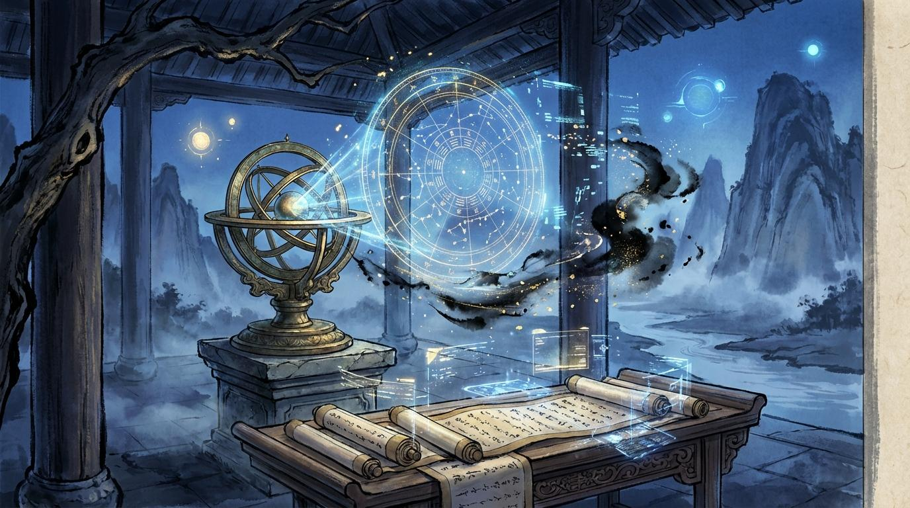

# 第三十六章　神藏顯現

## 一

九系新章頒布之後的第十日，太微玉京的天空，呈現出一種歷經五萬年沉悶之後罕見的清澈與明亮。

晨光穿過澄淨無雲的星海，灑在太微玉京五層浮城錯落有致的白玉飛簷之上。昔日總是在晨霧裡透出一股腐朽腥氣的第五層「泥巷」，如今竟已經拆去了半數封堵通風的舊石牆——在信仰疏導署與日曜、太陰兩系調派的工匠合力疏通之下，原本淤積在地脈暗渠裡的陳年濁泥被一點一點引出洗淨，取而代之的，是幾座剛剛立起來的公共月露淨水泉眼。

下層市集裡，幾個賣星燈與神域香料的年輕神裔正興高采烈地支起攤棚，遠遠看見一隊佩戴著「信仰監督院」白銀星秤徽記的巡查神官從長街走過。若是擱在半個月前，這種時候小販們早該嚇得抱頭縮進暗巷裡；可今日，那名帶隊的金峰系中年神官只是停下來例行核對了一遍街口小神祠的願力帳冊，確認沒有人私下克扣香火或強徵供奉，便點點頭繼續往前巡視，半句多餘的盤剝也沒有。

同一時刻，太微玉京外城那條連接大乾與九曜神域的跨界貿易棧橋上，三艘懸掛著萬界商盟青金旗幟的浮空靈舟正緩緩降落，卸下第一批來自青玄界三洲的靈茶、陣材與大乾工部特製的民生器具。

這場從天宮延燒到市井的新秩序，正以一種出乎許多老神明意料之外的平穩姿態，一點一點在九曜的土地上生根發芽。

而在九曜天宮西北角的跨界星門廣場前，今日清晨迎來了一場短暫的送行。

姬明月重新換上了那襲象徵大乾帝王威儀的玄黑紫金龍袍，青絲高挽，唯有掌心隱沒著那枚隨時能與紫薇天關遙相感應的天曜真龍神印。雖然九系議會剛剛步入正軌，但她心中清楚，大乾皇朝那邊同樣離不開帝王坐鎮，且經過這次紫薇天關之行，她手裡已經握有了重塑大乾百年國運的太古皇道傳承。

「九系議會的第一輪輪值章程已經定下，」姬明月站在萬界門的光幕前，轉過身看著並肩來送行的顧淵、羲凰與洛寒衣，神態從容而篤定，「赤炎神君那頭雖然還有日曜與金曜不少保守長老替他撐腰，但三權分離的架子已經立起來了。只要太陰與熒惑握緊監督與防務的實權，短時間內他翻不起大浪。更何況，天曜的一票我已托付給太陰代掌，真遇著大事，玉符一震，我隨時跨界回來。」

羲凰站在身側，手中提著一只裝滿廣寒月桂露與新法典籍副本的錦盒遞給她，溫聲道：「大乾那邊萬事繁雜，陛下路上小心。等九曜這邊的疏導署徹底理順，我亦想找個機會，去看看陛下治下的承天京。」

「朕隨時掃榻相迎。」姬明月接過錦盒，唇角揚起一抹淡笑，隨即目光移向旁邊抱劍而立的洛寒衣，「寒衣，我們在滄瀾的帳也還沒算完，等樓主把這頭的事忙完了，回承天京喝一杯？」

洛寒衣淡淡點了點頭：「可。」

最後，姬明月的鳳眸落在顧淵臉上，眸底原本的帝王威儀悄然化作一抹極私密的溫柔：「說好了，忙完之後，先回一趟青玄，再來承天京。」

「一定。」顧淵上前替她理了理被星風吹動的披風領口，溫聲道，「去吧，大乾的江山還在等它的皇帝。」

金光一閃，紫霄女帝的身影從容踏入星門，消失在通往滄瀾界的浩瀚光影之中。

與此同時，另一道素青色的身影也已經整理好隨身行囊。柳清虛站在不遠處的石階旁，手中的八卦星盤早已經收起，她只簡單地向顧淵與羲凰道了別——青雲觀那邊還有新入門的弟子要安頓，沈玄清亦在等她帶回祭天壇最新測繪出的鎖鏈穩定數據，以便繼續推演七界封魔陣的下一步防護。

「青玄界的山門大陣已經按這次的經驗重修過一遍，」柳清虛看著顧淵，清眸澄澈平靜，「沈太上與慕容玥都在青玄等你。路上不必急，我們都在那邊。」

「替我向師尊與玥兒帶句話，」顧淵溫潤一笑，「這一次，用不了多久。」

柳清虛微微頷首，轉身同樣步入了通往青玄界的星門通道之中。

送走兩位各自肩負一界重任的故人，羲凰也很快趕回廣寒月宮——信仰疏導署剛剛掛牌運作，今日正有一批來自水曜神系與木曜神系的年輕神官前來請教「轉化之河」的心法要義，玄月神母難得親自出面幫她壓陣，千頭萬緒都等著她去定奪。

臨別前，羲凰站在星門廣場邊的玉欄旁，替顧淵整了整白衣衣襟，輕聲笑道：「你明日一早就要動身前往熒惑赤淵了吧？幫我跟赫拉迪雅帶句話——她送來月宮的那幾壇熒惑烈酒，師尊嚐了一口便說太烈，全讓我收起來了，等下次她們來月宮聚會再開。」

「好，我一定帶到。」顧淵含笑應下。

---

黃昏時分，顧淵攜著洛寒衣，乘雲舟自太微玉京一路向東南飛行，穿過層層疊疊的赤紅雲海，重新降臨在永燃戰火的聖地——熒惑赤淵。

短短十日不見，這座昔日總是瀰漫著濃烈血腥與怨氣的裂谷戰場，竟也已經徹底換了一番氣象。

昔日那座高聳陰森、暗地裡抽取戰士亡魂榨取血煞願力的「戰魂祭壇」已經被徹底夷為平地，原本滿是焦黑血泥的死火山口如今立起了一座莊嚴簡樸的玄鐵紀念碑，碑面上密密麻麻刻著過去三百年裡所有莫名戰死在黑風谷與落日嶺的赤煌戰士姓名。碑前擺滿了軍中袍澤自發採來的赤焰草與烈酒，再無半絲怨煞哭嚎之氣。

遠處校場之上，原本兩萬名赤煌精銳與一萬兩千名剛剛收編進來、經過三個月考核重新整編的舊神殿衛隊，正在老副將石破天的口令之下整齊操練。戰吼震天，卻不再是過去那種帶著瘋狂嗜血氣息的狂躁嘶吼，而是每一拳、每一戟都透著純粹的鐵血與自豪——那是赫拉迪雅親手傳授下去的「戰魂自煉法」正在這支鐵血軍團裡生根。

「顧先生！寒衣姑娘！」

看見兩人走進營地，滿臉刀疤的石破天連忙大步迎上來，雙手抱拳行了一個極鄭重的軍禮，臉上滿是發自內心的笑意，「將軍剛在戰功堂核對完這季度的陣亡撫恤與新兵軍餉，正提著酒等二位呢！」

洛寒衣在營門口看了看校場裡那些即便沒有神殿加持、依然神火旺盛的熒惑戰士，冰冷的眼眸裡閃過一抹極淡的讚賞，對石破天微微頷首後，便自顧往營地東側一座安靜的玄岩劍台走去——她向來不喜歡湊熱鬧，正好趁著夕陽練一會兒劍，讓斷星古劍再適應一下赤淵地底殘存的戰伐道韻。

顧淵則獨自穿過整齊列隊的營帳，來到赤淵最深處、那頂熟悉的巨大赤紅戰陣帥帳之外。

掀開厚重的帳簾，一股醇厚辛辣的烈酒香氣混著溫暖的炭火熱意撲面而來。

「來得正好！」

帥帳之內，赫拉迪雅正盤坐在那張鋪著赤紋虎皮的寬大帥座之上，手裡提著一壇剛剛拍開泥封的「赤淵千年釀」。看見顧淵走進來，她仰頭暢快地喝了一大口，抬手豪邁地擦去唇邊酒漬，將另一隻早已倒滿烈酒的粗陶大碗朝顧淵推了過去：

「別跟我客氣！今日不喝清茶，陪我喝一碗！」

這位名震神域五千年的女武神，此刻早已經卸下了平日裡穿戴在身、重逾千斤的暗金戰鎧，只著一襲勾勒出修長矯健、充滿爆發力與健康美感線條的貼身黑色武者短袍。赤金色的長髮隨意束在腦後，一雙修長有力的蜜色長腿舒展在暖融融的獸皮毯上，肩背與手臂肌肉流暢緊緻，透出一種歷經萬戰卻徹底卸下重擔後的野性英氣與從容。

顧淵笑著走過去，在她對面的矮几旁盤膝坐下，並沒有如她所料那般拿折扇推辭，而是乾脆地端起那隻沉甸甸的粗陶酒碗，仰頭一口飲盡！

辛辣滾燙的烈酒順著喉嚨一路燒進丹田，隨即化作一股澎湃溫暖的熱流散入四肢百骸。顧淵放下酒碗，眼底笑意溫潤：「不錯，比太微玉京酒樓裡賣的那些摻水貨烈得多。」

「哈哈哈，這可是老娘……咳，這可是我藏在岩洞底下的私房酒，連石老頭平時都討不到兩口！」

赫拉迪雅大笑起來，眼底卻帶著幾分促狹的審視盯著他，「聽說赤炎那個老東西昨天又在九系議會裡拍桌子了，嫌你給熒惑軍團留下的獨立巡防權太大，還拿『赤煌軍團裁汰監軍太快、導致神殿神衛招不到人』這種廢話去向姬明月和羲凰施壓？」

「那都是朝堂上的拉鋸，你既成了九曜軍事防務的實權支柱，他心裡忌憚也是正常的。」顧淵替自己又倒了半碗，神色淡然，「只要他沒忘了祭天壇上那一幕，這十年八年裡，他便只敢在議事廳裡拍桌子，不敢真在戰場上動手。」

「理他作甚！」赫拉迪雅嗤笑一聲，抓起案几旁一塊剛烤得滋滋冒油的靈獸炙肉撕下一條，隨手拋進嘴裡嚼了兩口，隨即把雙手搭在膝蓋上，目光忽然從方才的豪邁調侃慢慢沉靜下來。

帳內炭火噼啪作響，赤紅色的火光在她極具立體感的深邃五官上跳躍不定。

她靜靜看著對面的青衫男子，盯了足足有十息之久。

「顧淵，」這位一向大大咧咧、說話從不繞彎子的女武神忽然開口，嗓音低沉而認真，「問你一件事。」

顧淵放下手中的酒碗，迎上她那雙燃燒著兩簇溫暖神火的亮眸：「你問。」

「還記得在戰神廣場那一夜，我親手斬了鐵赤、毀了戰魂祭壇之後，拉著你回這座大帳嗎？」

「記得。」顧淵唇角微揚，「那天夜裡，你拿熒惑神火按在我們心口，立下了戰士之間最高等級的『神魂誓約』。」

「是啊，那時候……我以為自己想得很清楚。」

赫拉迪雅緩緩站起身來，赤著雙足踩在厚實柔軟的獸皮毯上，一步一步繞過矮几，走到顧淵面前停下。她並沒有居高臨下地逼視他，反而緩緩彎下膝蓋，在他身前半步處蹲下身子，雙手輕輕搭在他的膝頭，仰起臉直視著他的眼睛。

那雙在五千年征戰裡從未流露過半分膽怯或迷茫的眼眸裡，此刻竟透出一種令人心頭微顫的坦誠與深沉情感：

「那一夜我找你立誓，一半是因為你幫我揭穿了祭壇的黑幕、替我守住了三萬弟兄的英靈；另一半，是因為我看重你的智計與擔當，認定這場對抗腐朽神權的大仗，唯有把後背交給你，我們才能贏。」

她頓了頓，伸出一隻帶著薄繭、卻滾燙得令人心跳加速的手掌，輕輕覆在顧淵的心口之上，感受著他衣衫底下沉穩有力的心跳聲：

「可直到後來去了祭天壇，親眼看見那片能把天地規則都抹平的高維天災壓下來的時候——當我跟洛寒衣在前面死戰、當我聽見你在後面一次次精準叫破規則破綻、把所有人護在陣眼最安穩的節點裡時……我才突然想明白一件事。」

赫拉迪雅微微揚起唇角，那張英氣勃發的臉龐在跳動的火光裡顯得無比動人，眼神熾烈得彷彿能將整座大帳點燃：

「顧淵——我以前以為，我赫拉迪雅一生不輕許人，那夜向你立誓，是為了找一個配得上站在我身後的戰場盟友。」

「但現在我知道，我立誓……不只是為了盟友，也不是為了熒惑軍團，更不是為了那場仗——我立誓，是為了一個讓我真正願意把全部自己交出去、讓我打從心底相信的人。」

帳內一片寂靜，唯有炭盆裡紅焰無聲升騰。

顧淵低頭看著眼前這位五階戰伐女武神。

五千年從未低頭的脊背，在戰神廣場敢孤身一人直面一萬兩千名叛軍、在祭天壇敢拿丈二長戟硬撼高維規則投影的絕代強者，此刻卻坦率得像一團毫無雜質的烈火，把一顆滾燙赤誠的心毫無保留地捧到他面前。

「誓約在戰場立下，」赫拉迪雅看著他的眼睛，嗓音帶著一絲罕見的低柔，卻又透著不容置疑的驕傲與決絕，「那是刻給天地與軍旗看的。今夜……我想讓它真正刻進我的靈魂裡。」

「戰局已定，神域也已經安穩了。」女武神微微俯身，鼻尖幾乎貼到他的臉頰，滾燙而帶著烈酒清香的氣息噴灑在他頸間，一雙亮眸灼灼發亮，「顧淵，我依然是統領赤煌軍團的赫拉迪雅，誰也別想讓我躲進後院做一個只能等人的女子。但除此之外——這份刻入骨髓的神魂道契，你敢不敢跟我走到最深處？」

---

## 二

赫拉迪雅的愛，正如她的戰戟與神火一樣，從來沒有半分掩飾與試探。

她是從赤淵熔岩裡爬出來的女武神，認準的敵人她親手斬殺；認準的男人，她便用這世界上最熾烈、最堂堂正正的方式去擁有。

顧淵看著近在咫尺的那雙如熒惑烈焰般燃燒的眼眸，心頭猛地湧起一股極其澎湃的熱流與感動。

他沒有說半句客套的廢話，只是緩緩抬起右手，一把穩穩扣住赫拉迪雅那柔韌有力、沒有半分多餘贅肉的纖腰，順勢微微用力向上一帶！

「唔！」

一聲帶著幾分驚訝與笑意的低呼之中，這位體格高挑健美的女武神便順勢跌坐進了顧淵寬闊溫暖的懷抱之中，雙腿自然而然地分開跨坐在他的腰間。

「你說呢？」顧淵一隻手掌溫熱地托住她的後腰，另一隻手輕輕撫過她健康的象牙蜜色臉頰與鬢角碎髮，深邃的眸子裡滿是包容萬界的笑意與篤定：

「我這個人向來不喜歡把人關在金絲籠裡。你這輩子註定是要握著戰戟站在沙場最前方的女戰神——我非但不會攔你，還要看著你的赤煌軍團踏遍更高的天地。」

他微微仰頭，指尖輕輕點在她眉心那道與自己遙相呼應的神魂印記之上，嗓音低沉而充滿磁性：

「至於這份刻入靈魂的道契……這諸天萬界，除我之外，又有誰接得住你這團熒惑神火？」

赫拉迪雅微微一愣。

下一瞬，一聲暢快而璀璨的大笑自她喉間爆發而出！

「哈哈……說得好！這才是我赫拉迪雅看上的男人！」

她不再多言，雙手一把環住顧淵的頸項，主動低頭將自己滾燙而帶著烈酒餘香的紅唇狠狠印了上去！

---

## 三

烈火烹油，狂瀾決堤！

如果說戰神廣場平叛那一夜的《神魂誓約》，是兩人初定生死盟約的激烈碰撞；那麼今夜在戰局徹底底定之後的這場交融，便是一場沒有半點外物牽絆、兩個強大靈魂徹底卸去防備的本源歸一！

大帳內的炭火無風自熾，映得整座空間一片暖金通透。

黑色的武者短袍在兩人滾燙交纏的撫觸間迅速滑落肩頭，露出一具充滿了驚人力量美感與女性成熟魅力的絕美胴體。沒有深閨女子的蒼白纖弱，赫拉迪雅的小腹平坦緊緻，腰線流暢深刻如神匠雕刻；修長筆直的蜜色長腿充滿驚人的彈性與爆發力，胸前峰巒飽滿挺拔，肩背處那幾道曾經在沙場上留下的淺淡舊疤，在暖金火光映照下反而透出一種令人心跳失控的野性神聖！

顧淵的唇沒有絲毫急切，而是先沿著她的下頜、修長健美的頸線、鎖骨與肩頭那幾道淺疤一路緩緩吻去。每一寸撫觸都帶著毫不掩飾的珍視與愛意，溫潤沉穩的掌心沿著她緊緻的腰線與脊柱摩挲而過，直把這位平時在千軍萬馬前連眉頭都不皺一下的女武神吻得呼吸紊亂、渾身泛起一層細密的微熱汗珠。

「顧淵……」

跨坐在顧淵腰間的赫拉迪雅仰起修長脖頸，赤金色長髮如火焰般披散在兩人身周。平日裡總想佔據上風的強勢女武神，在顧淵那看似溫柔卻無孔不入的從容節奏下，耳根與脖頸早已經透出醉人的緋紅，眼中既有燃燒的情慾，又有著毫無保留的信賴與戰意：

「別再這麼慢吞吞地逗我了……讓我看看，經歷過祭天壇那一戰之後，你的混沌本源，到底能不能徹底壓住我這團熒惑神火！」

話音未落，她雙手按住顧淵寬闊結實的雙肩，深吸一口氣，主動沉腰而下！

「唔——！！」

那一瞬間，彷彿火山終於迎來了最深處的噴發，純陽星海與熾烈神火在最深處轟然交匯！

與上次《神魂誓約》初立時那種帶著戰場餘烈、彼此試探交鋒的【魂靈相契】截然不同——今夜當兩人再次靈肉合一、陰陽交泰的那一剎那，那道早已烙印在彼此神魂深處的誓約印記驟然綻放出比太陽還要奪目的赤金神光！

「轟隆——！！」

大帳穹頂上方，萬里夜空之中那顆象徵戰伐大道的熒惑古星，竟在這一瞬主動垂落下一道龐大卻無比溫柔的金紅星輝光柱！

整座熒惑赤淵地底原本還在休眠的赤炎地脈同時發出低沉和諧的轟鳴！萬千縷不帶半點暴戾與殺氣的純淨戰伐神火自營地四周的篝火與礦脈間升騰而起，化作一場緩慢旋轉、美得令人窒息的金色火雨，將整座帥帳溫柔地包裹在天人相感的浩瀚法則之中！

【陰陽神性交泰】——【天人合一】！

帥帳之内，兩人不再有任何保留與防線！

《太上玄奼真經》在九曜神域的天地異象見證下，自發運轉至圓融無瑕的最高境地！

顧淵體內那股包容青玄仙道、滄瀾武道與九曜諸神氣韻的浩瀚混沌純陽本源，如九天銀河般毫無保留地灌注進赫拉迪雅的四肢百骸之中，將她在祭天壇一戰被高維幾何規則侵蝕留下的最後一絲暗傷與法則滯澀徹底洗滌、撫平；

而赫拉迪雅那顆本就完整無瑕、此刻更因為徹底明悟「為何而戰、為誰立誓」而昇華到圓滿極致的五階戰伐神格，亦綻放出前所未有的璀璨神光！最精純、最熾熱、最純粹的戰伐本源如同沸騰而溫順的金色暖流，毫無保留地反哺進顧淵的周天經脈與道台深處！

在長達三個時辰的狂熱交融與極致纏綿之中，力量與溫柔交替起伏。

赫拉迪雅緊緊抱住顧淵的寬闊背脊，修長有力的雙腿死死盤在他的腰側，迎接著那如同暴風驟雨般沉穩剛猛、直擊靈魂最深處的每一次衝撞與律動。她時而反客為主，挺直纖腰迎著穹頂垂落的星芒放聲吟嘯，如同一頭在草原月下徹底臣服於強者卻又驕傲無比的女王；時而又在顧淵翻身將她緊緊擁入懷中、深情耳語的瞬間徹底軟化，在極致的浪潮裡緊緊咬住他的肩頭，眼角滑落幾滴因神魂徹底融合而湧出的滾燙淚水。

沒有算計，沒有猶疑，唯有靈魂與血肉最深處的雙向奔赴！

當最後一波彷彿超越了九曜時空界限的本源洪流在兩人心神最深處轟然共鳴、徹底融為一體的那一刻——

赫拉迪雅發出一聲長長而暢快淋漓的顫抖低吟，渾身劇烈戰慄著攀上了前所未有的圓滿巔峰，隨即在漫天緩緩散去的金紅星雨之中，心滿意足地徹底軟倒在了顧淵溫暖寬闊的懷抱之中。

戰神歸心，道契永固！

---

## 四

不知過了多久，帳內洶湧流轉的星輝與赤金火光終於漸漸收斂歸於平靜。

炭盆裡依舊餘溫融融，空氣中瀰漫著戰後烈酒、淡淡桂花香與情事過後令人心安的旖旎氣息。

赫拉迪雅像是一隻終於徹底卸下尖刺與戰甲的雌豹，慵懶無比地伏在顧淵寬闊結實的胸膛之上。她渾身帶著事後的微微薄汗，肌膚泛著動人的健康粉紅，一雙修長的雙腿隨意交疊在顧淵腿側，隻手把厚實的赤色披風拉過兩人的腰際。

「……服了。」她把滾燙的臉頰貼在顧淵心口，聽著裡面沉穩得如同戰鼓般有力的心跳聲，嗓音帶著事後的沙啞與前所未有的柔軟笑意，「這輩子……就沒見過像你這麼不講道理的人。明明看起來像個連重劍都提不動的書生，真到了這一刻，連五階戰神神格都快被你融化了。」

顧淵低笑一聲，一手輕輕撫過她汗濕卻柔滑的赤金色長髮，低下頭在她微腫的紅唇上輕輕一吻：「那現在，我們這位赤煌天將是準備睡一覺，還是想再討教兩招？」

「討教個鬼！明早還要去新軍團點卯訓話呢！」赫拉迪雅哼笑一聲，卻伸手反過來把顧淵的手臂緊緊抱在懷裡，像是不肯讓他抽開半分。

沉默溫存了一盞茶的工夫，她的語氣漸漸變得極為認真而安寧：

「顧淵……等九曜這邊的制度再穩個半年一載，石老他們也能獨當一面了，我便抽空去你說的那個青玄界和滄瀾界看看。我倒要親眼見識一下，能養出柳清虛那樣冷靜的修仙掌門、養出姬明月那樣有膽魄的皇帝、還有洛寒衣那種純粹劍修的世界，到底長什麼樣子。」

「她們一定也會很歡迎你。」顧淵溫聲答道，「只是到時候，你可別見了洛寒衣就又拉著人去演武場打三天三夜。」

「哈哈！那可說不定！」赫拉迪雅滿足地閉上眼，在顧淵溫柔的懷抱裡漸漸放緩了呼吸，沉入一個安穩無夢的深眠。

而在大帳之外，遠處的玄岩劍台上，剛剛收劍入鞘的洛寒衣忽然微微停住了動作。

她轉頭看了一眼遠方夜空中那片正緩緩散去的金紅星雨，清冷的唇角微不可察地挑起極淡的一抹弧度，隨即低頭看著手中歸鞘的斷星古劍——不知為何，方才那一瞬間，她竟隱約覺得古劍劍柄深處那些沉寂許久的太古星紋，似乎也隨著萬界高空某處傳來的微弱波動，極輕微地跳動了一拍。

與此同時——

就在帥帳內的呼吸變得均勻綿長、雙修餘韻徹底落幕的這一剎那！

遠在諸天虛空極深處、獨立於萬千世界之外的【萬界樓】核心深處，驟然傳來了一聲彷彿穿越了萬古歲月、連天地法則都為之停頓一息的宏大長鳴！

枕畔的樓主玉佩並沒有像往常那樣只是溫潤亮起，而是猛地散發出一道直貫識海的清越鐘聲！

靈素那向來軟糯靈動、或是清冷優雅的聲音，在這一刻先是帶著一絲難以掩飾的欣喜響起，卻在話說到一半時，驟然戛然而止——

「主人！赫拉迪雅姐姐的戰伐神魂與誓約已經徹底圓滿歸一，第四卷的因果也結算完畢啦……修復度已經正式達到五百，百分之五點零……但是……」

靈素的聲音突然停住了！

那種停頓不像系統卡頓，更像是一個活生生的少女在走進自己住了十萬年的家門時，忽然看見大廳盡頭多出了一扇從來沒見過、卻令她靈魂都在發顫的巨門！

「主人……快進來看看……樓裡……樓裡好像有什麼東西自己醒過來了……！」

顧淵眼神驟然一凝！

他低頭看了一眼懷裡依舊熟睡得安穩香甜的赫拉迪雅，小心翼翼地以一縷溫潤神念穩住她的安眠，隨即閉上雙眼，心神一動，一縷純粹的萬界樓主真靈意識瞬間順著樓主玉佩的牽引，無聲無息地降臨到了萬界樓最底層的本源核心之中！

---

## 五

萬界樓，本源核心大殿。

剛一踏入古樓內部，顧淵便被眼前那番翻天覆地的景象震住了腳步！

原本總是籠罩在本源大殿四周、即便是破妄真視也無法看透十丈之外的濃厚太古混沌迷霧，此刻正如同遇見退潮號令的茫茫滄海般，向著左右兩側瘋狂倒捲潰散！

大殿四周那九根頂天立地、昔日總是顯得斑駁殘破的太初石柱之上，數不清的繁複太古道紋在一瞬間接連點亮！整個樓體的空間維度彷彿向外生生擴張了十倍不止，發出低沉而蒼茫的萬古共鳴！

然而，真正讓顧淵呼吸一頓的，並不是這些早已列在「修復進度預覽清單」裡的正常變化。

以往無論是修復度破百解鎖「萬法演武殿」、達到兩百開啟「天機秘庫」、還是兩百八十啟用「萬界通商行」，靈素總會提前知曉它們的名字與位置，在達標那一刻清脆地播報「某設施已達解鎖門檻，正在修復啟動」。

可這一次——沒有任何解鎖播報！

就在本源大殿正後方那片原本理應是萬古虛無、在古樓原始藍圖上寫明「空置禁區」的深淵方向，虛空如同被一雙無形的太古巨手緩緩拉開帷幕。

一座巍峨、蒼茫、莊嚴到令神魂都在本能戰慄的宏偉古殿，沒有半點新建成時的生澀光華，竟就這樣沉穩而理所當然地從迷霧深處緩緩顯現出來！

這座古殿的建築風格，與顧淵平日裡見慣的「萬界樓」其餘九大設施截然不同！

樓主殿、風月苑、天機閣乃至萬法演武殿，皆帶著濃厚的太古仙道與道門樓閣韻味，青瓦白玉，雕樑畫棟；可眼前這座拔地而起的龐大古殿，通體卻是由一種非金非石、彷彿在宇宙誕生之前便已凝結而成的暗青色太古星岩築成！一根根高達千丈的無字巨柱撐起蒼穹，殿頂宛如一片凝固的微縮宇宙星海，更古老，更宏大，簡直像是一個根本不屬於這個時代、甚至不屬於「萬界樓」這座建築本身的太古遺蹟！

古殿那兩扇緊閉的萬丈巨門正上方，赫然懸掛著一塊由太初原初法則自然凝聚而成的巨匾，上面烙印著五個既非青玄仙文、亦非九曜神文的奇異道印，卻在顧淵眼底直接轉譯出它的真名——

**【諸天神藏殿】**！

更令人震駭的事情，就在顧淵剛剛走近台階的那一剎那發生了——

「錚、錚、錚——！」

顧淵隨身收入儲物玉環之中、原本打算日後交給慕容玥或留作研究之用的幾枚九曜神格碎片（從天行者黑市拍賣場與諸神黃昏遺墟邊緣拾得的戰利品），此刻竟然完全不受顧淵的控制，自行化作幾道流光破空飛出！

這些平日在九曜神域足以讓神君打破頭爭搶、蘊含著高傲神性的神格碎片，在距離諸天神藏殿台階尚有十丈之處，竟彷彿見到了至高無上的神道君王一般，驟然在半空中齊齊顫抖著低垂下去，發出陣陣近乎「臣服」與「朝拜」的敬畏嗡鳴，乖巧地懸浮在台階下方，連一絲神光都不敢妄自散發！

神格朝拜！萬法俯首！

顧淵停下腳步，眼底金色破妄真視瘋狂流轉，看著那座大殿。僅僅只是站在門外，他已經能清晰感知到這座古殿內部隱隱流動的三股極其恐怖、卻又與他在九曜這一路經歷奇妙對應的至高權能——

其一為**「神格解析」**——足以洞悉並拆解諸天萬界任何文明神格與力量核心的底層結構（難怪萬界樓自進入九曜神域那一刻起，便對神道法則表現出遠超青玄與滄瀾的奇異親和！）；

其二為**「信仰溯源」**——能夠穿透億萬信眾與虛空通道，直接追溯信仰願力與因果濁泥的真正源流與流向；

其三為**「神術收錄」**——彷彿一座容納了諸天紀元萬千神道精華與法則奧義的太古書庫！

然而，就在顧淵凝神打量著這座突如其來的神秘古殿時，他忽然發現站在台階最前方的那個纖細白衣身影，有些不對勁。

「靈素？」顧淵喚了一聲。

白衣靈靈卻像是沒有聽見一般，呆呆地站在諸天神藏殿緊閉的巨門之前。

她那一雙向來靈動清澈、總是帶著幾分俏皮與忠誠的眼眸，此刻正有些迷茫、又像是被某種刻在存在最底層的本能接管了一般，微微失神地凝視著門扉左側一處連顧淵都完全看不出端倪的暗青色凹槽。

緊接著，在顧淵驚訝的目光注視之下，靈素緩緩抬起了她白皙纖細的雙手——

她的十指竟完全沒有經過思索，以一種極其流暢、精準、繁複到了極致的太古節奏，在虛空中迅速掐出了七十二道連顧淵都從未在任何古籍上見過的玄奧指訣！

最後一記指訣落下，輕輕點在門扉那處不起眼的暗青色星紋之上！

「哢噠。」

一聲清脆而沉厚的太古機括鎖扣輕響，在寂靜無聲的大殿裡迴盪開來。

那兩扇連顧淵以樓主權限神念探查都毫無反應、紋絲不動的諸天神藏殿巨門，竟然就這樣在靈素那雙無意識的纖手之下，緩緩向內推開了一條足有丈許寬的深邃門縫！

一股無法用言語形容的蒼茫太古氣息——混雜著億萬紀元星辰生滅的塵埃、沉睡無盡歲月的神明道韻、以及無數隱沒在黑暗書架深處的璀璨經卷微光——自那道門縫之中靜靜湧出！

做完這一切的瞬間，靈素整個人猛地如夢初醒般劇烈一震！

她像是被自己的動作嚇到了一般，猛地收回雙手，低頭死死盯著自己微微發顫的十指，那張一向鎮定優雅的白玉俏臉之上，第一次露出了近乎驚恐與徹底迷茫的神情！

「這……這是什麼……？」

靈素的聲音抖得像風中的花瓣，一步步後退半步，回頭看向身後的顧淵，眼中竟然泛起了一絲罕見的水霧與惶恐：

「主人……剛剛那套開啟禁制的指訣……是誰教我的？」

「這座諸天神藏殿，根本不在萬界樓的原始設施清單裡！在我的核心記憶庫中，萬界樓只有九座核心設施與萬界門……從來就沒有過這座大殿！」

她伸手指著門縫後方那片宏大無邊的星辰長廊，聲音顫抖著低語：

「它不是新建出來的……主人，我能感覺得到……它在這裡的時間，可能比我記憶中的萬界樓……還要早得多！而且……我竟然對這座大殿裡頭的外圍典藏區域，擁有最高級別的管理權限……可我明明半點關於它的記憶都沒有！！！」

「為什麼我的身體……為什麼我的本能……會記得怎麼打開它？！」

「主人……我……我到底是什麼？」

一句接一句的自我叩問，在空曠宏偉的本源大殿裡輕輕迴盪。

顧淵靜靜站在原地，沒有立刻去跨過那道已經開啟的門縫，也沒有草率給出什麼沒有根據的安撫假話。

他先是一眼掃過台階下方那幾枚正對著門縫深處微微發抖、彷彿在行叩拜大禮的九曜神格碎片；又想起在諸神黃昏遺墟斷崖邊緣，混沌始神臨湮滅前認出自己身上印記時那句被天雷打斷的「這座樓的背後……」，想起無名者離開黑市前留下的「從那座樓的陰影裡走出來吧」，想起青玄九霄古仙殘念曾提過的「最後一個錨點」……

這三層彼此緊扣、卻依然隔著濃霧的謎題——

這座比萬界樓自身還古老的諸天神藏殿；

對神藏殿擁有天然管理權限卻毫無記憶的靈素；

以及九曜神格對這座大殿表現出的天然位階臣服……

在這一刻，顧淵的心頭第一次真正升起了一個前所未有的巨大懷疑：

他一直以為自己在修復的，只是一座連接諸天、讓他在萬界之中安身立命與雙修成長的古樓。

可這座「樓」的真正來歷與本質……恐怕遠遠不只是「一座樓」那麼簡單。

但正如他這一路走來的性子一樣——看不清全貌的棋局，他從不急著瞎猜，只需要繼續往前走，總有把迷霧徹底撕開的那一天。

顧淵邁步上前，走到台階之上，伸出手輕輕拍了拍白衣靈靈有些冰涼、還在微微發顫的肩頭。

「別怕，靈素。」

顧淵的聲音一如既往地平靜沉穩，帶著一種無論天塌地陷都能讓人安下心來的力量，「記憶不見了可以慢慢找，大殿醒了，我們正好進去看看它到底藏了什麼。不管這座樓以前屬於誰、也不管你忘記了什麼——現在站在這裡的，是陪我從青玄一步步走到五百點的靈素，這就夠了。」

靈素抬起有些發紅的眼眸看著顧淵，原本極度慌亂的神魂，在青年那隻溫熱安穩的手掌安撫下，終於一點一點平復了下來。

她吸了吸鼻子，輕輕點了點頭：「……嗯。靈素聽主人的。」

就在兩人並肩準備轉身退出本源殿之前，顧淵的目光無意間掃過諸天神藏殿門縫深處那片剛剛亮起的星穹壁畫，腳步忽然微微一頓。

在神藏殿內側最邊緣的一座星圖石碑之上，除了代表青玄界、滄瀾界、九曜神域的三枚明亮星點正在穩定閃爍之外——在遙遠的星海深處，第四枚帶著奇異銀色幾何星芒與契約符文波動、卻又截然不同於九曜神話體系的陌生坐標微光，正透過神藏殿開啟的那一絲門縫，極其微弱地閃爍了一下！

彷彿在遙遠的某個高魔或者魔法契約交織的諸天彼端，正有另一方浩瀚世界的星門，等待著萬界樓在合適的時候前去叩響。

不過，顧淵只是靜靜地看了那點遙遠微光三息，便極為從容地收回了目光。

外面的諸天萬界永遠走不完，新的世界與風波什麼時候都能去探；但身邊這些陪著他走過青玄、踏破滄瀾、平定九曜的人，卻值得他先好好停下來，去兌現那些早就許下的承諾。

---

## 六

三日後，九曜神域之外，星海如畫。

那場持續了數個月的神權動盪與滅世風暴徹底平息之後，各方紅顏，也終於各自回到了自己最舒坦、最堅實的位置之上——

廣寒月宮之中，白玉長廊外漫山遍野的月桂花依舊盛放。羲凰身著一襲月白常服坐在新設的「信仰疏導署」案前，手邊放著師尊玄月神母親手送來的一壺桂花新釀，正在替各神系送來的年輕神官批註轉化新法。她眉心的弦月靈紋溫潤圓滿，偶爾抬頭望向天際流轉的星河時，眼底再無半點三千年的孤寂疲憊，只剩下一抹從容而溫柔的笑意。

熒惑赤淵的校場邊，赫拉迪雅重新換上擦得鋥亮的暗金戰鎧，丈二戰神重戟斜倚在帥座旁。她剛操練完重新整編的赤煌軍團，正拿著那張剛從太微玉京送來的九系防務調令與石破天大笑商議邊防佈置；只是每當夜深人靜、無人打擾時，女武神總會下意識地輕輕撫過自己左胸鎧甲底下那道已經徹底刻入神魂的暖意印記。

無盡星門的另一端，滄瀾界大乾皇城，承天京紫宸殿。

姬明月身著十二章紋紫金帝袍，負手站在御花園最高的觀星樓上，掌心那枚紫霄真龍神印正與皇朝氣運龍脈隱隱共鳴。殿下是政通人和、正在大興工造與邊軍整飭的盛世江山；她仰起頭看著雲層深處那片只有自己能感知的星門方位，原本威嚴冷峻的鳳眸微微彎起，低聲吩咐身旁的近侍內監：「傳旨下去，命御茶房把今春新採的紫筍好茶封存十罐——過些日子，承天京要迎一位極尊貴的客人。」

而在青玄界青雲山，清晨的山霧依舊清涼。

青雲觀主殿之外，已經正式穩固在元嬰初期境界的柳清虛，正一襲素青道袍負手立於玉階之上，指點著幾名核心弟子操演剛剛結合九曜法則改進過的護山大陣；不遠處的後山小亭裡，一襲白衣出塵的沈玄清正對著一張覆蓋七界星線的古仙殘卷靜靜推演，嘴角掛著一抹罕見的溫和笑意；山門外千丈處，剛徹底清算完落霞仙城三十六世家舊帳、讓萬界商盟徹底執掌青玄三洲商道命脈的慕容玥，正乘著一艘華麗的青金商舟緩緩降落，手裡還拿著那隻背面刻著一個「淵」字的精緻玉算盤，眼波流轉間滿是久別重逢前的明媚期待。

而此刻，九曜神域太微玉京之外的萬界門廣場上。

微風吹拂著顧淵纖塵不染的白衣衣袂，身旁一尺處，洛寒衣一襲白衣抱劍靜立，長髮在星風中微微揚起，腰間那柄斷星古劍依舊偶爾朝著遙遠東方發出幾聲微不可察的低沉嗡鳴，彷彿還在記掛著諸神黃昏遺墟深處某段尚未說破的太古往事。

顧淵收回了落在遠方星空的視線，轉頭看了一眼身旁這位從滄瀾陪著他一直走到神域的女武王，唇角勾起一抹極其從容溫柔的笑意。

「神藏殿那邊的東西先放著，第四號新星門也暫時不急著推開。」

顧淵輕輕展開手中的素面折扇，抬眼望向那扇正泛著熟悉溫潤青光的萬界門通道，朗聲一笑：

「走了這麼遠，也該回家看看了。備舟——先回青玄，再去滄瀾，最後再去月宮與赤淵把該接的人都聚到一塊兒。」

「我也想看看，等這諸天紅顏真正齊聚萬界樓的那一日，這萬界乾坤，又該是何等風景！」

清風拂過，一青一白兩道身影並肩邁步，從容走入了那扇流光溢彩的萬界之門。

【第四卷《九曜神域・神座之爭》　全卷終】

（請期待第五卷《諸女相逢・萬界情緣》）
