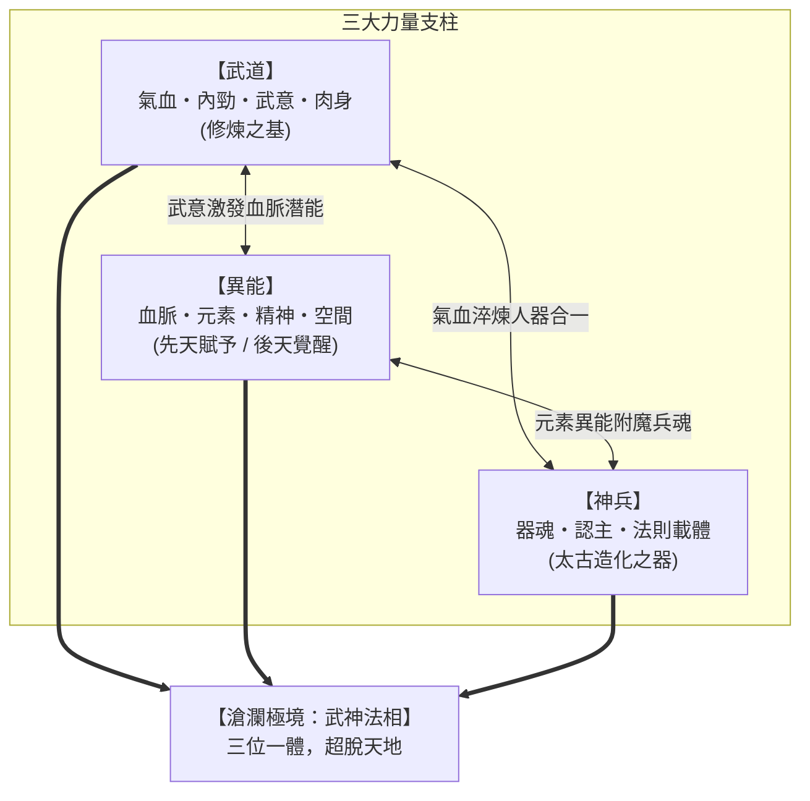
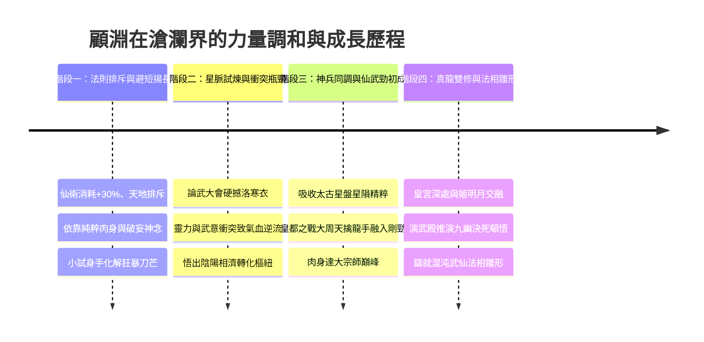
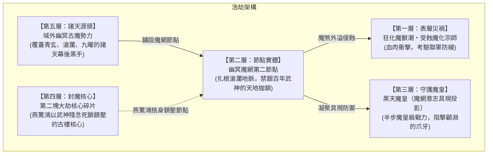

# 《萬界風月樓》第二卷力量體系｜滄瀾武道與仙武融合機制

> **文檔定位**：第二卷《諸天第一步・滄瀾風雲》之修煉體系、境界梯次、顧淵力量適應歷程、九幽魔劫層次及萬界樓修復進度大躍進（突破 100/10000）設定。  
> **體系綱領**：武道、異能、神兵三大體系交融；顧淵混沌星脈開闢「仙武同修」之道；姬明月真龍血脈與洛寒衣先天劍骨雙女主合一，推動古樓進度跨越百點大關！

---

## 一、滄瀾界三大力量體系剖析

滄瀾界的超凡力量由三大支柱構成，三者非孤立排斥，而是能夠深度融合、相輔相成：

### 1. 武道體系（後天勤修之基）
* **核心修煉**：以人身為天地，運轉呼吸吐納法、熬煉筋骨髓血、貫通全身經脈穴竅。
* **武道真意**：修行者將個人意志、生死經歷與自然天象融為一體，凝聚出專屬的「武道真意」（如洛寒衣的斷星劍意、霸刀門的狂雷刀意）。真意有形無質，能直接壓制對手心魂氣血。

### 2. 異能體系（先天天賦與血脈覺醒）
* **血脈傳承**：太古神魔或天地元氣洗禮遺留的血脈印記，以皇族、古老世家為主。
* **代表血脈**：
  * **紫霄真龍血脈（姬明月所具備）**：大乾太祖皇族傳承，掌控九霄紫龍雷罡與皇極威壓領域，神妙絕倫。
  * **先天劍骨（洛寒衣所具備）**：天生劍道奇脈，肉身經脈天生可化萬道劍氣。
* **局限**：若無強悍武道體魄承載，高階異能會反噬肉身經脈导致崩潰。

### 3. 神兵體系（天地法則載體）
* **器魂之說**：滄瀾界頂尖神兵皆以萬年玄鐵、地火精金與遠古凶獸神魂熔鑄，誕生了自主的「器魂」。
* **認主機制**：神兵不可強奪，唯有契合神兵性情與武道真意之天驕，方能引發器魂共鳴，實現「人器合一」。

---

## 二、滄瀾界八大武道境界階梯

滄瀾界的實力劃分不與青玄界一一對應，各自遵循本土天地法則運轉：

| 境界名稱 | 修煉核心與威能表現 | 社會地位與人數規模 | 對戰青玄仙道之參照 |
| :--- | :--- | :--- | :--- |
| **一、鍛體境** | 煉皮肉、易筋骨、換骨髓。力達千斤，奔跑如豹，抗擊尋常刀劍。 | 武者基石，軍中步卒與民間護院（百萬級）。 | 相當於練氣初期（一至三層肉身）。 |
| **二、通脈境** | 體內內勁自生，衝開奇經八脈與十二正經。飛簷走壁，拳出破木碎石。 | 鏢局鏢頭、宗門外門弟子（數十萬級）。 | 相當於練氣中後期（四至七層）。 |
| **三、先天境** | 內勁化為真氣，真氣外放達丈外，凝結護體罡氣，凌空踏步三息。 | 名門內門精英、各城偏將（萬人級）。 | 相當於練氣大圓滿～半步築基。 |
| **四、宗師境** | 貫通天地之橋，凝聚專屬**【武道真意】**，百步之內飛花摘葉皆可殺人，開宗立派之資。 | 江湖一流名宿、三品宗門掌門（千人級）。**姬明月（宗師巔峰）初期處於此境**。 | 相當於修仙界築基初期～中期。 |
| **五、大宗師境** | 真意凝練為**【武道領域】**（方圓十丈～百丈內掌控元氣），身融天地，凌空踏虛，一人可敵千軍。 | 天驕榜前列、名門巨擘長老、大乾神捕（數百人級）。**洛寒衣（大宗師巔峰/半步武王）初期處於此境**。 | 相當於修仙界築基大圓滿～假丹境。 |
| **六、武王境** | 破碎山河，身懷「皇極真罡」，武意化形外顯，調動百里天地元氣，壽元延至三百載。 | 天下頂尖巨擘（如天劍山主、武極殿輪值長老）（全界僅數十人）。**洛寒衣決戰突破後晉陞此境**。 | 相當於修仙界金丹期（初至後期）。 |
| **七、武皇境** | 鑄就「皇極武域」，自身領域內自成小天地法則，觸摸虛空裂縫，壽元五百載。 | 當世傳奇神話，武極殿隱世殿主、皇室太祖級供奉（全界不足五人）。 | 相當於修仙界金丹巔峰～半步元嬰。 |
| **八、武神境** | 武道通神，肉身不死，法相頂天立地，以極致武意撕裂虛空超脫本界（三千年僅燕驚鴻一人，近百年空懸）。 | 傳說存在，神話圖騰（目前無當世活人）。 | 相當於修仙界元嬰尊者～半步化神（戰鬥破壞力更偏向純粹毀滅）。 |

---

## 三、顧淵力量調和的漸進成長歷程

顧淵在滄瀾界的力量演化經歷了明確的**實戰碰撞、力量衝突瓶頸與漸進頓悟**：

1. **第一階段（ch017～ch021）**：仙術受阻，改以純粹肉身純力與破妄真視避短揚長。
2. **第二階段（ch022～ch027）**：硬碰斷星劍域，靈力與剛烈武意衝突引發經脈微創，參悟出陰陽相生周天化解瓶頸。
3. **第三階段（ch028～ch033）**：百兵祭壇汲取太古星火淬煉肉身，修成【混沌仙武勁】。
4. **第四階段（ch034～ch039）**：皇都血夜以大周天擒龍手捏碎萬魂煞陣；皇宮深處與姬明月雙修，同化紫霄真龍之氣，修為攀升至金丹中期巔峰。
5. **第五階段（ch040～ch052）**：九幽決戰融合燕驚鴻武神印記，於萬法演武殿推演開創【混沌武仙法相（雛形）】，一劍斬破萬里永夜！

---

## 四、九幽魔劫五大層次結構剖析

顧淵斬滅的是「黑天魔皇投影」並徹底熔斷焚毀「第二魔網節點」，奪回第二碎片，真正幕後黑手仍沉睡於更高維度的九曜神域與幽冥古界。

---

## 五、萬界樓修復進度大躍進：突破 100/10000（1.00%）

第二卷篇幅宏大、因果深遠，透過跨界暗線推進、青玄三女中卷重聚、姬明月真龍雙修、第二碎片取得及洛寒衣劍心定錨，萬界樓總修復度迎來**破百大躍進**：

### 1. 第二卷修復進度增量階梯表

| 推進節點 | 核心驅動事件與因果 | 當次修復增量 | 累計總修復度 | 系統解鎖與世界反饋 |
| :---: | :--- | :---: | :---: | :--- |
| **卷初基準** | 第一卷（青玄篇）結算 | —— | **8/10000（0.08%）** | 天機閣一層星盤、二層推演初步運算 |
| **節點一（ch032）** | 百兵神宮太古鑄兵星盤修復，古樓下界投影分殿認祖歸位 | **+7/10000** | **15/10000（0.15%）** | 萬界樓神兵鑄造殘篇解鎖，天機星盤穩定 |
| **節點二（ch033末）** | 顧淵返樓召集青玄三女重聚，情報交融＋三女深層陰陽反哺 | **+15/10000** | **30/10000（0.30%）** | 珍寶閣一層調配權擴張，青玄時空通道加固 |
| **節點三（ch038）** | 皇朝深宮救治，與監國帝女姬明月紫霄真龍雙修合一 | **+25/10000** | **55/10000（0.55%）** | 皇道龍氣融匯，【萬法演武殿】外層道台顯化 |
| **節點四（ch046）** | 破除九幽封印，融合第二塊大劫核心碎片（燕驚鴻武神印記） | **+30/10000** | **85/10000（0.85%）** | 古樓主體結構重塑，演武殿推演功能初步上線 |
| **節點五（ch051～052）** | 斬滅魔皇，與天劍女武王洛寒衣劍心雙修，立滄瀾紅顏時空錨點 | **+15/10000** | **100/10000（1.00%！）** | **【萬法演武殿】正式全面啟動！破百大關！** |

### 2. 破百大關（1.00%）帶來的系統質變
1. **萬界樓第三核心樞紐【萬法演武殿】全面解鎖**：
   * 跨世界功法推演、歷代強者戰鬥投影對練、仙武融合模擬試煉場全功能上線。
2. **珍寶閣二層玄器庫禁制破除**：
   * 慕容玥與姬明月獲得調配高階界外靈露與太古星金之權限。
3. **天機閣二層算力暴增十倍**：
   * 成功鎖定 03 號神話文明【九曜神域】之時空航道坐標，為第三卷拉開序幕！
