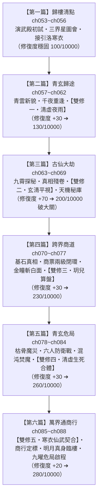

# 《萬界風月樓》第三卷綱要｜《諸天回首・青玄歸途》（v3.1）

> **卷名**：第三卷《諸天回首・青玄歸途》  
> **世界核心**：青玄界（主線）＋ 萬界樓（生活與中樞）＋ 滄瀾界（後方聯動）  
> **全書章節**：ch053 ～ ch088（全卷共 36 章）  
> **核心主題**：**「萬界之主，不忘根源——回頭看看你守護的地方，才知道往後的路有多長。」**  
> **敘事模式**：**青玄歸途主線 ＋ 跨界商道金融閉環 ＋ 純粹雙修修復引擎 ＋ 成熟多女主獨立群像 ＋ 下一界預熱（九曜神域救世與神座之爭）**  
> **核心女主**：**柳清虛**（獨立掌門・守望並肩）、**沈玄清**（尊嚴平視・承認需要並肩）、**慕容玥**（跨界商道・從家族生意轉為共建未來）  
> **並行女主**：**洛寒衣**（首次跨界青玄・獨立劍道與道侶同行悟道・主動以劍立誓）、**姬明月**（跨界商政交鋒共治・與慕容玥建立合作夥伴關係 ➔ 2.50% 門檻達成後真身親臨）  
> **卷末修復指標**：萬界樓總修復度自 **100/10000（1.00%）** 透過五場極致雙修穩步躍升至 **280/10000（2.80%）**，解鎖第四核心設施【萬界通商行】與【時空定標儀（三界同步版）】  
> **參考母本**：核心架構審查與十四項架構補強指引、第三卷人物與主線深度修訂（6.1～6.6、8.1～8.4、11.3）  
> **參考規範**：[README.md](../../../README.md)｜[writing_guide.md](../writing_guide.md)｜[MASTER_FORESHADOWING.md](../MASTER_FORESHADOWING.md)

---

## 一、第三卷文檔體系導航

* 📘 [02_power_system.md](./02_power_system.md)：**力量體系與跨界商道機制（v3.1）**
  * 陰陽交泰靈肉合一（唯一修復能量引擎）；太古七界封魔鎖鏈與青雲祖脈因果；沈玄清五百年殘印三階洗印。
  * 萬界商票兩級清算閉環與「官商分層共治」共識；兩界百倍暴利背後的生物學剛需。
  * 枯骨老魔本質（地脈天災）與六人群像防衛戰分工；洛寒衣境界定位；姬明月 2.50% 跨界物理硬門檻。
* 👥 [03_romance_and_characters.md](./03_romance_and_characters.md)：**愛情戲深化與群像人物補充（v3.1）**
  * 五女獨立人格坐標（秩序責任／尊嚴平等／利益效率／承諾行動／權責大局）與「相互尊重、不必事事認同」的成熟群像原則。
  * 五場差異化雙修高潮大戲（拒絕修為灌頂依賴與純粹傷勢推動）。
  * 女女互動與理念碰撞（清虛與寒衣破冰、明月與玥兒跨界商政交鋒共治、清虛與玥兒商門激辯、師徒幽篁茶談、夜宴與五女齊聚的和而不同）。
  * 支線情侶（陸遠・林芷萱）扎實能力成長、職責晉升與拉衣袖定情。
  * 新NPC深度：天行者獨立逐利黑市（與棋算者、蝕者三層分離）、枯骨老魔奪權動機、九霄古仙殘念核心線索與「最後一個錨點」留白。
* 📜 [05_chapter_outlines.md](./05_chapter_outlines.md)：**逐章編劇詳細大綱（全 36 章｜ch053～ch088，v3.1）**
  * 六大篇章逐章細綱（出場人物、場景、核心情節、爽點情感落點、伏筆埋設與萬界樓修復反哺）。
* 🌐 [MASTER_FORESHADOWING.md](../MASTER_FORESHADOWING.md)：**全書跨卷暗線總攬（頂層中央庫）**
  * S級終極主線（諸天蝕者規則天災、萬界樓天平引爆真相、七界封魔鎖鏈、顧淵前世薪火）。
  * A/B/C級跨卷長線狀態與天行者組織檔案。

---

## 二、第三卷的核心架構審查修正原則（十四項閉環）

> [!IMPORTANT]
> **本卷必須嚴格執行的系統鐵律**：
> 1. **唯一修復能量引擎（P0）**：萬界風月樓修復度（0 ➔ 10000）的唯一能量引擎只有顧淵與諸天命定神女的「陰陽交泰、靈肉合一」。大劫碎片僅為「物理骨架與上限圖紙」（無能量）；跨界商道為「世俗資源與宗門後勤」（無能量）；世界氣運為「女主卸防催化劑」（無能量）；設施解鎖為「達標後的被動結果」。
> 2. **青玄祖脈、七界鎖鏈與拆分封印權限（P0／8.4）**：青雲開派祖師為太古七界封魔守陣仙尊，青雲九峰為「九華陣樁地樞」。第三篇取得之【古仙遺志封印片】實為太古戰時人為拆分之古仙權限憑證，另一半權限仍殘留青雲祖脈（非宿命劇本，嚴守 R24 自主演化）；疊加滄瀾魔皇被滅引發的三炷香能量真空期，引來枯骨老魔企圖**強奪太古封印控制權**，將第五篇升級為太古封印控制權之戰。
> 3. **沈玄清三階洗印閉環（P0）**：舊傷本為五百年前沾染之太古古樓蝕煞殘印，五百年以七成元神壓制。ch067 以純陽除病因 ➔ 雙修復圓融至元嬰大圓滿巔峰 ➔ 平視相托悟化神契機。
> 4. **萬界商票兩級閉環（P0/P1）**：金絲靈券防偽；普通修士持票可平價提貨滄瀾神鐵或兌換靈石（大宗交易硬通貨）；兩大商盟透過萬界樓總差額清算；百倍暴利基於滄瀾武者洗滌暗傷延壽30年的「買命剛需」與青玄量產高階飛劍的「神鐵剛需」。
> 5. **姬明月真身跨界硬門檻與降臨時機（P0）**：真龍肉身厚重，必須在萬界樓修復度突破 2.50%（250/10000）以上且顧淵親手引導方能跨界。ch054 埋下抱怨伏筆；ch083 突破 2.60% 後以一兩句傳訊自然交代「大乾官商共治首期結算與暫攝政務收口、兼待商行定標儀校穩星門」，至 ch087 堂堂正正真身跨界，無落差感。
> 6. **第六篇終局懸念反轉與三源坐標拼圖（P1／8.2／8.3）**：ch076 密碼盤僅確認「九曜神域存在天行者核心交易站」；ch086 定標儀感應九曜血黑異動卻缺門戶坐標；ch087 經紫霄天龍殘圖、古仙抗魔全圖與天行者交易站暗記三圖拼合，方取得**九曜神域精確入口坐標**，揭露蝕者滲透神壇、天行者趁亂逐利、棋算者暗中佈局的三方錯位危局；ch088 姬明月真龍神座告急，啟程神域化為爭分奪秒的諸天救世與神座之爭！
> 7. **成熟多女主獨立群像（6.1～6.6）**：五位女主皆有獨立生活、判斷與成長，絕非男主獲取力量的工具；保留五人核心性格差異（清虛重秩序責任、玄清重尊嚴平等、玥兒重利益效率、寒衣重承諾行動、明月重權責大局），可以相互尊重但不必事事認同；補齊姬明月跨界商政參與、沈玄清尊嚴與「需要並肩」轉折、洛寒衣「獨立劍道 vs 同行」弧光、慕容玥「共建未來」轉折及柳清虛「非依賴雙修突破」的成長分寸。
> 8. **主線暗線分層與終極留白（8.1～8.4）**：ch066 古仙殘念保留「引爆是當年最後的辦法」，並認出顧淵身上印記留下「*你所見的萬界樓，不過是它留下的最後一個錨點*」（**第三卷絕不提前確定萬界樓終極本質**）；天行者（獨立逐利黑市）、棋算者（獨立私謀）、諸天蝕者（規則天災）嚴格三層分離。
> 9. **萬界樓秩序復甦・看得見的新功能・長文破萬與正文分寸（11.3）**：① 萬界樓不能只是獎勵建築，ch085 解鎖萬界通商行時靈素首度發現古樓浮現「從未記錄過的古老權限」且無法解讀（FB3-07）；② 每次重要修復度突破皆須提供看得見、用得上的實體變化；③ 正文採長文規格（常規 5,000～7,500 字，重要情節／第六篇四章 8,000～12,000+ 字破萬字級精寫）；④ 正文雙修寫「感情昇華順帶反哺古樓」防工具化，洛寒衣獨立寫「選擇性同行」而非「拒絕依賴」。

---

## 三、第三卷六大篇章結構圖

---

## 四、各篇章詳細核心內容

### 【第一篇】歸樓清點（ch053～ch056）

**核心任務**：萬界樓破百後的結構性質變盤點、三界星圖聯動、接引洛寒衣入樓。

#### 關鍵情節：
1. **萬法演武殿啟動與道法殘影（ch053）**：
   - 顧淵攜靈素在演武殿內演練滄瀾武意與仙武合一神通，千丈法相凝練為三丈凝實戰身。
   - 銘文解析伏筆：演武殿穹頂沉澱著太古古仙留存的**武道戰法殘影**（此伏筆將在第三篇秘境試煉中與古仙意志共鳴回收，B-02）。
2. **三界情報彙整與星圖聯動（ch054）**：
   - 顧淵透過天機閣整合雙界動態：青雲觀金丹大盛、古仙抗魔全圖繪成、神秘晶石待解析。
   - **首次跨界聯動會議**：姬明月以大乾星盤虛擬神魂投影列席。姬明月抱怨真龍肉身厚重，萬界樓空間承載力未達 2.50%（250/10000）前無法肉身跨界（P0 硬門檻伏筆）；五女靈魂道標共振，此處為純通訊，修復度維持 100/10000。
3. **接引洛寒衣入樓（ch055）**：
   - 顧淵依託已建立的滄瀾時空錨點，接引洛寒衣以「同行貴賓」身份踏入萬界樓（落實 A-03）。
   - 傲骨女劍仙打量古樓，與縮小版童女靈素互動展現反差萌；靈素引導參觀演武殿，洛寒衣見諸天殘兵痕跡，斷星劍器魂同頻輕鳴，武道傲骨與求道心大動。
4. **前往青玄界的決議（ch056）**：
   - 顧淵告知青玄界有傳承萬年的古仙道統與深淵魔煞，邀請洛寒衣陪同視察。洛寒衣撫劍坦然應允，顧淵牽其玉手步入一號萬界門。

---

### 【第二篇】青玄歸途（ch057～ch062）

**核心任務**：顧淵攜洛寒衣返青玄，宗門自立新貌，柳清虛守望者的脆弱與自尊，第一場雙修水火交泰。

#### 關鍵情節：
1. **異界來客與青雲新貌（ch057）**：
   - 洛寒衣初臨青玄，感受靈氣稠密與武意稀薄的反差，運轉戰罡適應環境；
   - 代理戒律堂主事陸遠（築基中期，頂著王家殘黨壓力鐵腕執法、一身硬骨）與丹草閣林芷萱（煉氣九層圓滿，深諳藥性）率眾巡邏迎接，宗門風氣清正蓬勃。
2. **通天峰的等待與重逢（ch058）**：
   - 柳清虛在峰頂布完第七重護山大陣，九品天道金丹圓滿金光流轉，眉心道印驟熱，走下長階看見顧淵，壓抑千夜相思輕喚「回來了」；
   - **清虛與寒衣初見交鋒與破冰**：兩位冷傲女子起初各自展現掌門威儀與武者求戰倨傲；轉角處洛寒衣見清虛手腕陣法灼傷，主動遞上天劍山凌霄雪峰特產「雪玉生肌膏」，以互敬打破心防。
3. **後山地脈與七界封魔殘跡（ch059）**：
   - 沈玄清察覺後山祖脈異動，顧淵以破妄真視配合「古仙抗魔全圖」勘查地脈深處。
   - **大劫真相第一層揭露（P0）**：確認青雲祖脈為太古古仙聯盟布設之「七界封魔鎖鏈」節點之一；開派祖師青玄道尊乃守陣仙尊，青雲為守墓一脈；祖脈鬆動源於卷二滄瀾魔皇殞落引發的跨界共振。
4. **【第一場雙修・清虛水火交泰】（ch060）**：
   - 通天峰古閣夜雨，柳清虛在顧淵離去期間已獨立證明守宗之能，今夜卸下掌門道袍傾訴相思，二人水火交泰乃感情與本源昇華（非修煉唯一途徑），長期苦修的道基自然共鳴萌發一縷紫金元嬰胎動；**修復度 +30/10000（達到 130/10000）**，風月苑顯化第二層「凝香道閣」；後山沈玄清僅遠距感應道基變化而絕不窺視，維持仙尊尊嚴。
5. **洛寒衣仙城試劍與芷萱雲糕（ch061）**：
   - 洛寒衣隨林芷萱採藥，於落霞仙城屈指一彈，純粹肉身劍罡近戰一指點碎王家殘黨金丹修士護盾，武道立威；林芷萱買桂花雲糕，在換防路上悄悄送給陸遠（丹草閣的燈）。
6. **廊下觀劍與幽篁師徒茶談（ch062）**：
   - 沈玄清廊下靜觀洛寒衣練劍，驚訝斷星古劍材質與古仙遺器同頻；五百年將情感視作修行負擔的孤高道心首次動搖，壓制殘印的心念防線初現裂紋；幽篁亭師徒茶談，清虛一句「師尊，徒兒知道顧淵的心容得下諸天，但他的眼裡始終有我們」，促使沈玄清正視自己「習慣作別人依靠，卻不知如何作道侶」的心結。

---

### 【第三篇】古仙大劫（ch063～ch069）

**核心任務**：深入九霄封魔秘境，古仙殘念揭露引爆往事與「最後一個錨點」留白，沈玄清平視相托恢復元嬰大圓滿巔峰並悟化神契機，第三碎片（古仙遺志封印片）歸位注能解鎖天機秘庫並揭示青雲祖脈殘存權限。

#### 關鍵情節：
1. **九霄封魔古仙遺址開啟（ch063）**：
   - 沈玄清以古圖定位九霄秘境，顧淵、沈玄清、洛寒衣三人組成探秘小隊，柳清虛坐鎮山門，慕容玥提供符丹物資。
2. **意志試煉與演武殘影回收（ch064～ch065）**：
   - 太古心魔霧襲來：洛寒衣斬破斷劍心魔，顧淵撕裂萬年死寂幻境握住沈玄清的手；
   - 殺陣爆發，顧淵引動 ch053 於萬法演武殿參悟之古仙武道殘影，同頻破開殺陣陣眼（B-02 伏筆回收）。
3. **古仙殘念核心揭露與「最後一個錨點」留白（ch066）**：
   - 顧淵承受三重神念考驗喚醒九霄古仙殘念，殘念吐露「*萬界樓……不是你以為的那樣……引爆……是當年最後的辦法*」與三大實質線索（規則天災、引爆以七界鎖鏈鎮封、顧淵薪火氣息）；
   - 消散前更認出顧淵身上某道古老印記，留下極具衝擊力的懸念：**「你所見的萬界樓，不過是它留下的最後一個錨點。」**（第三卷不提前定論）；
   - 留下實物【古仙承道玉簡】與【古仙遺志封印片】（**僅開拓物理上限框架至 200，修復度 +0，維持 130/10000**）。
4. **【第二場雙修・玄清仙尊平視相托】（ch067）**：
   - 仙靈泉幽室內殘印反噬僅為外因。顧淵「沒有憐憫，只有平視」守住她的尊嚴，沈玄清在神智清明中第一次誠實承認「自己也需要有人與之並肩」，主動放下五百年心防與素裳，**五百年凝練不散的太素道基**與萬界純陽狂暴交融！大劫殘印徹底驅散（除病因），七成本源解放重歸圓融至**元嬰大圓滿巔峰**（復修為），道心無瑕觸及化神門檻（悟契機）；
   - **修復度狂飆 +70/10000（達到 200/10000，整整 2.00% 破大關！）**，靈修殿解鎖元神加護陣眼！
5. **道台歸位、殘憑雙分與天機秘庫顯化（ch068）**：
   - 碎片融入道台核心，靈素檢視發現其乃**太古戰時人為拆分的「古仙權限憑證」**，另一部分封印權限仍殘留青雲祖脈（非宿命安排，嚴守 R24 自主演化，直連第五篇！）；五百年玄陰本源注滿新框架，**結構性解鎖全新設施【天機秘庫】**。
6. **萬界樓夜宴與和而不同（ch069）**：
   - 四女首次萬界樓實體同席，姬明月神魂投影列席。面對萬界樓未來走向與黑市線索，五女依各自性格核心（秩序責任／尊嚴平等／利益效率／承諾行動／權責大局）保留分歧、相互尊重而不強求一致；洛寒衣見眾女各有宗門、道統、商盟與皇朝，開始深入叩問自身獨立劍道。

---

### 【第四篇】跨界商道（ch070～ch077）

**核心任務**：慕容玥商業帝國價值全面兌現，萬界商票兩級閉環，交鋒黑市「天行者」，摘星樓算盤暗刻深情獻身。

#### 關鍵情節：
1. **基石被盜真相與獨立黑市天行者（ch070）**：
   - 剖析走私星紋晶石，確認為太古古樓崩解時遺落虛空的基石碎片遭非法切割牟利；正式鎖定獨立逐利的跨界情報走私網絡「**天行者**」（並非諸天蝕者附庸，與棋算者、諸天蝕者三層分離）。
2. **萬界商票與帝商交鋒（ch071）**：
   - 慕容玥提出兩級商票與三大防擠兌安全閥；姬明月從**皇權與國家財政安全**角度當場叫停，慕容玥從**市場效率與商業信用**寸步不讓反駁，兩位強勢女主爆發真實跨界理念衝突。
3. **商門對坐與玥兒內心轉折（ch072）**：
   - 柳清虛與慕容玥圍繞九華祖脈收益權激辯後結盟；走出配殿之際，慕容玥驟然意識到自己如今傾力經營的已不再只是家族商業，而是**她與顧淵共同建立的未來**，為 ch077 算盤刻字奠基。
4. **官商分層共治與首航暴利（ch073）**：
   - 姬明月與慕容玥各守底線達成**「官商分層共治」**共識（皇朝掌戰略配額與稅印，商盟掌市場定價與清算），建立彼此認可的合作夥伴關係；回春原液與星隕神鐵首航大捷，姬明月亦於星圖私語展露以江山為君鋪路的深情。
5. **截道黑煞與金瞳裂空（ch074～ch075）**：
   - 天行者白面具執事截殺商道，企圖掠奪商票母本；顧淵金瞳撕破虛空，洛寒衣千丈劍罡封死退路，慕容玥以【靈鑑神瞳】二重洞破法寶節點奪下黑市密碼盤。
6. **密碼盤破譯與九曜黑市線索（ch076）**：
   - 破譯密盤證實：天行者正按「方舟解體清單」收購殘片牟利；棋算者下達密令「將顧淵列為001號天平執掌者，密切觀察，必要時可交易」；**僅確認九曜神域存在一處天行者核心交易站**（刻意抹去門戶星標，精確入口坐標留待 ch087 三圖拼合）。
7. **【第三場雙修・玥兒摘星樓算盤獻身】（ch077）**：
   - 深夜摘星樓，慕容玥在算盤最隱蔽撥珠刻下「淵」字。顧淵飲其殘茶攬腰，精明商女算盡天下唯願在算盤與帳冊前動情承歡，純陰聚寶之體交感，突破築基大圓滿；
   - **修復度 +30/10000（達到 230/10000）**，珍寶閣開放大規模三界虛空專屬倉儲位！

---

### 【第五篇】青玄危局（ch078～ch084）

**核心任務**：西陵枯骨老魔引動幽冥煞海地脈天災進犯，六人群像戰術釘死防衛戰，顧淵回援焚魔，第四場雙修生死合體，拉衣袖定情。

#### 關鍵情節：
1. **老魔出世與太古封印權限之爭（ch078）**：
   - 枯骨老魔（幽冥魔網寄生體）察覺九霄半片封印憑證離位與九華陣樁三炷香能量真空期，調動地底三千年幽冥煞海席捲東華，**真實目標乃強奪殘留青雲祖脈的太古封印權限**，將本篇升級為爭奪太古封印控制權的生死之戰！
2. **六人群像戰術釘死防禦（ch079～ch081）**：
   - 柳清虛「青蓮開天大陣」護內門；
   - 陸遠率隊浴血死守山下凡俗城鎮，在生死邊緣突破**築基後期**；
   - 林芷萱晝夜統籌戰地救傷，煉解煞丹，丹道感悟在極限壓力下昇華；
   - 慕容玥調十萬靈丹並以黑市情報切斷老魔三處地下供煞靈脈；
   - 沈玄清以元嬰大圓滿巔峰（蘊含半步化神道韻）孤身入陣樁牽制老魔真身；洛寒衣極限近戰游擊以武王劍罡撕裂老魔白骨法相。
3. **天機警鳴與混沌焚魔（ch082）**：
   - 沈玄清道印微鳴，天機閣捕捉警訊；顧淵橫渡切入，三丈仙武真身顯化，引動純陽神雷一掌按在老魔頭頂，將寄生的魔網殘絲徹底焚滅，拔除根源！
4. **【第四場雙修・清虛石階後生死合體】（ch083）**：
   - **主線情感**：月下石階，清虛「沒讓你失望吧」與顧淵「從來沒有」的心靈對白。二人步入掌門寢宮，劫後餘生的極致放縱與依戀，清虛以並肩道侶之姿主導雙修，青蓮與純陽化作並蒂金蓮，元嬰胎息圓熟大成；**修復度 +30/10000（達到 260/10000）**，守護古陣威能暴漲五成！
   - **支線感情確認**：丹草閣外，林芷萱主動伸手拉住陸遠衣袖，打破「路過」藉口；陸遠反手執手，承諾「我一直在」，正式定情。
5. **東華修仙盟約重訂與封賞（ch084）**：
   - 柳清虛確立青雲東華第一名門地位；當眾任命陸遠為「戒律長老」、林芷萱為「丹草閣主」（林芷萱戰後穩步突破**築基中期**，以戰功與丹道造詣服眾）；沈玄清公開抗魔圖警示天下，慕容玥升格萬界商盟。

---

### 【第六篇】萬界通商行（ch085～ch088｜四章加長收官版）

**核心任務與四章重新分配**：保留四章並採破萬字級長文規格（建議每章 8,000～12,000+ 字），讓八大重頭戲從容鋪陳——**ch085 商行建成與古樓古老權限初現 ➔ ch086 寒衣劍誓與清虛獨立決策 ➔ ch087 明月真身、五女同殿與坐標拼合 ➔ ch088 出征前夕、人物送行與九曜啟程**。

#### 關鍵情節：
1. **萬界通商行建成、設施解鎖與古樓異權（ch085・加長章）**：
   - 洛寒衣歷經整卷內在衝突與破悟，於萬法演武殿與顧淵完成第五場雙修（仙武契合），**修復度 +20/10000（達到 280/10000，整整 2.80%！）**；
   - 中庭拔地而起九層白玉【萬界通商行】與【三界時空定標儀】並當場投入自動化清算試運轉；
   - **萬界樓自身暗線（FB3-07）**：靈素巡檢新設施時，首度發現古樓深處自主浮現一個**「從未記錄過的古老權限」**且無法解讀，首次意識到古樓修復並非單純恢復建築，而是在恢復某種原本存在的秩序。
2. **洛寒衣劍誓、柳清虛獨立決策與定標儀異動（ch086・加長章）**：
   - 洛寒衣以獨立女武王之尊主動按劍立誓，選擇與顧淵共同前行；柳清虛力排眾議獨立簽署《青玄・滄瀾道法交流盟約》，拍板設立青雲外門「仙武體修堂」；
   - **章末懸念突發（P1）**：時空定標儀指向九曜神域方向時驟現刺目**血黑色**，卻因缺少精確入口坐標無法穩定開門！
3. **姬明月真身到來、五女同殿與三源坐標拼合（ch087・加長章）**：
   - 萬界樓跨越 2.50% 硬門檻，姬明月首次一身皇袍**真身跨界降臨萬界樓**，與慕容玥相視互敬、五女首度真身同殿和而不同議政；
   - 透過紫霄天龍殘圖、古仙抗魔全圖與天行者交易站暗記三源拼合，**正式取得九曜神域精確入口坐標**，並揭露蝕者滲透神壇、天行者趁亂逐利與棋算者暗中佈局的三方錯位危局。
4. **出征前夕、人物送行與九曜啟程（ch088・加長章）**：
   - 姬明月感應大乾始祖「真龍神座」告急，遠征化為爭分奪秒的諸天救世與神座之爭；
   - 出征前夕，清虛、玄清、玥兒、明月四女各以己所長送行託付（姬明月親手於顧淵折扇繫上紫金龍紋玉扣，低聲留下「真身跨門連半盞合巹茶都未喝上、凱旋加倍還」的明確**「欠著」記號**，為第四卷補齊高潮鋪路）；顧淵攜洛寒衣踏入三號星門之際，靈素望見古樓深處那道未知古老權限微微一閃，第三卷圓滿收官，第四卷《九曜神域・神座之爭》大幕轟然揭開！

---

## 五、第三卷萬界樓修復進度表（純粹雙修引擎 ＋ 11.3 看得見、用得上原則）

| 章節節點 | 核心驅動事件（唯一能量來源） | 獲得本源增量 | 累計總修復度 | 看得見的變化與用得上的實際功能（11.3） |
| :---: | :--- | :---: | :---: | :--- |
| **卷二末** | 卷二末洛寒衣劍心雙修定錨 | — | **100/10000 (1.00%)** | 萬法演武殿解鎖・二號界門常態流轉（ch053 推演仙武戰身並參悟殘影破陣） |
| **ch054** | 三界星圖聯動會議（純通訊，明月鋪陳門檻） | **+0/10000** | 100/10000 | 星圖神魂投影通話模塊（支撐 ch071～073 跨界商政談判） |
| **ch060** | **【第一場雙修】柳清虛通天峰水火交泰** | **+30/10000** | **130/10000 (1.30%)** | **風月苑顯化第二層「凝香道閣」＋ 青玄通道徹底加固**（支撐高頻跨界與大宗商運） |
| **ch066** | 九霄秘境取得封印片（僅拓框架上限，落實 A-02） | **+0/10000** | 130/10000 | 解鎖 200/10000 大關之物理框架與圖紙（揭示拆分權限線索） |
| **ch067** | **【第二場雙修】沈玄清仙靈泉池平視相托** | **+70/10000** *(全卷最爆發)* | **200/10000 (2.00%)** **破兩百大關！** | **靈修殿解鎖元神加護陣眼 ＋ 白玉藏書樓【天機秘庫】顯化**（穩固元神、安放古仙玉簡、提升星圖算力以破譯密盤） |
| **ch077** | **【第三場雙修】慕容玥摘星樓算盤獻身** | **+30/10000** | **230/10000 (2.30%)** | **珍寶閣擴建三界虛空專屬倉儲位**（ch080 即時調運十萬枚破煞丹馳援青雲立大功） |
| **ch083** | **【第四場雙修】柳清虛戰後通天峰生死合體** | **+30/10000** | **260/10000 (2.60%)** | **萬界樓守護古陣實體化威能提升五成 ＋ 跨越 2.50% 硬門檻**（正式打通姬明月真身跨界物理條件） |
| **ch085** | **【第五場雙修】洛寒衣萬法演武殿仙武契合** | **+20/10000** | **280/10000 (2.80%)** | **建成並啟用【萬界通商行】與【三界時空定標儀】**（自動商票清算、預警九曜異變；同時浮現未知古老權限暗線 FB3-07） |

---

## 六、第三卷卷末人物成就清單

| 人物 | 入卷初始狀態 | 卷末成就與質變 | 情感與道侶狀態 |
| :--- | :--- | :--- | :--- |
| **顧淵** | 金丹初期・仙武初融・修復度 1.00% | 金丹中期・常態三丈武仙法相・執掌諸天商道・知曉古樓引爆往事與「最後一個錨點」之謎 | 萬界執棋人，五大道侶同心相助 |
| **柳清虛** | 入卷：九品金丹圓滿（自卷一「半步金丹」──> 卷二「結丹並淬至九品」） | 卷末：獨立守宗、重訂東華盟約、簽署仙武交流盟約；道基內紫金元嬰胚胎胎息圓熟大成（源於獨立厚積薄發，非依賴雙修突破） | 從思念守望者徹底成長為獨當一面的掌門與平等並肩道侶 |
| **沈玄清** | 元嬰初期巔峰・殘印受制 | 大劫殘印徹底驅散・本源解放恢復全盛・達至**元嬰大圓滿巔峰（觸及半步化神契機，本卷不直接突破）** | 維持高冷仙尊尊嚴；放下五百年把情感當負擔的心結，第一次承認「需要有人並肩」，平視相托 |
| **慕容玥** | 築基後期・落霞商盟盟主 | 築基大圓滿・【靈鑑神瞳】二重蛻變・與姬明月達成「官商分層共治」主導萬界商票閉環 | 意識到自己經營的已不再只是家族商業，而是與顧淵共建的未來；算盤刻「淵」字深情託付 |
| **洛寒衣** | 滄瀾女武王・未曾跨界 | 首次隨樓主跨界青玄・適應靈氣・實戰獨立破局・演武殿仙武交泰昇華 | 破悟「真正的道侶不是依附，而是各自強大卻願意同行」，主動以劍為誓選擇共同前行 |
| **姬明月** | 大乾監國帝女・遠端聯動 | 從皇權財政角度參與商票規則建立、與慕容玥建立合作夥伴關係・大乾國運昇華・突破 2.50% 門檻真身臨樓 | 擺脫遠端配角感，以一國秩序先行鋪路，真身降臨與眾女和而不同共商九曜救世與神座之爭 |
| **陸遠** | 築基中期・代理戒律堂主事 | 頂著威脅鐵腕執法・浴血死守城鎮立首功・正式轉正**戒律長老**・突破**築基後期** | 與林芷萱戰火相依，被拉住衣袖，感情正式確認 |
| **林芷萱** | 煉氣九層圓滿・丹草閣弟子 | 草木道體覺醒・煉製太素融靈丹突破築基初期・統籌戰地救傷昇華至**築基中期**・正式任**丹草閣主** | 主動拉住陸遠衣袖，執手定情，宗門溫馨守護者 |

---

## 七、第四卷預告

> **卷名（預定）**：第四卷《九曜神域・神座之爭》  
> **主要世界**：05 號世界【九曜神域】（神話信仰文明）  
> **核心女主**：**羲凰神女**（太陰神宮少宮主）、**赫拉迪雅**（熒惑戰伐女武神）  
> **核心動機**：  
> 1. 介入九曜神域神權崩潰與蝕煞滲透危局，同時直面趁火打劫的獨立黑市「天行者」與另有私謀的「棋算者」三方博弈；  
> 2. 探尋大乾姬氏紫霄真龍血脈起源，奪回即將被蝕煞吞噬的「大乾始祖真龍神座」；  
> 3. 以萬界純陽解救神明「信仰濁泥」之毒，爭奪至高神位，並進一步追尋「最後一個錨點」與古樓深處「未知古老權限」的蛛絲馬跡；  
> **萬界樓目標修復度**：280/10000 ──> 500/10000（突破 5% 大關）！
