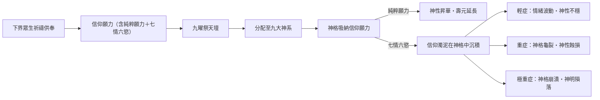

# 第四卷｜九曜神域世界設定（v1.0）

> **文件定位**：九曜神域（05 號世界）的完整世界設定，涵蓋神域歷史、九大星曜神系、神國地理、神權政治制度、信仰文明特色與信仰濁泥機制。本文件確立後，所有劇情文件必須與之一致。

---

## 一、九曜神域基礎定位

| 項目 | 設定 |
|:---|:---|
| 世界編號 | **05｜九曜神域** |
| 文明類型 | 遠古神話・星辰神權・信仰文明 |
| 力量體系 | 神性・神格・神火・信仰・法則 |
| 文明特色 | 神族、古神、神殿、神裔、神國 |
| 命名風格 | 星辰、天象、神話象徵（中文古典神名＋西域神名並用） |
| 卷內世界狀態 | **神權動盪期**：現任神王壽元將盡，各神系爭奪繼承，信仰濁泥爆發 |

---

## 二、九曜神域遠古史（三紀分期）

### 【太初紀】——萬界開闢之時（約十萬年前）

九曜神域並非一開始就存在。

遠古時期，諸天萬界剛剛開闢，宇宙虛空中飄蕩著九顆星辰的力量種子——日、月、金、木、水、火、土、羅、計，這九種星辰本源在某一個時刻凝聚成形，誕生了**九位原初大神**。

九位原初大神各自開創神系，以星辰神性為基礎，建立了九曜神域的骨架：

> **「九曜在天，各司其職，日升月落，星河永固。」**

這一時期，神明與下界眾生和諧共存，信仰願力純粹，神格清明，神道通暢。

### 【神戰紀】——遠古諸神黃昏（約五萬年前）

然而好景不長。

隨著諸天大劫（即萬界樓崩毀前後的浩劫周期）波及九曜神域，部分古神在大劫中隕落，遺留下破碎的神格和失控的信仰願力。

這場**遠古諸神黃昏（古稱「神域大崩」）**留下了兩個深遠的後果：

1. **「諸神黃昏遺墟」**：遠古神戰遺跡，神格碎片散落其中，古仙遺器與蝕者線索深藏其間。
2. **信仰濁泥的起源**：古神隕落後，下界眾生的悲傷、恐懼、怨恨無處歸流，形成最初的信仰濁泥，並因無人清理而逐漸累積。

遺墟所在地，至今仍是九曜神域禁地。

### 【神權紀】——現代神治時代（五萬年前至今）

遠古神戰後倖存的神明重建秩序，建立了**九曜神王議會制度**：

- 九大神系各推代表，共同推舉神王，以一萬年為一任期。
- 現任神王**昊天神皇**為第三任九曜共主，在位已七千年，壽元告盡。
- 表面上，神王由九系共推，實際上日曜神系長期掌握實際權力。

這一時期，信仰濁泥問題被系統化地壓制，但從未真正解決。

---

## 三、九大星曜神系詳細設定

### 1｜日曜神系（赤炎神系）
**神格領域**：太陽、光明、火焰、權威  
**神性特質**：強勢、尊貴、傲慢  
**現任首領**：赤炎神君（赤炎大帝・日曜神系第一人）  
**政治立場**：野心勃勃，企圖掌控下任神王，推行日曜神系世襲制  
**聖地**：赤炎天宮（九曜天宮最高層，俯瞰一切）  
**信仰濁泥問題**：長期以日曜神火焚燒濁泥，形成「以暴制暴」的惡性循環，日曜神系神明的神格普遍含有高濃度焦化信仰殘渣

---

### 2｜太陰神系（玄月神系）
**神格領域**：月亮、潮汐、夢境、慈悲  
**神性特質**：清聖、仁慈、溫柔  
**現任首領**：玄月神母（太陰宮主，掌握太陰神系的最深層秘密）  
**現任少宮主**：羲凰神女（本卷第一位新女主）  
**政治立場**：中立偏進步，主張改革信仰濁泥問題，但礙於神政現實而保持沉默  
**聖地**：廣寒月宮（太陰神宮・位於神域最高天的月輪之上）  
**信仰濁泥問題**：太陰神系長期以月華洗滌濁泥，轉移至太陰神格承擔，形成「越慈悲越崩潰」的悲劇——羲凰的神格龜裂即為此困境的縮影

**廣寒月宮結構**：
- 月輪廣場：每月一度的信仰洗滌儀式在此舉行
- 玄月殿：太陰宮主玄月神母的居所
- 太陰神格池：存放太陰神火，用於洗滌信仰濁泥
- 羲凰神殿：羲凰神女的修煉之所（神格龜裂跡象最明顯之處）

---

### 3｜金曜神系（白虎神系）
**神格領域**：金屬、戰甲、防禦、律法  
**神性特質**：嚴肅、守序、不苟言笑  
**政治立場**：保守派，傾向維持現有神權秩序，支持日曜神系  
**信仰濁泥問題**：以律法和規則壓制信仰濁泥流通，法度嚴苛導致下界眾生更多怨恨，形成惡性循環

---

### 4｜木曜神系（青龍神系）
**神格領域**：生命、自然、成長、醫療  
**神性特質**：溫和、博學、以生命法則著稱  
**政治立場**：溫和改革派，與太陰神系立場相近  
**信仰濁泥問題**：以生命本源稀釋濁泥，成效最高，但消耗也最驚人。木曜神系的古老神明幾乎全部因此耗盡神性

---

### 5｜水曜神系（玄武神系）
**神格領域**：水流、變化、智慧、算計  
**神性特質**：深沉、難以捉摸、善謀  
**政治立場**：表面中立，實際暗中與天行者有所往來（本卷重要伏筆）  
**信仰濁泥問題**：以水性法則將濁泥分散稀釋至各地下界，治標不治本

---

### 6｜火曜神系（即熒惑神系，戰伐神系）
**神格領域**：戰爭、破壞、征服、勇氣  
**神性特質**：強勢、直接、以戰為美  
**現任最高統帥之一**：赫拉迪雅（本卷第二位新女主，因反對以戰爭製造信仰而被神殿排擠）  
**主要政敵**：鐵赤將軍（熒惑軍團統帥，與神殿勾結的共謀）  
**政治立場**：表面強硬擴張，實際被少數神明操縱，以戰爭人為製造信仰願力  
**聖地**：熒惑赤淵（戰伐聖地，永燃的戰火，士兵以血淬煉戰魂）  
**信仰濁泥問題**：本卷最大黑幕——熒惑神殿的部分神明主動製造戰爭，以信仰願力（包含大量恐懼、仇恨濁泥）養肥自己的神格，是信仰濁泥問題的元兇之一

**熒惑赤淵結構**：
- 戰神廣場：熒惑神殿的主戰場，永不熄滅的熒惑神火
- 神將議政廳：赫拉迪雅與鐵赤將軍爭鬥的核心政治場域
- 戰魂祭壇：以戰死士兵的魂力加工信仰願力的秘密祭壇（本卷揭露的黑幕核心）
- 赫拉迪雅的戰陣帳：她與自己的軍團駐紮之地

---

### 7｜土曜神系（黃帝神系）
**神格領域**：土地、農耕、豐收、穩定  
**神性特質**：穩重、保守、重視傳統  
**政治立場**：最保守的神系，幾乎不介入神座爭奪，只求各界安穩  
**信仰濁泥問題**：土曜神系的信仰濁泥問題最輕微，因為下界農耕信仰相對純粹

---

### 8｜羅睺神系（影月神系）
**神格領域**：陰影、隱秘、腐化、蛻變  
**神性特質**：神秘、雙面、難以判斷善惡  
**政治立場**：本卷最神秘的神系——其神明在各方都有暗線，且與蝕者的關係最為可疑  
**信仰濁泥問題**：羅睺神系的信仰濁泥問題不是消耗，而是**主動吸收並轉化**，這讓其他神系既羨慕又恐懼

> [!NOTE]
> 羅睺神系是第四卷最大的潛在伏筆之一。其「主動吸收轉化濁泥」的能力，可能正是諸天蝕者在神域的滲透通道。建議第四卷不完全揭露，留作第五、六卷的長線伏筆。

---

### 9｜計都神系（命數神系）
**神格領域**：命運、因果、推算、封印  
**神性特質**：冷漠、超然、以旁觀者姿態存在  
**政治立場**：自稱不介入神座之爭，只記錄因果。但實際上，計都神系的神明掌握九曜神域最多的秘密  
**聖地**：命數殿（天機推算之地，第四卷不對外開放）  
**信仰濁泥問題**：計都神系以命數法則預測濁泥爆發，卻從不阻止，聲稱一切都是「命數使然」

---

## 四、九曜神王議會制度

### 神王選舉制度
- 每一萬年，九大神系各推一位代表至神王議會。
- 議會投票選出神王，原則上多數決。
- 實際上，日曜神系長期透過利益網絡控制五票以上，形成事實壟斷。

### 現任神王：昊天神皇
- 任期：已在位七千年（第八任，任期第三輪）。
- 神格：九曜混元神格（融合微量九系神性）。
- 壽元：即將告盡，本卷卷末做出最後選擇。
- 核心性格：**並非昏君，而是一個被制度困住的疲憊老神**。他見過信仰濁泥的爆發，見過神系之爭，他知道問題根源，但無力解決。
- 卷末定位：在看清信仰濁泥的真相、神座繼承的腐敗與蝕者威脅後，做出自己的**最後選擇**（非顧淵斬殺，而是昊天神皇主動選擇以自身神格為代價完成神域的最終封印或引爆）。

### 神王宮廷：九曜天宮
- 位於神域最高天的中央，以九曜星辰的力量共同支撐。
- 設有神王御座（唯神王可坐）、九系神君議政廳、神格封藏庫。
- 本卷卷末終局場景之一。

### 卷末議會改革後的神王權限邊界
本卷終局改革後，神王由九系共推的最高協調者擔任，有實際權力但受制度制衡：
- **實權範圍**：負責跨神系協調、危機應對及對外代表。
- **權力邊界**：不得單方面修改九系制度，不得任意調動其他神系的核心資源。
- **議會制衡**：重大事項必須經九系議會決議；神王的任期與連任規則由九系共同制定。

---

## 五、神國地理（七大核心地點）

### 1｜太微玉京（神域都城）
**定位**：九曜神域的物質文明核心  
**特色**：
- 以神格結晶為建材的天空浮城，永遠漂浮在九曜神域的中央天穹。
- 神裔居民（神明後裔、半神血脈者）在此居住、交易、生活。
- 天行者的核心交易站藏身於太微玉京的地下層。
- 表面繁盛——神技藝術、神性加工品、各界貿易——但地下層交易著濁泥、神格碎片與禁忌知識。

**本卷場景**：初探（第一篇）→ 天行者交易站揭露（第二篇）→ 神格黑市拍賣（第六篇）

---

### 2｜九曜天宮（神權中樞）
**定位**：九大神系共同的最高神權中樞，昊天神皇的宮殿  
**特色**：
- 以九曜星辰之力共同支撐，只有神君以上層級才能進入。
- 神王議會每百年舉行一次大議，決定九曜神域的重大事務。
- 本卷第一篇末，顧淵受召入宮，第一次見識神域的政治格局。

---

### 3｜廣寒月宮（太陰神宮）
**定位**：太陰神系聖地，月輪之上的神殿群  
**特色**：月華永照，清冷幽靜，是整個九曜神域最清淨的地方。  
**本卷主要場景**：羲凰主線（第三篇全篇）

---

### 4｜熒惑赤淵（戰伐聖地）
**定位**：火曜（熒惑）神系的軍事聖地  
**特色**：永燃熒惑神火，空氣中瀰漫著戰魂能量，是戰士的天堂、怯懦者的地獄。  
**本卷主要場景**：赫拉迪雅主線（第四篇全篇）

---

### 5｜紫薇天關（真龍神座所在）
**定位**：真龍神座與古老神系的交界，九曜神域最古老的禁地之一  
**特色**：
- 大乾太祖的紫霄真龍血脈，其源頭就在紫薇天關的天曜分支神格中。
- 紫薇天關外有七重禁制，只有真龍血脈者才能觸動內層封印。
- 真龍神座被信仰濁泥重度污染，幾乎無法辨識。

**本卷主要場景**：姬明月主線高潮（第五篇）

---

### 6｜諸神黃昏遺墟（遠古神戰遺跡）
**定位**：五萬年前神域大崩後留下的戰場廢墟  
**特色**：
- 神格碎片密集，古仙遺器散落，時空在此扭曲。
- 蝕者的規則投影在此最容易顯現（因為結界最薄弱）。
- 遺墟深處，有一尊混沌始神的殘念（提供遠古大劫情報的古神 NPC）。

**本卷主要場景**：第五、六篇（蝕者規則投影降臨地點）

---

### 7｜九曜祭天壇（信仰願力核心）
**定位**：信仰願力從下界匯入神域的最終節點  
**特色**：
- 外觀宏偉，神聖莊嚴。
- 實際上是信仰濁泥問題的真正源頭——所有來自下界的信仰（包括純粹願力與濁念）都在此匯集，再分配至各神系。
- 顧淵以破妄真視察看祭天壇時，才真正理解信仰濁泥的運作機制。

---

## 六、信仰文明特色

### 下界信仰體系
九曜神域的「下界」包含數十個小世界，各世界以不同形式崇拜九大神系：
- 日曜崇拜：太陽崇拜、光明神殿、農業祭祀。
- 太陰崇拜：月神信仰、潮汐祈禱、夢境預言。
- 熒惑崇拜：戰神信仰、武士誓言、以勝利為祭。
- 計都崇拜：命運神祠、科舉祈願、生死界口的祭祀。

### 信仰願力的運作
1. 下界眾生祈禱、供奉、祭祀，產生「信仰願力」。
2. 信仰願力透過神殿網絡，在每月的信仰儀式時匯入九曜祭天壇。
3. 祭天壇將信仰願力分配至九大神系，神明以此為食，維持神性、延長壽元。
4. **問題所在**：信仰願力並非純粹——眾生的貪婪、恐懼、仇恨、嫉妒，同樣以「願力」的形式進入神格。神明長期吸納，形成「信仰濁泥」。

---

## 七、信仰濁泥機制（本卷核心世界設定）

### 什麼是信仰濁泥？

信仰濁泥是下界眾生的七情六慾（貪婪・恐懼・仇恨・嫉妒・慾望）混入信仰願力後，積年累月沉積在神格中的污染物質。

它不是一種法術，不是一種外來的力量，而是**每一份信仰的陰暗面**。

### 為什麼神明無法自救？

神明的制度性困境是本卷最核心的矛盾：

1. **神明被教導：七情六慾是凡俗弱點，神明應保持神性清明，不能有七情六慾。**
2. **但信仰濁泥的本質，恰恰就是七情六慾。**
3. **因此神明在清理信仰濁泥時，等於要接觸和感受自己被禁止擁有的東西。**
4. **結果**：神明要麼以日曜神火焚燒（治標不治本）、要麼以太陰月華洗滌（轉移至自身神格承擔）、要麼以律法壓制（治標不治本）。
5. **沒有神明能說：「這是眾生的情感，讓它流過，不必恐懼。」** 因為這需要神明有七情六慾的體驗。

**羲凰的困境**：她最慈悲，吸納最多，神格龜裂最嚴重。她以太陰月華替信徒洗滌，自己承擔後果，卻從不退縮——因為她從小被教導，神明就應當如此。

**顧淵帶給羲凰的核心改變**：
> **「神明若連自己的意志都不能保有，又如何真正拯救眾生？承擔不是自我消耗，而是讓自己更完整，才能給予更多。」**

### 信仰濁泥的三個等級

| 等級 | 表現 | 神明反應 |
|:---:|:---|:---|
| 輕症 | 情緒偶爾波動・神性輕微不穩 | 大多數神明的常態，被視為「普通疲憊」 |
| 中症 | 神格出現龜裂紋路・神性明顯蝕損・情緒難以控制 | 羲凰的當前狀態（本卷揭露的核心問題） |
| 重症 | 神格開始崩潰・神明被七情六慾支配・神性快速消耗 | 多位老一代神明的狀況・本卷第二篇的爆發危機 |

### 信仰濁泥的真正出口

本卷的核心答案——**不是消滅，而是理解與轉化**：

顧淵以萬界樓的法則視角，提出截然不同的解法：
- 信仰濁泥中的七情六慾是眾生真實生命的一部分，不可消滅。
- 神明若能以清醒的意志「接觸」濁泥，理解其本質，而非恐懼迴避，就能在神格中建立「轉化路徑」。
- 本質上，這要求神明有自己真實的七情六慾——有所愛，有所痛，才能理解眾生所愛所痛。

**這就是為什麼羲凰與顧淵建立的情感，本身就是她神格自救的核心觸媒。**

---

## 八、神格結構（力量體系基礎）

詳細設定見 [02_power_system.md](./02_power_system.md)。以下為世界設定視角的基礎介紹。

### 神格五層
1. **神性**：神明最底層的本質屬性，決定其掌管的法則領域。
2. **神格**：神性凝聚而成的核心能量體，是神明力量的實體。
3. **神火**：神格燃燒的火焰，是神明施展神術的能量來源。
4. **信仰**：下界眾生供奉的願力，是維持神格的外部補給。
5. **法則**：神明掌握的天道規則，是最高層次的力量。

### 神階
| 神階 | 稱謂 | 大致等級 |
|:---:|:---:|:---|
| 一階 | 神使 | 神明的初步凝形 |
| 二階 | 神官 | 掌握微量法則 |
| 三階 | 神君 | 各神系的中堅力量 |
| 四階 | 神將 | 戰力強大的高層神明 |
| 五階 | 神尊 | 掌握完整法則 |
| 六階 | 神王 | 神系最高存在・具備混元神格 |

**羲凰**：五階神尊層次，但神格龜裂，實際戰力下降至四階強。  
**赫拉迪雅**：五階神尊層次，戰伐神格完整，是神域第一線戰力。

---

## 九、九曜神域與諸天的關係

### 與萬界樓的連結
- 第三卷三圖拼合後，取得九曜神域精確入口坐標。
- 九曜神域的神格法則與萬界樓的記錄系統之間，存在某種奇異的親和力——靈素在感知到九曜神域時，出現了從未有過的「認知錯位」。
- 這就是 FB3-07（古老權限）的前兆：萬界樓可能與神域的信仰體系有更深層的歷史連結。

### 與諸天蝕者的關係
- 蝕者已滲透九曜神域的部分神權系統（第二篇第二章確認）。
- 滲透通道疑似透過羅睺神系（影月神系）實現。
- 蝕者對神域的興趣：九曜祭天壇聚集的信仰願力規模，是整個諸天萬界中最龐大的「純淨本源」聚集之一——對蝕者而言，這既是目標，也是威脅。

### 與天行者的關係
- 天行者的九曜核心交易站，是其跨界走私網絡的最重要節點。
- 神格碎片是天行者目前最高利潤的商品——因為神格在低維世界的修士眼中等同於「天道法則碎片」。
- 棋算者選擇九曜神域為本卷行動核心，是因為神王繼承危機提供了最好的「混水摸魚」機會。
