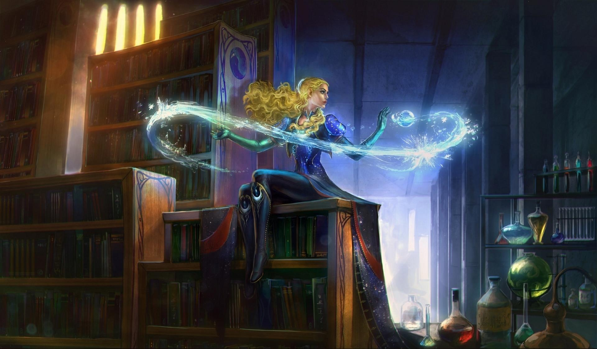

# 第七卷 ch007（全書 ch214）｜不懂魔法的研究者

> 所屬：第二篇｜奧術求知・冰霜魔導（卷內 ch007–012｜全書 ch214–219）

**篇章目的**： 建立顧淵與塞拉菲娜的知識型關係。她不是單純需要救援的天才法師，而是有自己的研究目標、學術地位與性格缺陷。

- **出場人物**：顧淵、塞拉菲娜、學院教授。
- **場景**：奧術學院符文研究室。
- **核心情節**：
   1. 塞拉菲娜主動找顧淵，追問他在公開課提出的問題。
   2. 顧淵坦承自己並非艾瑟蘭魔法師，而是來自另一套修煉文明。
   3. 塞拉菲娜對「真元、神識、經脈」等概念感到陌生。
   4. 兩人交換基礎理論，發現彼此都無法直接理解對方的能量模型。
   5. 塞拉菲娜提出合作研究，但要求顧淵接受她的實驗規範。
- **情感落點**：好奇、戒心與學術競爭。
- **伏筆**：塞拉菲娜的符文研究與某座失落法師塔有關。
- **萬界樓**：收錄奧術與真元的初步比較，不產生雙修修復。
