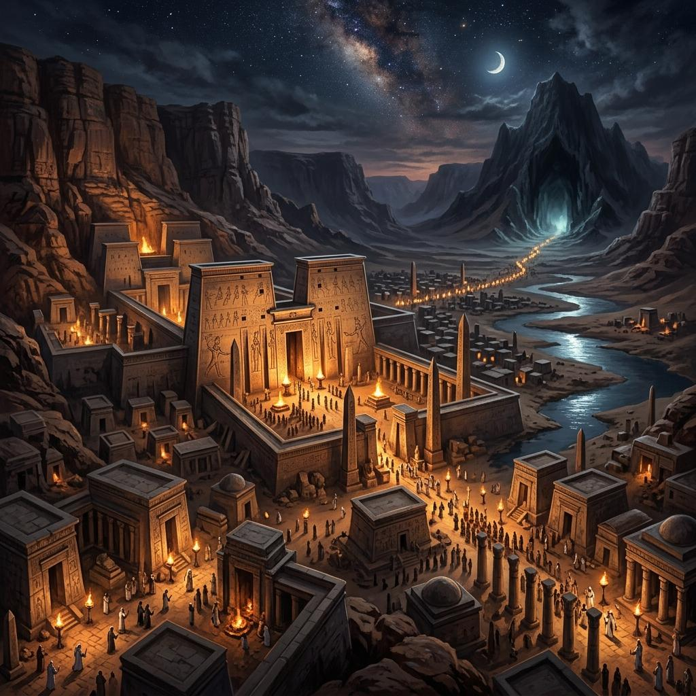

# 第七卷 ch025（全書 ch232）｜穿越黃沙

> 所屬：第五篇｜沙漠古國・失落秘法（卷內 ch025–034｜全書 ch232–241）

**篇章目的**： 這是本卷特別擴充的一篇。除了克麗奧佩脫拉的歷史映射，也要讓讀者看到艾瑟蘭並非只有帝國、奧術評議會與精靈庭院三種文明。沙漠古國有自己的魔法、歷史、政治與命運。

這篇分成五個階段：沙海初行、王都風華、女王之謎、王朝秘藏、泰坦遺痕。

- **出場人物**：顧淵、沙漠商隊、護衛。
- **場景**：南方沙漠商道。
- **核心情節**：
   1. 顧淵依菲奧娜取得的座標，前往南方沙漠。
   2. 沙漠氣候、地形與以太流動方式都與北方大陸不同。
   3. 商隊使用星象羅盤與古老符石辨認方向。
   4. 顧淵發現沙漠夜間的星辰能量十分特殊，並非單純以太魔網的延伸。
   5. 商隊談及古王國的王都與末代女王，暗示當地政治局勢並不穩定。
- **爽點與情感落點**：異域風情、沙漠冒險與文明差異。
- **伏筆**：商隊持有一枚古代王室符印，與顧淵在遺跡見過的符文相似。
- **萬界樓**：收錄沙漠星象能量資料。
