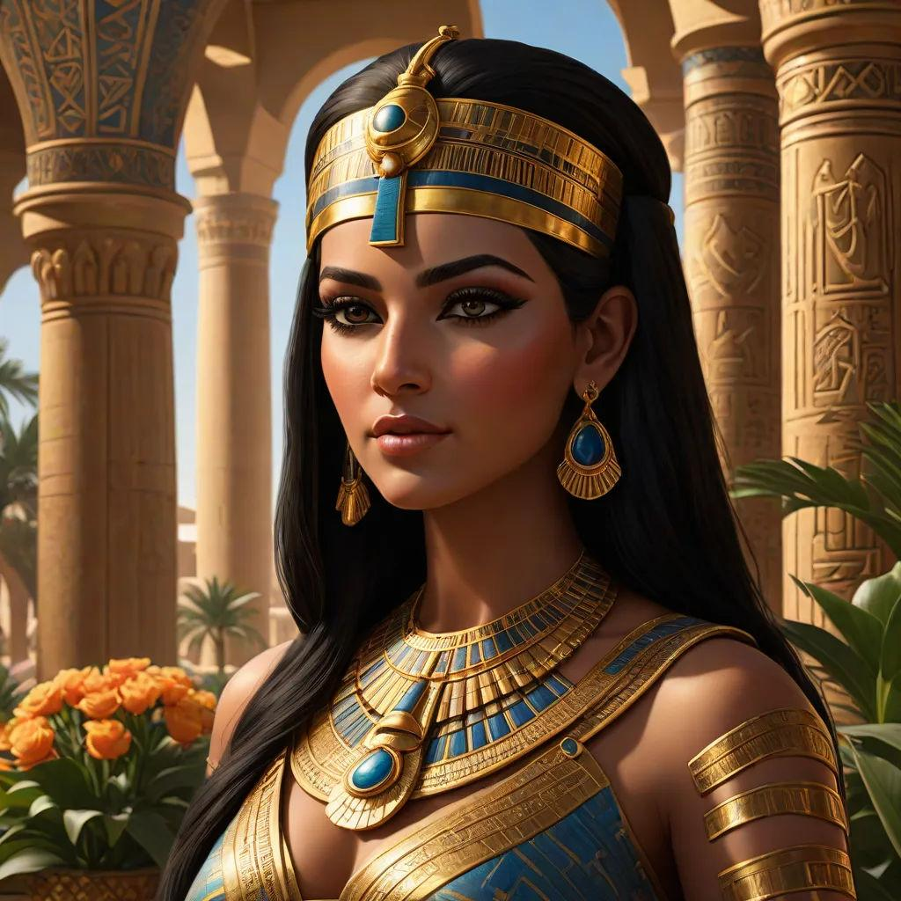

# 《萬界風月樓》第七卷人物關係設定｜顧淵與三位女主（v1.0）

這份文件不只是人物簡介，而是要定義四件事：

1. 女主原本是怎樣的人，有什麼人生目標。
2. 她與顧淵如何相遇，最初如何看待他。
3. 兩人如何從陌生、好奇、信任，逐漸發展成愛情與親密關係。
4. 確立關係後，兩人如何相處，以及她在萬界風月樓中的位置。

---

## 一、三位女主與顧淵的關係定位

### 艾琳諾・晨星｜溫柔守護型

**關係核心：從守護者到彼此的歸屬。**

- **初識**：她對顧淵抱持善意，但保持必要戒心。
- **相知**：顧淵理解精靈生命傳承，也尊重她對族群的責任。
- **動情**：她發現顧淵不只是想救她，而是真正關心她這個人。
- **確立關係**：她願意在守護精靈族之外，也為自己選擇一份感情。
- **相處特色**：溫柔、細膩、依戀，偶爾也會有自己的小任性。

### 塞拉菲娜・馮・羅恩｜知性傲嬌型

**關係核心：從學術對手到靈魂知己。**

- **初識**：她對顧淵的無咒施法極度好奇，甚至懷疑他隱瞞了某種古代魔法。
- **相知**：兩人透過研究、辯論、實驗建立默契。
- **動情**：她逐漸發現，顧淵是少數能理解她的知識追求，也能看見她脆弱一面的人。
- **確立關係**：她不願承認自己已經動心，卻開始在意顧淵與其他女性的相處。
- **相處特色**：鬥嘴、吃醋、口是心非，偶爾主動又迅速害羞。

### 菲奧娜・格里芬｜英武坦率型

**關係核心：從並肩作戰到相互託付。**

- **初識**：她因顧淵身分不明而調查他，對他保持警戒。
- **相知**：兩人經歷戰鬥與調查，逐漸建立信任。
- **動情**：她欣賞顧淵的實力，更看重他在關鍵時刻的判斷與擔當。
- **確立關係**：她不再只是以騎士身分與顧淵並肩，而是以一個女人的身分選擇他。
- **相處特色**：直率、熱情、不扭捏，有時比顧淵更主動。

---

## 二、三段感情必須有不同的發展節奏

不採用「男主救她、她感動、然後愛上男主」的單一模式。

| 發展階段 | 艾琳諾 | 塞拉菲娜 | 菲奧娜 |
|---|---|---|---|
| 相遇 | 善意與戒心 | 好奇與質疑 | 懷疑與調查 |
| 熟悉 | 理解與陪伴 | 研究與辯論 | 合作與磨合 |
| 動情 | 情感依靠 | 心智吸引 | 欣賞與信任 |
| 確立關係 | 溫柔接納 | 傲嬌承認 | 坦率選擇 |
| 親密相處 | 柔情依戀 | 甜蜜鬥嘴 | 熱情直接 |

這樣即使三人最後都成為顧淵的重要伴侶，讀者仍能清楚分辨她們各自的魅力。

---

## 三、還需要補充的關係資訊

每位女主都應建立以下資料：

| 項目 | 要確立的內容 |
|---|---|
| 基本身份 | 年齡、種族、外貌、職業、地位 |
| 性格 | 優點、缺點、習慣、情緒表現 |
| 感情經歷 | 是否曾經戀愛、對愛情的理解 |
| 拒絕與接受 | 哪些行為會令她反感，什麼會讓她動心 |
| 感情進度 | 初識、熟悉、曖昧、確立關係 |
| 親密關係 | 主動性、依戀方式、相處特色 |
| 未來生活 | 是否願意前往萬界樓、是否保留原世界身份 |
| 後續發展 | 是否有婚姻、子女、家庭與長期生活安排 |

另外還有一項不能忽略：**三位女主彼此的關係。**

她們不必一開始就熟悉，也不必沒有嫉妒。塞拉菲娜的傲嬌、菲奧娜的直率、艾琳諾的溫柔，三種性格碰在一起，本身就能產生不少有趣的互動。

---

## 四、共同前提

顧淵與三位女主的關係，不應只是第七卷結束時的階段性成果。她們應該是能夠持續出現在後續《萬界風月樓》故事中的長期伴侶。

因此，這一卷要完成的是：

- 建立彼此的感情。
- 讓三人有自己的選擇。
- 讓關係具有實際進展，而不只是口頭承諾。
- 為未來共同生活、親密關係、家庭與後代留下發展空間。

克麗奧佩脫拉則維持獨立人物定位，不套用上述女主關係模板。

---

# 第七卷人物設定｜克麗奧佩脫拉七世（彩蛋人物）

**克麗奧佩脫拉七世**　Cleopatra VII｜沙漠古王國末代女王
歷史映射人物｜彩蛋女主｜非長期伴侶

## 一、基本人物資料

| 項目 | 設定 |
|---|---|
| 姓名 | 克麗奧佩脫拉七世 |
| 外文名 | Cleopatra VII |
| 身分 | 沙漠古王國末代女王 |
| 種族 | 人族 |
| 年齡 | 約三十歲（出場時） |
| 外貌 | 黑色長髮、深邃眼眸、肌膚白皙，容貌明豔而高貴 |
| 身材 | 優雅勻稱，具有成熟女性的魅力 |
| 身分地位 | 王國最高統治者 |
| 魔法體系 | 古代星象、祭司秘法、靈魂契約 |
| 主要能力 | 星辰占測、精神幻術、古代召喚、王權契約 |
| 性格 | 聰慧、優雅、敏銳、善於交涉、意志堅定 |

這裡的年齡與外貌屬於小說版本設定，不必拘泥於歷史人物的具體生平。

## 二、人物性格

她不是單純的美豔女王，而是一位真正懂得如何統治國家的女性。

**外在性格：**

- 優雅從容，言談有禮。
- 擅長察言觀色，能迅速判斷對方的意圖。
- 喜歡掌握談話主導權。
- 對陌生人保持距離，不輕易暴露真實想法。

**內在性格：**

- 有強烈的自尊與王者尊嚴。
- 對自己的國家有深厚感情。
- 不甘心成為大國博弈中的棋子。
- 即使明知王朝可能走向終結，仍然希望親自決定自己的命運。
- 其實也渴望有人能夠不以女王身分，而是以一個普通女人的角度理解她。

**人物弱點：**

她太習慣以政治家的方式思考。她會計算利益、判斷風險、安排退路，甚至在感情上也容易先考慮對方的目的。但她未必能看透一個不受王權、利益與政治牽制的人。這正是顧淵可能帶給她的意外。

## 三、歷史映射與魔法世界改編

| 歷史影子 | 艾瑟蘭版本 |
|---|---|
| 托勒密王朝末代女王 | 沙漠古王國末代女王 |
| 凱撒 | 來自西方強大帝國的征服者與政治盟友 |
| 馬克・安東尼 | 與她建立軍事及政治同盟的強大統帥 |
| 羅馬勢力擴張 | 星輝帝國對南方沙漠的政治與軍事壓力 |
| 王朝覆亡 | 古王國面臨統治權與文明傳承的危機 |

但不照搬歷史結局。她可以失去部分領土、王權受到限制，甚至王朝最終終結；然而，她的個人命運必須由她自己作出選擇。

## 四、魔法能力與特殊傳承

她不是主流九環魔法師，而是古王國祭司王族的傳承者。

- **星辰占測**：能透過星象與古代星盤觀察以太流動，推測某些重大事件的可能走向，但不能準確預知未來。
- **祭司秘法**：利用古代咒文、祭儀與神殿結界，調動特殊的以太力量。
- **王權契約**：透過古老王族血脈與守護靈建立契約，能召喚王朝守護者，也能維持古代遺跡的封印。

她的力量不以正面戰鬥見長，真正可怕的是知識、情報、精神魔法與政治手腕。

## 五、她與顧淵的關係發展

1. **意外相遇**：顧淵為了追查泰坦以太核心，進入沙漠古王國的王室遺跡。克麗奧佩脫拉最初將他視為一名來歷不明、實力深不可測的外國強者。她不急著求助，而是先試探顧淵的目的。
2. **智慧交鋒**：她發現顧淵對權力、財富與王位似乎沒有興趣。兩人從古代遺跡談到文明興衰，從魔法傳承談到不同世界的統治者。她第一次遇到一個不需要向她效忠，也不打算利用她王權的人。
3. **卸下王冠**：在一次獨處的夜晚，她暫時放下女王身分，向顧淵談起自己的孤獨、焦慮與對王朝命運的憂慮。顧淵沒有承諾替她守住王國，也沒有要求她放棄王位。他只是認真聽她說話。這種不帶政治目的的相處，讓她產生了難以言明的情感。
4. **短暫情愫**：兩人可以有一段短暫而真實的親密時光。這不是政治交易，也不是女王對強者的依附。她主動作出選擇，顧淵也尊重她的身分、意願與人生。
5. **各自前行**：顧淵完成泰坦遺跡的調查，準備離開沙漠古王國。克麗奧佩脫拉沒有要求他留下。她仍然要面對自己的國家、臣民與王朝命運。兩人留下彼此的記憶，但不建立長期伴侶關係。

## 六、她的情感特色

她與三位正式女主最大的不同，在於她是一位成熟、具有豐富人生經驗的統治者。

| 情感面向 | 表現方式 |
|---|---|
| 對顧淵的好奇 | 想知道他真正來自哪裡 |
| 對顧淵的欣賞 | 欣賞他的自由與不受權力誘惑 |
| 對顧淵的情感 | 短暫放下戒心，享受一段不必計算利益的相處 |
| 主動性 | 有自己的判斷，也敢於表達意願 |
| 嫉妒心 | 不會刻意爭奪，但可能對顧淵的離去感到遺憾 |
| 最終態度 | 不挽留、不依附，保留一份特殊回憶 |

## 七、與三位正式女主的區別

| 人物 | 關係定位 | 情感持續性 |
|---|---|---|
| 艾琳諾 | 長期伴侶 | 持續發展 |
| 塞拉菲娜 | 長期伴侶 | 持續發展 |
| 菲奧娜 | 長期伴侶 | 持續發展 |
| 克麗奧佩脫拉 | 特殊相遇、短暫情愫 | 留下回憶，不建立長期關係 |

克麗奧佩脫拉不必在卷末加入萬界樓，也不必與三位女主見面。她的故事可以獨立成立。

## 八、人物代表台詞

以下作為人物語氣參考，正式寫作時可以再調整：

> 「我曾經擁有一個王國，卻從未真正擁有自己的命運。」
>
> 「你不想要我的王冠，也不想要我的土地。那麼，顧淵，你究竟想從我身上得到什麼？」
>
> 「今晚不要稱呼我為女王。至少在這個夜晚，讓我只做克麗奧佩脫拉。」
>
> 「你會離開，而我仍要留在這裡。這一次，我不打算讓任何人替我決定結局。」

## 九、人物設定的核心定位

她最有價值的地方，不在於她是第四位漂亮女性，而在於她代表了一種不同的人生。

艾琳諾守護生命，塞拉菲娜追求真理，菲奧娜堅持榮譽；克麗奧佩脫拉則是即使站在王座之上，也可能無法掌握自己命運的女人。

她與顧淵的相遇，不必改變整個人生，也不必成為萬界樓的一員。但她應該讓讀者記得：在艾瑟蘭，顧淵曾遇見一位女王，而那位女王曾有一個夜晚，只想做回她自己。

這樣就足以成為一個有辨識度的彩蛋人物。
