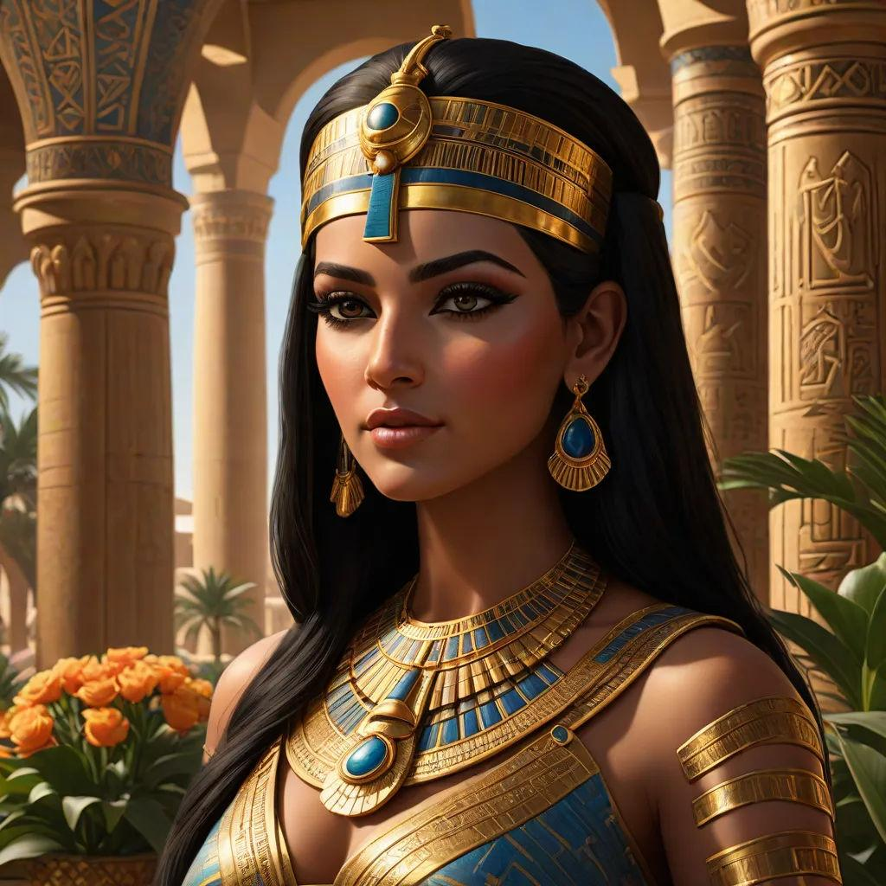

# 第七卷人物速查表｜艾瑟蘭三位正式女主＋彩蛋人物（第七卷完稿狀態）

> 原始規劃備份見 `characters.bak.md`。本表已依《第七卷》40 章完稿結果同步更新關係階段、修為蛻變、紅顏道印與後續去向。

## 一、核心關係與第七卷完稿總覽

- **結算總覽**：三位正式女主皆於本卷完成自主選擇、雙修共鳴與長期伴侶關係確立，並獲贈萬界樓跨界星墜，各自留守艾瑟蘭推展獨立志業（保留後續入樓、與他界諸女相會及未來家庭空間）；**克麗奧佩脫拉七世**完整走完獨立彩蛋弧線，不入萬界樓、不與三女見面。
- **本卷雙修總結（`800 → 910/10000`）**：`ch030` 克麗奧佩脫拉七世（+20）｜`ch036` 艾琳諾（+30）｜`ch039` 塞拉菲娜（+30）｜`ch040` 菲奧娜（+30）。

| 角色 | 關係狀態（卷末） | 紅顏道印／信物 | 卷末實力與反哺成果 | 當前去向與獨立志業 |
|---|---|---|---|---|
| **艾琳諾・晨星** | 長期伴侶｜正式確立（`ch036`） | **月曜星葉印**＋跨界星墜 | 生命印記淨化重鑄「**月曜生機無瑕印**」；高階生命共鳴境、天然抗死氣 | 翠玉庭院「自然與守序協調主祭」，守護新生世界樹 |
| **塞拉菲娜・馮・羅恩** | 長期伴侶｜正式確立（`ch039`） | **冰霜星軌印**＋跨界星墜 | 三年暗滯轉化「**太素冰心・六環魔導真印**」；正式晉升**六環冰霜大魔導士** | 達拉然「古奧術與平衡研究院」首席院長，推展平衡奧術 |
| **菲奧娜・格里芬** | 長期伴侶｜正式確立（`ch040`） | **聖輝長劍印**＋跨界星墜 | 凝成「**聖輝獅鷲不滅戰體**」；晉升**五階聖騎士巔峰**、抗暗影侵蝕 | 星輝帝國北境聖殿代理大隊長，攜亞瑟推動騎士改革 |
| **克麗奧佩脫拉七世** | 彩蛋人物｜短暫情愫・體面告別（`ch030`/`ch034`） | **王室星辰符印**（僅座標識別，非長期錨點） | 洗去十年血脈暗傷，覺醒「**星辰洞察靈覺**」；精氣重歸巔峰 | 留守黃金王都掌舵古王國外交與南端泰坦封印維護 |

---

## 二、三位正式女主（第七卷完稿檔案）

### 1. 艾琳諾・晨星｜精靈族・月曜主祭

- **性格與互動**：溫柔沉靜、原則堅定、細膩依戀偶帶小任性；與塞拉菲娜微醋交鋒時從容大氣。
- **第七卷弧線實績**：泉眼初遇（`ch013`）→ 議事庭力阻斷根術、霧葉地下根脈並肩阻死氣（`ch016`–`ch017`）→ 觀月平台卸下數十年孤寂（`ch018`）→ 四方會議定下二十人入林底線（`ch035`）→ 決戰前夜月露靜榭主動告白雙修（`ch036`，`+30 → 850/10000`）→ 千里坐鎮世界樹生命端接引順流（`ch038`）。
- **現況**：獲任精靈「自然與守序協調主祭」，保有獨立族群責任與對顧淵的長久牽掛。

### 2. 塞拉菲娜・馮・羅恩｜達拉然・六環冰霜大魔導士

- **性格與互動**：知性銳利、傲嬌嘴硬、對真理近乎偏執；花廊見艾琳諾與顧淵親暱後明顯吃醋，終以直球告白破冰。
- **第七卷弧線實績**：公開講堂因「陰陽動態雙弧」震動初識（`ch006`）→ 實驗室被顧淵點破三年右臂暗滯、失落法師塔並肩破局（`ch008`–`ch010`）→ 反噬卸防與雪夜論道成知己（`ch011`–`ch012`）→ 四方會議解析泰坦藍圖、泰坦核心現場重寫九重雙弧導正矩陣（`ch035`/`ch038`）→ 冰晶觀星亭雪夜告白雙修破境六環（`ch039`，`+30 → 880/10000`）。
- **現況**：發表《以太循環平衡與可持續調節系統論》震撼評議會，執掌達拉然古奧術與平衡研究院。

### 3. 菲奧娜・格里芬｜星輝帝國・北境聖殿代理大隊長

- **性格與互動**：英武坦率、鐵血護民、直球熱情且常掌握主動；面對權貴壓迫不盲從亦不衝動兵變。
- **第七卷弧線實績**：獅鷲堡問詢與校場演武互敬（`ch019`–`ch020`）→ 灰溪村共護百姓、端掉真理黑袍會地下工坊（`ch021`–`ch022`）→ 智送靈氣拓印鐵證赴帝都恩師處、城牆立並肩之約並交沙漠座標（`ch023`–`ch024`）→ 泰坦核心石橋血戰死守退路（`ch037`–`ch038`）→ 獅鷲堡觀星閣卸甲坦率主動雙修（`ch040`，`+30 → 910/10000`）。
- **現況**：清剿霍爾頓腐敗集團後獲擢升，留守帝國推動《騎士團獨立監察與榮譽改革條例》。

---

## 三、彩蛋人物｜克麗奧佩脫拉七世（Cleopatra VII）

- **基本資料**：沙漠古王國末代女王｜人族｜約 30 歲｜黑長髮、深邃黑曜石眼眸、明豔高貴、具極高政治手腕與祭司星辰傳承（星辰占測、祭司秘法、王權血脈契約）。
- **第七卷弧線完結**：星辰殿外交試探與平等合作（`ch028`）→ 星象台論史卸下外交辭令（`ch029`）→ 藍蓮星辰露台自選卸冠之夜雙修共鳴（`ch030`，`+20 → 820/10000`，覺醒星辰洞察靈覺）→ 親率王室近衛雷霆清算私通黑袍會之阿蒙元老反對派（`ch031`）→ 開放星辰圖書庫助尋深沙泰坦前哨（`ch032`–`ch033`）→ 撥出三分之一祭司穩固南端封印、開啟外交新局並與顧淵體面別離（`ch034`）。
- **定位原則（已嚴格落實）**：不入萬界樓、不與三女見面、不依附挽留；留給顧淵的「王室星辰符印」僅作日後辨識沙漠古國星域之座標媒介與珍貴回憶。

---

## 四、第七卷重要配角與勢力速查

| 人物 | 所屬勢力 | 第七卷結局與現況 |
|---|---|---|
| **奧爾良大師** | 達拉然・符文工坊院六環大師 | 由保守質疑轉為折服，支持塞拉菲娜組建「古奧術與平衡研究院」 |
| **大長老塞拉斯** | 精靈族・翠玉庭院 | 叫停斷根術，參與簽署四方《泰坦遺址共同維護公約》，贈顧淵銀葉徽章 |
| **亞瑟大騎士長** | 星輝帝國・帝都聖殿正直派系 | 憑菲奧娜密送鐵證發動皇室清腐，力挺菲奧娜推動騎士制度改革 |
| **銀龍使者奧瑞利安** | 北境銀龍一族 | 因黑袍會盜取古龍之魄參戰，協助守住冰谷外圍並代表龍族加入四方公約 |
| **真理黑袍會大導師** | 真理黑袍會（反派首腦） | 強行超載逆轉泰坦核心欲奪太古之力，遭深淵逆流與核心反噬形神俱滅（`ch038`） |
| **霍爾頓子爵／阿蒙元老** | 帝國北境權貴／沙漠神廟舊派 | 暗中勾結黑袍會牟利，先後遭帝都皇室與女王近衛雷霆清算落網（`ch031`/`ch040`） |
| **莫爾頓／巴頓／阿齊茲／綠洲老祭司** | 邊境與商路見證者 | 引領顧淵認識艾瑟蘭凡俗日常、奧術制度與大漠星辰時序傳承 |
