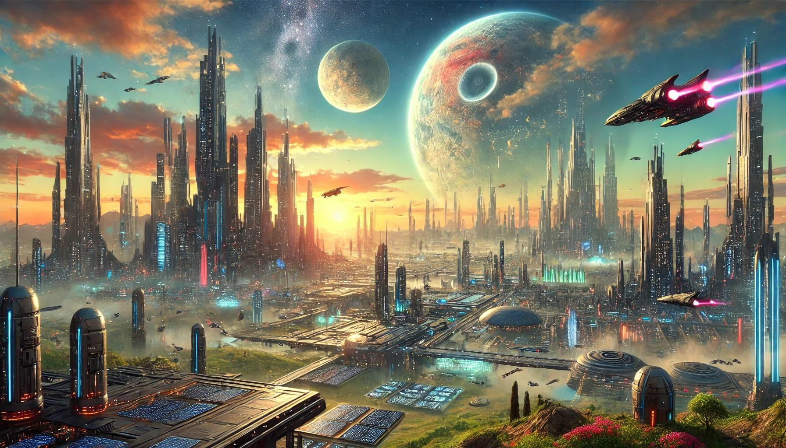

# 第八卷 ch001｜星軌觀覽台的新航程

> 所屬：第一篇｜星門之外（卷內 ch001–006）

**篇章目的**：讓顧淵與讀者進入一個「沒有修仙，卻創造了生命」的星際文明。前六章先建立諾瓦星的生活感、制度與三種人工生命的存在樣貌，再讓雷婭在衝突中登場；不急著談感情，也不急著談利維坦。

- **出場人物**：顧淵、靈素。
- **場景**：萬界樓【星軌萬象觀覽台】、本源大殿。
- **核心情節**：
   1. 第七卷歸樓後短暫休整：修復度 `910/10000`，四座雙向星門穩定運轉，文瀾界三錨點仍被絕靈霧暫封。
   2. 觀覽台精度提升後，`04｜諾瓦星域` 的座標首次清晰浮現——一顆被城市燈火包覆的星球。
   3. 觀覽台同時捕捉到諾瓦星深處一段極低頻、規律的脈動，靈素形容「像心跳，又像潮汐」，無法歸類，只能標記為未知。
   4. 靈素提醒：諾瓦星靈氣稀薄、法則偏向物質與電磁，顧淵的修為將大幅受限，可倚重的只有心念共鳴與部分神識。
   5. 顧淵決定前往——不是為了尋找資源或伴侶，而是想親眼看看一個以科技「造出生命」的文明，如何回答「生命是什麼」。單向通道開啟。
- **生命層次**：序章——由顧淵心中浮現全卷總提問「生命的價值，究竟來自它的存在本身，還是來自它所做的選擇？」
- **爽點與情感落點**：歷經七卷後的沉穩好奇；靈素一句「這次別又四年不回來」，帶出萬界樓作為「家」的溫度。
- **伏筆**：
   - 低頻脈動（`WL8-02` 起點，**永不揭曉**）。
   - 靈素談及「無實體意識」時微妙的沉默（`SL-02`，遙呼應零）。
- **萬界樓回饋**：建立諾瓦星初始座標，開啟單向通道。修復度維持 `910/10000`。
