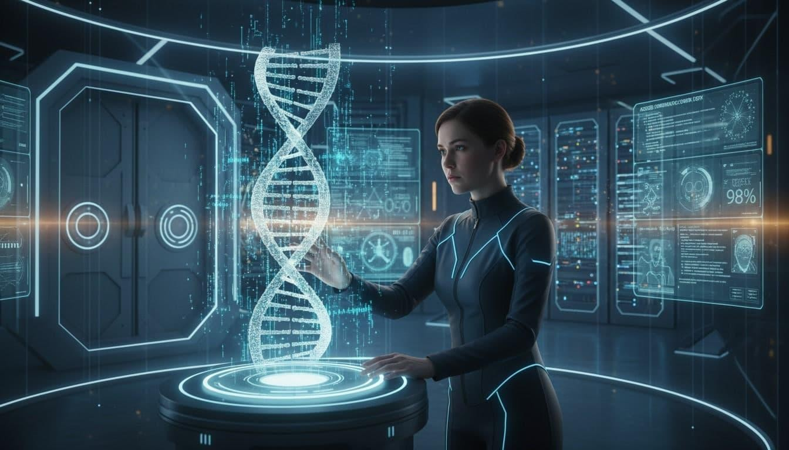

# 第八卷 ch014｜基因城

> 所屬：第三篇｜複製人生（卷內 ch014–020）

**篇章目的**：以薇薇安的身世與自主權為主軸。顧淵**始終不替她做決定**，她以自己的力量奪回人生；感情走「照顧→信任→依戀→相許」弧線，與雷婭的「好奇→測試→失控→確認」明確區隔。雷婭在本篇有自己的事要忙，並與薇薇安展開第一次理性 vs 感性的合作與摩擦。

- **出場人物**：顧淵、雷婭、伊甸穹頂居民、**羅莎・伊巴拉醫生（Dr. Rosa Ibarra）**（短暫）。
- **場景**：**伊甸穹頂（Eden Dome，俗稱基因城）**——巨型生態穹頂、培育中心、複製人社區。
- **核心情節**：
   1. 雷婭為米拉案需調閱伊甸穹頂的醫療紀錄，與顧淵同行進入基因城；抵達後二人分頭行動，雷婭專注於自己的案子。
   2. 基因城景觀：人工四季的生態穹頂、如大學城般的培育中心；城內大多數居民是以設計、調整或重組基因組誕生的**基因培育人**（不一定有單一原始個體），以「序號＋自選名」生活；唯獨少數高階專案會以特定傑出人物為藍本培育**基因複製人**。
   3. 人工培育生物生命的社會地位：自然生物軀體，法律上多屬「受培育合約約束之公民」——人生前三十年的職業與居住常由合約預定，有人安於此道，也有人渴望自主。
   4. 穹頂內生命場密度遠高於外界；諾瓦星稀薄靈氣與此處高密度生命氣息的落差，令顧淵受壓制的真元躁動逆衝。
   5. 顧淵在穹頂溫室區經脈逆亂，昏倒在花圃邊。
- **生命層次**：2. 繁衍與延續——生命可以被「培育」與「規劃」嗎？
- **爽點與情感落點**：基因城之美與規訓並存；顧淵難得的狼狽。
- **伏筆**：
   - 真元逆衝（`ch015` 由薇薇安救治）。
   - 穹頂中央禁區的「繆思計畫」。
- **萬界樓回饋**：收錄基因工程概要。修復度維持 `936/10000`。
