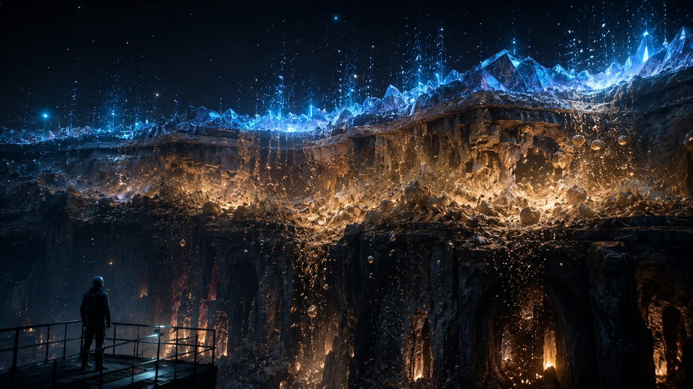

# 第八卷 ch029｜古老訊號

> 所屬：第五篇｜星球的低語（卷內 ch029–036）

**篇章目的**：顧淵與三位女主共同探索，利維坦謎團浮現。**本篇不是戰爭篇**：以探索、環境災害、遺跡解謎與科技冒險為主；**不創造幕後黑手**，也**不讓利維坦成為最後答案**——它不現身、不對話、不揭曉。三女各自以專長切入，形成共同事件。

- **出場人物**：零、顧淵、雷婭、薇薇安、**歐文・里德教授（Prof. Owen Reid，諾瓦星古地質研究所）**。
- **場景**：星網深層檔案庫、舊港區公寓、古地質研究所。
- **核心情節**：
   1. 零在整理「大斷網」前的殘存檔案時，發現一段極古老的資料：八千年地震與地磁紀錄中，存在週期約三十七年的低頻脈動。
   2. 顧淵察覺此頻率與 `ch001` 觀覽台捕捉到「像心跳又像潮汐」的訊號相似——但無法證明兩者是同一件事。
   3. 依週期推算，下一次脈動就在一個月內。
   4. 四人拜訪古地質研究所的里德教授：他研究此現象四十年，被同行視為怪人，研究所即將被裁撤。
   5. 里德邀請他們同行最後一次深井勘查。三女各有理由：雷婭想驗證系統假說，薇薇安想看伊蓮娜當年未竟的研究，零想知道「不知道」是什麼感覺。
- **生命層次**：7. 宇宙與存在——生命是偶然，還是必然？
- **爽點與情感落點**：冒險序幕；四人第一次以團隊身分行動。
- **伏筆**：
   - 三十七年週期（`ch035`）。
   - 伊蓮娜曾與里德合作（`ch033`）。
- **萬界樓回饋**：無。
