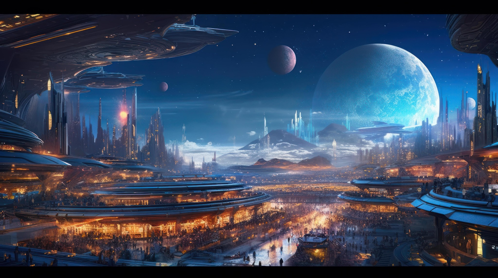

# 第八卷 ch046｜未來再相會

> 所屬：第六篇｜各自的生命（卷內 ch037–046）

- **出場人物**：顧淵、雷婭、薇薇安、零、（萬界樓）靈素。
- **場景**：舊港區廢棄航運塔頂（初次落地處）、萬界樓星軌萬象觀覽台。
- **核心情節**：
   1. 黎明，四人回到顧淵初次落地的塔頂。三女的生命共鳴與萬界樓錨點結合，**第五座雙向星門・諾瓦星門**穩固成形。
   2. 星門可開，但四人約定：門在，各自仍要好好生活——不是等待，而是各自往前走之後的重逢。
   3. 道別：雷婭給他一個不經任何感官調整的擁抱；薇薇安把一包溫室番茄種子塞進他手裡；零讓整座城的燈依序亮起，鋪成通往星門的路（呼應 `ch027` 望遠鏡）。
   4. 顧淵回到萬界樓，在觀覽台打開零的資料星籤：一首歌，一句話——「生命的價值，我還沒有答案。但我選擇了你，也選擇了我自己。」
   5. 尾聲：諾瓦星上，三人各自走向協助中心、溫室診所與無數節點；觀覽台上，另一個陌生星域（`06｜幽羅界`）的座標正在閃爍。
- **生命層次**：總提問回收——以「選擇」回應，但不替生命下定義。
- **爽點與情感落點**：卷末溫柔收束；三女留在自己的世界，繼續活出各自的生命。
- **伏筆**：
   - `WL8-03`：諾瓦星三女重逢與成長線。
   - 第九卷《幽羅界》座標與萬界道標物。
- **萬界樓回饋**：修復度 **`1012/10000（10.12%）`**；第二重天樓已解封；五座雙向星門（青玄／滄瀾／九曜／艾瑟蘭／諾瓦）與二樓【星箋亭】五芒星環全數連通；二樓首殿【萬靈共鳴苑】已啟。
