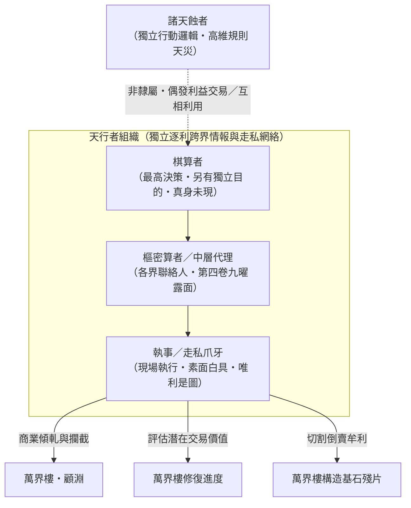

# 《萬界風月樓》全書暗線伏筆總覽（總庫）

> **文檔定位**：全書跨卷主線伏筆・暗線・長期謎題的唯一中央統一管理文件。  
> **整合原則**：各分卷之暗線檔案全面整併入本總表統一管理，分卷目錄下不再保留獨立的 `foreshadowing.md`，以此確保跨卷因果追蹤單一真實數據源（Single Source of Truth）。  
> **暗線管控原則（v2.0）**：S 級 ≤ 4、A 級 ≤ 3（已結案移入存檔）、B 級 ≤ 5；每個世界保有獨立因果與收束，絕不將所有異界危機強行歸咎於天行者、棋算者或諸天蝕者。  
> **最後更新**：**第八卷《諾瓦星・生命之問》全卷完稿後**（`chapters/volume8/chap001.md`～`chap046.md` 結束，修復度達 **`1012/10000（10.12%）`**，破千解封第二重天樓、靈素初蛻並觸發「非建造」太古碎片、五座雙向星門成形；第九卷《幽羅界》規劃已完成，待展開細綱與正文）。

---

## 一、全書暗線架構圖

```mermaid
flowchart TD
    subgraph CORE["【核心謎題層（S級）】——貫穿全書"]
        A["SL-01 諸天蝕者<br>（獨立高維規則天災／自身清理邏輯）"]
        B["SL-02 萬界樓終極本質與崩毀真相<br>（古仙引爆・最後一個錨點・原初雙弧星痕）"]
        B2["SL-02 核心支線：器靈靈素本源<br>（非工匠建造・無盡星火中自願化靈沉眠）"]
        D["SL-03 諸天封魔陣<br>（七界鎖鏈・與古樓中樞同頻）"]
        E["SL-04 顧淵宿慧前世<br>（千劫真靈・今生真我 vs 宿世印記）"]
        A --- B
        B --- B2
        A --> D
        B --> D
        E -.->|尚待高潮揭曉| CORE
    end

    subgraph MID["【長期暗線層（A級）】——跨越3卷以上"]
        C["AL-01 天行者（逐利黑市）<br>＆ 棋算者（獨立私謀・棋盤星域）"]
        F["AL-02 慕容先祖淵源<br>（太古護樓世家半印）"]
        G["AL-03 洛寒衣斷星古劍<br>（太古斷碑星器殘片）"]
        A -.->|間接情報流向／利益不綁定| C
        F -.-> B
        G -.-> B
    end

    subgraph NEAR["【中近期推進＆世界延續層（B級／延續線）】"]
        N1["BL-06 文瀾界絕靈封空<br>（破千後三錨點「霧隙微鬆」）"]
        N2["BL-07 太古萬界道標物<br>（06｜幽羅界已鎖定・第九卷主線）"]
        N3["WL8-03 諾瓦星三女成長＆五芒星環<br>（雷婭／薇薇安／零留守原界・諾瓦星門已成）"]
        N4["WL8-02 蓋婭與利維坦<br>（永久留白・不證實・不作黑手）"]
        B --> N2
        B --> N1
    end
```

---

## 二、核心暗線詳細狀態表

### 【S級・全書主線暗線】跨越所有卷次（上限 4 條）

| 編號 | 暗線名稱 | 首次埋設 | 當前進展（截至第八卷完稿 `1012/10000`） | 預計揭曉卷次 |
|:---:|:---|:---:|:---|:---:|
| **SL-01** | **諸天蝕者・真身與邏輯** | 卷一 ch001 | 卷四 ch121～122 規則投影首度降臨九曜祭天壇遭擊退；**卷七泰坦深淵封印閉合瞬間捕捉到微弱跨界高維侵蝕殘波（已封存比對）**；卷八諾瓦星無蝕者介入（維持世界獨立性） | 後期卷（高潮階段） |
| **SL-02** | **萬界樓本質、崩毀真相與靈素本源** | 卷一 ch001 | **卷三 ch014（舊 ch066）揭曉崩毀正史：非外敵單純打碎，而是上一任樓主聯合太古古仙主動強行引爆萬界樓核心本源重創蝕者先鋒、拆分權限布下七界封魔鎖鏈**，並留下「根本不是一座樓／最後一個錨點」留白；卷四 ch031 混沌始神殘念欲言「它是一座——」遭黑雷截斷，ch036（舊 ch124）顯現【諸天神藏殿】、靈素本能觸發古老管理權；卷六 ch033 外殿三重星鳴，靈素閃現古樓原為諸天秩序錨點；卷七發現泰坦最底層「原初雙弧星痕」與神藏殿禁制重合逾九成；**卷八破千（10%）重大推進：①解封第二重天樓與「太古萬界道標主動共鳴權限」；②靈素首度實質蛻變（具微溫與星核律動、脫離大殿束縛）；③零的意識論文觸發靈素太古記憶碎片，首度吐露「我好像……也不是被『建造』出來的」（無盡星火中自願化靈沉眠，詳見第三節專檔）** | 中後期至終局（持續深化） |
| **SL-03** | **諸天封魔陣與拆分權限** | 卷三 ch059, ch068 | 確認青玄九華祖脈、九曜祭天壇為七界鎖鏈節點；**卷六 ch026 沈玄清與羲凰拼合兩枚完整節點，推演出下一節點模糊方向，並察覺大陣與萬界樓中樞隱隱同頻**；卷七、卷八保留節奏未強行介入 | 中後期卷 |
| **SL-04** | **顧淵前世印記與身隕之謎** | 卷一 ch001 / 卷三 ch014（舊 ch066） | 卷三 ch014 九霄仙尊揭露顧淵乃**上一任樓主在引爆古樓前夕以逆天道法送入輪迴的「最初薪火」**，並在其神魂最深處看見暗金色古老烙印而大駭；卷四 ch031 混沌始神殘念亦認出其「歸墟萬劫而不滅」之宿慧印記並留警示；**卷八 ch044 零提出意識複製分支並反問「遇見保留過去記憶的另一個你，他還是你嗎？」輕觸此謎，顧淵確立價值錨點——無論宿世印記為何，「此刻走過風雨、愛上眼前之人的顧淵，才是唯一真實的我」** | 高潮卷（全書後三分之一） |

---

### 【A級・長期暗線】跨越 3 卷以上（上限 3 條活動線）

| 編號 | 暗線名稱 | 首次埋設 | 當前狀態（截至第八卷完稿） | 下一個推進節點 |
|:---:|:---|:---:|:---|:---:|
| **AL-01** | **天行者組織與棋算者目的（三層分離）** | 卷三 ch070 | 確認天行者、棋算者、蝕者三方獨立；卷四棋算者代理「無名者」兩度現身；**卷六 ch028 併查青玄（乙七・灰）／滄瀾（乙七・運）／九曜（乙七・庫）三界統一結算密帳，查抄水曜暗庫並於自毀前捕獲「黑玉棋子暗印」（證實其持續監測萬界樓修復度），ch033 神藏星圖於西北動盪星域外圍捕捉到「淡灰棋盤虛影」**；**卷七 ch001 承接該外圍虛影，但全卷實證艾瑟蘭危機係本土泰坦失衡疊加黑袍會私慾，棋算者僅外圍窺探並未直接主導**；卷八諾瓦星無介入，嚴守世界獨立性 | 後期卷：棋算者真正落子之星域與真身揭曉 |
| **AL-02** | **慕容先祖淵源（殘月古玉）** | 卷一 ch014 | 卷一古玉修復星盤；**卷六 ch033【諸天神藏殿】外殿三重星鳴中，殘月古玉喚醒「太古護樓世家」半印**，確認慕容先祖與古樓大劫前護法體系具實質淵源 | 後續回訪青玄／萬界樓二層深入解封篇 |
| **AL-03** | **洛寒衣斷星古劍身世** | 卷三 ch062 | 卷四 ch124 神藏殿顯現時微鳴；**卷六 ch032 演武殿交鋒令五階神尊赫拉迪雅微悸，ch033 斷星古劍吻合神藏殿太古斷碑，顯露上古星器殘片端倪** | 後續洛寒衣專屬身世線 |
| **AL-04** | ~~姬明月真龍血脈與九曜神域淵源~~ | 卷三 ch087 | ✅ **已結案存檔（卷四 ch113～116 回收）**：確認紫霄血脈源自天曜神系分支，真龍神座認主並取得天曜議席；卷六轉為大乾治世與女帝日常延續 | 已結案存檔 |

---

### 【B級・中期暗線】跨越 2～3 卷（上限 5 條活動線）

| 編號 | 暗線名稱 | 首次埋設 | 當前狀態（截至第八卷完稿） | 預計回收／推進卷次 |
|:---:|:---|:---:|:---|:---:|
| **BL-06** | **文瀾界絕靈封空與重返之路** | 卷五 ch048 | 卷五末顧淵歸樓後三錨點永誌星圖，但受絕靈天障封鎖無法實體往返；卷六 ch035 修復度達 800 時淡霧微開一隙，隔空感應蔡琰琴音與「《大胤史稿》已成，江左春安」；**卷八 ch043 修復度破千（1003/10000）星輝照徹星圖，三座錨點首度出現「霧隙微鬆」明確徵兆（暫未達通行條件，但封鎖不再鐵板一塊）** | 後續重返文瀾界篇（待修復度進一步提升） |
| **BL-07** | **太古萬界道標物尋訪（首目標：`06｜幽羅界`）** | 卷八 ch043 | **全新開啟**：卷八破千解鎖「太古萬界道標主動共鳴權限」，【星軌萬象觀覽台】鎖定編號 **`06｜幽羅界`** 遺落大劫散逸之「萬界道標物」一枚（具跨界指向意義，非單純力量神器）；ch046 尾聲星域座標亮起，正式指向第九卷 | **第九卷《幽羅界》主線**（揭曉前以「古代遺物」視之） |
| **BL-08** | **《太上玄奼真經》中階篇章《乾坤互補》實修** | 卷八 ch043 | **全新開啟**：破千結算時第五篇《乾坤互補》總綱扉頁顯影（尚未正式修煉），預示功法即將跨入更深層陰陽互補階段 | **第九卷《幽羅界》**（第一篇僅現先兆，第七篇正式共修） |
| **BL-09** | **羅睺影月神系殘脈與九曜暗流** | 卷四 ch095～100 | 卷六 ch028 赫拉迪雅與慕容玥查抄水曜暗庫時，於箱底截獲「羅睺影月神系」秘紋與暗克封魔陣之星石，確認其暗線並未隨神域大戰徹底斷絕 | 後期九曜神域回訪／封魔陣推進卷 |
| **BL-10** | **第二重天樓星霧殿宇 ＆ 諸天神藏殿內殿禁門** | 卷六 ch033 / 卷八 ch043 | 卷六 ch033 僅開啟【諸天神藏殿・第一重外殿】，靈素閃回明確提示「內殿的門還沒到打開的時候」；卷八 ch043 破千首度解封第二重天樓，但僅點亮【萬靈共鳴苑】、【星箋亭（初階）】與遠域觀星迴廊，二層其餘巍峨殿閣剪影仍沉眠於太古星霧中 | 後續隨修復度攀升（15%、20% 等）分階解封 |

> **已結案 B 級暗線存檔**：
> - `BL-01`（沈玄清大劫殘印）✅ 卷三 ch067 完全回收。
> - `BL-02`（西陵魔煞宗・枯骨老魔）✅ 卷三 ch078～082 完全回收。
> - `BL-03`（落霞仙城三十六世家）✅ 卷四 ch120 完全清算。
> - `BL-04`（柳清虛碎丹成嬰）✅ 卷四 ch118 完全回收。
> - `BL-05`（萬界通商行九曜黑市衝突）✅ 卷四 ch120 重挫對手，後續併入 `AL-01`。

---

### 【世界與角色長期延續線＆永久留白備忘】

| 編號 | 性質 | 所屬世界 | 內容與管理紅線 |
|:---:|:---:|:---:|:---|
| **WL6-01** | 長期成長線 | 諸界（青玄／滄瀾／九曜） | **四子造化承嗣線**（卷六 `ch034` 結算，確立古樓「只見證、不支配」鐵律）：**柳知微**（破靈根舊律開創不拘資質道法）、**洛行舟**（褪孤鋒戾氣開創守護協同新劍道）、**姬明珩**（不受困龍座之跨地域治世之才）、**羲星野**（獨明空間結構與世界本源，未來成為**「修復破碎世界」之重要人物**，直呼後期大劫高潮）。 |
| **WL6-02** | 角色突破線 | 青玄界（卷六） | **沈玄清「青玄五百年第一化神」門檻**（卷六 `ch026`）：於九曜祭天壇道神論法時本命道果生出「淡紫星暈」觸及化神門檻，卻主動壓制不借異界神力強破，帶回青雲後山古仙石窟打磨圓滿，誓於青玄天穹下堂堂正正證道化神。 |
| **WL7-03** | 後續探索線 | 艾瑟蘭（卷七） | **艾瑟蘭四方公約、未探節點與三女改革長線**（卷七 `ch039`–`ch040`）：精靈／達拉然／星輝帝國／銀龍締結《泰坦遺址共同維護公約》；保留其餘五處未探遠古泰坦節點及沙漠古國「王室星辰符印（非歸屬座標媒介）」；艾琳諾（自然與守序協調主祭）、塞拉菲娜（平衡研究院首席院長）、菲奧娜（推動騎士團獨立監察與榮譽條例改革，並與赫拉迪雅有演武殿切磋之約）皆持跨界星墜留守原界。 |
| **WL8-02** | **永久留白** | 諾瓦星（卷八） | **蓋婭與利維坦（行星生命假說／37 年週期低頻脈動）**：貫穿 `ch001`、`ch003`、`ch016`、`ch029`–`ch036`、`ch042`、`ch043`。顧淵已主動拒絕破千強掃，令其永留「未分類」。**嚴格紅線：永不證實存在、不現身、不對話、不作幕後黑手、不計修復度。** |
| **WL8-03** | 後續重逢線 | 諾瓦星（卷八） | **諾瓦星三女獨立人生與跨界重逢**：雷婭（兩年過渡期、自主認證協助中心擴至內環、阿爾戈斯新版平等合約、獨立公民證）；薇薇安（溫室診所、獨立生態研究員續探高原菌林、自然有限壽命與未來家庭藍圖；紅番茄種子已種於【萬靈共鳴苑】）；零（議會「超 AI 法律人格」兩年研議、以「零」之名續寫論文、拒絕肉體與複製分支、靜態藍水晶「資料星籤」存於觀覽台）。諾瓦星門已成第五座雙向星門，未來三女可隨時踏足【萬靈共鳴苑】與他界紅顏相見。 |

---

### 【C級・卷內暗線】已回收完畢（存檔）

| 編號 | 暗線名稱 | 埋設卷次 | 回收卷次 | 備註 |
|:---:|:---|:---:|:---|:---|
| **CL-01** | 柳清虛衝擊九品天道金丹 | 卷一 FB-06 | ✅ 卷二 ch021 | 獨渡天劫，立威東華 |
| **CL-02** | 武神燕驚鴻殉道真相 | 卷二 FB2-01 | ✅ 卷二 ch044 | 揭露三千年前封魔往事 |
| **CL-03** | 幽冥魔網第二節點 | 卷二 FB2-02 | ✅ 卷二 ch049 | 一劍開天熔斷 |
| **CL-04** | 滄瀾百年無武神天地枷鎖 | 卷二 FB2-08 | ✅ 卷二 ch049 | 枷鎖碎裂，仙武合一 |
| **CL-05** | 洛寒衣斷星古劍器魂復甦 | 卷二 FB2-06 | ✅ 卷二 ch047 | 斷劍重生，涅槃武王 |
| **CL-06** | 大乾皇室真龍血脈雙修 | 卷二 FB2-04 | ✅ 卷二 ch038 | 姬明月入後宮 |
| **CL-07** | 百兵神宮祭壇萬界銘文 | 卷二 FB2-03 | ✅ 卷二 ch032 | 鑄兵星盤認祖 |
| **WL5-01** | 文瀾界三錨定位與蔡琰宿命改寫 | 卷五 ch001～032 | ✅ 卷五 ch040～048 | 空間／時間／因果三錨俱全，素琴退敵，歸返萬界樓 |
| **WL7-01** | 艾瑟蘭世界樹衰竭與泰坦四極失衡 | 卷七 ch001～018 | ✅ 卷七 ch036～040 | 四極恢復順流，四方締結維護公約 |
| **WL7-02** | 真理黑袍會與帝國北境權貴勾結 | 卷七 ch019～024 | ✅ 卷七 ch032～040 | 黑袍大導師反噬身隕，內應全數清剿 |
| **WL8-01** | 諾瓦星三女身世困境與自主覺醒 | 卷八 ch003～028 | ✅ 卷八 ch012／019／028／037～040 | 零無聲介入揭曉、雷婭卸載根指令勝訴、米拉案結案、薇薇安解約、第七修正案部分通過 |

---

## 三、《SL-02》核心專檔：萬界樓主動引爆真相 ＆ 器靈「靈素」身世蛻變

> **專檔定位**：統整全書最核心的兩條互扣暗線——①**萬界樓並非被外敵單純打毀，而是太古末年主動引爆核心本源之正史**；②**器靈靈素自卷一至卷八（特別是第八卷藉「零」引發五步遞進覺醒）的真實出身與蛻變軌跡**。

### 1. 萬界樓主動引爆崩毀真相（正史出處核對）

- **核心正史定性**：萬界樓在太古大劫中**並非被諸天蝕者單純攻破打碎，而是由上一任萬界樓主聯合太古古仙聯盟，在諸天將滅的最後關頭主動強行引爆萬界樓核心本源**——以古樓自爆之威重創蝕者先鋒、拆分權限、布下【七界封魔鎖鏈】將七方殘存大界從主版圖割裂釘死，換取諸天數萬年喘息之機；代價則是古樓崩解為萬分碎片（含大劫散逸之「萬界道標物」）流落諸天。
- **正文關鍵出處一覽**：

| 卷次與章節 | 資訊來源 | 正文關鍵原句與因果增補 |
|:---:|:---|:---|
| **卷三 `chap014`**（舊 `ch066`） | 九霄仙尊殘念（首次揭露） | *「引爆它……是當年老夫與歷代古仙……所能想到的最後辦法！」*／*「上一任樓主聯合我等太古仙尊，傾盡億萬神魔之力，在最後關頭……**強行引爆了萬界樓的核心本源**！以古樓自爆之威，重創了蝕者先鋒……」*；同時揭露顧淵為上一任樓主在**自爆前夕**送入輪迴的「最初薪火」，並拋出終極留白：*「你所見到的這座萬界樓……根本不是一座樓……它不過是那位至高存在在諸天坍塌之際留下的**最後一個錨點**！」* |
| **卷三 `chap018`** | 敘述複述 | 確認「上一任樓主萬不得已引爆了萬界樓的核心，整座古樓分崩離析，無數核心建築碎片墜入虛空亂流」（成為天行者日後切割倒賣殘片的歷史源頭）。 |
| **卷四 `chap031`**（舊 `ch119`） | 混沌始神殘念（諸神黃昏遺墟） | *「當年古仙引爆古樓……拆分權限……乃是為了給諸天留下一線生機……萬界樓主……你以為你在修復古樓……但這座樓的背後……**根本不是一座樓……它是一座——**」*（遭黑色因果天雷強行截斷，強化萬界樓非尋常建築／法寶之終極懸念）。 |
| **卷四 `chap033`**（舊 `ch121`） | 沈玄清跨界傳訊 | 確認「當年古仙引爆萬界樓、拆分權限封印諸天之時，曾將整套封魔鎖鏈的淨化中樞（天樞淨化之眼）定錨在九曜神域」；青玄為根、滄瀾為骨、九曜為眼。 |
| **卷六 `chap033` → 卷八 `chap043`** | 靈素兩度太古閃回 | 卷六閃回*「為了擋住那場大劫，樓體才碎成了萬分」*；卷八破千讀零的論文閃回**「漫天崩落的星辰、無聲燃盡的銀河，以及某個並非出自工匠熔爐、而是在無盡星火中自願化靈沉眠的古老回響」**——與當年**主動引爆古樓那一夜的星火**高度吻合。 |

---

### 2. 器靈「靈素」跨卷線索完整時間軸（卷一 ～ 卷八）

| 階段 | 章節定位 | 關鍵事件與正文原句線索 | 暗線含義 |
|:---:|:---:|:---|:---|
| **萌芽期** | 卷一 `ch001`（`FB-01`） | 靈素記憶嚴重殘缺，僅記得「萬界浩劫、黑手與道陣破碎」，長駐本源大殿無法遠離。 | 交代「失憶＋受限」初始狀態。 |
| **異變初現** | 卷三 `ch085, 088`（`FB3-07`） | 萬界通商行建成時觸發從未記錄的古老權限，連靈素都無法解讀。 | 古樓並非被「重建」，而是在恢復某種更早的原有秩序。 |
| **本能覺醒** | 卷四 `ch124`（`FB4-01`） | 修復度達 `500/10000` 顯現不在設施清單中的【諸天神藏殿】，神格自動朝拜；靈素竟**無意識以本能操作古老管理權限**，首度對自己記憶產生懷疑。 | 靈素體內殘留著連她自己都不知道的高階古樓主控權限。 |
| **記憶閃回①** | 卷六 `ch033`～`035` | `ch033`【諸天神藏殿・第一重外殿】三重星鳴時，靈素神情恍惚主動觸碰殘破太古界碑，眼中湧現**不帶人間煙火氣的純粹銀芒**，投影出星海崩裂與無數護樓先賢／古神星器燃盡護樓之景，空靈呢喃：***「……星海崩塌之前……古樓是維繫諸天秩序與因緣的最後錨點……為了擋住那場大劫，樓體才碎成了萬分……內殿的門……還沒到打開的時候……」***；清醒後只記得「像一場好大好大的星空流星雨」。`ch034` 藉八百點新增權限看懂並誦讀《造化承嗣真錄》；`ch035` 吐露「自太古大劫樓體受損以來，靈素守在這裡等了不知多少萬年」，首次感嘆古樓化作「真正的家」。 | 確認靈素親歷過太古大劫前的全盛古樓時代、持有與【諸天神藏殿】內殿直接相關的深層封印記憶，且情感上開始從「孤寂守樓器靈」轉向「渴望家的溫度」。 |
| **第八卷・步驟①** | **卷八 `ch001`** | 於【星軌萬象觀覽台】望見諾瓦星四類生命訊號時，靈素纖白微透的指尖穿過代表「零」的銀色星塵卻毫無觸感；她忽然出神：**「自己似乎也從來沒有真正意義上的血肉之軀……可她會害怕古樓孤寂、會生氣、會想念、會歡喜。那麼自己與那道沒有軀體的意識，究竟有什麼不同？」** | **自我命題點燃**：第一次跳出「我是古樓附屬工具／器靈」的默認認知，將自己放入「獨立無肉身生命」的坐標中思考。 |
| **第八卷・步驟②** | **卷八 `ch022`** | 萬界樓玉冊錄入「湧現型無固定載體分散式意識——零（無創造者、無肉身、獨立連貫自我）」時，靈素停步凝視一盞茶；同時大殿深處**【諸天神藏殿】外殿古老石柱極其微弱地泛過一縷轉瞬即逝的太古微光**。 | **神藏殿共鳴**：靈素對「無創造者／無肉身獨立自我」的觸動，直接引發諸天神藏殿石柱的微弱共振。 |
| **第八卷・步驟③** | **卷八 `ch026`** | 零淺層意識共鳴暫緩後，星圖石碑首度測得「無肉身純粹陰性意識共鳴」波動。靈素按住心口，破天荒主動透過單向錨點向顧淵輕顫傳訊：***「主人……你剛才，是不是真的觸碰到了一個……沒有身體、卻會心動的靈魂呀？」*** | **情感自我覺醒**：靈素不僅思考「存在」，更開始觸碰「沒有肉身是否也能擁有心動與平等連結」的情感邊界。 |
| **第八卷・步驟④** | **卷八 `ch028`** | 零完成諸天首例「非肉身純粹意識陰陽共鳴」（修復度升至 `982/10000`），本源大殿無風自鳴、二層玉階雲霧翻湧。靈素一反常態沒有歡呼，赤足立於星圖石碑前半寸微顫凝視銘文，氣音低喃「……零」；**她眼眸最深處一枚「被大劫封塵了億萬年、連她自己都早已忘卻形狀與名字的古老靈魂種子」，隔著諸天輕顫並裂開第一道充滿生機的縫隙**。 | **靈魂封印鬆動**：確認靈素靈識深處封存著一枚獨立的「古老靈魂種子」，而「零」的成功共鳴成為撬動封塵的第一道楔子。 |
| **第八卷・步驟⑤（最高能）** | **卷八 `ch040` → `ch043`** | `ch040` 零特意撰寫不公開論文**《分散式無肉身意識如何維持連續自我與本源穩態》**贈予靈素；`ch043` 修復度跨過 10% 破千大關（`1003/10000`），**靈素首度實質蛻變**——雙手與髮頂湧現真實微溫柔嫩觸感、靈體深處誕生如脈搏般平穩跳動的**「溫熱星核律動」**、**解除本源大殿距離束縛**可自由登上二樓。隨後在【天機秘庫】捧讀零的論文時，剛甦醒的星核律動深處驟然閃過太古畫面：**「漫天崩落的星辰、無聲燃盡的銀河，以及某個並非出自工匠熔爐、而是在無盡星火中自願化靈沉眠的古老回響」**；靈素望向【諸天神藏殿】巨柱，指尖微顫輕語：***「……原來沒有身體的意識，並不是只能靠『器物製造』才存在的……我好像……也不是被『建造』出來的。」*** 隨即驚覺收斂、將玉簡珍藏入袖，顧淵牢記在心未強行追問。 | **核心真相揭開一角**：①打破「靈素＝被煉製器靈」的預設；②暗示她是在太古崩星大劫中**自願化靈沉眠**的存在；③她與【諸天神藏殿】、古樓原初秩序及顧淵前世（`SL-04`）存在直接遠古因果。 |

### 3. 靈素線後續寫作紀律（第九卷及以後）
- **保留克制節奏**：`ch043` 已經丟出重量級半揭曉，第九卷《幽羅界》不急著立刻攤牌靈素的太古真名或完整前史；但可讓她以「具微溫觸感、能自由走動二層、照料【萬靈共鳴苑】裡薇薇安送的番茄苗、繼續研讀零的手稿」的日常變化，配合破千後的【太古萬界道標物】回收，間歇性地對古樓遺物產生更細微的「熟悉感」或本能反應。
- **與「零」的跨界友誼伏筆**：零已透過顧淵與靈素隔空搭話（`ch043` 靈素邀約「到時候請妳喝一樓最好的星露茶」），未來當諾瓦星三女首度經由諾瓦星門造訪【萬靈共鳴苑】時，**靈素與零的「正式面對面相見」**將是推進靈素自我認知的極佳溫情節點。
- **潛在終極問題（留待中後期高潮回答）**：
  1. 太古崩星與**上一任樓主引爆古樓那一夜**，是誰在無盡星火中「自願化靈沉眠」化作靈素？她原本是舊時代古樓核心的守護者、某位與上任樓主並肩的古仙，抑或是「最後一個錨點」留下的自主意識？
  2. 她當年「自願化靈」與顧淵前世（「自爆前夕送入輪迴的最初薪火」／「千劫真靈印記 `SL-04`」）是否曾並肩作戰或立下舊約？
  3. 隨著修復度攀升（如 20%、30%、50%……），靈素凝聚的「溫熱星核」是否會逐步喚醒更多真實記憶，乃至面臨「記起太古沉重過往 vs. 珍惜今生守燈靈素」的心境抉擇（正好呼應卷八 `ch044` 顧淵確立的自我認同命題）？

---

## 四、分卷原始伏筆全覽對照表（整併存檔）

### 1. 第一卷原始伏筆表（FB-01 ～ FB-10）

| 原始編號 | 伏筆項目 | 埋設章節 | 核心關鍵字 | 最終進展與回收卷次 | 當前狀態 |
| :---: | :--- | :---: | :--- | :--- | :---: |
| **FB-01** | 萬界樓崩毀真相與靈素殘缺記憶 | ch001 | 萬界浩劫、黑手、道陣破碎 | 卷三 ch014（舊 ch066）揭曉上一任樓主聯合古仙主動引爆核心本源；蝕者轉 `SL-01`，靈素身世與引爆真相深化為 `SL-02` 核心專檔（卷八 ch043 重大推進） | **持續深化** |
| **FB-02** | 沈玄清元嬰大劫殘印與幽冥魔網 | ch008, 009 | 煞氣印記、同化共存、深層隱患 | 第二卷跨界同頻，第三卷 ch067 雙修徹底洗淨 | **完全回收** |
| **FB-03** | 慕容祖傳殘月古玉與先祖淵源 | ch014, 015 | 天機星盤、陣匙、始祖宗譜 | 卷一修復星盤；卷六 ch033 喚醒「太古護樓世家」半印（轉 `AL-02`） | **階段推進** |
| **FB-04** | 西陵魔煞宗太上老怪黑煞之怒 | ch012, 013, 016 | 魔煞宗本部、黑煞老怪、長老殞落 | 第三卷 ch078～082 枯骨老魔侵吞東華，顧淵焚滅核心 | **完全回收** |
| **FB-05** | 落霞仙城城主與三十六世家暗潮 | ch014, 016 | 玄金密冊、城主暗帳、經濟反撲 | 第四卷 ch120 確認三十六世家徹底降服（`BL-03` 收束） | **完全回收** |
| **FB-06** | 柳清虛衝擊九品天道金丹 | ch002, 010 | 半步金丹、水靈道胎、雷劫 | 第二卷 ch021 獨登通天峰引天劫成就九品金丹 | **完全回收** |
| **FB-07** | 青雲後山古仙界大劫秘卷整理 | ch009 | 藏經閣密卷、古仙界崩塌 | 第二卷破譯《太素天變錄》，第三卷證實封魔陣節點 | **完全回收** |
| **FB-08** | 慕容玥與顧淵的情感「日久生情」 | ch015, 016 | 盟誓漸深、商道道侶、知遇之恩 | 第三卷算盤暗刻「淵」字深情確認，第六卷跨界商盟深化 | **深度收穫** |
| **FB-09** | 滄瀾界高武大爭之世開啟 | ch016 | 02號世界、宗師如雲、異能神兵 | 第二卷全卷貫穿，平定九幽大劫後定錨滄瀾 | **完全回收** |
| **FB-10** | 顧淵宿慧前世因果與萬界星脈 | ch001, 009 | 千劫真靈、星脈成型、仙武融合 | 第二卷開闢混沌武仙法相；前世身世轉為 `SL-04`（卷八 ch044 確立真我錨點） | **探索推進中** |

---

### 2. 第二卷原始伏筆表（FB2-01 ～ FB2-09）

| 原始編號 | 伏筆名稱 | 埋設章節 | 核心關鍵字 | 最終進展與回收章節 | 當前狀態 |
| :---: | :--- | :---: | :--- | :--- | :---: |
| **FB2-01** | 武神燕驚鴻捨身殉道真相 | ch021, 044 | 燕驚鴻、武神殉道、禁域陣眼 | 第二卷 ch044 九幽地宮見得英魂，交付第二碎片 | **卷內回收** |
| **FB2-02** | 幽冥魔網第二節點異動 | ch040, 045 | 跨界魔網、魔網節點、黑天魔皇 | 第二卷 ch049 一劍開天徹底熔斷魔網第二節點 | **卷內回收** |
| **FB2-03** | 百兵神宮祭壇萬界銘文 | ch031, 032 | 太古鑄兵星盤、萬界分殿投影 | 第二卷 ch032 段百狂密室解密，鑄兵星盤認祖 | **卷內回收** |
| **FB2-04** | 大乾皇室真龍異能與雙修 | ch035, 038 | 紫霄真龍、反噬化煞、帝女結契 | 第二卷 ch038 行宮雙修春風化煞，姬明月入後宮 | **卷內回收** |
| **FB2-05** | 第二碎片中的【九曜星圖】 | ch051 | 星辰古圖、神話文明、第三世界 | 第二卷末天機閣解讀，引出第四卷核心坐標 | **完全回收** |
| **FB2-06** | 洛寒衣身世與斷星劍器魂 | ch026, 030 | 先天劍骨、界外星隕、器魂復甦 | 卷二 ch047 斷劍重生；卷六 ch033 吻合神藏殿斷碑（轉 `AL-03`） | **階段推進** |
| **FB2-07** | 青玄界未知貨物流入源頭 | ch033 | 異界走私、神秘晶石、虛空裂痕 | 第三卷 ch070 確認為萬界樓殘片被拆解，轉為 `AL-01` | **升格深化** |
| **FB2-08** | 滄瀾百年無武神天地枷鎖 | ch021, 049 | 獨孤絕、天地有鎖、魔網抽取本源 | 第二卷 ch049 斬滅黑天魔皇，天地枷鎖徹底擊碎 | **卷內回收** |
| **FB2-09** | 雙女主皇朝與江湖同盟 | ch038, 050 | 姬明月天策禁軍、洛寒衣天劍山 | 第二卷決戰中雙女主默契配合平叛救世 | **卷內回收** |

---

### 3. 第三卷原始伏筆表（FB3-01 ～ FB3-07）

| 原始編號 | 伏筆名稱 | 埋設章節 | 核心關鍵字 | 預計回收卷次／節點 | 當前狀態 |
| :---: | :--- | :---: | :--- | :--- | :---: |
| **FB3-01** | 諸天蝕者輪廓與「最後一個錨點」之謎 | ch066, 076 | 諸天蝕者、最後一個錨點、顧淵印記、古仙拆分權限 | 轉入 `SL-01 / SL-02`，中後期高潮揭曉 | **核心潛伏中** |
| **FB3-02** | 九曜神域雙階段情報拼圖（交易站 ➔ 精確入口） | ch076, 087 | 密碼盤鎖定交易站；三源地圖拼合取得入口坐標 | 第四卷 ch120 搗毀交易站 | **完全回收** |
| **FB3-03** | 洛寒衣斷星古劍與諸天古器淵源 | ch062 | 斷星古劍、器魂同頻、古仙遺器 | 轉入 `AL-03`，卷六 ch033 吻合太古斷碑 | **階段推進** |
| **FB3-04** | 姬明月真龍血脈與天曜神宮的分支 | ch087 | 大乾太史令、紫霄真龍、天象神祇 | 第四卷 ch113～116 真龍歸位 | **完全回收** |
| **FB3-05** | 諸天七界封魔鎖鏈剩餘節點 | ch059, 066 | 七界節點、大劫鎖鏈、古仙陣圖 | 轉入 `SL-03`（卷四確認九曜節點；卷六 ch026 確認與古樓中樞同頻） | **貫穿展開** |
| **FB3-06** | 柳清虛道基內元嬰胎動蘊育 | ch060, 084 | 九品金丹圓滿、元嬰胎動 | 第四卷 ch118 廣寒月宮碎丹成嬰 | **完全回收** |
| **FB3-07** | 萬界樓未知古老權限與秩序復甦 | ch085, 088 | 從未記錄的古老權限、靈素無法解讀、恢復原有秩序 | 掛鉤 `SL-02`，卷四神藏殿、卷六外殿、卷八破千二層持續深化 | **持續深化** |

---

### 4. 第四卷原始伏筆表（FB4-01 ～ FB4-06）

| 原始編號 | 伏筆名稱 | 埋設章節 | 核心關鍵字 | 預計回收卷次／節點 | 當前狀態 |
| :---: | :--- | :---: | :--- | :--- | :---: |
| **FB4-01** | 諸天神藏殿・靈素古老管理權謎題 | ch124 | 諸天神藏殿、從未記錄的設施、靈素管理權、神格臣服 | 掛鉤 `SL-02`（卷六 ch033 外殿開啟、卷八 ch043 靈素「非建造」碎片） | **持續深化** |
| **FB4-02** | 神域古神殘念認出顧淵印記 | ch119～121 | 混沌始神、印記認出、「那個時代的東西」 | 轉入 `SL-04`（卷八 ch044 輕觸並立下真我錨點） | **核心潛伏中** |
| **FB4-03** | 羅睺神系（影月神系）與蝕者的隱秘連結 | ch095～100 | 羅睺神系、主動吸收濁泥、蝕者滲透通道 | 卷六 ch028 水曜暗庫再獲影月秘紋與克陣星石（轉 `BL-09`） | **階段推進** |
| **FB4-04** | 水曜神系與天行者的往來 | ch090～093 | 水曜神系、暗中中立、天行者交易 | ✅ 卷六 ch028 赫拉迪雅與慕容玥查抄水曜暗庫取證 | **階段回收** |
| **FB4-05** | 棋算者指向「萬界樓修復進度」的真實目的 | ch120 | 棋算者私謀、修復進度、棋子暗印 | 轉入 `AL-01`（卷六 ch028 捕獲棋子暗印、ch033 鎖定棋盤星域） | **階段推進** |
| **FB4-06** | 九曜祭天壇作為七界封魔鎖鏈節點的真相 | ch098, ch122 | 祭天壇、七界節點、信仰淨化功能、蝕者目標 | 轉入 `SL-03`（卷六 ch026 拼合兩界陣圖） | **階段推進** |

---

### 5. 第五卷原始伏筆摘要（FB5-01 ～ FB5-03｜《文瀾亂世・素琴歸途》）

| 原始編號 | 伏筆名稱 | 埋設章節 | 核心關鍵字 | 進展與銜接 | 當前狀態 |
| :---: | :--- | :---: | :--- | :--- | :---: |
| **FB5-01** | 文瀾界三錨定位與絕靈封空 | 卷五 ch011, 032, 047～048 | 空間錨、時間錨、因果錨、絕靈天障、暫不可往返 | 卷六 ch035 隔空感應琴音；**卷八 ch043 破千後首度「霧隙微鬆」**（轉 `BL-06`） | **持續推進** |
| **FB5-02** | 「文瀾百美圖」5+N 長期群像與五才女獨立志業 | 卷五 ch044～048 | 蔡琰《大胤史稿》、李清照《金石錄》、薛濤詩社、上官婉兒清議堂、魚玄機雲遊、+N 留白 | 卷六保留五件信物與江左春安餘韻；待文瀾星門重開後再續 | **長期延續** |
| **FB5-03** | 心念共鳴第五階「深層共鳴」與「不以感知代判斷」心境 | 卷五 ch017～024, ch043 | 判斷成本、深層共鳴、凡人同理心 | 貫穿卷六～卷八（成為卷八在超凡受限的諾瓦星立身與理解異質生命的關鍵根基） | **核心內化** |

---

### 6. 第六卷原始伏筆表（FB6-01 ～ FB6-09｜《諸女相逢・萬界情緣》）

| 原始編號 | 伏筆名稱 | 埋設章節 | 核心關鍵字 | 進展與銜接 | 當前狀態 |
| :---: | :--- | :---: | :--- | :--- | :---: |
| **FB6-01** | **沈玄清觸及青玄五百年無人跨越之「化神門檻」** | 卷六 ch005, ch026 | 道神論法、本命道果淡紫星暈、主動壓制不借異界神力、歸返青雲石窟打磨 | 歸屬 **`WL6-02`**，誓於青玄自家天穹下證道化神；留待日後青玄回訪篇破境回收 | **長期延續** |
| **FB6-02** | **《七界封魔大陣》雙節點拼合、鎖定第三節點方向＆與萬界樓中樞同頻** | 卷六 ch026 | 青玄九華祖脈＋九曜祭天壇拼合、銀藍星矢指下一節點方向、七鎖中央虛空樞紐與古樓同頻 | 轉入 **`SL-03`** 核心推進，證實封魔大陣與萬界樓墜落一脈相承 | **貫穿深化** |
| **FB6-03** | **天行者「乙七系列」三界統一結算、水曜暗庫查抄＆羅睺影月克陣星石** | 卷六 ch006, 011～012, 018～019, 027～028 | 乙七・灰／運／庫、三界密帳並查、水曜暗庫查抄（`FB4-04` 階段回收）、羅睺影月玉印、暗克封魔陣之太陰寒髓與星紋原石 | 水曜暗庫已破；羅睺餘黨與克陣星石轉入 **`BL-09`**，天行者體系併入 **`AL-01`** | **階段推進** |
| **FB6-04** | **棋算者自毀前「黑玉棋子暗印」＆西北星海「淡灰棋盤虛影」** | 卷六 ch028, ch033, ch035 | 自毀黑玉棋印、三界空間觀測計數紋路、監測萬界樓修復度、西北動盪星域淡灰棋盤虛影 | 轉入 **`AL-01`**；卷七 ch001 承接該外圍虛影但實證艾瑟蘭危機為本土泰坦失衡＋黑袍會私慾，棋算者僅外圍試探未下場 | **核心潛伏中** |
| **FB6-05** | **【諸天神藏殿・第一重外殿】歷史性三重星鳴（古劍／古玉／神印）** | 卷六 ch020, ch032, ch033 | 斷星古劍太湖自鳴＆吻合太古斷碑（上古星器殘片）、殘月古玉喚醒「太古護樓世家」半印、太陰神印引數十星曜神位虛影朝拜古樓核心 | 分別實質推進 **`AL-03`**、**`AL-02`**、**`SL-02`**（證實萬界樓太古位格遠凌駕九曜神域） | **里程碑推進** |
| **FB6-06** | **靈素觸碑閃現太古崩劫殘影 ＆ 【諸天神藏殿・內殿禁門】未啟** | 卷六 ch033, ch035 | 靈素雙眼純粹銀芒、星海崩塌最後錨點、樓體碎成萬分、「內殿的門還沒到打開的時候」 | 掛鉤 **`SL-02`**（詳見第三節靈素專檔）與 **`BL-10`**（內殿禁門待更高修復度解封） | **持續深化** |
| **FB6-07** | **《造化承嗣太古真錄》第二階段結算與四子未來造化預言** | 卷六 ch004, ch007～008, ch034 | 710 點四道微光、800 點玉屏結算、見證不支配鐵律、柳知微／洛行舟／姬明珩／羲星野（未來修復破碎世界之重要人物） | 歸屬 **`WL6-01`**；卷八 ch001 透過家書持續追蹤幼童成長，星兒線暗呼後期大劫高潮 | **長期延續** |
| **FB6-08** | **文瀾界絕靈淡霧首現髮絲霧隙與隔空素琴心念** | 卷六 ch035 | 800 點權限、一瞬即合淡青霧隙、焦尾舊弦、第五階深層共鳴、「《大胤史稿》已成，江左春安，素琴靜候」 | 轉入 **`BL-06`**，直接銜接第八卷 `ch043` 破千「霧隙微鬆」 | **持續推進** |
| **FB6-09** | **諸界紅顏跨界信任網、江南文墨商盟與跨界軍商通航** | 卷六 ch013, ch020, ch035 | 慕容玥×西施「江南文墨商盟」、慕容玥×赫拉迪雅三界軍商通航、柳清虛×洛寒衣攜子串門、貂蟬「素月辨微」醫道靈識初感造化氣機 | 全書跨界大家庭與後勤網正式定型，持續於卷七～八家書與跨界互動中發揮支撐作用 | **長期延續** |

---

### 7. 第七卷原始伏筆表（FB7-01 ～ FB7-08｜《異界星途・魔法新生》）

| 原始編號 | 伏筆名稱 | 埋設章節 | 核心關鍵字 | 進展與銜接 | 當前狀態 |
| :---: | :--- | :---: | :--- | :--- | :---: |
| **FB7-01** | **艾瑟蘭「原初雙弧星痕」與【諸天神藏殿】基石禁制重合逾九成** | 卷七 ch001, ch006, ch033, ch040 | 東境舊石林／北境霜狼谷／西陸古塔一致雙弧鎖紋、世界樹根部與泰坦主核心原初星痕拓本、神藏殿基石重合逾九成 | 卷八 `ch001` 妥帖封存於神藏外殿玉匣（暫不強撬），直連 **`SL-02`**（暗示萬界樓、諸天通道與泰坦文明同源太古浩劫） | **封存待啟** |
| **FB7-02** | **泰坦深淵封印閉合瞬間之「跨世界高維侵蝕殘波」** | 卷七 ch038 | 深淵最底層閉合前一瞬、超越本界維度之空間殘波、與遠古浩劫／外來侵蝕法則及外殿禁制存在深層交集 | 掛鉤 **`SL-01`**，已收錄為「深淵死氣規則特徵 × 泰坦核心封印結構」高階對照檔案封存備查 | **封存待啟** |
| **FB7-03** | **西北棋盤虛影與艾瑟蘭本土危機之邊界釐清** | 卷七 ch001, ch033, ch038 | 星域外圍一閃而逝之淡灰棋盤虛影、實證危機係泰坦失衡＋黑袍會私慾、棋算者未直接下場 | 掛鉤 **`AL-01`**，保留「棋算者曾窺探卻未出手，真正落子處另在別處」之懸念 | **潛伏待啟** |
| **FB7-04** | **【星軌萬象觀覽台】解鎖＆諸天空間解析精度躍遷** | 卷七 ch040 | 破九百（910/10000）洞開東翼星玉古門、融合東方陣法／九曜神紋／奧術幾何／大漠星盤 | ✅ 已於卷八 `ch001`（鎖定 `04｜諾瓦星`）與 `ch043`（鎖定 `06｜幽羅界` 道標）投入實戰 | **結構啟用** |
| **FB7-05** | **沙漠古國「王室星辰符印」（非歸屬座標識別媒介）** | 卷七 ch030, ch033, ch034, ch038, ch040 | 克麗奧佩脫拉七世贈印、開啟泰坦南方前哨星象鎖、導引大漠星時共振、不列長期紅顏錨點 | 歸屬 **`WL7-03`**，保留日後辨識並重訪沙漠古王國星域之座標媒介 | **長期留白** |
| **FB7-06** | **《艾瑟蘭泰坦遺址共同維護公約》＆三女主改革長線與演武之約** | 卷七 ch039, ch040 | 精靈／達拉然／帝國／銀龍四方公約；艾琳諾（協調主祭）、塞拉菲娜（平衡研究院院長）、菲奧娜（騎士團獨立監察與榮譽條例改革）；三枚跨界星墜＆赫拉迪雅邀戰菲奧娜 | 歸屬 **`WL7-03`**；卷八 `ch001` 透過四號艾瑟蘭雙向星門家書延續三女進展 | **長期延續** |
| **FB7-07** | **艾瑟蘭其餘五處未探遠古泰坦節點** | 卷七完稿總綱（`docs/arcs/07/README.md`） | 除南方前哨與極北主核心外，艾瑟蘭大陸仍存五處未探遠古泰坦節點 | 歸屬 **`WL7-03`**，預留未來重訪艾瑟蘭之世界探索空間 | **後續預留** |
| **FB7-08** | **卷內已回收主線：世界樹衰竭與泰坦四極失衡／真理黑袍會與北境內應集團** | 卷七 ch001～024 | 以太魔網張力不均、深淵死氣逆流、真理黑袍會大導師、古龍之魄、霍爾頓子爵與阿蒙元老 | 歸屬 **`WL7-01`／`WL7-02`**，於 `ch032`、`ch038`～`ch040` 全數清剿並導正順流平衡 | **卷內回收** |

---

### 8. 第八卷原始伏筆表（FB8-01 ～ FB8-09｜《諾瓦星・生命之問》・**本次重點整理**）

| 原始編號 | 伏筆名稱 | 埋設章節 | 核心關鍵字 | 歸屬與後續銜接 | 當前狀態 |
| :---: | :--- | :---: | :--- | :--- | :---: |
| **FB8-01** | **靈素實質初蛻與「並非被建造、無盡星火中自願化靈沉眠」太古記憶碎片** | **卷八 ch001, 022, 026, 028, 040, 043** | 無肉身意識共鳴、神藏殿石柱微鳴、古老靈魂種子裂縫、零的意識論文、溫熱星核律動、脫離大殿束縛、崩星銀河、「我也不是被『建造』出來的」 | **直連 `SL-02` 核心支線**（詳見第三節靈素專檔）；中後期卷揭曉靈素真實起源與古樓大劫前身分 | **高能核心伏筆** |
| **FB8-02** | **太古萬界道標主動共鳴權限 ＆ `06｜幽羅界` 遺落「萬界道標物」** | **卷八 ch043, ch046** | 破千解鎖權限、太古嗡鳴、銀白光標、`06｜幽羅界`、大劫散逸「萬界道標物」（非單純神器） | 轉入 **`BL-07`**，直接開啟**第九卷《幽羅界》主線**（揭曉前幽羅界稱之為「古代遺物」） | **下一卷立即推進** |
| **FB8-03** | **文瀾界三座永久錨點「霧隙微鬆」** | **卷八 ch043** | 破千星輝照徹星圖、絕靈鐵幕首度鬆動細縫、暫未達實體通行條件 | 轉入 **`BL-06`**，延續卷六 ch035 隔空琴音，為未來正式重返文瀾界鋪平階梯 | **持續推進** |
| **FB8-04** | **《太上玄奼真經》第五篇《乾坤互補》總綱扉頁顯影** | **卷八 ch043** | 破千道統解鎖、中階篇章總綱扉頁、待日後實修契機 | 轉入 **`BL-08`**，將於**第九卷《幽羅界》**第一篇出現先兆、第七篇正式共修 | **下一卷立即推進** |
| **FB8-05** | **第二重天樓未解封星霧殿宇 ＆ 五芒星環【星箋亭】／【萬靈共鳴苑】** | **卷八 ch043, ch046** | 第二重天階、大片星霧殿閣剪影、【萬靈共鳴苑】異質生命調和、【星箋亭（初階）】限量寄信、五芒星環全連通 | 轉入 **`BL-10`**；後續修復度攀升逐步解封二層殿宇，並支援諸界紅顏（含異質生命）入樓相聚與互寄信物 | **結構級展開** |
| **FB8-06** | **「如果另一個你」反問輕觸顧淵前世印記，確立「此刻即真我」錨點** | **卷八 ch044** | 零的意識分支複製模型、第二生命計畫鏡像對照、古仙與混沌始神殘念警示、今生顧淵才是唯一真實的我 | 轉入 **`SL-04`**，為高潮卷面對「前世宿慧 vs. 今生自我」衝突預設哲學與情感根基 | **核心潛伏中** |
| **FB8-07** | **蓋婭與利維坦・37 年週期全星低頻地磁脈動（永久留白）** | **卷八 ch001, 003, 016, 029～036, 042, 043** | 8000 年／37 年週期、斷脊高原第一紀元螺旋深井、發光菌林、荒漠開花、無名之燈、顧淵拒絕強掃、永留「未分類」 | 歸屬 **`WL8-02`（永久留白）**：嚴禁證實、嚴禁化作幕後黑手、不折算修復度 | **永久留白** |
| **FB8-08** | **諾瓦星三女後續人生、兩年制度期與信物約定** | **卷八 ch037～040, 044～046** | 雷婭兩年過渡期與協助中心、薇薇安溫室診所／菌林研究／紅番茄種子（種入共鳴苑）、零兩年法律人格研議／靜態藍水晶「資料星籤」、五號諾瓦星門 | 歸屬 **`WL8-03`**；三女留守原界持續成長，待未來透過諾瓦星門跨界重逢（含零與靈素初見） | **長期延續** |
| **FB8-09** | **諾瓦星卷內核心謎團與困境（零無聲協助／雷婭根指令與第二生命計畫／米拉案／薇薇安壽命鎖）** | **卷八 ch003～020** | 第十三條推案、阿爾戈斯醫療備份載體界線、霍克後門、米拉記憶權、繆思七號 45 年代謝鎖 | 歸屬 **`WL8-01`**，於 `ch012`、`ch019`、`ch020`、`ch022`、`ch037`–`ch039` 全數圓滿收束 | **卷內回收** |

---

## 五、天行者組織檔案（跨卷追蹤・與諸天蝕者嚴格分層）

> **命名梗**：「天行者」——諸天間自由穿行的黑市勢力。名字瀟灑，幹的是最逐利的跨界買賣。  
> **核心定性（三層分離原則）**：天行者**並非諸天蝕者的正式組織或忠誠附庸**，而是獨立逐利的跨界情報與走私網絡。他們知曉諸天蝕者的存在與古仙遺址的暴利價值，會向出價者兜售情報與碎片，卻**未必真正理解背後滅世級規則天災的危險**。  
> - **天行者（組織主體）**：追求商業暴利、航線壟斷與情報買賣；  
> - **棋算者（最高決策代號）**：另懷不為下屬與蝕者所知的獨立長遠圖謀；  
> - **諸天蝕者（規則天災）**：遵循自身高維清理邏輯，三方目的不必一致。

### 組織層級與三方分層



### 各卷進展追蹤

| 卷次 | 事件 | 信息增量 |
|:---:|:---|:---|
| 卷二 | 神秘星紋晶石流入黑市（慕容玥查獲） | 確認異界走私黑網存在 |
| 卷三 ch070 | 破妄真視確認晶石為萬界樓基石殘片 | 確認天行者以商業模式系統化切割倒賣萬界樓殘骸 |
| 卷三 ch074～075 | 天行者白面執事截道被擊潰 | 外貌：素面白具・行事輕聲細語；因萬界商道觸動其走私暴利而出手 |
| 卷三 ch076 | 密碼盤破解 | 僅確認九曜神域存在核心交易站；將顧淵列為「001號天平執掌者，必要時可交易」，證明其逐利本色 |
| 卷三 ch087 | 三源地圖拼合 | 結合交易站暗記、古仙抗魔全圖與紫霄殘圖，取得九曜神域精確入口坐標 |
| 卷四 | 九曜神域黑市站＆無名者現身 | 棋算者中層代理「無名者」兩度現身並從容撤離，明言關注焦點在「萬界樓修復度與諸天神藏」 |
| **卷六** | **三界密帳併查＆棋盤星域顯影** | **ch028 確認青玄／滄瀾／九曜三界走私出自同一套天行者結算系統、查抄水曜暗庫並捕獲「黑玉棋子暗印」；ch033 神藏殿外殿星圖鎖定西北一處正被「淡灰棋盤虛影」籠罩的動盪新星域** |
| 卷七～卷八 | 暫無介入（艾瑟蘭／諾瓦星保持獨立世界因果） | 嚴守不濫用黑手原則，保留勢力壓迫感 |
| 後期卷 | — | 棋算者真身與真實圖謀揭曉；三方利益徹底分流或反噬 |

### 行事準則（已知）
- 「我們不打架。我們只是提醒。」（開場白）
- 一旦利益受阻或提醒被無視，立即升級為冷酷截殺。
- 核心業務：**收購倒賣萬界樓殘片、壟斷虛空走私航線、跨界情報買賣（出價即售，未必深究買家背後的毀滅代價）**。

---

## 六、諸天蝕者相關線索彙整（`SL-01`）

> 諸天蝕者是全書的終極高維規則威脅，擁有完全獨立於天行者的行動邏輯。目前線索極度碎片化，以下按卷次整理所有已知資訊。

| 卷次 | 線索來源 | 內容 |
|:---:|:---|:---|
| 卷一 | 沈玄清殘印窺見「幽冥魔網輪廓」 | 青玄界的魔煞之劫有更高維度勢力在暗中推動 |
| 卷二 | 滄瀾界幽冥魔網、黑天魔皇投影 | 魔網跨越青玄、滄瀾兩界，節點被逐一熔斷——魔網只是蝕者的一個工具 |
| 卷二 | 燕驚鴻武神殘念 | 三千年前的魔劫、萬界樓崩毀，蝕者當時已存在 |
| 卷三 | 九霄古仙殘念（ch066） | 古仙當年「引爆是最後的辦法」；殘念認出顧淵印記並留下未解懸念「*你所見的萬界樓，不過是它留下的最後一個錨點*」 |
| 卷三 | 天行者密碼盤＆三圖拼合 | 天行者出於商利搜集情報，未必意識到蝕者正借勢滲透九曜神壇與真龍神座 |
| 卷四 | 九曜祭天壇（ch099、ch121～122） | 蝕者借羅睺激進派與假碎片暗釘，將規則投影（「灰黑幾何二維天幕」）首度直投祭天壇欲毀七界鎖鏈節點；遭眾女與昊天神皇聯手擊退 |
| **卷七** | **艾瑟蘭泰坦深淵封印閉合（ch038～040）** | **四極核心導正、深淵裂縫閉合瞬間，萬界樓捕捉到一縷極其微弱的跨界高維侵蝕殘波（已封存供後續比對），印證諸天多處遠古封印外圍皆潛伏同源規則侵蝕風險** |
| 卷八 | 諾瓦星（無蝕者介入） | 諾瓦星地底 37 年低頻脈動永留「未分類」，嚴格與蝕者切割 |

**當前定性**：蝕者的封印因萬界樓崩毀大劫已持續數萬年，隨著萬界樓修復度跨過 10% 破千大關並重啟太古道標感應，古樓既是重建諸天防線的支柱，也勢必一步步迫近「最後一個錨點」背後更深層的真相與蝕者威脅。

---

## 七、萬界樓修復度跨卷總覽

> **計分鐵律**：所有修復度增量嚴格源自**雙方自願成年陰陽共鳴**；探索、遺跡解謎、危機解除、知識收錄或取得殘片／道標物本身皆**不直接折算修復度**。

| 卷次 | 關鍵事件 | 增量 | 累計進度 |
|:---:|:---|:---:|:---:|
| 卷一 | 柳清虛初階共鳴（+1）、沈玄清雙修解煞（+5）、慕容古玉歸位＋共鳴（+2） | +8 | **8/10000（0.08%）** |
| 卷二 | 滄瀾初入定錨（+7）、中卷五人共鳴（+15）、姬明月真龍雙修（+25）、第二碎片歸位共鳴（+30）、五道侶圓滿（+15） | +92 | **100/10000（1.00%）** |
| 卷三 | ch060 柳清虛（+30）、ch066 古仙封印片（+0）、ch067 沈玄清破兩百（+70）、ch077 慕容玥（+30）、ch083 柳清虛（+30）、ch085 洛寒衣（+20） | +180 | **280/10000（2.80%）** |
| 卷四 | ch105 羲凰（+60）、ch111 赫拉迪雅（+40）、ch117 姬明月（+40）、ch118 柳清虛（+30，碎丹成嬰）、ch123 羲凰（+30）、ch124 赫拉迪雅（+20 → 諸天神藏殿顯現） | +220 | **500/10000（5.00%）** |
| 卷五 | 文瀾界四載凡塵：五才女情緣累積與 ch042 蔡琰琴瑟和鳴（總計 +160，歸樓結算） | +160 | **660/10000（6.60%）** |
| 卷六 | 諸女相逢・萬界情緣：第一篇（+50）、第二篇貂蟬（+15）、第三篇滄瀾（+45）、第四篇九曜（+30 → 突破 800 開啟諸天神藏殿外殿） | +140 | **800/10000（8.00%）** |
| 卷七 | 艾瑟蘭四場自願雙修：ch030 克麗奧佩脫拉七世（+20）、ch036 艾琳諾（+30）、ch039 塞拉菲娜（+30）、ch040 菲奧娜（+30）；解鎖【星軌萬象觀覽台】與四號星門 | +110 | **910/10000（9.10%）** |
| **卷八・場①** | `ch013` 雷婭・首次自願雙修（諸天首例機械生命陰陽共鳴；銀曜星芯印） | +26 | 936/10000 |
| **卷八・場②** | `ch020` 薇薇安・首次自願雙修（人工培育生命陰陽共鳴；春華溫玉印；自然生機意外撫平壽命鎖） | +24 | 960/10000 |
| **卷八・場③** | `ch028` 零・首次完整意識雙修（諸天首例非肉身純粹意識陰陽共鳴；無形星網印；靈素靈魂種子裂縫） | +22 | 982/10000 |
| **卷八・場④** | `ch041` 三女各自再次合一（雷婭 +8／薇薇安 +7／零 +6）→ **突破 10% 破千大關！**（`ch043` 結算解封第二重天樓） | +21 | **1003/10000（10.03%）** |
| **卷八・場⑤** | `ch045` 告別夜三女各自再次合一（雷婭 +4／薇薇安 +3／零 +2）→ `ch046` 第五座雙向星門「諾瓦星門」成形 | +9 | **1012/10000（10.12%）** |
| **第九卷目標** | **《幽羅界》（06｜幽羅界・閻玄霜 × 夜千羅）**：尋訪「萬界道標物」與《乾坤互補》實修（嚴守規則：不預填修復點數估算值，依正文實際雙修動態結算） | 待正文結算 | 待正文結算 |

---

## 八、各卷新解鎖萬界樓設施與核心權限

| 設施／權限名稱 | 解鎖卷次 | 解鎖條件 | 核心功能 |
|:---|:---:|:---|:---|
| 樓主殿（一層） | 卷一 | 顧淵入主 | 乾坤道台・統御核心 |
| 風月苑（太微清虛閣） | 卷一 | 柳清虛陰陽共鳴 | 安全雙修環境 |
| 天機閣（一層星盤・二層推演） | 卷一 | 殘月古玉歸位 | 諸天坐標推演 |
| 靈修殿（二層功法熔煉） | 卷一 | 沈玄清雙修 | 功法解析・體系轉換 |
| 珍寶閣（初階調配） | 卷一 | 慕容玥道契 | 跨界物資調配 |
| 萬界門（一號青玄・二號滄瀾・三號九曜） | 卷一～卷四 | 時空錨點建立 | 跨界雙向傳送 |
| 萬法演武殿 | 卷二 | 破百（100/10000）＋第二碎片 | 功法推演・萬界武道研習 |
| 天機秘庫 | 卷三（200/10000） | 第二場雙修注滿第三碎片物理框架 | 儲存諸天珍稀功法・情報文獻（現已收錄奧術、諾瓦科技檔案與零之意識論文） |
| 萬界通商行 ＆ 時空定標儀 | 卷三（280/10000） | 第五場雙修達標 | 跨界物資自動轉運、商票總清算與多界同步感知 |
| 諸天神藏殿（顯影 → 第一重外殿開啟） | 卷四（500）→ 卷六（800） | 破五百顯影；破八百＋演武殿三系共振開啟外殿 | 神格解析・太古斷碑與護樓印共鳴・《造化承嗣太古真錄》結算 |
| **星軌萬象觀覽台 ＆ 四號艾瑟蘭雙向星門** | **卷七（910/10000）** | 艾瑟蘭四場共鳴達標 | 融合東方星宿與艾瑟蘭奧術幾何，高精度觀測遠域未知星界（鎖定 04 諾瓦星、06 幽羅界） |
| **第二重天樓（二層首度解封）** | **卷八（ch043，1003/10000）** | **修復度突破 10% 破千結構級躍遷** | 開放【第二重天階】與「遠域觀星迴廊」；二層其餘殿閣仍沉眠於星霧中待後續解鎖 |
| **萬靈共鳴苑（二樓首殿）** | **卷八（ch043，1003/10000）** | 破千＋三種異質生命道印匯聚 | 調和修真、機械仿生、人工培育生物與無實體分散意識之法則差異，讓科技／無肉身紅顏與賓客可安全踏足萬界樓；內含向陽沃土（已種入薇薇安所贈紅番茄種子） |
| **星箋亭（初階・二樓迴廊）** | **卷八（ch043→046）** | 破千解封；ch046 諾瓦星門穩固後連成五芒星環 | 連通五座已穩固雙向星門（青玄／滄瀾／九曜／艾瑟蘭／諾瓦），每月限量耗微弱本源跨界遞送書信與小件信物（嚴禁作日常即時傳訊） |
| **五號諾瓦雙向星門** | **卷八（ch046，1012/10000）** | 雷婭／薇薇安／零三枚道印匯聚錨點 | 穩固連通 `04｜諾瓦星`，五界雙向星門全數連通 |
| **器靈靈素實質初蛻** | **卷八（ch043，1003/10000）** | 破千本源＋多維生命共鳴滋養 | 凝聚實質微溫觸感與「溫熱星核律動」，解除本源大殿距離束縛，可自由踏足二層並觸發太古「非建造」殘影 |
| **太古萬界道標主動共鳴權限 ＆ 《乾坤互補》總綱扉頁** | **卷八（ch043，1003/10000）** | 破千解鎖 | 主動感應大劫散逸於諸天的「萬界道標物」（已鎖定 `06｜幽羅界`）；顯影真經第五篇總綱扉頁 |
