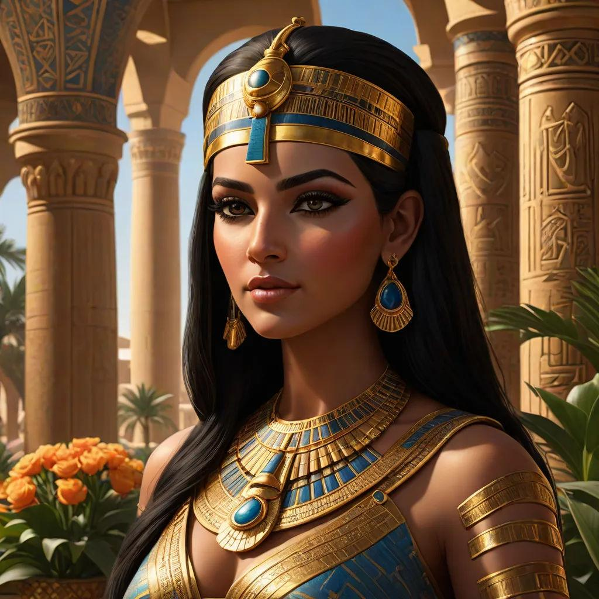

# 《萬界風月樓》第七卷彩蛋人物檔案｜克麗奧佩脫拉七世（沙漠古王國末代女王）

> **人物一句話定位**：立於千年王朝末路、憑智慧與王權契約在強權與派系間走鋼絲的沙漠末代女王；不依附、不乞憐、不入萬界樓，主動選擇一段星夜真實親密後，繼續昂首掌舵自己與國家的命運。  
> **所屬世界**：艾瑟蘭・南方沙漠古王國（黃金王都・亞歷山德里亞）  
> **人物定位**：**第七卷獨立彩蛋人物（歷史映射改編，拒絕套用正式女主模板與照搬歷史悲劇結局）**。  
> **與男主關係**：平等合作者與短暫靈魂知己；於 `ch030` 卸冠自選一夜真情共鳴，不建立長期紅顏錨點，僅留「王室星辰符印」作為座標辨識與珍貴回憶。

---

## 一、基本人物形象與外貌特質

* **基本資料**：人族，約 30 歲，正值成熟女性風華與威儀最盛的黃金年華。
* **外貌特質**：
  * 烏黑濃密的長髮如上等黑緞垂落腰際，肌膚白皙如象牙脂玉，深邃黑曜石眼眸彷彿能洞穿世間權謀與人心。
  * **日常裝束**：臨朝時戴純金藍寶石雙翼聖蛇王冠、著流淌金白輕紗王服與青金石項飾、眼尾勾勒古王國青金眼線，明豔高貴不可逼視；卸冠私下相會時褪去眼線與王飾，僅著象牙白真絲長裙披散黑髮，慵懶惑人而坦蕩真實。
* **歷史映射與改編原則**：
  * 托勒密王朝 → 沙漠古王國；羅馬擴張 → 星輝帝國南向施壓（西方征服者／盟友統帥僅作政治背景對照）；**王朝可面臨衰危，但女王的個人命運由她自己決定，絕不淪為大國附庸或悲劇陪葬品**。

---

## 二、性格特質與專屬魅力

* **外在從容，內在孤傲**：精通七國語言與外交博弈，善察言觀色掌控談話節奏；深愛古國與尼羅大河子民，寧可走鋼絲也絕不做大國棋子。
* **唯一弱點與心防鬆動**：習慣以權謀、利益與籌碼丈量所有接近她的強大男性，反而完全看不透不圖王位、不圖黃金、更不肯開空頭支票說教的顧淵。
* **嚴格邊界原則（已完整落實）**：不入萬界樓、不與艾琳諾／塞拉菲娜／菲奧娜三女見面、不向顧淵乞求拯救或挽留，體面相聚、清醒別離。

---

## 三、傳承、能力與星夜反哺

* **傳承體系**：非達拉然九環主流奧術，屬三千年古代沙漠祭司王族秘傳——強項在知識、情報、精神魔法與政治手腕：
  1. **星辰占測**：借星象與水銀星盤觀測以太流向與大勢走向（推測趨勢而非全知預言）。
  2. **祭司秘法**：古咒、星辰祭儀、神殿結界與遠距離星辰守封。
  3. **王權契約**：以千年血脈與守護靈立契，維繫黃金王都守護結界與先王遺跡封印。
* **星夜雙修反哺（ch030）**：在完全自願且不涉政治交易的藍蓮星辰露台一夜中，與顧淵觸發《太上玄奼真經》「星辰共鳴」（反哺萬界樓 **`+20 → 820/10000`**），澈洗十年維繫結界累積之精神暗傷與血脈透支，覺醒高階**「星辰洞察靈覺」**，精氣重歸巔峰。

---

## 四、五步獨立彩蛋弧線（第七卷 ch028～ch034）

1. **遺跡試探（ch028）**：星辰殿以外交談判試探顧淵來歷與企圖，見他對王權財富毫無貪念，遂以星辰圖書庫與遺跡引導達成對等合作。
2. **智慧交鋒與卸冠傾訴（ch029）**：王宮星象觀測台共論王朝興衰與統治重負；顧淵既不說教也不許空諾，讓她首次卸下外交辭令吐露孤獨與焦慮。
3. **自選短暫親密（ch030）**：秋分晚宴後於藍蓮星辰露台親手摘下王冠，以「克麗奧佩脫拉本人」主動選擇一段清醒而滾燙的真實親密時光，觸發星辰共鳴（`+20`）並贈「王室星辰符印」。
4. **自主平亂與開放秘庫（ch031～033）**：拒絕由外人插手內政，親率王室近衛雷霆清算私通真理黑袍會的阿蒙元老反對派；開放星辰圖書庫並助顧淵探明深沙泰坦前哨核心藍圖。
5. **各自前行（ch034）**：投入三分之一祭司穩固南端泰坦封印，同時憑新覺醒的星辰靈覺與外交手腕主導愛琴城邦商約破局；夕陽白玉長亭一吻告別，昂首留在黃金王都書寫自己的結局。

---

## 五、經典名言

> **「我曾經擁有一個王國，卻從未真正擁有自己的命運。」**（ch029）  
> **「你不想要我的王冠，也不想要我的土地。那麼，顧淵，你究竟想從我身上得到什麼？」**（ch029）  
> **「今晚不要稱呼我為女王。至少在這個夜晚，讓我只做克麗奧佩脫拉。」**（ch030）  
> **「你會離開，而我仍要留在這裡。這一次，我不打算讓任何人替我決定結局。」**（ch034）
