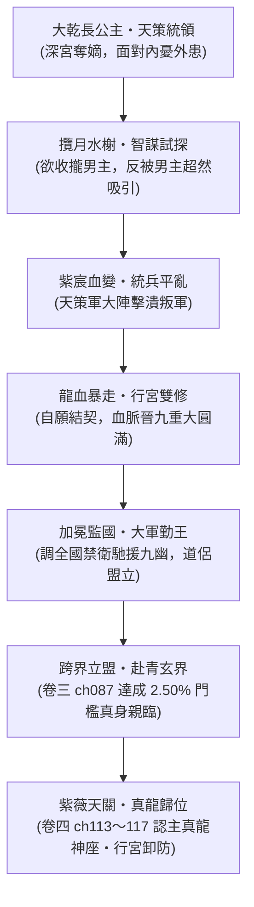

# 《萬界風月樓》第五女主設定檔案｜姬明月（監國帝女・紫霄女帝）

> **人物一句話定位**：習慣掌控江山棋局的高冷女帝，偏偏遇上不入她棋盤的諸天至尊；兩個極致強勢靈魂間的智性博弈、權力同盟與私密卸防。  
> **所屬世界**：02｜滄瀾界（高武異能玄幻文明）  
> **人物模型**：遵循 `writing_guide.md` **高冷女帝型 ＋ 成熟御姐型（掌控與失控的極致情趣）**。  
> **與男主關係**：第五位紅顏道侶、皇朝與萬界樓最高政治同盟者、平等坐江山的智性伴侶。

---

## 一、基本人物形象與外貌特質

* **外貌特質**：
  * **「鳳目含威凌九重，暗紅金袍肅乾坤。」** 大乾皇朝第一傾國絕色。
  * 容顏非尋常女子之清秀，而是帶著無上皇極威儀的絕世美艷。鳳眸狹長銳利，眼波轉動間自帶帝王生殺予奪的威壓，鼻樑秀挺，紅唇若硃砂，美得極具侵略性與壓迫感。
  * 身段曼妙豐腴，修長修挺，舉手投足間帶著多年執掌天策禁衛與朝堂大權的尊貴霸氣。
  * **日常裝束**：
    * **臨朝掌軍之時**：常著一襲暗紅描金玄鳥紋錦繡宮袍，內襯紫金軟甲，腰佩大乾天子蟠龍玉璽與紫金短刃，頭戴九鳳金絲步搖，氣場全開，百官與萬軍無不躬身屏息；
    * **私密行宮之時**：卸下沉重鳳冠與外袍，僅著一襲貼身絳紫色絲綢內衫，長髮披散，玉膚隱現，慵懶而嫵媚，威嚴微斂，偶露柔情。
* **氣質內核**：
  * **「深謀遠慮，家國為先；掌控一切，偏被君奪。」**
  * 她是天生的政治家與統治者，習慣將天下宗門、名宿強者視為棋子，步步為營；但內心深處卻極度孤寒，渴望一位不懼其權威、不求其利益、能與其並肩俯瞰萬里山河的真正同路人。

---

## 二、性格反差與專屬味道

> **用戶核心批註**：*「高冷帝女，習慣掌控一切，偏偏遇上顧淵這個不按她棋局走的人。兩個強勢人物之間的情趣，與一般戀愛完全不同。」*

### 1. 棋局掌控者的「甜蜜失控」（智性戀情趣）
* **棋盤之外的驚豔交鋒**：
  * 攬月水榭設宴試探顧淵，姬明月布下言語陷阱與政治籌碼，企圖將這位「異界客卿」納入自己奪嫡的棋局；
  * 顧淵卻放下酒杯，洞若觀火地一笑，談笑間點破皇城龍脈煞氣與三皇子死穴，言明「不求凡俗王權，只為求道而來」——顧淵完全跳出她的棋盤，反將其軍，讓習慣掌控一切的女帝第一次感到心神大亂與失控的悸動；
  * 她不惱怒於這種失控，反而深深迷戀顧淵超然於世俗皇權之上的強大與從容。
* **私密行宮深處的卸防與歸心（ch038）**：
  * 紫宸殿血夜平叛後，姬明月因過度催動真龍異能，體內幽冥魔煞誘發血脈暴走，瀕臨爆體；
  * 在攬月行宮深處，侍衛盡退，平日高高在上的監國長公主汗透重裳、金簪委地，在劇痛中第一次展露女人的脆弱，依偎在顧淵懷中；
  * **強勢女帝的主動託付**：即使雙修之際，她依然帶著帝女的高傲，鳳眸凝視顧淵坦言：「本宮此生不弱於任何人，但若與你共參天地大道，本宮甘之如飴！」；
  * **事後調侃與江山盟約**：事後雲鬢散亂，她一邊玉容微紅地依偎在顧淵胸膛，一邊鳳眸含笑打趣：「敢把本宮當爐鼎的，天下唯君一人……」下床後披上鳳袍，她依然是威震天下的監國帝女，將《九幽天圖》親自交付顧淵，確立大乾國運與萬界樓的永固道侶同盟！

---

## 三、修為、血脈與專屬異能

* **當前修為**：宗師巔峰 ──> 卷二行宮雙修突破【大宗師後期】 ──> 卷四於紫薇天關認主【紫霄真龍神座】並重塑真龍神脈，獲得九曜「天曜神裔」法則認可（對應神階五階神尊級位格權限）。
* **血脈異能**：**紫霄真龍血脈（太祖皇族傳承，源出九曜神域天曜神系分支）**：
  * 引動九天紫龍雷罡，掌控天地紫霄雷霆，天生克制陰濁魔煞；
  * 身懷皇極天子威壓，可調動皇朝百萬里龍脈氣運加持己身，並能執掌紫薇天關真龍神印。
* **專屬信物與權柄**：
  * **【天策玄龍暗令】**：可調動十萬天策玄甲禁衛。
  * **【九幽天圖】古卷**：大乾皇室歷代珍藏的遠古九幽禁域機密地圖。
  * **【天曜真龍神印】**：卷四 ch116 認主紫霄真龍神座後所得，正式取得九曜九系議會「天曜代表」席位（暫託太陰代掌輪值一票）。

---

## 四、獨立成長軌跡（落實 R24 原則）

1. **暗潮洶湧（ch034～ch035）**：父皇昏睡，兄弟相爭，姬明月以驚人鐵腕維持皇都大局，設宴試探顧淵，達成初步情報同盟。
2. **血夜變宮（ch036～ch037）**：三皇子勾結魔宗突襲紫宸殿，姬明月親自披甲指揮天策軍結真龍玄甲陣死戰中軍；顧淵自天而降捏碎萬魂煞陣，兩人完美協同粉碎叛亂。
3. **行宮雙修（ch038）**：真龍血脈反噬，顧淵純陽相救，二人在行宮深處心意相通、行太上玄奼陰陽交泰，姬明月血脈突破九重大圓滿，破境大宗師後期，萬界樓修復度暴漲 25 點！
4. **監國女帝，發動勤王（ch040～ch050）**：加冕監國帝女，頒布全國勤王令，親率十萬天策禁衛攜紫霄雷炮遠征九幽天塹，與江湖聯軍並肩平定浩劫！
5. **跨界商政共治，親臨青玄（第三卷 ch053～ch088）**：與慕容玥確立大乾「官商分層共治」與萬界商票結算閉環；於萬界樓修復度突破 2.50% 硬門檻後，真身跨界親臨青玄界（ch087），憑大乾太史令紫霄天龍殘圖與眾女拼合九曜入口坐標。
6. **真龍神座歸位（第四卷 ch098～ch124）**：依太史令線索抵太微玉京與顧淵重逢並夜探祭天壇（ch098～099）；隨後隻身通過歷代殘念與濁泥考驗，憑「為萬民立命、主宰自身皇道」之帝王意志收服【紫霄真龍神座】（ch113～116），於行宮秘境卸防完成天人合一雙修（ch117），並在祭天壇之戰鎮壓地脈（ch122）後將天曜一票託付太陰代掌、返大乾穩固國運並接通九曜商路（ch124）。
7. **南巡太湖・紫霄持衡・母女情深（第六卷 ch014～ch022）**：獨自育有聰慧愛撒嬌的 4 歲大乾小公主**姬明珩（明珠）**；微服南巡越溪初會西施，由帝威試探轉為平坐合作，聯手四女粉碎吳州暗派與天行者破壞吳越盟約之毒計；姑蘇行宮紫霄暖殿內聽顧淵道「明珠不必當女帝，可走出更寬廣治世之路」徹底融化五年孤冷，反客為主卸冠重契（`+25 → 750/10000`），紫霄真龍氣運昇華至「**紫霄持衡之境**」，並立下日後離去前須先向母女告假之約。

---

## 五、親密互動與雙修模式特性

* **主要適用模式**：**高冷女帝型專屬（模式 A 皇家奢靡威儀卸防 ＋ 模式 C 真龍星脈交泰）**。
* **互動神態細節**：
  * 征服與反征服的心理拉扯：她習慣掌控節奏，初時會反客為主，主動解開龍袍將顧淵按在軟榻上，居高臨下審視男主；但當顧淵反客為主、展現出浩瀚的混沌純陽與霸道溫柔時，這位帝女終於在低吟中卸下所有帝王防禦，長睫掛淚，軟軟伏在顧淵懷中；
  * 雙修異象：紫金雷龍與混沌星脈在宮殿頂端盤旋長嘯，九天雷罡化作生機春水，帝王龍氣與萬界本源融匯，極致震撼；
  * 事後溫存：絕不似尋常小女人的黏膩，而是雍容優雅地靠在顧淵身側，一邊享受顧淵的撫弄，一邊與顧淵推演天下局勢，充滿了強者之間心照不宣的智性浪漫。

---

## 六、經典名言

> **「這大乾萬里江山，本宮要守；這深宮萬丈孤寒……唯有你，敢跨進來。」** —— *攬月行宮私密相許之言*  
> **「你若要在這滄瀾求道，本宮便以大乾國運為你鋪路；你若要征戰諸天，本宮便在後方為你穩坐江山！」** —— *加冕監國時對顧淵的霸氣承諾*
