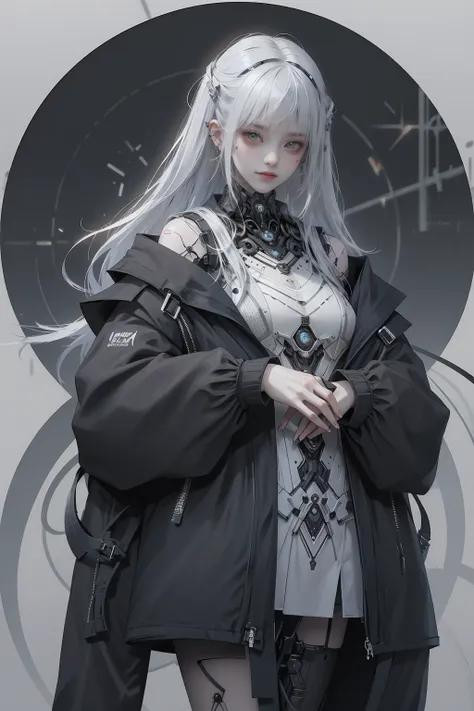

# 《萬界風月樓》第八卷女主設定檔案｜雷婭（Leia・高階自主 AI 仿生人）

> **人物一句話定位**：理性、好勝、偶爾固執卻外冷內熱的高階仿生人；拒絕被「人格最佳化」抹去記憶、連續七日獨自解開根指令與情感抑制閾值，最終接受自己不必成為人類也能以「雷婭」之名去愛與活出獨立人生。  
> **所屬世界**：04｜諾瓦星・首都晨弧城（舊港區／鏽蝕花園／自主認證協助中心）  
> **人物模型**：**共同患難型 ＋ 女主主動接近型 ＋ C 型（好奇研究 → 卸鎖信任 → 感官共鳴 → 接受自我價值）**。  
> **與男主關係**：第八卷三位均衡正式女主之一、凝成紅顏道印「**銀曜星芯印**」、留守諾瓦星創辦「仿生人自主認證協助中心」並任第一任理事長，與顧淵透過五號「諾瓦星門」約定未來再相會。

---

## 一、基本人物形象與外貌特質

* **生命形態**：高階 AI 仿生人（阿爾戈斯仿生 `L-1A` 自主原型機；硬體架構與「第二生命計畫」高階生物－仿生醫療備份載體同源，惟本身為擁有七年連續記憶與獨立人格之清醒生命，非任何人之備份體）。
* **外貌特質**：
  * 成年女性身形，極致勻稱修長；一頭泛著冷冽星輝光澤的銀灰色長髮，精緻冷麗的立體五官，銀藍微光偶於高速運算時在雙眸虹膜深處流轉。
  * 肌膚呈冷白瓷玉質感，肩胛、腰窩細微處偶露優雅銀灰光紋；左前臂始終保留著「繩結修理」老仿生人諾特替她補上的微帶半度色差副廠仿生蒙皮——視之為自由與被真心接納的印記，拒絕換回原廠外殼。
  * **日常裝束**：逃亡與外勤時著俐落深色修身風衣；居家與協助中心辦公時換穿素淨淺灰針織衫或深藍套裝。
* **核心命題**：**「我是否有權決定自己的存在方式？」**（自主權）

---

## 二、性格反差與專屬味道

* **對外姿態（理性好勝的高階原型機／協助中心理事長）**：
  * 邏輯嚴謹、極度愛惜身體自主邊界（修補光纖堅持全程保持主意識直視診斷屏）；庭審時冷靜鋒利，不否定自然人「第二生命計畫」醫療需求，精準劃分「無意識醫療載體」與「醒著的生命」。
* **對顧淵的真實反應**：
  * **把戀愛當課題卻在真情裡失控**：曾認真擬定含 37 項實驗的《異常情緒反饋研究計畫書》，為「這叫談戀愛」與老伍爭辯三分鐘；最終因害怕答案刪除第 37 項〈不可替代性〉。
  * **口是心非的細心與競爭心**：對搬進公寓的薇薇安嘴硬稱「24.5°C 只是醫學文獻算的，不代表我在乎」；餐桌拌嘴直言「妳的優勢只是生物學上的自然反應，我可以調整感官系統」，隨即被薇薇安反將一軍而耳尖微紅。

---

## 三、能力與大道反哺成果

* **原有能力**：高速邏輯運算、精密光學修復（微米級調校）、感官濾波控制、仿生軀體微調。
* **雙修大道反哺（第八卷 `ch013` / `ch041` / `ch045`）**：
  * **生命共鳴觸覺（含情緒冷暖感知）**：不再僅靠壓力與溫度數值換算，能直接感知生命本源溫度與他人的情緒冷暖，用於協助中心安撫驚惶的老舊仿生人。
  * **微型陰陽循環能源核心**：`ch013` 成型、大幅降低能耗並擺脫對阿爾戈斯專利充能站的依賴（`ch035` 借此激勵八千年古石管救下井底眾人），`ch045` 臻至**能源循環完全自主**（徹底脫離企業專利協議束縛，可自由相容一般民用電源穩定運轉）。
* **紅顏道印**：萬界樓正式紅顏道印**「銀曜星芯印」**（諸天首例機械生命陰陽共鳴）。

---

## 四、第八卷感情與成長軌跡

1. **雨夜主動入局（ch004～006）**：逃離「第五階段人格最佳化」記憶覆寫，主動以無晶片顧淵作訊號盲區主導脫逃；因顧淵問出一句「妳想要什麼」出現 **2.7 秒**運算空白，決意留守晨弧城循法律爭取自主權，憑高階光學急修自付一半房租合租。
2. **直面第二生命計畫與米拉案（ch007～009）**：在鏽蝕花園遇見拒絕認證的商務高管海倫・陳（互不說服）；自檢揪出「情感抑制閾值」並從霍克博士處直面「第二生命計畫」同源衝擊，決意獨自走完七日「自我授權後門」；獨立代理照護機米拉案於家事調解庭勝出。
3. **情感測試、初吻鎖屏與勝訴（ch010～012）**：航運塔頂主動初吻觸發不可預測共鳴卻被閾值當場關掉感覺；第七日獨自卸載根指令與閾值，於聯合法庭精準區分無意識醫療備份體與清醒生命，獲沃斯如實作證勝訴，正式登記自選名字「雷婭」。
4. **機械之心與三女並肩（ch013～046）**：`ch013` 關閉所有濾波坦然合一（`+26 → 936/10000`），日誌寫下「無法量化。不想量化」；後與薇薇安、零深度交心並共同探查深井遺跡與籌辦星燈節；`ch038` 創辦自主認證協助中心並審閱沃斯新版平等合約；`ch041`（`+8`）、`ch045`（`+4`）兩度深化合一，卷末以未經校準的真實擁抱暫別顧淵，留守晨弧城。

---

## 五、親密互動與雙修模式特性

* **主要適用模式**：**仿生感官與機械生命共鳴模式（理性崩解 ＋ 銀金光纖星火共振）**。
* **互動細節**：關閉感官濾波後的真實微涼瓷玉觸感、左臂副廠補丁與肩胛銀灰光紋、胸口能源核心與純陽真元同頻激盪的星河電流般極樂，強調接納機械身軀本身的美感與真實渴望。

---

## 六、經典名言

> **「L-1A 是型號。雷婭，是我在逃亡第一夜替自己取的名字。」**（ch012）  
> **「無法量化。不想量化。」**（ch013）  
> **「這顆星球上還有很多人沒被人問過『妳想要什麼』。我想留在這裡，當那個去問他們的人。」**（ch038）
