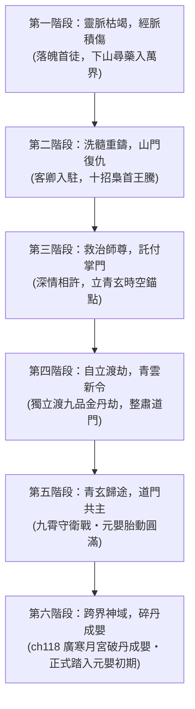

# 《萬界風月樓》第一女主設定檔案｜柳清虛（青雲掌門）

> **人物一句話定位**：外有威嚴肅穆之掌門道骨，內有柔韌繾綣之似水深情；清麗出塵、不負師門、更不負君的道門女魁首。  
> **所屬世界**：01｜青玄界（古典修仙文明）  
> **人物模型**：遵循 `writing_guide.md` **清冷仙子型 ＋ 外柔內韌型**。  
> **與男主關係**：第一位紅顏道侶、第一個建立萬界時空錨點的女主、青雲道統的終身合夥人。

---

## 一、基本人物形象與外貌特質

* **外貌特質**：
  * 肌膚勝雪，吹彈可破；雙眸清澈如幽潭秋水，眉若初春遠黛，唇若初綻桃花。
  * 青絲如墨，平日以簡潔的青玉道簪端莊挽起，幾縷青絲自然垂落香肩。
  * 身段纖柔婀娜，腰肢如春柳，舉手投足帶著修道者自然的輕盈與從容。
  * **服飾風尚**：
    * **公開場合**：身著一襲青雲觀象徵掌門權柄的月白雲紋廣袖長袍，手按青玉法印，背負青蓮長劍，仙威凜凜，不可逼視；
    * **私密場合**：換上素雅的湖藍或藕粉色薄紗長裙，洗盡鉛華，宛若鄰家溫婉小師姐。
* **氣質內核**：
  * **「清冷來自修養，非傲慢拒人；溫柔發自本心，非毫無原則。」**
  * 初見時清雅如雪中白梅，熟悉後溫婉如春日暖陽。面對外人莊重自持，唯有在顧淵面前才會展露出少女般的羞澀與嬌憨。

---

## 二、性格反差與專屬味道

> **用戶核心批註**：*「青雲掌門，外有威嚴、內有情意。她與顧淵之間有共同經歷與深厚羈絆。」*

### 1. 外在反差：對外雷霆手段 vs 對內溫柔依戀
* **對宗門與外敵（威嚴掌門）**：
  * 殺伐果斷：王騰逼婚時，十招之內秋水長劍當場將其梟首，絕無半分婦人之仁；
  * 孤身禦侮：太華道宮長老挑釁時，拒絕依賴顧淵，孤身登通天峰引動【九品天道水火金丹天劫】，一劍斬破挑釁法寶，頒布「青雲新令」清洗內鬼、整肅長老院；
  * 領袖風範：以一己之力重鑄青雲護山青蓮大陣，組建東華道門自保同盟，威震東華修仙界。
* **對顧淵一人（情深義重）**：
  * 卸下重擔的脆弱：當褪去繁複沉重的掌門法袍、屏退門人弟子後，她會將額頭輕輕抵在顧淵胸膛，低聲訴說白日宗門瑣事的疲憊，享受被顧淵撫摸秀髮的溫暖；
  * 煮茶添香的溫存：會親手為顧淵烹煮青雲特產的「雨前靈霧茶」，眼波流轉，滿是繾綣愛意；
  * 平等堅定的羈絆：不做依附顧淵的金絲雀，而是努力修行，渴望以掌門實力成為顧淵在諸天征途上最可靠的後方大本營。

---

## 三、修為、功法與專屬法寶

* **修為進階全歷程（跨卷境界階梯表）**：
  * **第一卷**：**半步金丹**（早年強行衝擊金丹受創，靈根雜亂、經脈暗傷，經顧淵救治重塑「水火既濟無瑕道基」）。
  * **第二卷**：**正式凝結金丹，逐步提升品階**（ch021 孤身引動天劫成就上品金丹，在顧淵跨界期間持續閉關、溫養道胎，至第二卷末穩步淬煉至九品天道金丹層次）。
  * **第三卷初～中**：**九品金丹圓滿，開始孕育元嬰**（ch058 九品天道金丹金輝大盛、氣度圓融；ch060 與顧淵深夜本源交泰後，道基內化生一縷紫金胎息，正式步入「元嬰蘊育期／元嬰胎動」）。
  * **第三卷結束**：**九品金丹圓滿・元嬰胎動完成**（東華平定、九霄守衛戰後道心無瑕，已備齊化嬰契機，留待臨門一腳碎丹成嬰）。
  * **第四卷（ch118 起）**：**元嬰初期（正式突破！）**——於 ch118 跨界親臨九曜神域，在廣寒月宮月輪之上與顧淵雙修共鳴後，憑自身累積的修為與道心自行碎丹成嬰，並於 ch122 祭天壇決戰中以元嬰陣法穩住太陰月輪，ch124 返青玄界結合九曜法則改進護山大陣。
  * **第六卷（ch003～ch035）**：**元嬰初期圓滿穩固（初悟雪韻青蓮道意）**——於青雲山獨自育有 5 歲女兒**柳知微（微微）**，靜候顧淵歸來；雪夜哄睡女兒後主動自背後環抱顧淵、水火既濟共修（`+20 → 680/10000`）洗去五年操勞暗滯；第五篇於萬界樓初會赫拉迪雅並於演武殿以九品元嬰青蓮劍陣展現道門風範，於神藏殿見證《造化承嗣真錄》徹底放下對微微資質普通的暗憂。
* **核心靈根**：水火雙極變異靈根（經顧淵《玄奼真經》洗髓修復後，化生「水火既濟無瑕道基」）。
* **根本功法**：
  * 《太素水火既濟真訣》
  * 《秋水既濟劍法》（顧淵以宿慧親傳，專破剛烈煞火）
  * 《青蓮開天劍陣》（青雲鎮派大陣）
* **專屬法寶**：
  * **本命靈劍【秋水青蓮】**：三尺青鋒如澄澈秋水，出鞘引動漫天青蓮劍氣。
  * **掌門法印【青雲祖印】**：沈玄清重傷時親手託付，可調動九華九峰祖靈脈防禦大陣。

---

## 四、獨立成長軌跡（落實 R24 原則）

1. **破繭初成（ch001～ch008）**：誤入萬界樓，與顧淵相遇，運轉玄奼真經重塑水火道基，回歸山門一劍梟首王騰，奪回宗門尊嚴。
2. **師尊託付（ch009～ch016）**：為救寒煞噬體的師尊沈玄清，深明大義，求助顧淵，並承接青雲掌門之印；與顧淵深層道心共鳴，銘刻青玄首枚紅顏錨點。
3. **獨當一面（第二卷中卷）**：王氏覆滅後面對各大仙門強勢逼宮，拒絕傳訊求助顧淵，孤身引爆九天雷劫成就東華罕見的「九品天道水火金丹」，頒布新令徹底掌握宗門大權！
4. **樓中重逢（ch033末）**：身著掌門道袍赴萬界樓相聚，在乾坤道台向顧淵展示金丹神輝，以強者道侶的成熟姿態與顧淵溫存交泰，反哺萬界樓修復進度。
5. **執掌東華，九霄守陣（第三卷 ch053～ch088）**：於青雲觀與顧淵深層水火交泰孕育紫金元嬰胎息（ch060），戰後生死合體（ch083），並在枯骨老魔之戰後頒布東華新序，正式登臨東華十九洲正道女魁首之位。
6. **跨界成嬰，穩陣神域（第四卷 ch118～ch124）**：將宗門日常事務交託長老團後跨界親臨九曜神域，於廣寒月宮月輪之上自行碎丹成嬰突破**元嬰初期**（ch118），並於祭天壇大戰中以修仙元嬰陣法穩住太陰月輪（ch122），戰後返回青玄界融合九曜法則改良護山大陣（ch124）。

---

## 五、親密互動與雙修模式特性

* **主要適用模式**：**模式 A（古風含蓄型） ＋ 模式 C（玄幻水火雙修）**。
* **互動神態細節**：
  * 清眸微顫、玉頰染霞、素手緊攥顧淵衣角，雖羞赧至極卻絕不閃躲閉眼，而是勇敢凝視顧淵雙眸，展現「外柔內剛」的主動託付；
  * 雙修過程中水火既濟，室內浮現青蓮伴金芒之異象，靈息流轉溫潤綿長；
  * 事後溫存：靜靜伏在顧淵肩窩，聽其心跳，輕聲詢問顧淵在異界是否受傷，並主動提起宗門事務的進展，充滿了「老夫老妻般的深情踏實感」。

---

## 六、經典名言

> **「顧道友為青雲做得已足夠多。如今清虛為一派之主，青雲道骨，當由我手中長劍親自捍衛！」** —— *ch021 孤身引動天劫震懾群雄*  
> **「在天下人面前，我是青雲掌門柳清虛；但在你面前，清虛永遠只是那個在萬界樓被你牽住手的女子。」** —— *密室溫存定情*
