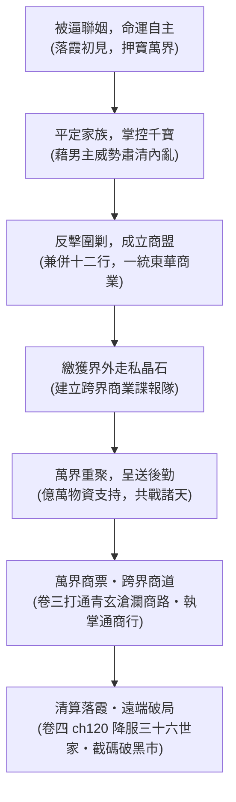

# 《萬界風月樓》第三女主設定檔案｜慕容玥（萬界商皇・精明貴女）

> **人物一句話定位**：商道博弈算無遺策、利益場上寸步不讓；風情萬種、敢愛敢恨，將整座天下商盟作為嫁妝全盤押上的精明商女。  
> **所屬世界**：01｜青玄界（古典修仙文明）  
> **人物模型**：遵循 `writing_guide.md` **成熟御姐型 ＋ 精明商女型**。  
> **與男主關係**：第三位紅顏道侶、萬界樓財經與物流後盾、諸天跨界情報總管。

---

## 一、基本人物形象與外貌特質

* **外貌特質**：
  * **「桃腮杏面含春色，秋波流轉動人心。」** 青玄修仙界著名的絕色女財閥。
  * 容顏明豔照人，肌膚如凝脂蜜桃，眼角微挑，天生帶著三分勾魂攝魄的嫵媚與七分世家貴女的貴氣。
  * 身材極其惹火高挑，蜂腰削肩，峰巒起伏，修長筆直的玉腿在開叉的綾羅長裙下若隱若現，行走間如弱柳扶風、步步生蓮。
  * **日常裝束**：
    * 偏愛一襲暗金絲線刺繡的紫紅或深緋色錦緞宮裙，腰佩精巧的白玉算盤吊墜與儲物靈囊；
    * 烏黑青絲盤成繁複奢華的靈雀髻，插著金絲翡翠步搖，走動時清脆作響，貴氣逼人。
* **氣質內核**：
  * **「三分精明算計，七分大膽深情。」**
  * 在商言商，撥弄算盤時冷靜犀利，殺伐決斷；轉頭面對顧淵時，眼角眉梢皆化作如絲春水，主動妖嬈，是全書最懂男人心理、最擅長營造閨房情趣的女主。

---

## 二、性格反差與專屬味道

> **用戶核心批註**：*「精明商女，談生意時寸步不讓，談情時也有自己的手段。」*

### 1. 談生意時寸步不讓 vs 談情時主動大膽
* **商場上的鐵血女掌櫃**：
  * 利益寸步不爭必死：面對中天仙商巨頭的價格絞殺與惡意收購，慕容玥憑藉《玄金密冊》與顧淵提供的跨界資源，連消帶打，僅用三個月便強勢吞併十二家大型拍賣行，組建「東華萬界商盟」；
  * 眼光毒辣獨到：查抄魔修暗庫時，一眼挑出非本界的「神秘星紋晶石」，敏銳嗅出跨界走私商機，組建跨界情報隊。
* **顧淵懷裡的小狐狸（專屬情趣與手腕）**：
  * **「明算帳」與「暗撒嬌」**：她會拿著厚厚的帳冊，一本正經地向顧淵匯報為萬界樓採購了多少萬石靈材，隨後話鋒一轉，紅著臉跨坐在顧淵膝頭，纖指點著顧淵的胸膛，嬌聲索要「利息」；
  * **全副身家的孤注一擲**：在外人面前她是唯利是圖的精明商女，但唯有顧淵知道，她早在落霞仙城初遇時，便將慕容家數百年的基業、千萬靈石與自己的清白之軀，全部毫無保留地賭在了顧淵身上；
  * **絕不吃醋的大格局**：她深知顧淵志在諸天，不僅不嫉妒柳清虛與沈玄清，反而主動以雄厚財力為青雲觀運送靈石，為師徒二人分憂，成為萬界後宮最稱職、人緣最好的「後方大總管」。

---

## 三、修為、道統與商業秘術

* **當前修為**：**金丹境**（第三卷 ch077 觸及半步金丹並令【靈鑑神瞳】突破第二重；第六卷歸來時已穩步邁入**金丹境**，執掌跨三界萬界通商行）。
* **修行道統**：慕容世家真傳・九寶玄金訣。
* **核心天賦與神通**：
  * **【靈鑑神瞳】（第二重：破妄辨脈・洞悉諸天）**：天生具備看破萬物靈氣品階與異界道韻殘留的神異瞳術，第三卷突破第二重後更可辨識跨界走私物品與陣紋脈絡。
  * **《玄金密冊》**：青玄界上古遺留的商道與金融秘術，擅長以小博大、操控股價與物價。
  * **法寶【金玉如意算盤】**：上品地階法寶，既可作為防身陣盤，亦可瞬息計算億萬筆跨界靈石交割。

---

## 四、獨立成長軌跡（落實 R24 原則）

1. **破局求存（第一卷）**：不甘淪為家族聯姻犧牲品，在千寶拍賣會上識得顧淵超凡風骨，果斷結盟。在顧淵支持下整肅慕容世家，奪回千寶樓大權。
2. **商業帝國崛起（第二卷初期）**：面對中天仙商聯合制裁，強勢兼併落霞周邊拍賣行，成立「東華萬界商盟」，成為青玄界最大的商業巨無霸。
3. **查獲異界線索（第二卷中卷）**：憑藉【靈鑑神瞳】繳獲非本界的「神秘星紋晶石與零件」，察覺諸天黑市裂痕，成立跨域情報隊（FB2-07 關鍵推進）。
4. **樓中重逢與後勤獻寶（ch033末）**：赴萬界樓相聚，為顧淵備妥「清心破煞露」等滄瀾征戰急需的龐大仙液物資，並與顧淵纏綿溫存，以深情與商業帝國反哺萬界樓修復進度。
5. **跨界商票與兩界共治（第三卷 ch053～ch088）**：與大乾女帝姬明月建立「官商分層共治」跨界合作，推行萬界商票與青玄—滄瀾兩界貿易閉環，擊退天行者白面執事截殺並於摘星樓雙修晉升瞳術第二重（ch077）。
6. **清算舊帳與遠端神域情報（第四卷 ch091、ch120、ch124）**：將青玄商道推展覆蓋三洲，徹底降服落霞仙城三十六世家（BL-03 收束）；出征前為顧淵推算天行者交易站密盤規律（ch091），並於 ch120 遠端截獲天行者核心暗碼盤，助顧淵於九曜黑市拍賣會當場截胡破局；卷末（ch124）將青玄靈舟商路正式接通太微玉京。
7. **文墨商盟・神域抄庫・護樓半印（第六卷 ch002、ch015～ch035）**：久別重逢撲懷算「複利」展現鮮活吃醋與乾娘寵愛（極疼愛微微、阿舟與明珠）；於滄瀾初會西施，借文瀾薛濤花信紅箋靈感共建「**江南文墨商盟**」並抄封姑蘇黑商斷天行者財路；於九曜太微玉京首度與赫拉迪雅線下會師、「財神配戰神」奇襲端掉水曜暗庫繳獲羅睺影月與棋算者暗印；於【諸天神藏殿】外殿以慕容殘月古玉喚醒「**太古護樓世家**」半印（`AL-02` 推進），並與赫拉迪雅簽訂跨三界軍商通航五五分帳大約！

---

## 五、親密互動與雙修模式特性

* **主要適用模式**：**模式 B（通俗直白、熱情主動） ＋ 模式 A（古典溫存）**。
* **互動神態細節**：
  * 主動撩撥、花樣繁多：她不像清虛那般克制，也不似玄清那般肅穆。她會身著薄如蟬翼的紫金紗裙，主動挽起顧淵的脖子，呵氣如蘭，用言語和眼神大膽挑逗男主；
  * 親密時的嬌喘低吟與求饒：雖然平時精明強勢，但在雙修進入高潮時，往往被顧淵那份深沉從容的純陽之力征服得潰不成軍，軟語求饒，玉背弓起，極具征服感；
  * 事後溫存：伏在顧淵懷中把玩他的墨髮，一邊嬌笑著說「今晚這筆交易，妾身可是賠本賠到底了」，一邊又緊緊抱住顧淵不願鬆手。

---

## 六、經典名言

> **「在商場上，一兩銀子的虧我都不能吃；但面對夫君你……妾身連這條命、這座萬界商盟，都甘願賠個精光！」** —— *商盟成立之夜的深情自白*  
> **「顧大樓主在外征戰諸天，妾身管不了你招惹多少絕色女劍仙；但這後方的金庫與帳本，只能由妾身親自來管！」** —— *萬界樓重聚時的俏皮宣言*
