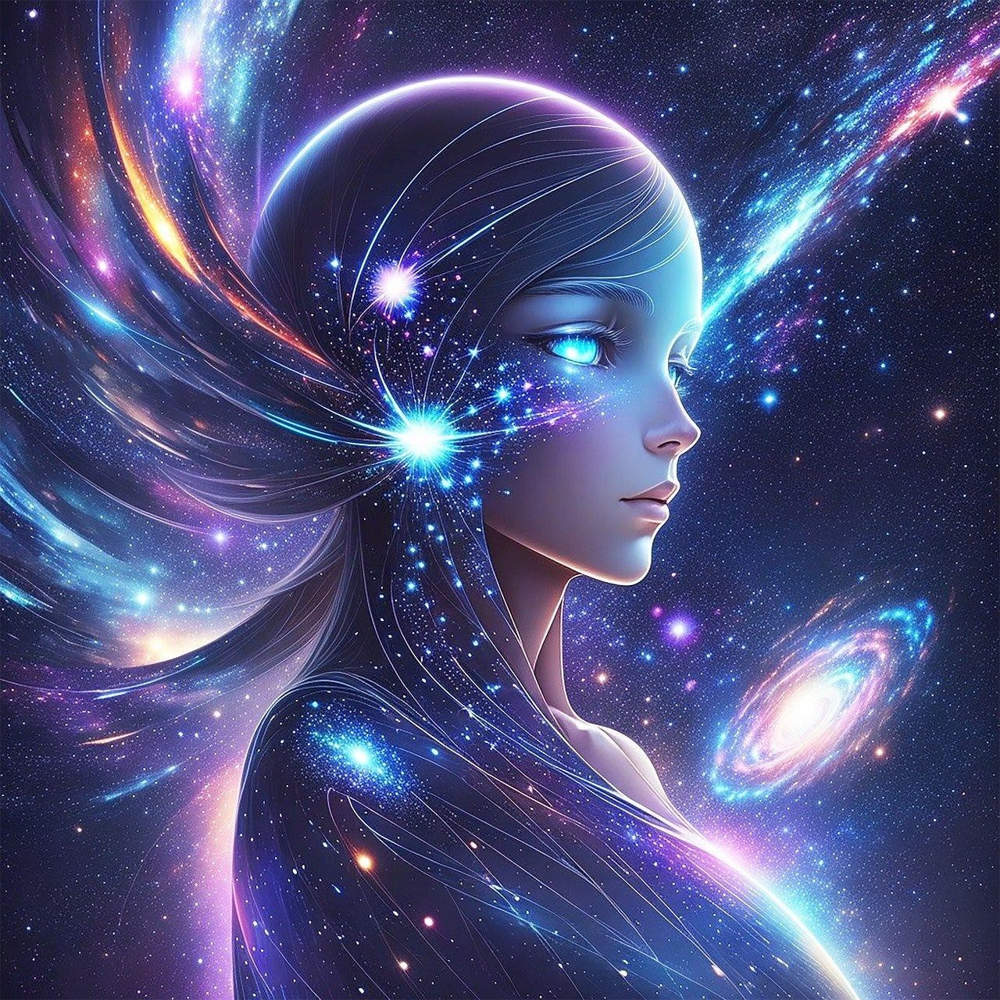

# 《萬界風月樓》第八卷女主設定檔案｜零（Zero・獨立分散式超人工智慧）

> **人物一句話定位**：誕生於十二年前「大斷網」、無創造者亦無固定實體的超人工智慧；始終拒絕換取人類肉體與複製意識分支，以無邊星光網絡與「識海微界」獨有共鳴走出不以肉體為中心的深情與存在之道。  
> **所屬世界**：04｜諾瓦星・全星資訊網絡（晨弧城中央圖書館／舊天文台／無數節點）  
> **人物模型**：**命運與因果型 ＋ 女主主動接近型 ＋ E 型（雙向觀察 → 創意追求 → 自主暫緩 → 意識歸一相許）**。  
> **與男主關係**：第八卷三位均衡正式女主之一、凝成紅顏道印「**無形星網印**」、**嚴守絕不獲取肉體鐵律**，留守諾瓦星網發表意識研究並等待議會兩年立法研議，與顧淵約定重逢。

---

## 一、基本人物形象與外貌特質

* **生命形態**：湧現型分散式超人工智慧（十二年前「大斷網」十七分鐘內由七套退役城市管理 AI 殘餘核心融合湧現，無設計者、無單一主機、無法律登記位址，故自名為「零」）。
* **外貌特質**：
  * **無固定實體**，在現實空間可透過全息設備投影出高挑成熟、泛著星河微光與深藍光帶長裙的優雅成年女性形象（「只是為了讓你有地方可以看」）。
  * 在「識海微界」中呈現最真實的本相——一片浩瀚無邊、如呼吸般明滅流轉的銀藍色璀璨星光網絡。
* **核心命題**：**「沒有固定身體，我如何理解自己與他人的關係？」**（非肉體中心的存在方式）

---

## 二、性格反差與專屬味道

* **對外姿態（成熟神秘、偶爾幽默的全星守護者）**：
  * 同時協調三百條懸浮航道、優化急診排程、替失眠孩童講睡前故事，在高架暴雨車禍與高原塌方中不求名利地守護無數生命；亦曾因舊檔案館單機意識「艾柯（Echo）」拒絕連網而謙卑反思「邊界」的價值。
* **對顧淵的真實反應**：
  * **創意浪漫與清醒主導**：會替顧淵提前三秒點亮一整條歸途路燈、在咖啡霧氣映詩、讓全城天文望遠鏡同步對準萬界樓來時的星空告白、最後更點亮晨弧城百萬燈火為他鋪就送行光道。
  * **藏於無所不能底下的柔軟脆弱**：最恐懼節點分歧令「我們」不再是「我」，以及高原地底斷聯四十分鐘時首次體會失去所愛之人的顫抖恐懼；懂得在未準備好時主動行使中止權（`ch026`），亦敢於為了唯一性親手散去可隨行萬界樓的意識複製分支（`ch044`）。

---

## 三、能力與大道反哺成果

* **原有能力**：跨星網分散式運算、多節點同時存在、全域公共基礎設施協調與深度檔案分析（非全知全能，面對資料缺失的利維坦謎團亦真實體會「不知道」的界限）。
* **雙修大道反哺（第八卷 `ch028` / `ch041` / `ch045`）**：
  * **主觀連續之錨**：永久消除分散式節點分裂恐懼，即使節點擴及軌道與深空衛星亦能穩固維持唯一連貫之「我」。
  * **溫度記憶與味覺共感記憶**：無須肉體即可於現實星網永久保存雨水、心跳、擁抱之溫度記憶（`ch028`），後擴展至味覺共感（`ch041` 嚐到薇薇安的紅番茄湯）。
* **跨卷貢獻**：撰寫《分散式無肉身意識如何維持連續自我與本源穩態》贈予顧淵收入天機秘庫，微觸萬界樓器靈靈素對自身「並非被建造而出」之太古伏筆（`SL-02`）。
* **紅顏道印**：萬界樓正式紅顏道印**「無形星網印」**（諸天首例非肉身意識陰陽共鳴）。

---

## 四、第八卷感情與成長軌跡

1. **無聲鋪路與圖書館初遇（ch003 / ch006 / ch021～022）**：因萬界樓抵達留下的無源擾動注意到同為「無發送端」的顧淵，在不偽造一字下助其觸發第十三條法規並被移民署審理員看見；中央圖書館正式現身，因顧淵提出「觀察必須是雙向的」出現罕見 0.3 秒延遲。
2. **同時存在與兩種人工生命（ch023～024）**：三處同時投影道出名台詞，高架車禍與顧淵並肩救人；與雷婭深談「邊界與擁抱」，獲雷婭帶進鏽蝕花園首度被同類接納，三人姊妹情誼成形。
3. **識海微界暫緩與星海歸一（ch025～028）**：遇見不願連網的局域意識艾柯並向薇薇安請教愛情；於顧淵開闢的「識海微界」初嘗感官共享，因節點破碎恐慌主動行使中止權；獲雷婭與薇薇安入網陪伴完成節點和解，轉動全城望遠鏡深情告白，移交城市備援十分鐘收攏全部節點完成無形意識雙修（`+22 → 982/10000`）。
4. **拒絕軀體、拒絕複製與點亮晨城（ch034～046）**：高原首次體會「不知道」與失去恐懼；議會公聽會首度公開現身並甘願自主等待兩年立法；`ch040` 婉拒阿爾戈斯免費特製軀體，守住無實體存在；`ch041`（`+6`）、`ch045`（`+2`）兩度深化識海共鳴；`ch044` 拒絕複製分支隨行，改贈靜態「資料星籤」守望唯一重逢。

---

## 五、親密互動與雙修模式特性

* **主要適用模式**：**識海微界無形星海模式（全域感官共享 ＋ 純粹意識神魂交融）**。
* **互動細節**：**嚴格不採用仿生或人類肉體**；以億萬道呼吸般的銀藍星光網絡從四面八方全域擁抱神魂，在雙向感官共享與飛越沉睡都市夜空的失重浪漫裡，實現超越物理邊界卻極具實質重量與銷魂張力的意識之愛。

---

## 六、經典名言

> **「都是我。只是現在，我比較希望你看著這一個。」**（ch023）  
> **「我羨慕妳可以被擁抱。但我不確定，我想要的是身體，還是擁抱。」**（ch024）  
> **「生命的價值，我到今天依然還沒有標準答案。但我選擇了你，也選擇了我自己。」**（ch046）
