# 《萬界風月樓》世界檔案 01｜青玄界（修仙文明）

> 本文件為《萬界風月樓》諸天九界之第一界詳細設定。世界架構與創作規則遵循 [小說創作總綱](../../README.md)。

---

## 一、世界基本概況

* **世界編號**：01
* **世界名稱**：青玄界
* **文明類型**：古典修仙文明
* **一句話定位**：仙山道骨、宗門林立、求道長生與天地靈脈危機並存的玄門仙境。
* **世界格局**：
  青玄界廣袤無垠，天地靈氣充沛，分為「東華靈嶽」、「南離瘴州」、「西陵荒原」、「北寒玄極」四大靈域，以及諸派共奉的中樞「中天仙京」。凡人國度依附於仙宗世家，修仙者高居雲端，追尋超脫長生。

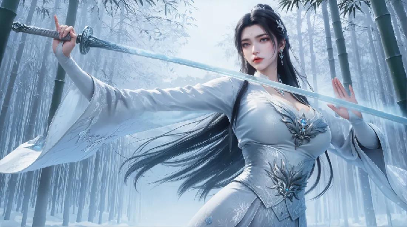

---

## 二、力量體系與修煉機制

修仙者感應天地靈氣，洗滌肉身與神魂，經歷道基鑄造至神遊天地之途：

| 境界層次 | 修煉特徵與威能表現 |
| :--- | :--- |
| **煉氣期（一層至九層）** | 引氣入體，通百骸經絡，凝練靈力，可驅使下品法器與基礎五行符籙。 |
| **築基期（前、中、後期、圓滿）** | 靈力化液，開闢道基丹田，壽元延至兩百載，可御劍凌空，修成護體罡氣。 |
| **金丹期（九品道丹）** | 道基凝丹，丹生道紋（以九品為尊），掌握本命法寶，能移山填海，壽享八百載。 |
| **元嬰期（破丹化嬰）** | 丹碎成嬰，神魂獨立，肉身雖毀亦能奪舍或重塑，舉手投足引動天地異象。 |
| **化神期（神遊太虛）** | 元嬰化神，神念籠罩萬里，初步觸碰天地法則，為青玄界頂尖巨擘。 |

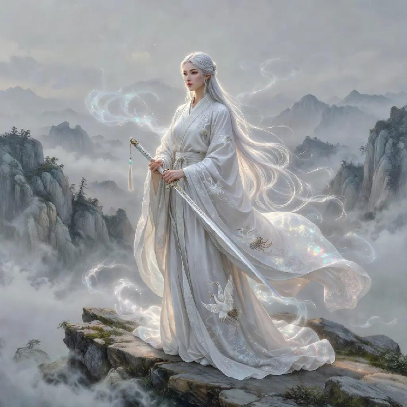
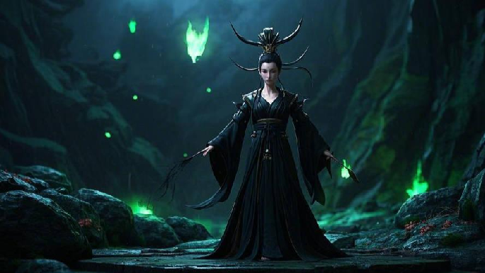

---

## 三、地理板塊與核心勢力

1. **三大名門正宗**：
   * **青雲仙宗**：東華第一正派，底蘊萬年，座落於青雲九峰，以玄門道劍與清靈之氣名動天下。（女主角柳清虛所屬宗門）。
   * **太華道宮**：傳承上古純陽道統，精於符陣與煉丹，與各大修仙世家關係盤根錯節。
   * **天劍神宗**：座落於極西劍峰，全派皆修殺伐劍意，行事孤傲。
2. **四大修仙巨族**：
   * 慕容世家、姬氏家族、姜氏望族、謝氏丹閥。掌控仙城商會、靈礦脈絡與跨域寶船。
3. **重要地標與秘境**：
   * **青雲觀／九華靈峰**：青雲仙宗之核心清修秘境。
   * **落霞仙城**：天下散修與世家交易之第一大集市，設有「千寶拍賣樓」。
   * **天隕古淵**：萬年前仙魔大戰封印之地，煞氣瀰漫，藏有無數古仙洞府。

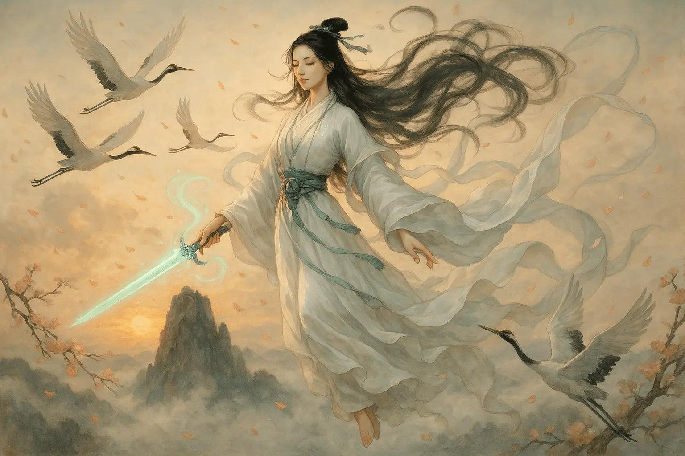
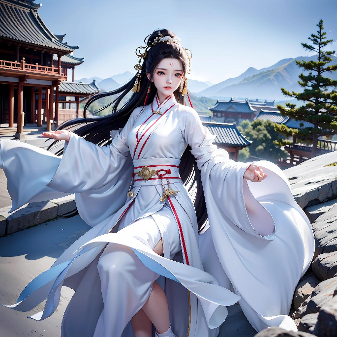

---

## 四、文明風貌與命名特徵

* **文化風貌**：崇尚道法自然、古典風雅、尊卑有序。仙凡界限森嚴，散修為求資源朝不保夕，宗門弟子則講求傳承心性。
* **命名風格**：
  * 地名以山川名嶽、洞天福地為主（如：落霞峰、紫虛崖、碧淵寒潭）。
  * 宗門與功法帶有古典玄門道韻（如：《太清引靈訣》、《紫霄神雷引》、《太虛化劍錄》）。

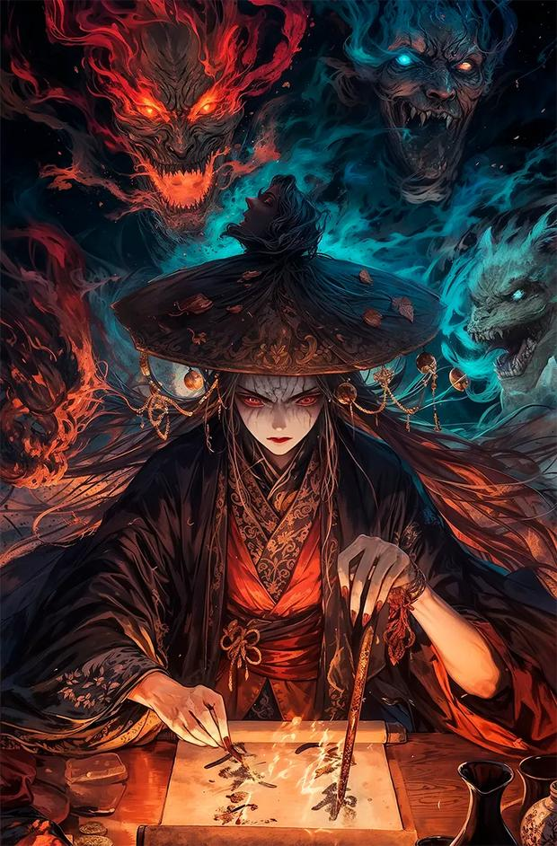
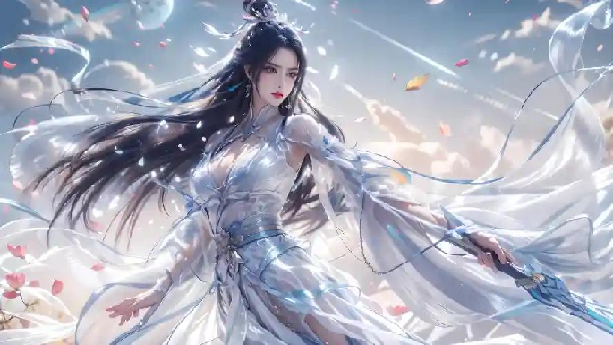

---

## 五、核心矛盾與世界事件（第一～四卷演進）

1. **天地斷脈危機（已緩解並重塑）**：青玄界核心九大祖靈脈近年漸現枯竭徵兆，青雲觀首當其衝；經顧淵協助重啟靈眼、柳清虛成就九品金丹並破嬰後，九華祖脈徹底復甦並進一步結合九曜法則改良護山大陣。
2. **太古封魔鎖鏈節點與西陵魔煞宗之患（第三卷平定）**：青雲九華祖脈實為太古七界封魔鎖鏈節點之一；第三卷枯骨老魔企圖趁真空期強奪封印權限，已被顧淵與青玄、滄瀾眾女聯手殲滅（ch078～ch082）。
3. **東華秩序重整與商道擴張（第三～四卷完成）**：青雲觀成為東華十九洲正道共尊之首，慕容玥執掌的萬界商盟於第四卷徹底降服落霞仙城三十六世家、覆蓋青玄三洲並接通滄瀾界與九曜神域跨界靈舟商路。

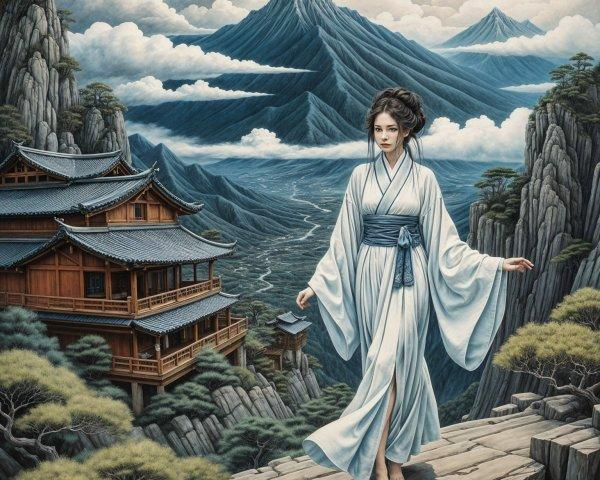
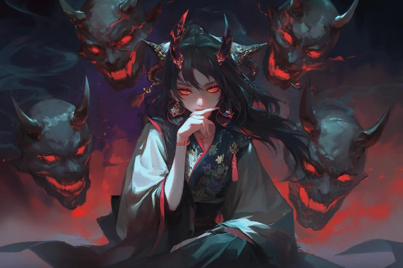

---

## 六、女主群像與世界線演進（截至第四卷）

* **柳清虛（青雲觀掌門・元嬰初期・第一位紅顏道侶）**：
  * **身分**：青雲觀新任掌門、東華十九洲正道女魁首。
  * **演進軌跡**：自早期靈脈枯竭、王氏逼婚破局起，歷經第二卷孤身渡九品天道金丹劫、第三卷九霄守衛戰孕育元嬰胎息並重塑東華秩序，於第四卷 ch118 跨界親臨九曜神域廣寒月宮碎丹成嬰突破**元嬰初期**，ch124 返青玄界結合九曜法則改良護山大陣。
* **沈玄清（青雲太上仙尊・元嬰大圓滿巔峰・第二位紅顏道侶）**：
  * **身分**：青雲太上仙尊（「寒玉仙子」）、古仙傳承與七界封魔陣研究核心。
  * **演進軌跡**：第一卷雙修鎮壓極陰寒煞；第二卷破譯《太素天變錄》、繪製「古仙抗魔全圖」；第三卷 ch067 徹底洗淨五百年大劫殘印重歸元嬰大圓滿巔峰（觸及半步化神契機）並共守青雲祖脈；第四卷坐鎮後方並於 ch121 遠端傳訊確認九曜祭天壇為七界封魔鎖鏈節點。
* **慕容玥（東華萬界商盟盟主・半步金丹・第三位紅顏道侶）**：
  * **身分**：萬界商盟盟主、萬界通商行掌舵者、慕容世家家主。
  * **演進軌跡**：第一卷奪回千寶樓大權並獻上殘月古玉；第二卷成立「東華萬界商盟」建立跨界情報隊；第三卷打通青玄—滄瀾跨界商票閉環並令靈鑑神瞳晉升第二重（ch077）；第四卷徹底降服落霞仙城三十六世家、遠端破獲天行者九曜黑市陰謀（ch120），並於 ch124 開通青玄—九曜跨界靈舟商路。

> 註：早期大綱草案曾列「蘇凝霜（天劍神宗長老）」作為潛在原型，後續正式正文改由「沈玄清」作為第二位核心女主，蘇凝霜未進入正式人物陣容。

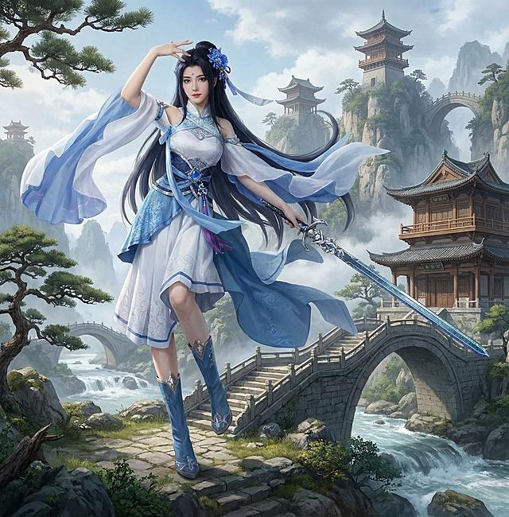
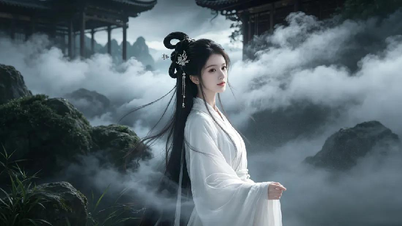
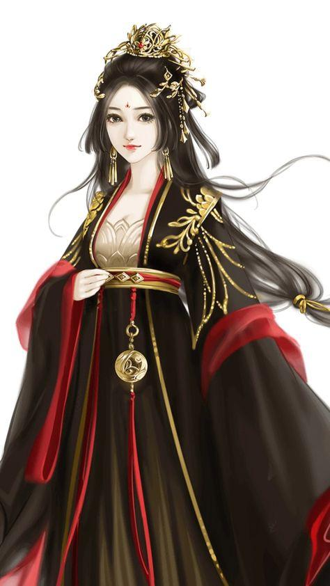

---

## 七、萬界樓造化與當前世界格局（截至第四卷）

1. **青玄界回饋萬界樓**：
   * 供應玄門吐納法、五行煉丹術、飛劍銘刻技藝、古仙封魔陣圖考據，以及三洲商盟源源不絕的靈石與靈材資源。
2. **萬界樓賦能青玄界**：
   * 修復青雲九華祖靈脈（確認為太古七界封魔鎖鏈節點之一）、徹底拔除西陵魔煞宗與枯骨老魔之患（第三卷 ch078～082）、並打通通往滄瀾界（02）與九曜神域（05）的跨界商貿與法陣交流網絡。
