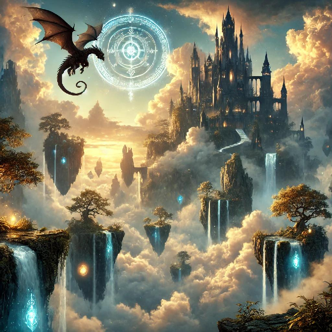
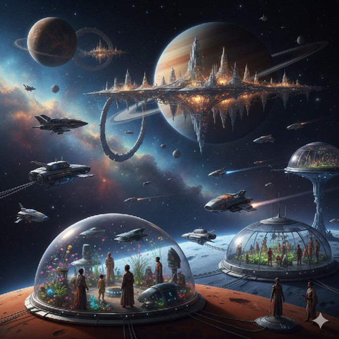

# 《萬界風月樓》世界檔案 03｜艾瑟蘭（魔法文明）

> 本文件為《萬界風月樓》諸天九界之第三界詳細設定。世界架構與創作規則遵循 [小說創作總綱](../../README.md)。

---

## 一、世界基本概況

* **世界編號**：03
* **世界名稱**：艾瑟蘭（Aetherland）
* **文明類型**：奇幻西方魔法文明
* **一句話定位**：奧術法師塔高聳入雲、精靈古樹低語、龍吟震徹雪峰的魔網奇蹟之界。
* **世界格局**：
  由星輝帝國、至高奧術評議會、迷霧精靈庭院與龍脊雪山四大勢力分立。以太魔網由遠古世界樹「尤克特拉希爾」輻射至全界，法師們透過冥想與符文構築各階魔法。

---

## 二、力量體系與修煉機制

法師依據魔力純度、冥想空間開闢大小以及對以太符文的解讀深度劃分：

| 階位稱號 | 環級範圍 | 魔法威能與代表性能力 |
| :--- | :---: | :--- |
| **魔法學徒** | 0環（戲法） | 感應微弱元素共鳴，引導光亮、生火、引水等初級魔法戲法。 |
| **正式法師** | 1～3環 | 凝練法力之池，掌握火球術、冰錐風暴、奧術護盾等戰術魔法。 |
| **大魔法師** | 4～6環 | 開闢體內魔力迴路，掌握群體增益、高階召喚術與飛行漂浮術。 |
| **大魔導士** | 7～8環 | 精神溝通以太魔網深層，瞬發高階法術，掌握空間短程閃爍與次元錨。 |
| **傳奇奧術法聖** | 9環及禁咒 | 構築個人浮空法師塔，能引發流星火雨、時空凍結等改寫地形之禁咒。 |

---

## 三、地理板塊與核心勢力

1. **至高奧術評議會（達拉然浮空群島）**：
   * 七大傳奇法師塔鼎立，掌控著跨大陸傳送門與奧術禁書庫，獨立於世俗王權之上。
2. **星輝人族帝國（聖輝城）**：
   * 擁有龐大的獅鷲騎士團與聖黎明神殿，崇尚騎士信條與光輝聖火。
3. **迷霧森林・翠玉庭院**：
   * 壽元漫長的木精靈與月精靈隱居於世界樹根部，掌握自然魔法與神射技藝。
4. **龍脊雪峰・遠古龍巢**：
   * 巨龍棲息的極寒之巔，守護著上古泰坦神裔留下的以太核心。

---

## 四、文明特質與命名風格

* **文化風貌**：學者嚴謹、注重貴族禮儀、追求真理與知識。精靈親近自然，人族渴望擴張，巨龍傲視眾生。
* **命名特徵**：
  * 地名與家族帶有古典西幻音節（如：艾爾文之森、奧克蘭德要塞、晨星家族、銀月法師塔）。
  * 魔法術語強調以太與原初元素（如：「永恆霜凍之棺」、「紅蓮熾炎界」、「以太裂解之矛」）。

---

## 五、核心矛盾與世界事件

1. **世界樹以太衰竭危機**：世界樹根部遭遇未知深淵死氣侵蝕，以太魔網日漸薄弱，部分地區出現魔法枯竭荒原。
2. **禁忌鍊金與人體實驗**：奧術評議會內部「真理黑袍會」試圖抽取精靈純血與巨龍之魄以製造永生魔導人偶，引發種族血戰。
3. **男主介入契機**：男主偕萬界樓生生不息之純陽生機與跨界大道親臨，撫平世界樹病變，成為精靈與奧術評議會奉為上賓的超然存在。

---

## 六、女主群像與錨點契機（遵循 R19 原則）

* **艾琳諾·晨星（精靈王國月曜祭司）**：
  * **性格外貌**：銀髮碧眸、超凡脫俗、善良聖潔。手持月神法杖，氣質空靈宛如林間朝露。
  * **命運困境**：守護世界樹核心時被深淵死氣反噬，生命印記衰敗，需尋求能容納浩瀚生機之純靈之體方能重續生機。
* **塞拉菲娜·馮·羅恩（最年輕的冰霜傳奇魔導士）**：
  * **性格外貌**：金髮雙馬尾、傲嬌博學、面冷心熱。身著精緻法師黑袍與過膝長靴。
  * **故事線**：為研究失落的古代符文身陷魔法反噬，對男主帶來的東方仙道陰陽本源充滿研究渴望，在交流中漸生情愫。
* **菲奧娜·格里芬（帝國聖殿女騎士長）**：
  * **性格外貌**：紅髮烈焰、英武挺拔、恪守榮譽信條，身披秘銀騎士鎧甲。

---

## 七、萬界樓互動與造化機緣

1. **艾瑟蘭回饋萬界樓**：
   * 精靈古樹甘露、九環禁咒魔導書、秘銀魔精礦、空間傳送符石與龍族真血。
2. **萬界樓賦能艾瑟蘭**：
   * 男主以造化生機修復世界樹靈核，以萬界道法啟發塞拉菲娜突破法神壁障，改寫大陸種族衝突走向。
