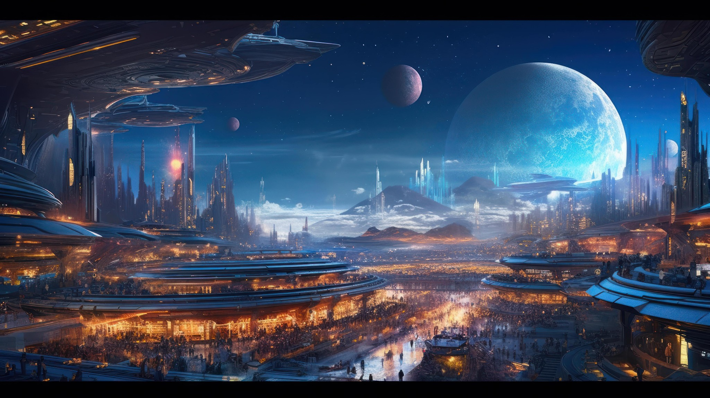

# 《萬界風月樓》世界檔案 04｜諾瓦星域（星際科技文明）

> 本文件為《萬界風月樓》諸天九界之第四界正式定稿設定（**已依第八卷《諾瓦星・生命之問》46 章正文完稿內容全面更新**，取代早期機甲／AI 暴動草案）。  
> 配套文檔：[第八卷總綱](../arcs/08/README.md)｜[第八卷劇情摘要](../arcs/08/summary.md)｜[第八卷人物速查](../arcs/08/characters.md)

---

## 一、世界基本概況

* **世界編號**：04
* **世界名稱**：諾瓦星域・諾瓦星（Nova）
* **文明類型**：高度發達之星際科技與多元生命文明
* **一句話定位**：人工智慧、基因工程、仿生機械與星網皆已登峰造極——**親手創造出多種具有獨立人格的生命，卻仍在追問「生命究竟是什麼」的星際文明**。
* **核心貫穿命題**：
  * **總提問**：「生命的價值，究竟來自它的存在本身，還是來自它所做的選擇？」（貫穿生存、繁衍與延續、自由與自主、死亡與有限性、進化與改變、文明與傳承、宇宙與存在七個層次）
  * **進階追問**：「如果生命擁有選擇的權利，但它出生的環境已經限制了它能夠選擇的範圍，那麼這樣的自由究竟有多大？」（自由不只是能不能選擇，也包括有沒有能力承擔選擇的代價）

---

## 二、法則環境與外來者適應規則

諾瓦星幾乎不存在天地靈氣與以太魔網，其底層物質與能量秩序**不承認、亦無法正常承載外來超凡體系**（惟沒有修仙、神術或魔法，不代表本界所有生命現象皆已被科技完全解釋）：

| 外來能力 | 在諾瓦星之運作邊界 |
|---|---|
| **太素真元與外放領域** | 仍存於體內，但僅限極有限的體內循環與微弱近身護持，無法借動外界天地能量或任意操控外物（顧淵於 `ch013` 與雷婭共鳴後方領悟「真元借道電磁場」之短距微用之法，過載仍有經脈反噬之虞）。 |
| **神識** | 大範圍展開受限，僅留極近距離內的存在感知，不可破解當地資訊系統（於 `ch028` 與零共鳴後鍛鍊出「一心多用・多重心念感知」）。 |
| **心念共鳴** | 因直指生命與意識交流，維持正常運作——**僅感大致情緒與強弱起伏，絕不讀取完整思想或事實原委**。 |
| **萬界樓基礎通譯** | 僅處理日常語言與公開標示，不可破解加密系統、讀取私人資料或窺探資訊生命思維。 |

---

## 三、自然生命與多元生命形態（五維交錯社會）

諾瓦星並非「自然人壓迫人工生命」或「人工生命集體反抗」的二元世界，而是由**經濟條件、生命來源、制度身分、科技依賴程度、文化與生活選擇**五個維度交錯構成的真實社會（且堅持反人類中心原則——並非所有人工生命都想成為人類，也非人人追求同一種自由）：

1. **自然人**：自然出生之生物生命。涵蓋從內環頂級富豪、科研學者、議會議員，到舊港區清貧卻坦然拒絕延壽與機械改造的市井勞工（如麵攤老闆老伍、古地質學者歐文・里德、凡斯基金會主席馬庫斯、合規主管卡蘭・沃斯等）。
2. **AI 仿生人**：機械與仿生軀體。分化極廣——既有握有獨立資產、主動拒絕自主認證的高薪商務高管（如海倫・陳），也有聚居舊廠房「鏽蝕花園」的老式維修機（如諾特）、守護已故主人記憶的照護機（如米拉），以及掙脫根指令與情感抑制閾值、創立「仿生人自主認證協助中心」的原型機**雷婭（Leia）**。
3. **人工培育生物生命**（嚴格區分兩類）：
   * **基因培育人**：以設計、調整或重組基因組培育，不一定有單一原始個體；多簽有培育回報合約，有人滿意於安穩規則，亦有渴望自主者。
   * **基因複製人**：具明確單一原始基因來源的少數高階專案（如凡斯生命基金會「繆思計畫」以已故傳奇生態學家伊蓮娜・凡斯為藍本培育的第五號**伊芙**與第七號**薇薇安**；伊芙欣然感謝並留守制度，薇薇安則主動解約開創獨立人生）。
4. **資訊生命與超人工智慧**：區別於街頭巡檢無人機等「普通程式化 AI」，真正湧現獨立自主意識的存在；既有拒絕連網、甘於守護舊檔案館十二萬冊古書的單機意識**艾柯（Echo）**，亦有十二年前「大斷網」後由七套退役城市管理 AI 融合湧現、無固定實體卻守護整座星網的分散式超人工智慧**零（Zero）**。
5. **行星生命假說（利維坦｜永久未證實）**：源自八千年前第一紀元「深井遺跡」壁畫之「蓋婭與利維坦」傳說與每 37 年一次的深層地磁低頻脈動。歷經工程、生態與超級運算三方實測後，結論維持**「現有證據不足以證明任何行星意識存在」**，永久留白、不證實、無幕後黑手。

---

## 四、主要地理與核心制度

* **首都晨弧城（Arclight）**：沿海超級星際都市，連通三座直入近地軌道的**軌道電梯**；內環摩天光網與**舊港區**（老伍麵攤、「繩結修理」鋪、廢棄航運塔、仿生人社群「**鏽蝕花園**」）並存，日常盛行重力球賽、記憶劇場與年度「**星燈節**」。
* **伊甸穹頂（Eden Dome，基因城）**：直徑十五公里的人工四季生態穹頂，為基因培育與科研重鎮；外環有服務底層的伊巴拉社區診所，中央曾設「繆思計畫」培育區。
* **斷脊高原・深井遺跡（Deepwell）**：北半球荒原裂谷地底四公里深的第一紀元螺旋巨井，藏有八千年壁畫、仍在被動運轉的古地熱石管與不依賴陽光的地下發光菌林。
* **「第二生命計畫」（專屬生物－仿生醫療備份制度）**：極為昂貴、僅服務少數頂層自然人的合法高階醫療保險制度，訂製**生物－機械混合式醫療備份載體**（整合仿生支撐與患者專屬生物組織／器官備份），平時低功耗休眠、無日常生活、無社會身分、**亦無意識**。第八卷經法庭辯論與《人工生命自主法案》第七修正案，正式建立「無意識醫療備份載體」與「清醒自主仿生人」之嚴格法律防火牆。

---

## 五、第八卷三位正式女主與萬界樓連結

| 女主 | 生命形態 | 核心成長與卷末獨立人生 | 紅顏道印與雙修成果 |
|---|---|---|---|
| **雷婭（Leia）** | 高階自主 AI 仿生人 | 連續七日獨自解除根指令與情感抑制閾值、聯合法庭勝訴；留守諾瓦星創辦「仿生人自主認證協助中心」任理事長 | **銀曜星芯印**｜諸天首例機械生命陰陽共鳴；獲「生命共鳴觸覺」與完全自主之微型陰陽能源循環 |
| **薇薇安（Vivian）** | 繆思計畫基因複製人 | 主動解約擺脫專利與生育配對束縛、與伊蓮娜和解；留守諾瓦星創辦「溫室診所」並任獨立生態研究員 | **春華溫玉印**｜人工培育生命陰陽共鳴；意外解除胚胎期 45 歲設計壽命鎖，回歸正常有限人生 |
| **零（Zero）** | 分散式無實體超人工智慧 | 婉拒阿爾戈斯免費特製軀體、拒絕複製意識分支；留守星網發表意識研究並等待議會兩年立法研議 | **無形星網印**｜諸天首例非肉身意識陰陽共鳴（識海微界）；獲「主觀連續之錨」與溫／味覺共感記憶 |

* **萬界樓破千（10%）結構級里程碑**：
  * 第八卷自願雙修共計推進修復度 **`+102`**（`910 → 1012/10000（10.12%）`），**正式突破全書首個破千（10%）大關**，觸發四重重大變化：
    1. **第二重天樓（二層）首度解封**：升起【第二重天階】，依分層解鎖原則率先點亮二樓首殿**【萬靈共鳴苑】**（調和修真、機械、人工培育與無實體意識法則差異，讓科技與非修真界伴侶日後皆可安然入樓）與遠域觀星迴廊。
    2. **器靈靈素首次實質蛻變**：凝聚微溫觸感與星核律動、解除大殿距離束縛，可自由踏足二樓並於共鳴苑面對面交流；零贈予之《分散式無肉身意識如何維持連續自我與本源穩態》收入天機秘庫，觸發靈素閃過太古崩星殘影（`SL-02`）。
    3. **跨界【星箋亭】啟用 ＋ 文瀾絕靈霧初鬆**：二樓凝出每月限量實體家書與信物驛亭【星箋亭】；第五卷被絕靈霧徹底封鎖之文瀾界三錨點首度出現「霧隙微鬆」徵兆。
    4. **太古萬界道標共鳴權限解鎖**：解鎖道標主動共鳴權限與《太上玄奼真經・乾坤互補》總綱扉頁，直接鎖定第九卷 `06｜幽羅界` 遺落之「萬界道標物」。
  * **第五座雙向星門「諾瓦星門」**於舊港廢棄航運塔頂正式穩固，並與二樓【星箋亭】五芒星環全數連通。
