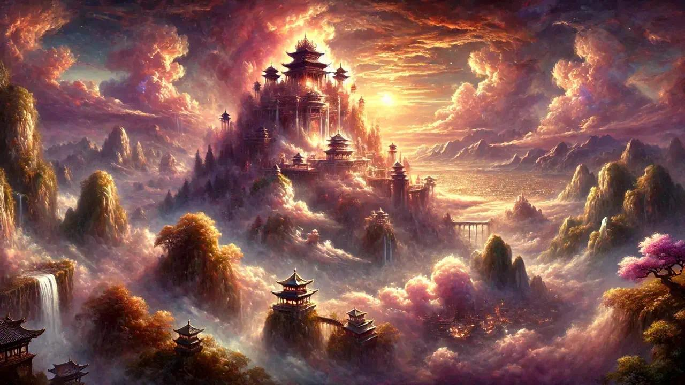
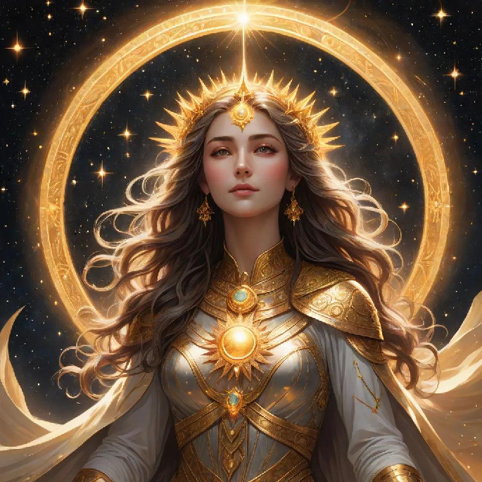

# 《萬界風月樓》世界檔案 05｜九曜神域（神話文明）

> **文件定位**：本文件為《萬界風月樓》諸天九界之第五界（第四卷主舞台）正式詳細設定。世界架構與創作規則遵循 [小說創作總綱](../../README.md)，並與 [第四卷世界設定](../arcs/04/01_world_setting.md) 完全對齊。

---

## 一、世界基本概況

* **世界編號**：05
* **世界名稱**：九曜神域
* **文明類型**：遠古神話・星辰神權・信仰文明
* **一句話定位**：神光璀璨照耀九重天闕、諸神俯瞰下界億萬信徒、神格與天條律令威嚴至高，卻在千年信仰積弊下瀕臨崩潰的神聖國度。
* **核心主題**：**「神明因眾生而存在，還是眾生因神明而存在？當信仰成為毒藥，神明是否還有資格代表天道？」**
* **世界格局**：
  神域由高居天外的「九曜天宮」執掌天地運轉，對應日、月、金、木、水、火、土、羅、計九大星曜神系。現任九曜神王**昊天神皇**壽元告盡，九系圍繞神王繼承權與信仰濁泥危機爆發全面動盪。

---

## 二、九曜神域三紀遠古史

1. **【太初紀】（約十萬年前）**：宇宙虛空中九顆星辰本源（日、月、金、木、水、火、土、羅、計）凝聚成形，誕生九位原初大神，各自開創神系，信仰願力純粹，神道通暢。
2. **【神戰紀・諸神黃昏】（約五萬年前）**：諸天大劫波及九曜神域，部分古神隕落，留下禁地「**諸神黃昏遺墟**」與無人清理的失控願力，成為「信仰濁泥」的最初起源。
3. **【神權紀】（五萬年前至今）**：倖存神明建立**九曜神王議會制度**，每萬年由九系共推神王。表面九系共治，實則日曜神系長期把持多數席位，信仰濁泥問題被系統化壓制卻從未根治。

---

## 三、力量體系與神階定位

九曜神域神明力量的**五個構成維度**（非單純境界晉升順序）：**神火**（力量燃燒狀態）、**神性**（神明本質屬性）、**神格**（承載神道權柄的核心）、**信仰**（外部願力來源）、**法則**（所理解與掌控的宇宙規則）。

| 神階 | 稱謂 | 境界特徵與掌控權柄 | 代表人物 |
|:---:|:---:|:---|:---|
| **一階** | **神使** | 神明初步凝形，掌握基礎神術與神火 | 神殿巡察使 |
| **二階** | **神官** | 掌握微量法則，駐守下界或神宮要衝 | 神殿守衛高層 |
| **三階** | **神君** | 各神系中堅力量，凝聚穩固真神格 | 各系核心長老 |
| **四階** | **神將** | 戰力強大的高層神明，統御神域軍團 | 鐵赤將軍（卷四 ch111 陣前伏誅） |
| **五階** | **神尊** | 掌握完整法則，一念引動天地星象 | 羲凰・赫拉迪雅・赤炎神君・玄月神母 |
| **六階** | **神王** | 具備九曜混元神格，九曜神域最高統治者 | 昊天神皇（卷四終局以身鎮封裂隙隕落） |

---

## 四、九大星曜神系與核心地點

### 1. 九大星曜神系
| 神系 | 星曜 | 領域與特質 | 政治立場與濁泥處境 |
|:---|:---:|:---|:---|
| **日曜神系** | 日 | 太陽・光明・權威 | 由**赤炎神君**領銜，企圖推行日曜世襲；以神火焚燒濁泥導致高濃度焦化殘渣 |
| **太陰神系** | 月 | 月亮・潮汐・慈悲 | **玄月神母**掌權、**羲凰**為少宮主；以月華將濁泥轉移自身承擔，「越慈悲越崩潰」 |
| **金曜神系** | 金 | 戰甲・防禦・律法 | 保守派，傾向支持日曜神系；以嚴苛律法壓制濁泥反增下界怨恨 |
| **木曜神系** | 木 | 生命・自然・醫療 | 溫和改革派；以生命本源稀釋濁泥成效最高但消耗驚人，古神多因此耗盡神性 |
| **水曜神系** | 水 | 水流・智慧・算計 | 表面中立，實則暗中與天行者交易站有所往來；將濁泥分散稀釋治標不治本 |
| **火曜神系（熒惑）** | 火 | 戰爭・征服・勇氣 | **赫拉迪雅**與**鐵赤將軍**內部分裂；部分神殿高層以人為戰爭製造信仰願力 |
| **土曜神系** | 土 | 土地・農耕・穩定 | 最保守，不介入神座之爭；農耕信仰純粹，濁泥最輕微 |
| **羅睺神系** | 羅 | 陰影・腐化・蛻變 | 最神秘神系，主動吸收並轉化濁泥，疑為諸天蝕者滲透神域的通道 |
| **計都神系** | 計 | 命運・因果・推算 | 號稱超然旁觀、僅記錄因果，實則掌握神域最多秘密 |

### 2. 七大核心地點
* **太微玉京**：神格結晶築成的天空浮城，神域物質文明中心，地下藏有**天行者核心交易站**。
* **九曜天宮**：九系最高神權中樞，神王議會所在。
* **廣寒月宮（太陰神宮）**：太陰神系聖地，內設月輪廣場、玄月殿與太陰神格池。
* **熒惑赤淵**：戰伐神系軍事聖地，永燃熒惑神火，內藏以戰魂加工信仰的秘密祭壇。
* **紫薇天關**：九曜最古老禁地之一，外有七重禁制，深處封存大乾太祖血脈源頭——**紫霄真龍神座**。
* **諸神黃昏遺墟**：遠古神戰遺跡，散落神格碎片與古仙遺器，深處存有**混沌始神殘念**，結界最薄弱、易現蝕者投影。
* **九曜祭天壇**：下界信仰願力匯入神域的最終節點，亦是信仰濁泥擴散與七界封魔鎖鏈節點的關鍵所在。

---

## 五、核心矛盾與世界事件

1. **信仰濁泥的起源與制度性死結**：
   * **原始來源**：五萬年前「諸神黃昏」大戰留下的失控願力。
   * **持續擴大原因**：九曜神域長期壓抑神明七情六慾，使神明無法理解與疏導眾生的信仰情緒。
   * **制度性死結**：神明只能選擇焚燒、壓制或自行承受，沒有真正的轉化機制。諸天蝕者只是利用並加速這場污染，卻非問題的製造者。
2. **九曜神座之爭**：
   現任神王昊天神皇壽元將盡，日曜神君企圖奪位；天行者趁亂高價收購神格碎片；棋算者中層代理暗中撥弄局勢；諸天蝕者規則投影則企圖趁亂滲透祭天壇。
3. **破局關鍵（非單純救治，而是神道重塑）**：
   顧淵以萬界樓的諸天法則視角點破：「只有當神明真正保有自己的意志與七情六慾，才能理解眾生所愛所痛，建立轉化濁泥之路。」同時揭露紫霄真龍神座與七界封魔鎖鏈的秘密，促成神域新秩序的建立。

---

## 六、女主群像與跨界因果（遵循 R19 / R23 原則）

* **羲凰神女（太陰神宮少宮主・五階神尊）**：
  * **性格定位**：清聖、仁慈、孤高，因過度承擔眾生苦難而神格龜裂。
  * **相遇與弧光**：主動求見顧淵（E 型主導），在理念碰撞中領悟「唯有完整自我方能給予更多」，自願選擇與顧淵共探神道並完成神格洗滌。
* **赫拉迪雅（熒惑戰伐女武神・五階神尊）**：
  * **性格定位**：豪爽、強勢、好戰、坦率，手握精銳軍團、厭惡虛偽神權。
  * **相遇與弧光**：以挑戰者姿態主動邀戰（D 型追求），在揭露戰爭信仰黑幕與平定叛亂後，以熒惑最高規格「神魂誓約」與顧淵締結生死盟約。
* **姬明月（紫霄女帝・跨界主線高潮）**：
  * 揭露大乾太祖血脈源自九曜天曜分支，於紫薇天關憑自身帝王意志完成真龍神座認主。

---

## 七、第四卷終局結果、新秩序與諸天暗線

1. **九系新章與三權分立（ch122～ch124）**：
   * 諸天蝕者規則投影降臨九曜祭天壇時，現任神王**昊天神皇**以自身九曜混元神格重新錨定七界鎖鏈節點、封印裂隙並壯烈謝幕（ch122）。
   * 戰後正式改革延續五萬年的神王議會，確立**治理、監督、執行三權分離**新秩序（ch123）：設立**【九系議會】**（九系基本議席平等）、**【信仰監督院】**與**【信仰疏導署】**。赤炎神君失去獨斷大權（日曜仍保有龐大資源與保守派支持）；羅睺神系影月被揭露為趁亂牟利的投機者（僅部分激進派私連蝕者）。
   * **姬明月**以紫霄真龍神座奪回「天曜代表」席位（暫託太陰代掌）；太微玉京外城亦已接通通往青玄與大乾的跨界貿易棧橋（ch124）。
2. **萬界樓突破**：第四卷結束時萬界樓修復度由 `280/10000` 提升至 `500/10000`（5.00%），並顯現不在原有設施清單中的古老結構——**諸天神藏殿**（FB3-07 / FB4-01 深化）。
3. **跨卷暗線推進**：
   * **AL-01 / BL-05**：摧毀天行者九曜核心交易站（ch120），棋算者中層代理（白玉面具無名者）首次現身並於戰後從容撤離。
   * **SL-01 / SL-03 / SL-04**：首次直面諸天蝕者規則投影；確認九曜祭天壇為諸天七界封魔鎖鏈節點；混沌始神殘念認出顧淵身上的古老印記（ch119）。
