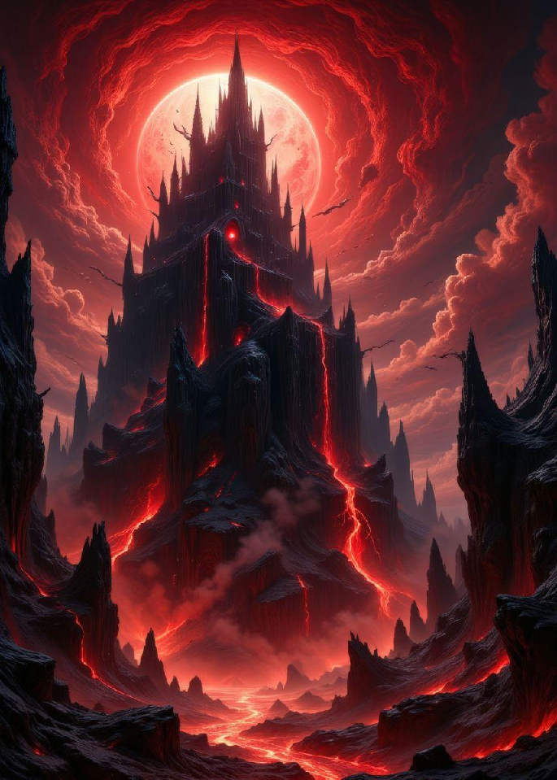
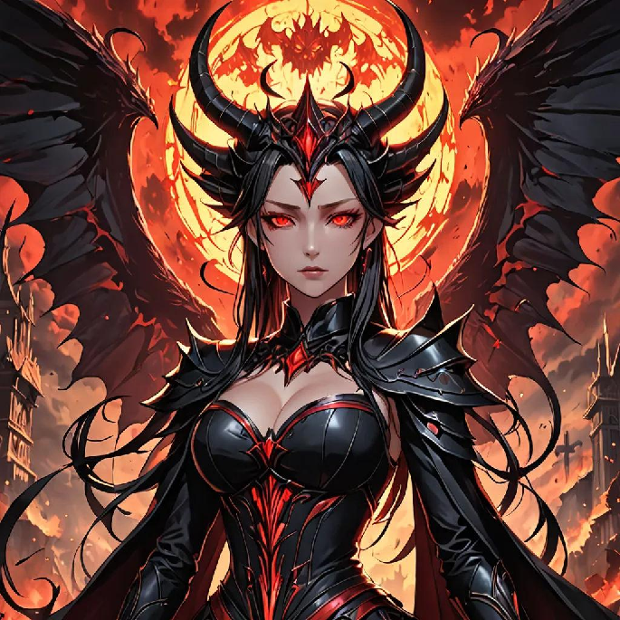

# 《萬界風月樓》世界檔案 06｜幽羅界（魔族文明）

> 本文件為《萬界風月樓》諸天九界之第六界詳細設定。世界架構與創作規則遵循 [小說創作總綱](../../README.md)。

---

## 一、世界基本概況

* **世界編號**：06
* **世界名稱**：幽羅界
* **文明類型**：暗黑魔族古老王庭文明
* **一句話定位**：血月懸空、深淵巨裂、弱肉強食、崇尚極致血脈力量與王庭權謀的暗黑修羅之土。
* **世界格局**：
  大地覆蓋著漆黑的黑曜石高原與沸騰的九幽血海。古老的天魔、地魔與修羅十二支族建立各自的「深淵王庭」，共尊中央的「幽羅魔帝」。萬載之前魔帝失蹤，幽羅界陷入各大部族王庭混戰征伐的動盪時代。

---

## 二、力量體系與修煉機制

幽羅魔族不修清靈仙氣，專煉地底九幽煞氣、天魔真血與狂暴魂力：

| 魔位階層 | 戰鬥形態與標誌性威能 |
| :--- | :--- |
| **魔卒／煞衛** | 吸收地煞之氣淬煉魔骨，身軀堅若生鐵，力拔千鈞，嗜血狂暴。 |
| **魔將（覺醒本命魔紋）** | 體表銘刻部族遠古魔紋，魔氣外放如黑炎，可催動化血魔刀與嗜魂黑霧。 |
| **魔帥（凝聚真魔核）** | 體內結成幽黑魔核，掌握部族天賦魔神通（如虛空影遁、狂化修羅變、天魔幻音）。 |
| **天魔王（深淵王座）** | 開闢自身本源魔域，滴血重生，壽數綿長，足以一人屠滅千萬凡俗城邑。 |
| **幽羅魔帝（九幽至尊）** | 煉化整座幽羅界地脈魔煞，掌控「幽暗吞噬原初法則」，萬魔伏首。 |

---

## 三、深淵格局與核心勢力

1. **夜魘王庭（黑夜主宰）**：
   * 精於暗殺、空間影遁與暗影魅惑，族人身姿曼妙妖嬈，智計百出。
2. **修羅血海王庭（殺戮皇族）**：
   * 盤踞於億里無盡血海，全族好戰成狂，肉身戰法冠絕幽羅界，以殺證道。
3. **裂魂魔淵（靈魂氏族）**：
   * 專精幽冥鬼火、攝魂奪魄之法，行事隱秘莫測，世代守護幽羅古帝陵寢。
4. **幽羅中央帝宮**：
   * 矗立於深淵天柱頂端，魔帝寶座常年空懸，各大王庭每隔百年在此進行「七殺血祭」以爭奪帝血令。

---

## 四、文明風貌與命名特色

* **文化特質**：崇尚絕對強者、尊卑以血統純度而定。外表冷酷嗜殺，但高階貴族遵循古老典雅的深淵禮節。
* **命名特徵**：
  * 部族與地帶多冠以暗、幽、煞、血等古老幽暗字眼（如：黑煞峰、修羅骨海、夜魘天闕）。
  * 人物名字帶有冷冽幽邃的音韻（如：夜琉璃、幽千愁、煞羽、屠靈）。

---

## 五、核心矛盾與世界事件

1. **深淵天脈枯竭與血脈逆反**：幽羅界地脈精氣逐年衰退，王族後裔真魔血脈日趨稀薄，更頻繁遭受「魔煞逆行蝕魂」之痛苦折磨。
2. **逼迫和親與王庭傾軋**：修羅王庭仗著兵強馬壯，逼迫實力漸衰的夜魘王庭交出第一長公主作為爐鼎血祭，戰事一觸即發。
3. **男主介入契機**：男主以降維般的陽和生機與仙家玄功駕臨，徹底化解天魔血煞反噬之苦，反手鎮壓強橫修羅，俘獲夜魘長公主芳心。

---

## 六、女主群像與錨點契機（遵循 R19 原則）

* **夜琉璃（夜魘王庭長公主・冷豔妖后）**：
  * **性格外貌**：紫髮紫眸、妖嬈冷豔、身姿曼妙無雙。一襲深紫魔紗羽衣，兼具女王的睥睨與深藏的脆弱。
  * **命運困境**：為保族人免遭修羅屠戮，甘願自我犧牲，但在絕境中尋求逆天改命之契機，無意間踏入萬界樓。
* **幽梵天（修羅血海一脈女武神）**：
  * **性格外貌**：紅髮烈甲、身負巨型修羅魔刃、性格狂傲倔強。崇拜純粹力量，誓言只臣服於能單手壓制她的真男人。
  * **故事線**：在戰場上被男主以灑脫姿態招招壓制，心神震盪，修羅戰血反倒為之共鳴臣服。

---

## 七、萬界樓互動與造化機緣

1. **幽羅界回饋萬界樓**：
   * 提供深淵黑曜魔金、九幽天魔晶核、血海靈珊瑚、幽暗吞噬傳承。
2. **萬界樓賦能幽羅界**：
   * 萬界樓純陽本源成為中和天魔煞毒的世間神珍，男主助夜琉璃提純真祖天魔血脈，登臨新一代幽羅女帝。
