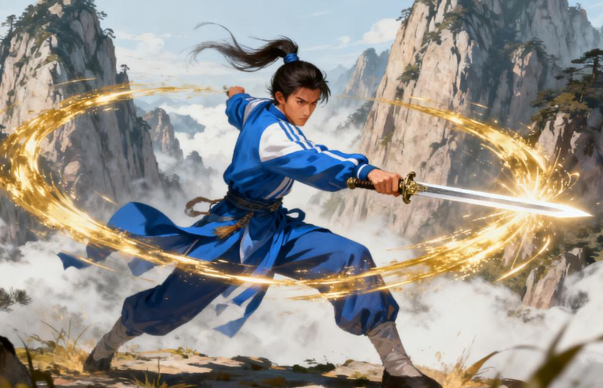

# 《萬界風月樓》

## 第二十章　星脈吐納，初融武意

---

### 一、鬧中取靜，天字別院

朱雀長街折扇化刀罡一事，宛如一顆巨石狠狠砸入了天武城看似平靜的湖面，在極短的時間內掀起了軒然大波。

不過小半個時辰，「一柄尋常竹扇化解先天後期十丈狂雷刀芒」的駭人消息，便如插上翅膀的飛鳥般傳遍了半座巨城。

霸刀門長老暴怒封鎖長街，天策府的黑衣密探與武極殿的執法裁決衛更是紛紛出動，試圖在人海中掘出那位神龍見首不見尾的「月白長袍折扇高人」。

然而，任憑各方勢力的眼線將朱雀大街翻了個底朝天，那位正主卻早已神不知鬼不覺地消失得無影無蹤。

此時此刻，天武城東隅。

與西城和南街的喧囂狂暴截然不同，東城依山傍水，多是高門大閥的私家園林與頂級清修之所。

穿過一條幽深的青竹古巷，映入眼簾的是一座名為「臨泉別苑」的雅致客棧。此處依山開鑿了一池清泉，泉水叮咚，修竹依依，環境清幽得宛若世外桃源。

顧淵負手立於一座名為「幽篁居」的天字號獨棟別院天井之中。

院落佔地足有半畝，周圍佈置了隔音與避塵的基礎符文，三間青瓦精舍掩映在翠竹流泉之間，鬧中取靜，極合修道者的心境。

「客官，這幽篁居是咱小店最好的上房，每日五十兩雪花紋銀，您看可還滿意？」掌櫃的親自躬身引路，滿臉堆笑。

「甚好，取一桶淨水，今夜無事莫要讓人打擾。」

顧淵隨手拋出一錠成色極佳的銀餅，掌櫃的千恩萬謝，知趣地掩上院門躬身退下。

天井內頓時安靜了下來。

夜幕漸漸垂落，一輪皎潔如玉盤的冷月悄然爬上梢頭，將斑駁的竹影灑在平整的青石板上，夜風吹過，竹葉沙沙作響，泛著幾分清涼意境。

顧淵步入精舍正房，反手合攏雕花木門，在屋內一張由千年沉香木打磨而成的溫潤蒲團之上緩緩盤膝坐定。

---

### 二、青竹留韻，刀意殘痕

「啪嗒。」

顧淵將白日隨身攜帶的那柄青竹折扇，輕輕平放在面前的紅木茶几之上。

屋內並未點燃燭火，唯有自窗櫺傾瀉而入的如水月華。

借著幽微的月光細看，只見原本光滑無暇的青竹扇骨頂端，此刻竟隱隱泛著一層極其微弱、若隱若現的血色毫芒。

那是白日裡顧淵以折扇引導混沌氣場、將雷烈那記暴走的「十丈狂雷刀芒」壓縮化解時，折扇扇骨自發吸附留存下來的一縷極致精純的——**狂雷刀意殘韻**！

在滄瀾界，尋常武者修煉至先天境，體內真氣便會開始帶有個人屬性；而若想跨入宗師之境，則必須凝聚出專屬於自己的心靈意志，這便是「武道真意」。

霸刀門的刀法脫胎於沙場萬軍廝殺，雖然雷烈心浮氣躁、仗勢欺人，但他那柄斬馬巨刀之上所凝聚的這縷狂雷刀意，卻是實打實歷經了十餘載苦修磨礪出的剛猛之氣。

狂暴、焦灼、霸道、一往無前。

「嗡……」

似乎是感應到了周遭空氣中游離的天地元氣，那一縷原本沉寂在扇骨之上的血色電芒，忽然像是一條受驚的毒蛇般微微蠕動起來，散發出一股微弱卻尖銳刺骨的割裂感。

顧淵垂眸凝視著這縷異界武意，深邃的眼眸中浮現出一抹探索與沉吟。

白日裡在聽雨茶樓，他說書聽道、長街觀戰，已然隱約窺見了滄瀾武道的修煉本質。

青玄界的仙道，重在「引氣、洗神、感悟大道自然」，靈力空靈變幻，神念巡天徹地，修的是超脫於凡軀之上的天地法則；

而這滄瀾界的武道，卻是「以身為爐、以血為炭、以意為鋒」，將凡胎肉身的潛能榨取挖掘到了令人髮指的境地！一拳崩石、一刀斷流，戰鬥爆發力極致純粹狂猛。

「仙術在此界受到天地排斥，範圍縮減兩成，消耗增加三成……」

顧淵微微一笑，右手食指指尖輕輕點在了扇骨那一縷血芒之上：

「但若能將這股剛烈武意納為己用，以混沌包容萬道，以武意重塑筋骨……這所謂的天地排斥，何嘗不是一場天賜的洗髓機緣？」

話音落下，顧淵指尖微吐！

「嗖！」

那一縷宛如髮絲般纖細的血色狂雷刀意，順著顧淵的指尖經脈，如同一道細小的火蛇，毫無阻礙地鑽入了顧淵的氣海之中！

---

### 三、星脈熔爐，包容萬道

「轟——！」

刀意入體的剎那，顧淵體內的經絡頓時傳來一陣微弱的灼刺之感。

異界的力量與青玄仙道金丹在本質上是截然相反的兩條大道。

仙道靈氣清靈高渺，而這股狂雷刀意卻充斥著肉身氣血的暴烈與殺伐煞氣。剛一進入顧淵的少陽經，這縷刀意便像是落入水滴中的滾燙沸油，瘋狂震顫，試圖撕裂周圍那看似柔弱的經脈壁障，暴走衝撞！

然而，顧淵的神色沒有絲毫變化，甚至連眉頭都未曾皺上半下。

「不知天高地厚的小東西。」

顧淵心中淡笑一聲，神念驟然沉入丹田。

「嗡————！」

下一瞬，顧淵丹田最深處，原本靜止懸浮的【萬界混沌星脈】，轟然運轉！

三百六十五處大穴猶如夜空中的漫天星辰齊齊亮起，深邃古老的混沌道韻自星脈深處狂湧而出，化作一座直徑尺許、緩緩旋轉的陰陽漩渦，頃刻間便將那條狂暴暴走的血色雷蛇籠罩在正中央！

混沌，乃是萬物之始，大道之源。

無論是青玄仙道的五行靈氣，抑或是滄瀾世界的武意煞氣，溯本逐源，皆誕生於混沌太虛之中。

那縷狂暴凶戾的狂雷刀意在撞入混沌星脈的剎那，就宛如撞上了一堵不可撼動的諸天神山！

任憑其雷芒如何炸響、刀鋒如何凌厲，在浩瀚無邊的混沌星脈面前，皆如蚍蜉撼樹。

「嗤嗤嗤……」

混沌星火無聲燃燒。

在混沌真元的層層碾磨與熔煉之下，刀意之中那些屬於雷烈的個人暴戾雜念、嗜血殺意被如抽絲剝繭般徹底焚燒殆盡，化作幾縷黑灰色的濁氣自毛孔排出。

而留下來的，則是這道狂雷刀意最純粹、最核心的大道精粹——

一縷散發著淡淡雷音、晶瑩剔透、宛如赤色琉璃般的純陽剛勁！

---

### 四、仙武同修，肉身昇華

「去。」

顧淵心念微引，不再將這縷淬煉完畢的純陽剛勁壓制在氣海，而是引導著它順著奇經八脈，緩緩流淌進了全身那浩如繁星的微細經絡與四肢百骸之中。

「滋滋……」

奇妙的變化，在這一刻悄然發生！

修仙者的肉身，雖歷經築基洗髓與金丹天劫的淬煉，無垢無瑕、壽享八百，但在純粹的物理抗性與肌肉筋骨的爆發力上，向來被忽視，往往依仗護體法罩與防禦法寶。

然而，當這縷帶著狂猛雷音的滄瀾純陽剛勁滲透進肌肉纖維與骨膜深處之時——

顧淵體內的每一顆細胞，彷彿乾涸了萬載的大地迎來了暴雨傾盆，瘋狂吞噬著這股前所未見的剛烈力量！

「喀啦……喀啦……」

微細到了極致的骨骼摩擦聲在屋內輕輕迴盪。

顧淵只覺周身四肢百骸泛起一陣溫熱舒泰的麻癢之感。原本略顯柔和的肌肉紋理在這一刻被鍍上了一層極度內斂的暗金色光澤，皮膜堅韌如上古龍蠶之絲，經脈拓寬了整整兩成，體內的氣血奔騰之聲，甚至隱隱化作了長江大河拍擊礁石的低沉轟鳴！

更讓顧淵欣喜的是——

隨著這縷本土純陽剛勁徹底融入肉身，原本籠罩在顧淵周圍、讓他感到微微凝滯的天地法則壓制，在這一刻竟然如冰雪遇陽般迅速消融！

原本增加三成的法術消耗，驟降到了不足一成；

原本被壓制兩成的神念感知範圍，瞬間拓展開來，甚至比先前更加敏銳地捕捉到了周圍十里之內每一道微弱的真氣流轉！

「借異界武道磨礪仙軀，借混沌星脈融匯萬道……」

顧淵緩緩睜開雙眸。

那一雙原本深邃若古潭的黑眸深處，破妄真視的金色神紋之中，此刻竟然多出了一縷若隱若現的霸道雷芒！一眼望去，深邃中帶著一股洞穿虛空的實質鋒芒，令人不敢直視。

「成了。」

顧淵抬起右手，五指微微收攏。

「啪！」

沒有動用任何金丹法力，僅憑純粹的肉身氣力一握，掌心之中的空氣竟然被生生捏爆出一聲清脆刺耳的氣爆雷音！

「仙武同修的大門，已然正式推開。」

顧淵唇角微揚，長長吐出一口微帶雷芒的濁氣：

「在青玄界，修士鬥法依仗法寶符籙，遠攻有餘而近戰不足；而在這滄瀾界，近身搏殺狠辣至極。如今我仙道底蘊未減，肉身骨骼又得武意淬鍊……這座世界的宗師與武王，想要近我的身，怕是要打錯算盤了。」

---

### 五、觸碰枷鎖，暗夜微瀾

就在顧淵體內力量調和完畢、周天循環即將收束的最後一剎那。

他的神魂感知伴隨著那一縷新生的純陽剛勁，與滄瀾界那浩瀚無垠的天地元氣產生了深層次的共振同調。

「嗡————！」

在破妄真視那洞悉天地因果的超然視界之中，天武城上方那原本浩浩蕩蕩、如怒濤奔湧的天地元氣汪洋，驟然變了模樣！

在那高達九萬里的天穹罡風之巔，在那奔騰萬里的大地龍脈極深之處——

密密麻麻、肉眼根本無法看見的漆黑魔紋，宛如一張覆蓋了整座世界的無形蛛網，正悄無聲息地扎根在每一條靈脈與氣運節點之上！

那張大網，極其隱秘，極其古老。

它像是一個無形的水蛭，以一種極其緩慢、連本土武王甚至武皇都無法察覺的速度，長年累月地吸食著滄瀾界的天地精氣與眾生氣運！

而在那張大網的中央，無數道漆黑如墨的因果鎖鏈交織在一起，死死扼住了天穹頂端的大道門戶，形成了一道冰冷、死寂、不可逾越的森然絕壁！

這……便是讓百年前天屠武神獨孤絕力戰兵解的根源！

這……便是滄瀾界世間百年再無武神的真正罪魁禍首——

**【幽冥天地鎖】**！

「呼……」

顧淵的神念在觸碰到那道枷鎖邊緣的瞬間，體內的萬界樓主真靈印記微微一燙，隨即極其自然地收了回來。

靜室之內，燭影未動，月色依舊。

顧淵從蒲團上長身而起，踱步走到窗邊，負手推開了雕花木窗。

夜風拂面，竹林如海。

遠處的天武城中心，聖武廣場方向依舊燈火通明，隱隱傳來各派天驕擦拭神兵的錚鳴與戰旗獵獵之聲。

而在更遠方的極西雪原與東南黑沼，歷史的宿命正化作一張收緊的大網，靜靜等待著明日的盛會。

顧淵拿起桌上的青竹折扇，在掌心輕輕一擊，深邃的眼眸倒映著漫天星河：

「明日，便是這天下論武大會了。」

「洛寒衣的劍骨，各大名門的真意，還有那沉睡在九幽深處的第二塊大劫核心碎片……」

顧淵微微一笑，折扇輕搖，清朗的聲音在清幽的竹林間悠然消散：

「這座世界的棋局，該由我來下了。」

---

**（第二十章完）**
