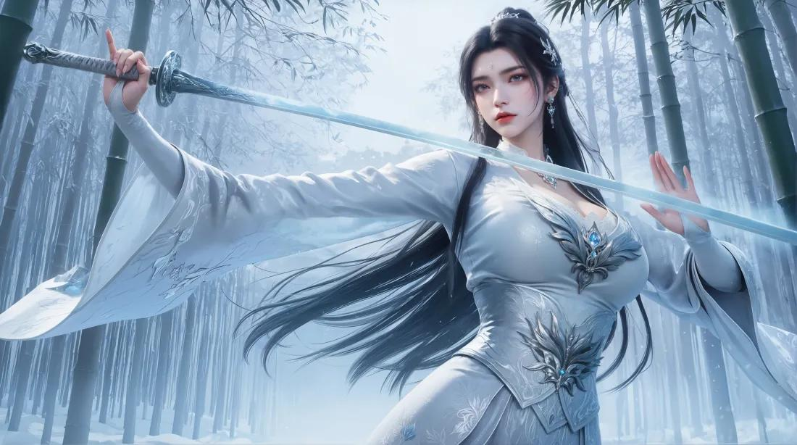

# 《萬界風月樓》

## 第二十四章　孤傲劍心，拔劍邀戰

---

### 一、群雄避退，天下無人

主擂台之上，冰風呼嘯。

整整千步方圓的玄金擂台，已完全化作了一片泛著幽藍光暈的萬載凍土。厚達三寸的玄冰覆蓋在青石之上，散發出陣陣刺骨的白霧寒煙。

擂台四周，鴉雀無聲。

原本摩拳擦掌、躍躍欲試的數十位宗門天驕與世家英傑，此刻一個個臉色慘白，腳步下意識地向後退避，連手中的佩兵都悄悄收回了鞘中。

無人敢應！

無人敢戰！

方才那凌厲至極的三寸拔劍、那如白虹貫日般的七招橫掃，已然將這座大陸年輕一代的尊嚴與底線徹底擊碎！

大宗師巔峰！先天劍骨！

面對這等宛如雲端神明般的絕對實力，哪怕是踏入宗師境界的名門宿老，亦自知上台不過是自取其辱。

主觀禮台中央，首座大長老楚烈天撫鬚長嘆一聲，眼中滿是欣賞與讚嘆之色。他緩緩站起身來，運轉體內如雷鳴般的武皇真罡，正欲朗聲宣布本屆論武甲組的第一天驕非天劍山莫屬之時——

擂台中央，異變突生！

原本負劍傲立、承受著十萬武者如雷崇拜與狂熱目光的洛寒衣，卻並未如常人般露出半點得色或傲意。

她那一雙清冽如寒潭的眸子，甚至未曾朝著高台上的楚烈天看上一眼。

下一刻。

在全場所有人愕然不解的目光中，洛寒衣動了。

她微微轉過身，修長挺拔的身姿在漫天風雪中顯得無比清冷孤絕。

長劍斜背於身後，足尖輕點冰面，她竟然……**直接走下了主擂台！**

---

### 二、步步踏雪，穿透人海

「踏、踏、踏。」

雪白雲靴踩在青石台階上，發出一聲聲清脆利落的聲響。

隨著洛寒衣走下擂台，整座聖武廣場西側的看台人潮，頓時爆發出一陣劇烈的騷動！

「洛仙子下台了？！」

「她要做什麼？！論武尚未結束，勝者金牌還未頒發啊！」

「她朝著西看台走過去了！快讓開！別擋了天劍山的路！」

在無數驚呼與吸氣聲中，原本擠得密密麻麻、水洩不通的十萬江湖武者，在感受到那股逼人眉睫的徹骨寒霜之時，本能地如潮水般向兩側瘋狂退避！

十丈！三十丈！五十丈！

人海之中，硬生生被那股無形的先天劍意，自正中央劈開了一條寬達丈許的空曠坦途！

洛寒衣一身白衣勝雪，長袍下擺隨著步伐輕輕翻飛，如孤鴻踏雪，不染半點塵埃。

她所過之處，地面堅硬的青石板上，竟然無聲無息地凝結出了一條筆直而晶瑩的寒霜小徑！

她目不斜視，清冷絕艷的玉容上宛如覆蓋著一層萬載不化的冰霜。

十步、五十步、百步……

在全場所有人近乎凝固的窒息注視下，洛寒衣穿透了那喧囂狂熱的萬千人海，徑直穿過了各大一品宗門的錦繡坐席，一步步，踏上了最西側、最荒涼偏僻的那片散修觀禮台！

散修席上的數百名底層武者，此刻早已嚇得魂飛魄散，一個個面無人色地貼著山壁瘋狂向後瑟縮，生怕這尊殺神劍仙一個不高興，將他們隨手切成碎片。

然而！

在一片恐慌後撤的狼狽人影之中，唯有一處角落，顯得是那樣的突兀與扎眼。

長條青石旁。

一襲月白暗紋長袍的顧淵，依舊保持著慵懶閒適的坐姿。

他一手輕輕搖動著青竹折扇，另一手端著粗陶酒盅，正迎著秋風，從容自得地小酌著壺中辛辣的燒刀子，身形穩如磐石，連眉毛都未曾動上一動。

---

### 三、三步之外，青鋒直指

「呼……」

一股冰冷的寒霧隨著女子的腳步，在青石桌案前三步之處，驟然停住。

洛寒衣停下了腳步。

她與顧淵之間，僅僅隔著三步的距離。

這個距離，對於一位半隻腳踏入武王門檻的大宗師劍修而言，與面貼著面拔劍殺人毫無區別！

四周數百名散修早已嚇得大氣都不敢喘一口，滿場十萬人的目光，包括高台之上的楚烈天、各大宗門的掌教長老，在這一刻，齊刷刷地聚焦到了這處偏僻狹窄的散修角落！

所有人都看傻了眼——

那位名動天下、視群雄如草芥的天劍山女劍仙，放著滿場名門貴冑不理，孤身一人走下神壇，竟然是為了一個名不見經傳的白袍散修？！

靜。

天地之間唯有夜露微風吹動竹葉的沙沙聲。

洛寒衣微微低下頭，那雙沒有半點人間雜質、清冽得宛如萬丈冰川般的清眸，居高臨下，直直刺向顧淵那張俊逸溫潤的側臉。

良久。

一聲如高山碎冰、清脆動人卻又冰冷刺骨的嗓音，在死寂的人潮之中，清晰地響起：

「三日前，朱雀長街之上。」

「於十丈雷霆之下，以一柄青竹折扇，將霸刀門失控狂雷刀芒無聲化解的那位前輩……」

洛寒衣微微頓了頓，目光精準無比地落在了顧淵右手握著的那柄青竹折扇之上：

「便是閣下吧？」

譁————！

一句話落，整座聖武廣場西側看台，徹底炸開了鍋！

「什麼？！朱雀街那位神人是他？！」

「天哪！三日前那一扇化刀罡的傳奇……竟然是眼前這個毫無真氣波動的白衣年輕人？！」

「難怪洛仙子放著天驕榜首不要，親自走下擂台……」

高台中央，楚烈天原本撫鬚的右手猛然一僵，鷹隼般的目光如電光般撕裂長空，死死盯住了坐在青石畔的顧淵！

---

### 四、純粹劍心，登台邀戰

面對滿場近乎失控的喧囂與駭然，顧淵的神色卻依舊平靜得如同一潭幽泉。

他將盅中最後一滴燒刀子飲盡，隨後放下酒盅，轉過頭來，迎著洛寒衣那凌厲逼人的目光，微微一笑：

「天武城酒好，風也甚喧囂。」

顧淵手中折扇輕輕合攏，抬眸看著眼前這名英姿颯爽、渾身散發著純粹劍骨鋒芒的白衣女子，語調溫潤而從容：

「在下不過是恰巧路過，隨手拂開了一縷微塵罷了。洛姑娘劍道通神，何必對這等市井微末小事耿耿於懷？」

「隨手拂開一縷微塵？」

洛寒衣唇角泛起一抹極淡、卻極其高傲的弧度。

她反手握住身後長劍的鞘口，手腕一抖——

「鏗！」

長約三尺三寸、通體被粗白布緊緊包裹的【斷星古劍】，被她重重倒插在了顧淵身前的青石板中！

劍尖沒入堅硬的岩石整整三寸，一道深邃凌厲的寒霜裂痕順著劍尖蔓延至顧淵腳下，卻在觸及顧淵鞋底的前一寸，被一股無形的柔韌氣勁無聲阻隔，再難前進半毫。

洛寒衣的眼中，沒有尋常女子的羞怯，沒有世家貴女的虛偽算計，更沒有半點男女之間的情愫雜念。

在那一雙清澈見底的美眸深處，唯有一團熊熊燃燒、熾熱到了極致的——**求道戰意！**

「閣下的手段，空靈縹緲，舉重若輕，絕非我滄瀾界的武學路數。」

洛寒衣單手按在劍柄之上，白衣勝雪，長髮飛揚，字字如金鐵交擊，擲地有聲：

「但那份對力量極限的掌控，放眼這座大陸同輩之中，無人能出其右！」

「我洛寒衣練劍二十載，自幼立誓：此生不慕虛名，不求權貴，只求這天下間最強之劍道！」

洛寒衣抬起那張清絕無瑕的玉顏，直視著顧淵的雙眼，拔劍之意動盪乾坤：

「擂台之上那些碌碌之輩，不堪一擊，贏之無趣！」

「今日在這天武城，唯有閣下一人，配當我洛寒衣的對手！」

「閣下若真有強者之傲骨，可敢登上這聖武擂台，與我手中長劍……痛痛快快分個高下？！」

拔劍邀戰！

以天劍山首徒之尊，當著天下十萬武者之面，主動向一名籍籍無名的散修拔劍邀戰！

這不是仗勢欺人，更不是英雄救美的陳舊套路！

這是一位將劍道奉為生命信仰的純粹女劍仙，在茫茫人海中覓得真正同道強者時，那發自靈魂深處、最堂堂正正、最不屈自尊的極致宣戰！

整座聖武廣場在此刻陷入了長達三息的絕對死寂。

所有人都屏住了呼吸，無數道灼熱震撼的目光，死死聚焦在那個坐在青石旁的青年身上。

他……敢應戰嗎？！

---

### 五、杯酒置案，從容登天

面對那柄插在身前半寸、寒氣森森的斷星古劍，面對眼前這位戰意灼熱、傲骨嶙峋的絕美劍仙。

顧淵沒有生氣，更沒有退縮。

他只是靜靜地看著洛寒衣那雙毫無雜質的眼眸。

在青玄界，他見過太多為了長生不擇手段的宗門長老，見過太多利益熏心的世家修士。

然而眼前這名女子，卻像是一塊生於萬仞絕巔之上、歷經萬載風雪洗禮的無瑕玄玉。她的高傲，來自於對手中之劍的絕對忠誠；她的冷漠，源於她不屑與庸人同流合污的純粹。

這是一個真正的求道者。

「呵……」

一聲極其輕微、卻滿含欣賞與快意的低笑聲，自顧淵的唇間溢出。

顧淵緩緩自青石上站起身來。

他伸手拿起石桌上的空酒盅，隨手往旁邊的托盤上一擱，發出一聲清脆的「嗒」響。

隨後，他左手負於身後，右手輕輕一抖折扇。

「唰！」

青竹折扇在胸前舒展開來，墨染遠山的扇面隨風微揚。

顧淵迎著洛寒衣那灼熱如火的清眸，長身玉立，白袍勝雪，溫潤清雅的話音宛如九天清泉落入幽谷，在整座死寂的聖武廣場上空，悠然傳開：

「顧某本只想在此偷得浮生半日閒，品一壺燒刀烈酒，看一場人間大戲。」

「未曾想……洛姑娘這雙慧眼，竟連這點清靜都不願相讓。」

顧淵邁出腳步，身形與洛寒衣擦肩而過。

在兩人肩膀微錯的剎那，顧淵微微側首，目光深邃而含笑地看了那張近在咫尺、長睫微顫的精緻玉顏一眼，淡淡笑道：

「既然洛姑娘戰意如此純粹……」

「顧某今日，便陪你登台，論一論這天下之劍！」

言罷！

顧淵不再遲疑，足尖在青石階梯上隨意一踏！

「嗡————！」

沒有刺目的靈光，沒有狂暴的氣血噴湧！

但就在顧淵右足落下的那一瞬間——

整座聖武廣場方圓十里之內的天地元氣，彷彿受到了某種無上至尊的悄然召喚一般，竟然極其詭異地微微下沉了三寸！

下一刻！

在全場十萬武者目瞪口呆的注視下，顧淵那一襲月白長袍的身影，竟然如同一縷清風般，凌空虛渡，每一步落下皆有一道無形無質的氣勁蓮華托舉，青衫飄飄，宛如謫仙臨凡，直奔主擂台凌空踏步而去！

主觀禮台中央，首座大長老楚烈天的瞳孔在這一刻狠狠縮成了針尖大小，猛然一掌捏碎了身前的純金扶手：

「縮地成寸……身融虛空？！」

「這年輕人……究竟是何方神聖？！」

而在散修看台之上。

洛寒衣單手拔出深陷石中的斷星古劍，那雙原本冰封萬里的清冷美眸之中，戰意在這一刻徹底化作了衝破雲霄的熾熱星火！

「鏗！」

劍鳴如雷，白衣化虹！

洛寒衣化作一道撕裂長空的驚世劍芒，緊隨其後，轟然衝向聖武擂台！

仙武宿命之戰，一觸即發！

---

**（第二十四章完）**
