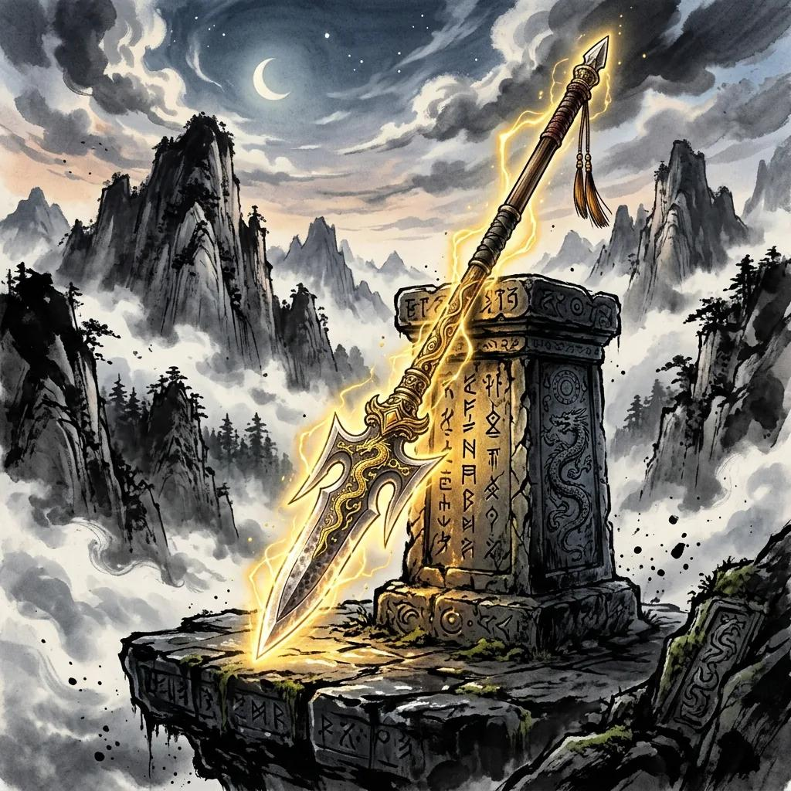

# 第二卷 諸天第一步・滄瀾風雲

## 第 029 章｜斷星之謎，道心昇華

夜幕降臨，南嶺的熱浪漸漸被萬千冰冷金鐵的肅殺之氣所取代。

百兵神宮後山，迎賓劍閣。
此地修築於一處孤峰絕壁之上，下方是一泓清冽見底的冷泉洗劍池。月華灑落池水，倒映著漫天繁星與千峰器海林立的刃鋒倒影，顯得格外幽寂清冷。

閣樓窗扉半掩，顧淵坐於窗前青玉几案旁，面前煮著一壺清冽的山泉靈茶。

白日裡「萬兵朝宗」引發的軒然大波，早已傳遍了整座千峰器海。無數世家大族與聖地長老瘋狂打探這位神祕青衫客的底細，甚至連段百狂都幾次三番欲言又止、眼中充滿了近乎狂熱的探求。

但顧淵只是淡然置之，退居這僻靜的迎賓劍閣，自得其樂。

篤、篤。

兩聲清脆而略顯遲疑的敲門聲在寂靜的夜色中響起。

顧淵端起茶盞，微微一笑：「既然來了，洛姑娘何不進來坐坐？這洗劍池邊的夜風，可有些涼意。」

門扉無聲自開。

只見月色之下，洛寒衣依舊是一襲勝雪白衣，背負長劍，俏生生立於門階之上。山風拂過，將她額前的幾縷青絲輕輕吹散，露出那張精緻無暇、卻慣常覆蓋著一層薄霜的絕美容顏。

只是今夜，那雙一向凌厲冰冷的鳳眸深處，卻多出了一抹極其罕見的猶豫與侷促。

她站在門口，玉手下意識地攥緊了腰間的劍穗，咬了咬薄唇，終究還是邁動步子走了進來，在顧淵對面的蒲團上端正跪坐。

「顧先生。」
洛寒衣開口，嗓音空靈如擊碎的冰玉，卻比白日裡少了一分生硬，多了一分敬稱。

「洛姑娘夜訪劍閣，所為何事？」顧淵將一杯剛剛沏好的靈茶推到她面前，語氣溫和從容。

洛寒衣看著眼前清澈如碧玉般的茶湯，鼻尖輕嗅著淡淡的茶香，緊繃的神經不知不覺中放鬆了幾分。她抬起眼簾，目光灼灼地盯著顧淵，直截了當地解下背後的斷星古劍，連鞘平放在几案之上：

「寒衣今夜前來，並非為尋先生論武比試……而是想請先生救一救它。」

「哦？」顧淵眉頭微挑，視線落在這柄伴隨洛寒衣名震天下的神兵之上。

只見原本森白冷冽的古劍劍鞘，此刻竟隱隱泛起一陣極不自然的暗紅光暈，劍柄處的深藍色晶石更是不時發出微弱而尖銳的微顫，宛如受傷幼獸在絕望中的悲鳴。

「自我踏入半步武王境以來，斷星古劍便時常出現這般莫名灼熱。」
洛寒衣眼中浮現出一抹痛惜與無力，嗓音微微低啞：「師尊曾言，神兵有靈，是寒衣劍意殺伐過甚、致使器魂暴走。可這半月來，特別是白日裡先生在天池引動萬兵共鳴之時……斷星古劍深處的悲鳴愈發劇烈，甚至隱隱抗拒我的劍罡灌注。」

這位在演武場上面對天下豪雄都不曾皺一下眉頭的天之驕女，此刻在顧淵面前，卻毫無保留地展現出脆弱與無助。

對於一個純粹至極的劍修而言，本命神兵的異變與抗拒，無異於道心的大地震。

顧淵深深看了她一眼，眼神依舊平靜淡漠，沒有嘲弄，亦無輕視。
他伸出修長手指，輕輕覆在斷星古劍的劍柄之上。

剎那間，混沌星脈無聲運轉，雙眸深處化作兩枚流轉諸天玄奧的星輪——破妄真視，轟然洞開！

嗡！

在破妄真視的穿透之下，古劍厚重的外殼瞬間化為透明。顧淵的神識如一縷春風，直透古劍的核心中樞。

下一瞬，顧淵眼中閃過一抹訝異。

這柄斷星古劍的材質，根本不是滄瀾界尋常的地心精鐵，而是一種蘊含著濃郁天外星力的太古玄晶！在古劍的最深處，赫然沉睡著一頭形似星光天凰的遠古器魂！

然而，令人心悸的是，這尊本該聖潔無暇的星光器魂身上，此刻竟然纏繞著數十條細如髮絲、卻散發著滔天怨毒氣息的漆黑倒刺！那些倒刺如同活物般深深啃噬著器魂的羽翼，留下了一個個觸目驚心的黑色齒印！

「這是……九幽魔煞的本源侵蝕印記？」顧淵心中暗忖。

這股氣息，與青玄界大劫魔網、以及白日裡血煞老魔體內的黑血同源同根！顯然，在萬載歲月之前，這柄誕生自外星天鐵的神兵，曾在與九幽魔煞的殊死大戰中受過極嚴重的道傷，體內早已積存了近乎石化的萬古煞氣。

而洛寒衣一味追求「斷星、斬仙、天下第一」的狂暴劍意，非但未能洗滌這些煞氣，反而如烈火烹油，將古劍逼入了瀕臨碎裂的崩潰邊緣！

顧淵收回神識，指尖在劍身上輕輕一彈。

錚！

一聲清越的顫音響起，原本暴躁不安的古劍竟然在一瞬間奇蹟般地平靜了下來。

洛寒衣美眸圓睜，急切地問道：「先生，如何？可能救？」

「此劍核心，並非凡俗鐵石，乃萬載之前墜落滄瀾的遠古界外星隕所鑄。」顧淵收回手指，端起茶盞抿了一口，語氣平靜無波。

「界外星隕？！」洛寒衣身軀一震。

「不僅如此，古劍深處沉睡著一縷太古星光器魂。但它體內，深埋著遠古神魔大戰留下的九幽魔煞齒印。」顧淵放下茶盞，目光銳利如電，直視洛寒衣的雙眼：

「洛姑娘，你可知你為何遲遲無法突破武王天塹？」
「你可知你的右肩琵琶骨為何會真氣阻滯？」

洛寒衣一怔，茫然地搖了搖頭。

顧淵神色肅穆，字字如珠璣墜地：「因為你太想贏了。」

「你想做天下第一劍修，你想橫掃五域、無可匹敵。你的劍意凌厲絕倫，但殺氣太重、執念太深！你把斷星古劍當作替你披荊斬棘、斬獲虛名的無雙凶器，卻從未傾聽過它在萬載魔煞折磨下的痛苦哀鳴！」

「真氣走足少陰，滯於琵琶骨，正是因為古劍本源的魔煞在與你的肉身產生反噬！若非你天生先天劍骨強行支撐，換作旁人，早已走火入魔、經脈爆裂而亡！」

顧淵的聲音並不大，但每一個字，都如同一記萬鈞重錘，狠狠砸在洛寒衣的靈魂深處！

「我……我只是為了虛名？」
洛寒衣臉色刷地一下變得慘白，玉手不由自主地撫上胸口，只覺體內氣血翻湧，道心劇烈搖晃。

從七歲握劍起，師門長輩灌輸給她的便是「天劍出鞘、天下俯首」，她日夜苦修、以身化劍，自以為走在最純粹的無上劍道上。
可如今，眼前這個青年卻一針見血地揭開了她華麗外表下的致命盲區——

她以為自己在御劍，實則早已被名韁利鎖與神兵凶煞所役使！

看著眼前臉色蒼白、神情恍惚的孤傲少女，顧淵眼神微緩，抬起右手，一縷精純宏大、包羅諸天星象的混沌星脈本源之力，自他掌心緩緩流淌而出。

那光芒溫暖醇和，宛如春回大地。

「劍，乃兵中君子，護道之鋒。」
顧淵將手輕輕按在斷星古劍之上，溫潤如玉的混沌星力順著劍柄緩緩灌入劍身深處：

「執劍者，心中當有天地山河，當有守護之念，而非只有『勝負』二字。若只為天下第一的虛名而拔劍，劍意再快，亦不過是凡塵一莽夫。」

嗡——！

在混沌星脈那足以融合諸天的至高道韻溫養之下，古劍深處那尊痛苦蜷縮的星光天凰器魂，發出了一聲無比舒暢的輕鳴。
那些附著在器魂羽翼上的黑色魔煞齒印，在浩瀚純陽的星力沖刷下，寸寸瓦解冰融！積存了萬載的暴戾濁氣，化作一縷肉眼可見的灰黑煙塵，順著劍柄孔隙被逼出窗外，消散在夜風中。

轟！

下一刻，洗盡鉛華的斷星古劍猛然爆發出璀璨如銀河般的通透星芒！一道純淨無暇的清越劍意自劍身倒灌而回，溫柔地湧入洛寒衣的體內。

卡嚓！

一聲極其微弱的經脈貫通聲在洛寒衣右肩響起。
困擾了她整整三年、令她無法衝擊武王境的琵琶骨暗傷與滯澀，在這一瞬豁然開朗！周身真罡暢通無阻，宛若大江奔湧！

洛寒衣整個人僵立在蒲團之上，星光在她清澈的眸子中流轉。

昔日那股拒人於千里之外的尖銳戾氣悄然退去，取而代之的，是一種返璞歸真、澄澈如洗的深邃與寧靜。

道心昇華，由爭強，轉為守道！

良久。
洛寒衣緩緩睜開雙眸，看著眼前神色自若、重新為自己斟滿熱茶的青衫青年。

她站起身，退後一步，整理好如雪的白衣衣袂。
隨後，這位名震天下、傲骨天成的天劍女劍仙，雙手合抱長劍，向著顧淵深深地彎下了纖細的腰肢，一揖到底：

「洛寒衣……多謝先生傳道點化之恩！」

嗓音清冷，卻字字鏗鏘，帶著前所未有的真摯與信服。

在這一夜，兩柄絕世之鋒之間的防備與敵意徹底冰消雪融。
孤傲的女劍仙，終於在漫漫求道途中，找到了唯一能與她並肩俯瞰星空的真正知己。

然而，就在二人心照不宣之際——

轟隆隆！

一聲地動山搖的恐怖巨響，陡然自千峰器海地底深處轟然爆發！
濃烈如墨的血腥黑煞沖天而起，將滿天繁星瞬間吞噬成一片無邊永夜！

敵襲！太古祭壇劇變！