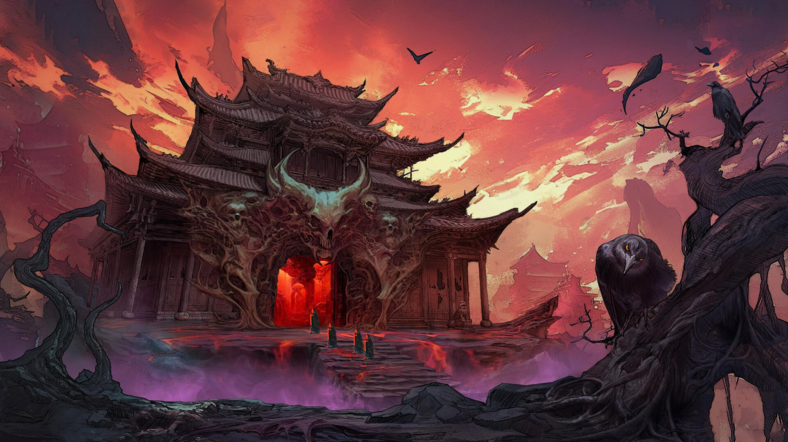

# 第二卷 諸天第一步・滄瀾風雲

## 第 039 章｜九幽古圖，老魔甦醒

大乾皇宮深處，皇家萬寶秘庫。

這裡是大乾皇朝立國整整三千年來，最核心、最神秘的終極禁地。

整座秘庫並非修築於地面之上，而是深入承天京地底千丈之下的天子龍脈石竅之中。四周峭壁皆以深海萬年玄冰與億萬斤天外隕星玄鐵重重澆築而成，厚達丈許的玄鐵壁壘之上，密密麻麻地銘刻著初代帝尊親手布下的九重皇道封禁符文。

空氣冰寒徹骨，滴水成冰。數百名修為皆在大宗師之境的天策近衛精銳，披堅執銳，日夜在此寸步不離地森嚴巡弋。

「轟隆隆——！」

伴隨著一陣沉重無比的機括咬合轟鳴，厚達三丈、重逾十萬斤的隕星玄鐵庫門緩緩向兩側滑開，露出了深邃幽暗、靈光溢目的漫長通道。

只見在清脆的步履聲中，三道身影並肩步入秘庫之中。

走在最前方的姬明月，已然重新換上了一身極盡雍容華貴的暗紅金鳳九章宮袍。長裙拖曳在地，三千青絲被高高挽起，一支垂落著細密珍珠流蘇的赤金步搖，在額前隨著蓮步輕輕搖曳，顧盼生輝。

雖然她舉手投足之間，依舊維持著那股執掌億萬生靈生殺大權的監國女帝威嚴；但若是走近細看，便能清晰地發現，這位往日裡冷酷如玄冰的鐵血長公主，此刻整個人卻散發著一種前所未有的動人風韻。

她那原本因走火入魔而慘白無血色的面容，如今白裡透紅，肌膚吹彈可破，宛如被九天甘露徹底洗滌浸潤過的空谷幽蘭，明艷得不可方物。眉宇間那一抹孤傲刻薄的戾氣早已被昨夜那一場極致的陰陽雙修徹底化去，取而代之的，是一種深沉內斂的尊貴與成熟女子的嫵媚。

而在她的身旁，顧淵一襲淡青長衫，青玉折扇隨意在掌心敲動，神情悠閒愜意，眼底帶著一抹洞悉世事的淡然微笑。

走在二人身後數步之外的洛寒衣，背負斷星古劍，一襲白衣出塵如仙。

然而，當這位天劍女劍仙那一對清澈如秋水般的鳳眸，不著痕跡地落在前方的姬明月身上時，長長的睫毛卻不由自主地微微一顫，眼底深處掠過了一抹難以掩飾的震撼與微瀾。

身為感知敏銳到了極致的頂尖劍修，洛寒衣清晰地察覺到——

僅僅是一夜過去！

昨夜在紫宸殿前明明已經真龍血脈逆流、瀕臨經脈盡斷的姬明月，此刻不僅體內的九幽濁毒被拔除得乾乾淨淨，其周身那股紫霄真龍雷罡，更是雄渾暴漲了數倍不止，竟硬生生跨越了大宗師壁壘，直達大圓滿之境！

更讓洛寒衣芳心微顫的是，在姬明月舉手投足呼吸之間，她體內散發出的那股純陽皇道龍氣，竟然與身旁顧淵身上的混沌星脈道韻，產生了一種隱秘至極、水乳交融般的深層律動！

昨夜在那座緊閉的攬月行宮御寢殿中，究竟發生了何等驚心動魄、翻雲覆雨的大道奇蹟……

身為女子的洛寒衣心中自然心知肚明。

少女精緻白皙的耳垂悄然泛起了一抹淡淡的緋紅，握著斷星古劍劍柄的玉指，下意識地微微收緊了幾分，心中莫名湧現出一絲難以言喻的羞怯與悵然。

顧淵何等敏銳，似乎感應到了身後少女那略顯紊亂的心緒，他微微側過頭，朝著洛寒衣溫和一笑，目光之中滿是包容與深意，頓時讓洛寒衣緊繃的心弦悄悄放鬆了下來。

「顧郎，到了。」

姬明月在一座矗立於秘庫正中央、九龍盤繞的紫晶石台前停下了腳步。

她轉過身來，面向顧淵，那一雙鳳眸中滿是毫無保留的柔情。她伸出青蔥玉指，自腰間那條暗金真龍玉帶上解下了那一柄散發著溫潤光芒的【玄龍玉匙】，毫不猶豫地探手嵌入了紫晶石台正中央的九龍凹槽之中。

「咔嚓！」

伴隨著一聲清脆悠揚的金石交擊之響，整座紫晶石台轟然裂開！

只見一座完全由萬年雷擊棗木雕琢而成、表面覆蓋著九重雷霆封印的古老寶盒，在淡淡的紫金色霞光包裹之下，自石台核心緩緩升騰而起。

姬明月素手輕揮，天子真氣拂去盒上的陣紋，寶盒無聲自啟。

只見在鋪著明黃色天蠶絲的古盒正中，靜靜平放著一卷通體泛著暗金色幽光、不知由何種太古神獸之皮揉制而成的古老殘卷——

大乾皇朝自萬載開國以來世代單傳、被列為絕密鎮國之寶的——【九幽天圖】！

姬明月雙手捧起古卷，神情莊嚴肅穆，轉身無比鄭重地遞到了顧淵的手中：

「顧郎，這便是我大乾始祖傳承至今的九幽天圖。」

姬明月鳳眸凝視著顧淵，嗓音沉凝：

「始祖遺訓，此圖事關滄瀾億萬生靈氣運，非天下大亂、皇朝生死存亡之際，絕不可輕啟示人。」

「天圖之中所烙印記載的，正是這方滄瀾天地間最凶險、最可怖的生命禁區——【九幽禁域】的三千山河全圖！而在天圖正中央那處標記著『萬魔歸墟』的極北無底深淵，正是萬載之前太古大劫爆發時，古仙抗魔先驅與幽冥魔網展開終極血戰的核心戰場！」

顧淵伸出修長的雙手，接過了那一卷沉重如鐵的古老獸皮。

當他的指尖觸碰到古卷的剎那，體內的混沌星脈本源微微震顫，一陣蒼涼、悲壯、帶著無盡太古神魔煞氣的遠古歷史氣息，撲面而來！

嘩啦！

顧淵輕輕一抖袍袖，將整幅長達丈許的九幽天圖徐徐展開！

只見在那暗紅色的古老獸皮之上，以某種太古神禽的精血，繪製出了一幅波瀾壯闊、卻又猙獰可怖的山河地脈星圖。黑水滔天，魔焰滾滾，將極北之地數十萬里的山脈河流盡數化作了一片漆黑死地。

而在那整張天圖的最核心深處、在那座標記著「萬魔歸墟」的無底黑洞正中央，赫然標記著兩處令顧淵雙眸驟然凝結的至高神祕坐標！

第一處坐標之上，以極其霸烈蒼涼的太古金篆，描繪著一柄斷裂為兩截、卻依舊被數以萬計的黑色魔煞鎖鏈死死捆縛在萬丈魔窟之中的通天血刃！

血刃之側，一行歷經萬載歲月依舊殷紅如血、散發著滔天殺戮戰意的古老血字，深深刺痛著每一個觀者的眼眸：

【天屠武神・獨孤絕戰隕之地】！

而第二處坐標，則是在那血色魔海的最深處，懸浮著一座殘破不堪、通體由混沌太虛神石雕琢而成的古老偏殿虛影！

嗡——！

就在顧淵目光落在這座偏殿虛影上的剎那，他紫府識海深處的萬界樓乾坤道台，猛然發出了一聲前所未有的劇烈共鳴！

靈素那激動得近乎尖叫的聲音在識海中瞬間響起：

「主人！是它！是昔日萬界樓八大主殿之一的【神兵造化殿】主體核心！那裡封存著萬界樓第二塊核心修復碎片啊！！！」

「天屠武神獨孤絕……萬界樓第二塊核心碎片……」

顧淵指尖緩緩拂過古卷上那柄斷裂的血刃與殘破的偏殿，深邃如星空的雙眸之中，金色星輪急速運轉，所有遺落在歷史迷霧中的諸天因果，在這一刻徹底串聯成了一條清晰無比的脈絡！

「傳聞在萬載歲月之前，滄瀾界尚未降下天地枷鎖之時，天下武修盛極一時，曾誕生過一位驚才絕豔、以一柄神刃橫壓五域的絕代武神——天屠武神獨孤絕。」

洛寒衣款步走到古圖之旁，凝視著那一柄斷裂的血刃，清冷的鳳眸之中泛起了一抹肅穆的敬仰與悲壯：

「天劍山祖師曾有手札記載：萬載之前，九幽深淵撕開天地魔網，欲將滄瀾界徹底煉化為魔土。獨孤武神為庇護億萬蒼生，一人一刀，孤身殺入九幽深淵最底層，與太古真魔血戰三月，最終力竭戰死，長眠於深淵魔海。」

「而在獨孤武神戰殞之後，深淵降下萬古魔詛，化作了封鎖滄瀾天地靈氣三千年的『天地枷鎖』，自此之後，滄瀾界再無人能打破武皇極限、踏入武神之境。」

洛寒衣抬起頭，那一雙眸子堅定無比地注視著顧淵：

「天劍山歷代祖師臨終遺訓——凡我滄瀾劍修，終有一日，當仗劍殺入九幽魔海，迎回武神遺骸，以手中三尺青鋒，斬破這壓制天下三千年的萬古枷鎖！」

看著身旁兩位風華絕代、性格截然不同卻皆心懷蒼生的命定紅顏——

一位是執掌大乾億萬生靈軍政的鐵血監國女帝；

一位是傲視天下五域劍道、道心澄澈的絕世女劍仙；

顧淵胸中豪氣干雲，朗聲一笑：

「好！迎回武神遺骸，斬碎天地枷鎖，平定九幽大劫！」

姬明月上前一步，主動伸出玉手，溫柔而堅定地扣住了顧淵修長的大手，鳳眸之中紫電雷芒大盛：

「大乾皇都大局已定，逆黨伏誅。本宮已下達天策最高動員令，調集十萬真龍黑甲精銳、千艘巡天雷舟，隨時聽候顧郎調遣！」

「這一次，明月願隨夫君，踏平深淵！」

洛寒衣亦是橫劍於胸前，微微躬身，嗓音清脆如玉：「寒衣與手中斷星古劍，誓死相隨！」

三道無雙身影立於萬寶秘庫之中，一場席捲整座滄瀾界的滅魔征程，即將轟然拉開序幕！

……

然而。

就在滄瀾界三巨頭密謀征伐九幽禁域之際。

在遙遠浩瀚的虛空彼端——【青玄界】西陲，卻正在經歷著一場令人毛骨悚然的邪惡復甦！

青玄界西陲，八百里黑沼險峰。

這裡長年被一層遮天蔽日、散發著刺鼻腐爛惡臭的碧綠毒瘴所籠罩，寸草不生，白骨累累，乃是青玄界第一魔道巨擘「魔煞宗」傳承萬載的總壇禁地——【枯骨深淵】。

呼嘯的陰風之中，一尊渾身骨骼經脈盡斷、金丹早已徹底碎裂的枯瘦老者，正如同野狗一般手腳並用、連滾帶爬地跪在懸崖祭壇邊緣，鼻涕眼淚糊了滿臉，瘋狂地對著前方的猩紅王座磕頭求饒：

「宗主饒命！宗主饒命啊！」

這名狼狽到了極點、周身沒有半點生機的老者，赫然正是數月之前在青玄東華洲青雲觀前，被顧淵一指隨手廢去金丹、如喪家之犬般千里奔逃回西陵的——黑煞老祖！

祭壇正上方，魔煞宗當代宗主身披一襲猩紅如血的骷髏魔袍，端坐於骨椅之上。

他一雙眼眸陰鷙如毒蛇，居高臨下地俯視著地上如蠕蟲般求饒的黑煞老祖，嘴角勾起一抹極其殘忍無情的譏諷：

「黑煞，你還有臉回西陵來見本座？」

「你丟盡了我魔煞宗數千年的顏面！不僅在青雲觀那群雜毛道士面前一敗塗地，連本座賜你的鎮宗魔器『化血神瓶』都被人奪走！」

「如今，青雲觀柳清虛在那個神祕青年的相助下結成了天道九品金丹，沈玄清更是跨入了元嬰圓滿；連那凡俗萬寶閣的商女慕容玥，都敢吞併商界、組建商盟封殺我宗的靈脈資源！」

魔煞宗主猛然站起身來，周身殺機暴漲，聲音陰寒得宛如自九幽深淵刮來的刺骨罡風：

「黑煞……你說，本座留你這條金丹已碎、修為盡失的廢物之命，在這世上還有何用？！」

「宗主！再給老奴一次機會！老奴知道青雲觀後山的秘密啊！」

黑煞老祖驚恐欲絕地尖叫起來，雙手死死抱著祭壇石階：

「青雲觀後山封魔大陣鬆動了！老奴知道如何繞過沈玄清的神識、暗中潛入陣眼！求宗主饒我一條狗命啊——」

然而，他的話音尚未落下，魔煞宗主眼中那一抹殘忍的譏諷，已然化作了毫不掩飾的嗜血狂熱：

「你的秘密，本座毫無興致。」

「但你這具殘存著金丹修士精血本源的殘軀……倒是正好適合作為喚醒老祖宗的最後一道活人血祭！」

「砰！」

話音落下的剎那，魔煞宗主眼中兇光大盛，猛然一腳狂暴踹出，重重轟在了黑煞老祖的胸口之上！

「啊——！宗主！你這不得好死的畜生——！！！」

伴隨著一聲淒厲絕望到了極致的泣血哀嚎，黑煞老祖乾枯的身軀如同一顆炮彈般，被生生踢下了深不見底的萬丈枯骨深淵！

咕嘟！咕嘟！咕嘟！

萬丈深淵底部，並非山石土地，而是一片由數萬年來被屠戮的數十萬修士骸骨溶解而成的——碧綠腐骨血海！

黑煞老祖的身軀剛一墜入血海之中，平靜的血水深處，頓時伸出了億萬隻長滿倒刺的慘白骨爪！

那些骨爪瘋狂地刺入黑煞老祖的皮肉內臟，將這位昔日名震東華的魔道老祖活活撕成漫天肉屑！一名金丹強者最後的精血、生機、怨恨與靈魂，在轉瞬之間被深淵血海吞噬得乾乾淨淨！

「轟隆隆——！！！」

吞噬了金丹本源的碧綠血海，猛然掀起了高達數百丈的滔天血色狂濤！

整座方圓八百里的黑沼山脈地動山搖，天地間的五行靈氣在這一瞬間被一股霸道絕倫的太古死氣抽吸一空！

只見在深淵血海的最核心深處——

一具高達十丈、通體骨骼晶瑩如黑玉、被整整萬道九幽萬古鎖鏈死死捆縛的太古骷髏魔軀，眼窩深處，驟然點燃了兩團猩紅如血、焚盡諸天的至尊魔焰！

卡嚓！卡嚓！卡嚓！

萬道封印鎖鏈寸寸崩碎！

那尊太古骷髏魔軀緩緩自血海狂濤之中拔地而起，巍峨聳立！在他那乾枯漆黑的骨爪掌心之中，赫然死死握著一枚通體漆黑、散發著溝通諸天魔網氣息的遠古傳送骨牌！

「桀桀桀桀……八千年了……」

一聲沙啞、蒼老、恐怖得宛如億萬生鏽鐵片摩擦般的太古咆哮，自深淵地底轟然傳出，直震得整座西陵山脈萬獸匍匐、群魔叩拜：

「滄瀾界的九幽魔網節點已然動盪……諸天魔網即將全面復甦！」

「沈玄清……青雲觀……老祖我……終於回來了！！！」

青玄界西陲，封印了整整八千年的太古巨魔——【枯骨老魔】，於今日，正式破封甦醒！

一場席捲兩大世界、跨越萬載歲月的終極神魔大戰，正如同宿命的狂潮般，在青玄與滄瀾兩界深處，同時拉開了浩劫滅世的血色序幕！
