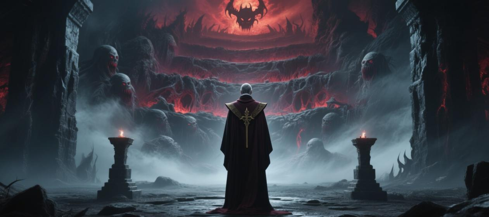

# 第二卷 諸天第一步・滄瀾風雲

## 第 040 章｜永夜遮天，東南魔變

大乾承天京，欽天監九霄觀星台。

這座通體由萬年玄冰晶玉與天外吸星石堆砌而成的觀星高台，高達整整三百丈，直插雲霄，如同一柄刺破蒼穹的玉石長槍，巍然矗立於皇城正北方的最高巔峰之上。

過去三千年來，這裡向來是大乾皇朝國師推演周天星象、監測天下萬里靈脈生滅、感應人間五穀豐歉的神聖祭壇。登臨此台，可俯瞰整座八百里承天京的萬家燈火與天子龍脈的紫金吞吐。

然而此時此刻，立於觀星台最高層漢白玉欄杆之旁的顧淵、姬明月與洛寒衣三人，面色卻無比凝重肅穆，深邃的目光穿透重重流雲，直直投向了遙遠的東南方天際盡頭。

「嘶啦——！」

一聲彷彿天地錦帛被萬丈魔爪生生撕裂的刺耳尖嘯，自虛空深處幽幽傳來。

只見在數萬里之外的東南方群山盡頭，一道接天連地的巨大黑色天幕，正以不可思議的毀滅之勢，瘋狂地朝著中原腹地吞噬蔓延！

黑煞滔天，宛如九幽黃泉倒灌人間！

原本應當是紅霞滿天、晴空萬里的正午蒼穹，在短短數十個呼吸之間，被那一團不斷翻滾、蠕動、膨脹的幽冥死氣徹底侵蝕抹殺！漫天星辰日光盡數泯滅，方圓數萬里的天地山川，在瞬息間墜入了一片伸手不見五指的森然永夜之中！

而在那片無邊永夜的天穹正中央——

一張無邊無際、若隱若現的太古黑色巨網虛影，正伴隨著地脈的轟鳴，緩緩自虛空中浮現凝實！

那張魔網太過巨大、太過恐怖！

每一根網線皆由數以億計的枉死冤魂、血煞屍毒與扭曲古老的太古魔紋編織而成。它們在幽暗的蒼穹之上劇烈蠕動、抽搐著，宛如一頭自沉睡了萬載歲月之中緩緩睜開猩紅魔眼的混沌巨獸，正將無數條生滿黑色倒刺的猙獰觸角，瘋狂刺入滄瀾界的大地地脈深處，大口大口地貪婪吮吸著這方世界的本源氣運與天地靈機！

「轟隆隆——！！！」

整座滄瀾大地在劇烈顫慄悲鳴！

滾滾地脈熔岩逆流暴走，哪怕相隔數萬里之遙，承天京這座雄踞中原的古老帝都，腳下的巍峨城牆與漢白玉石階，都在這股源自地心深處的恐怖震盪之下，劇烈顫抖不休！

城中數百萬百姓與修士無不驚恐萬狀地走出街巷，仰望著東南方那片令人窒息的漆黑死寂，孩童的啼哭與修士的驚呼在整座城池中此起彼伏。

「九幽深淵……這一次，封印是真的徹底崩裂了……」

姬明月迎著撲面而來的狂暴陰風，一襲暗紅金鳳宮袍在秋風中獵獵作響。

她那一雙狹長威嚴的鳳眸之中寒霜密布，扣在腰間天策佩劍上的纖細玉手骨節發白，指尖因極致的憤怒而微微顫抖。

身為大乾的監國帝女，她比任何人都清楚這意味著什麼。那是足以將三千年社稷江山、億兆生靈盡數拖入萬劫不復之地的滅世天災！

在她的身側，顧淵一襲淡青長衫，任由狂風吹亂額前的鬢髮，深邃如星空的雙眸之中，破妄真視洞穿萬里虛空，倒映著那一張籠罩東南的猙獰魔網，眼神冰冷到了極致：

「好快的速度。那姬凌翊臨死前遁走的一縷魔煞殘魂，竟成了引爆地脈濁穴的最後一道引信……」

就在此時，觀星台下方那座以極品靈玉鐫刻的「八百里加急傳訊法陣」，猛然爆發出刺目至極的血紅色警示凶芒！

「踏！踏！踏！」

伴隨著一陣慌亂而沉重的腳步聲，一名身披破碎染血甲胄、渾身插著數支漆黑魔箭的皇朝傳令官，連滾帶爬地衝上了三百丈觀星高台，噗通一聲重重撲倒在姬明月腳下，泣血悲鳴：

「報——！！！啟稟監國長公主殿下！大禍……東南塌天大禍啊！」

「東南九幽禁域外圍……三十六處上古鎮魂石碑，被三皇子殘魂引動九幽死火同時炸碎！」

「整座天塹深淵的十萬丈地煞火脈徹底逆流暴走！數十萬頭體長數丈、通體魔化狂暴的太古凶獸與九幽地魔，如決堤狂潮般自萬丈裂谷深處狂湧而出！」

傳令官滿臉血淚，額頭重重撞擊在漢白玉石板上，發出撕心裂肺的哭嚎：

「東南防線全線崩潰！大乾沿邊三大門戶大州——青州、雷州、雲州……在三個時辰之內，已盡數淪陷於魔獸潮水之中！」

「魔修過處，屠城滅派，白骨露野！數百萬黎民百姓流離失所，慘遭妖魔生吞活剝！青州鎮守大將、雷州水師提督、雲州總兵……三大武王強者，皆已率部戰至一兵一卒，以身殉國啊殿下！！！」

字字泣血，句句含悲！

慘烈到了極點的八百里加急軍報，讓整座三百丈高聳的觀星台之上，陷入了一片死一般的窒息與沉寂。

唯有狂暴的冷風，在空曠的石台邊緣發出嗚咽如鬼泣的尖嘯。

「數百萬生靈……三大州沉淪……」

洛寒衣纖瘦的身軀微微顫抖，那一張清冷出塵的絕美玉容之上，覆蓋著前所未有的極致寒霜與滔天怒火！

「錚——！」

少女背後的斷星古劍感應到主人心中那股極致的悲憤與殺意，猛然在劍鞘之中發出一聲高亢凌厲的刺耳長吟！

至純至淨的太古星光劍意自她周身轟然爆發，將四周落下的幾縷黑煞陰風生生凌空絞碎成漫天冰晶！洛寒衣一雙星眸死死盯著東南方的黑色永夜，咬碎銀牙，字字如刀：

「這幫喪心病狂、滅絕人性的妖魔孽障……寒衣若不將爾等斬盡殺絕、挫骨揚灰，誓不歸山！」

「踏！踏！踏！」

就在滿場悲憤壓抑到了極致的剎那，觀星台下方的白玉石階處，忽然響起了一陣沉重如萬鈞巨石滾落山崗般的霸烈腳步聲！

只見一道身形魁梧宛如鐵塔小山般的狂霸身影，每一步邁出，皆引得整座三百丈觀星台發出沉悶的轟鳴！

來人赤裸著古銅色的虯結臂膀，身披一件沾滿了斑駁血跡的赤銅重鎧，虯髯如戟，虎目含煞，正是滄瀾界第一武道聖地——武極殿大長老，「裂天武皇」楚烈天！

此刻的楚烈天，神情凝重到了極點，那一雙平日裡豪爽威嚴的虎目之中，此刻滿是血絲與決然。

在他那隻佈滿厚厚老繭的粗糙巨掌之中，高高托舉著一面通體由深海萬年玄金熔煉而成、其上雕刻著滄瀾五大武道聖地圖騰的古老重令——

名震滄瀾天下數千年、非人族生死存亡不可輕出的人族最高號召信物——【天下武林令】！

「長公主殿下！洛仙子！顧先生！」

楚烈天聲如洪鐘大雷，在觀星台之巔轟然迴盪，激盪得虛空震顫！

他來到顧淵身前三步之處，龐大的身軀宛如一座巨山般轟然單膝跪地，雙手將那一面沉重如山的天下武林令高高舉過頭頂，字字鏗鏘，帶著整個武極殿乃至天下武修的托付：

「九幽魔網吞天，東南三州陸沉！這是自我滄瀾界有史以來，關乎億兆蒼生生民生死存亡、亡國滅種的滔天浩劫！」

「武極殿已啟動歷代祖師血誓，正式頒發【天下武林令】！號召天下五域所有武道宗師、九品大宗師、各大隱世門閥以及閉關名宿——凡我滄瀾人族武修，即刻傾巢而出，奔赴東南邊境最後一道天塹『落日峽谷』立寨扎營，勤王護道！」

楚烈天猛然抬起頭，那一雙熾熱如火的虎目死死注視著眼前的青衫青年，神情莊嚴肅穆到了極點，抱拳嘶聲大吼：

「顧先生！當日天武城演武場之上，先生隨手一指點化狂雷、鎮殺血煞老魔的無上純陽神威，楚某至今歷歷在目、奉若神明！」

「今日魔劫屠世，人族危在旦夕！老夫代表武極殿萬名武僧、代表天下百萬武修同道——懇請顧先生親赴東南前線，主持大局，引領我滄瀾人族，破此萬古魔劫！！！」

這一跪，重逾萬鈞！

這一拜，托付蒼生！

顧淵收起手中的青玉折扇，神色從容而肅穆地走上前去。

他伸出雙手，掌心之中一縷溫暖浩瀚的混沌純陽道韻悄然流淌，穩穩地穿過楚烈天周身霸烈的罡氣，將這位名震南域的巔峰武皇輕輕托扶而起。

「楚長老言重了。」

顧淵的嗓音平和沉穩，卻宛如一道劃破無盡永夜的神聖曙光，帶著一種足以安撫天地萬物的從容定力：

「魔網鎖天，諸天同悲。天地不仁，大道有常。顧某既然身在此界，便絕不會坐視這幫九幽妖孽將人間化作血海屠場。」

顧淵緩緩轉過身來，目光深邃地落在身旁的姬明月身上。

兩人的目光在半空之中交匯。

昨夜在那座寢殿之中靈肉交融、真龍交泰的記憶尚在心頭，姬明月感受著體內那洶湧澎湃、純淨無暇的九重真龍神威，又看著眼前這個將自己從絕望深淵中徹底拯救出來的男人，她那顆原本悲痛沉重的心，在這一刻被無窮的勇氣與豪氣徹底填滿！

有他在，這天塌不下來！

「鏘——！！！」

一聲清脆高亢、宛如龍吟九天的拔劍之聲，驟然在觀星台之巔撕裂雲霄！

姬明月單手拔出腰間那柄象徵著皇道極致的天策神劍「紫電奔雷」，劍指東南方那一望無際的永夜魔雲，鳳眸含威，聲如雷霆神旨，傳遍八百里承天京的每一寸虛空：

「大乾天策軍！皇城羽林衛！天下勤王將士——全軍聽令！」

「即刻升起皇城所有『巡天雷舟』！調撥三十萬天策玄甲鐵騎、十萬神機破靈弓弩手、三萬皇室黑龍死士！」

女帝身姿挺拔，暗紅金鳳長袍在狂風中如一面獵獵戰旗，殺氣沖霄：

「本宮將攜天子鎮國玉璽，親率大軍御駕親征！隨顧先生奔赴東南落日峽谷，誓與九幽魔孽——決一死戰！！！」

「轟——！！！」

皇城之下，整座八百里承天京在這一瞬間徹底陷入了沸騰的狂暴戰意之中！

數十萬早已披掛重鎧、手按兵刃的天策軍精銳將士，爆發出撼動乾坤的狂暴咆哮：

「御駕親征！決一死戰！」
「殺！殺！殺！」

在漫天肅殺的戰吼聲中，只見承天京四方的天工船塢之中，一艘艘長達百丈、通體覆蓋著重型青銅雷甲、銘刻著無數太古天雷道紋的漆黑「巡天雷舟」，宛如一片遮天蔽日的鋼鐵烏雲，伴隨著陣法引擎的震耳轟鳴，緩緩自雲海之中拔地而起！

千舟破空，旌旗遮天！

在正中央那一艘長達三百丈的至尊真龍旗艦船頭之上，三道風華絕代的無雙身影迎風而立。

顧淵一襲淡青長衫，青衫在狂暴的黑煞狂風中獵獵作響，負手而立，氣度出塵超然，宛若自九天謫落人間的鎮世真仙；

姬明月紫金真龍戰鎧加身，暗紅披風隨風狂舞，英姿颯爽，如同一尊執掌天下生殺大權的鐵血女帝；

洛寒衣白衣如雪，三千青絲束起，絕美的容顏清冷出塵，手按斷星古劍，宛若一柄出鞘即斬滅諸天的無雙神鋒！

一青、一金、一白！

三道光芒萬丈的身影，引領著這方滄瀾高武天地間最強悍、最精銳的人間洪流，撕裂開漫天翻滾的血雨腥風，帶著義無反顧的滔天戰意，直直扎向了那片被永夜徹底籠罩的九幽死境！

滄瀾界萬載以來最慘烈、最浩瀚的終極浩劫血戰——

於今日，正式打響！
