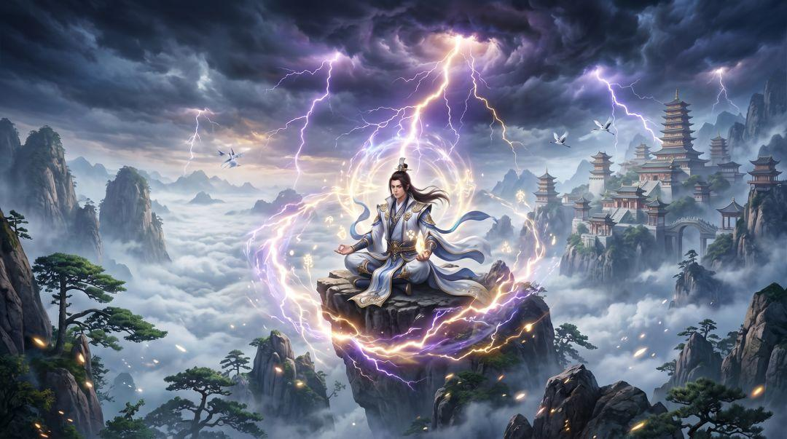

# 第二十一章　天機引動，青雲新令

---

### 一、天機推演，指向東南

滄瀾界，天武城東，臨泉別苑。

熹微的晨光穿透幽篁居天井中的稀疏青竹，在青石地面上映照出點點斑駁的金斑。清晨的微風拂過，露珠順著尖細的竹葉滾落，在石几上濺開一圈晶瑩的水花。

顧淵負手立於庭院的流泉池畔，青衫隨風微動。

經過一夜的星脈熔煉與純陽淬體，他周身的氣息愈發沉凝內斂，彷彿一柄洗盡鉛華、收入鞘中的絕世神兵，感受不到半點外溢的威壓，卻自有一種天地皆在掌中的超然風度。

「嗡————！」

就在這時，顧淵識海最深處，萬界樓第二層的【天機閣】大殿之中，驟然響起了一聲宛如遠古青銅巨鐘敲響般的宏大長鳴！

那座以混沌神鐵雕琢而成的巨大周天星盤天儀，在晨曦破曉的剎那，瘋狂旋轉起來！

漫天星斗飛速排列，最終化作了一道鋒銳無匹的金紅兩色神光，死死指向了滄瀾界星圖的最東南方位！

樓靈靈素那清冷飄渺的神念，如約在顧淵心頭響起：

「啟稟樓主，天機星盤演繹功成！」

「結合白日吸收之滄瀾武道氣息與昔日沈玄清體內大劫殘印之因果糾纏，萬界樓第二塊大劫核心碎片之具體下落，已徹底鎖定！」

「空間方位：東南死境——【九幽禁域】深處封魔地宮！」

「因果宿命：此碎片於三千年前被遠古武神燕驚鴻以本命法相與斷魔神斬釘入陣眼，死鎖諸天幽冥魔網第二節點；百年前，天屠武神獨孤絕力戰探秘，殘魂長眠於外圍雪原，留碑『前路已斷，天地有鎖』……碎片與兩代武神之執念深度相融，非大毅力、大因果者不可取！」

聽完靈素條理分明的推演匯報，顧淵微微頷首，眼中閃過一抹深邃的瞭然：

「燕驚鴻捨身封魔，獨孤絕力竭留碑……九幽禁域，果然是這座世界所有悲歌與大道的匯聚之地。」

「這第二塊核心碎片，我必取之。」

---

### 二、眉心溫熱，道侶同頻

正當顧淵沉思之際，異變陡生！

「嗡！」

一陣極其強烈、極其純淨、甚至帶著幾分凌厲鋒芒的滾燙熱意，毫無徵兆地自顧淵眉心正中爆發開來！

那是……【紅顏時空錨點】的共振！

顧淵抬起右手，指尖輕觸眉心。只見原本隱匿於識海深處的那枚代表著青玄界第一道侶柳清虛的青蓮道印，此刻正綻放出前所未有的璀璨青芒！

道印溫熱，神魂相通。

穿透無盡維度的時空長河，顧淵彷彿能無比清晰地感應到，遠在青玄界的青雲觀通天峰頂，正有一道清麗出塵、傲骨嶙峋的絕美身影，正迎著漫天咆哮的狂暴雷霆，將一身道心催動到了極致巔峰！

「這是……天道金丹劫？！」顧淵眼中掠過一絲驚訝。

靈素清冷的聲音再次響起，語氣中罕見地帶上了一抹讚許：

「恭喜樓主！青玄界第一道侶柳清虛，心境圓滿，厚積薄發！」

「她並未動用跨界傳訊向樓主求助，而是以一派掌門之尊嚴，孤身引爆水火雙極道基，引動了青玄界千年未現的【九品天道水火金丹天劫】！」

「雙方神魂印記劇烈同頻，因果共鳴正在大幅加深！」

顧淵望著指尖那抹跳動的青蓮微光，神情由驚訝迅速化為一抹無比溫暖與欣慰的笑意。

「清虛……」

顧淵放下手指，目光遙遙望向虛空，低聲自語：

「好一個青雲掌門，好一個外柔內韌的柳清虛……顧某果然沒有看錯你。」

「既是一派之主，這場證道之戰，便該由你親手踏上神壇！」

---

### 三、名門逼宮，青雲危機

與此同時。

遙遠的青玄界，東華靈嶽，青雲九峰。

原本清幽寧靜的山門正殿前方巨大的漢白玉廣場上，此刻卻被一股令人窒息的肅殺之氣死死籠罩！

東華王氏全族覆滅的驚天波瀾，在短短數日之內引爆了整個東華修仙界。

然而，還不待青雲觀眾弟子從復仇的狂喜中喘口氣，來自東華修仙界另外兩大一品名門——**【太華道宮】**與**【天劍神宗】**的巨大威脅，便如黑雲壓頂般轟然降臨！

此時的青雲演武場上，數百名青雲觀弟子拔劍在手，個個面帶怒色，將正殿死死護在身後。

而在對面，兩艘足有百丈之巨的破空靈舟橫亙在半空之中，投下大片陰森的陰影。

靈舟下方，站著兩位氣息深不可測、周身散發著浩瀚金丹威壓的威嚴老者——太華道宮傳功長老玄陽子（金丹後期），以及天劍神宗執法長老萬劍生（金丹後期巔峰）！

在兩位長老身後，還站著數十名神色傲慢、修為皆在築基期的宗門精英長老。

「玄陽前輩，萬前輩！」

青雲觀二師弟陸遠一身染血青衣，手握長劍，咬牙厲聲道：

「昔日王騰逼婚、王氏奪山之時，兩大名門閉門謝客，坐視青雲受辱！如今王氏惡徒伏誅，兩位前輩卻帶著數十位精銳強登山門，口口聲聲要『代管九華靈田與地宮秘庫』……這難道就是所謂東華正道的做派？！」

「放肆！」

太華道宮玄陽子面色一沉，金丹後期的威壓轟然外放，化作一股恐怖的靈罡風暴，將陸遠震得連退三步，嘴角溢血！

玄陽子撫鬚冷笑，居高臨下道：

「陸遠小輩，休要血口噴人！沈玄清太上長老閉關數年毫無音訊，外界皆傳其早已坐化；而你們那位所謂的『首席客卿顧淵』，在王氏事了之後便不知所蹤，顯然也是個畏事潛逃之輩！」

「青雲觀如今只剩下一群孤兒寡母、殘兵敗將，何德何能執掌東華最大的九華祖靈脈？！」

「老夫今日與萬兄登門，乃是奉兩派掌教法旨，為保東華靈脈不墮魔道，特來青雲長老會入駐輔政！只要你們交出【青雲祖印】與後山地契，太華道宮保你們衣食無憂！若敢抗命……」

「若敢抗命，又待如何？！」

一聲清冷如九天鳳鳴、森寒若萬丈玄冰的清冽女聲，驟然自青雲九峰最高處的通天峰頂，滾滾炸響！

---

### 四、通天峰頂，九品天道劫

「呼————！」

狂風驟起，滿山青松劇烈搖曳！

在所有人駭然震動的目光中，只見一道雪白中帶著月華雲紋的絕美倩影，自通天峰的縹緲雲海之中，凌虛踏空，款款而落！

來者正是柳清虛！

此刻的她，已徹底褪去了過往身為受難大師姐的柔弱。

一襲象徵著青雲歷代掌門至高權威的月白廣袖法袍迎風狂舞，墨髮高綰，青玉法簪纖塵不染。她的右手穩穩托舉著那一枚散發著浩瀚地脈青光的【青雲祖印】，腰間懸著秋水青蓮神劍，容顏清絕勝雪，雙眸如澄澈秋潭，神威凜凜，不可逼視！

「大師姐！」

「掌門師姐回來了！」

滿場數百名青雲弟子爆發出震天的歡呼，二師弟陸遠與三師妹林芷萱更是熱淚盈眶。

玄陽子與萬劍生眉頭微皺，上下打量著柳清虛，隨即相視嗤笑一聲：

「柳清虛，你不過是半步金丹境界，縱有幾分姿色與機緣，也休想在此狐假虎威！沈玄清不出，你青雲觀今日便必須交出祖靈脈的管轄之權！」

萬劍生更是踏前一步，背後九柄靈劍錚然出鞘三寸，劍氣森森直逼柳清虛面門：

「小娃娃，勸你莫要自誤！交出祖印，否則休怪老夫劍下無情！」

陸遠急切上前，附在柳清虛身側咬牙低語：「掌門師姐……要不要立刻催動客卿令箭，恭請顧先生回歸救局？」

滿場弟子皆滿懷期待地望向柳清虛。在他們心目中，那位談笑間覆滅王氏、神秘莫測的首席客卿顧淵，便是無所不能的神明。

然而！

柳清虛聽聞「顧先生」三字，眼波深處泛起一抹溫柔的眷戀，但隨即便化為了一種近乎鋼鐵般的決絕與傲骨！

她微微搖了搖頭，聲音清朗、響徹整座青雲九峰：

「不必。」

「顧先生為我青雲做得已足夠多。他有他的諸天大道要走，清虛豈能事事如雛鳥般尋求庇護？！」

柳清虛美眸一轉，冰冷至極的目光直刺玄陽子與萬劍生，長劍鏘的一聲拔出半寸，秋水劍芒照亮天地：

「我柳清虛今日在此立誓——」

「只要我還有一口氣在，青雲九峰的一草一木、一寸靈土，便絕不容許外人染指半步！」

「你們不是欺我青雲無金丹、無人能壓陣嗎？！」

「那今日……清虛便當著天下名門的面，證給你們看！」

話音落下的瞬間！

柳清虛身形化作一道璀璨青虹，拔地而起，直衝通天峰最頂端的萬丈絕壁雲海！

在第一卷中，顧淵以《太上玄奼真經》為她洗髓除煞、以自身純陽道韻引導她感悟水火相濟的極致平衡，早已為她鑄就了萬年難得一見的水火無瑕道基！

過往的磨礪、師尊的重託、山門的屈辱、以及對那個男人的深情與追趕之心，在此刻盡數化為了照破萬古黑暗的滔天道心！

「轟隆隆隆————！」

柳清虛傲立峰頂，右手猛然掐訣，體內被壓制到了極致的圓滿靈力毫無保留地轟然引爆！

頃刻間！

整座東華修仙界方圓萬里的天穹，驟然化為了一片伸手不見五指的滾滾墨雲！

狂風呼嘯，天崩地裂！

九天之上，紫色的神雷、赤色的天火、黑色的罡風瘋狂匯聚旋轉，化作了一座遮蔽了半邊蒼穹的恐怖劫雲漩渦！

那是……傳說中唯有逆天道體出世才會降臨的——**【九品天道水火金丹天劫】**！

---

### 五、青雲新令，道門女魁

「九……九品天道劫？！」

太華道宮玄陽子仰頭望著那散發著毀天滅地威壓的萬丈雷海，嚇得雙腿發軟，手裡的拂塵險些跌落在地，失聲駭然尖叫：

「這怎麼可能？！水火雙極本是相剋死脈，她怎能引動相生相濟的天道神雷？！這瘋女人是要在我們面前強行結丹？！」

天劍神宗萬劍生亦是滿臉駭然，連連倒退數步。

然而，峰頂之上的柳清虛，卻再沒有多看他們一眼。

「來！」

柳清虛一聲長嘯，白衣獵獵，秋水青蓮神劍悍然斬向天穹！

「哢嚓————！」

第一道足有水缸粗細的紫金神雷轟然劈落！

柳清虛不退反進，長劍在半空中劃出一道玄奧無比的陰陽太極圓弧，正是顧淵傳授的【秋水既濟劍法】！神雷落入劍弧，狂暴的毀滅力量竟被柔韌無比的水火真意層層化解、反哺肉身！

第一道！第二道！第五道！第七道！

漫天雷海傾瀉而下，通天峰的千年古松被劈得粉碎，山石化為焦土，但那一襲白衣勝雪的身影，卻宛如風暴之中傲然挺立的青蓮，任憑雷火加身，劍意愈發璀璨奪目！

直到第九道！

整座東華大地的生靈，皆能看到天邊猛然亮起了一道刺破蒼穹的萬丈紫光！

「破————！」

柳清虛長劍逆斬苍天，一劍將最後一道滅世紫雷生生劈成了漫天碎芒！

下一剎那！

「嗡————！」

天地俱寂，劫雲散盡！

一輪晶瑩剔透、直徑足有一尺、表面銘刻著整整九道天道水火神紋的無瑕金丹，自柳清虛天靈蓋升騰而起，懸浮於青雲九峰正上方！

三千里紫氣自東方浩蕩而來！

漫天靈雨傾盆灑落，整座九華靈脈在這一刻發出興奮的嗡鳴，枯竭的靈泉瘋狂湧出甘霖，漫山遍野枯木逢春、百花齊放！

「九品……無瑕天道水火金丹！」

玄陽子噗通一聲癱坐在地，面如死灰。

修仙界自古相傳，九品天道金丹者，同境無敵，越階戰元嬰如探囊取物，日後必成化神天尊！

通天峰頂，柳清虛周身散發著浩瀚無邊的金丹仙威，緩步踏雲而下。

每踏出一步，天地的威壓便重上一分。當她在演武場上空站定之時，那股甚至超越了尋常金丹巔峰的天道靈壓，直接將玄陽子與萬劍生二人壓得彎下了腰桿，連頭都抬不起來！

「鏗！」

柳清虛長劍歸鞘，清冷冰冽的眸光俯瞰二人，淡淡開口：

「太華道宮，天劍神宗……二位長老方才說，要代管我青雲祖脈？」

萬劍生渾身冷汗直冒，再無半點方才的跋扈，連忙抱拳深深作揖，顫聲道：

「誤……誤會！柳掌門神功蓋世，得天道垂青，實乃我東華道門千年未有之奇才！我兩派長老今日特來賀喜……絕無霸佔之意！這便告退！這便告退！」

言罷，兩位名門大長老連滾帶爬地衝上靈舟，帶領數十位精銳狼狽逃竄，轉眼便逃出了青雲界域！

滿山青雲弟子寂靜片刻，隨即爆發出了驚天動地的歡呼咆哮：

「掌門萬歲！青雲道統永昌！」

陸遠與林芷萱激動得雙膝下跪，熱淚盈眶。

柳清虛飄然落地，手握【青雲祖印】，神色肅穆而威嚴，當場向全宗宣佈法旨：

「傳本座青雲新令！」

「即日起，廢黜舊長老會！升二師弟陸遠為戒律堂首席長老，肅清門規；升三師妹林芷萱為丹草閣閣主，統理後勤物資！」

「凡過往暗通世家、出賣宗門利益之內門執事，一律廢除修為逐出九峰！」

「重啟青雲護山青蓮大陣，昭告東華七十二宗門——三日之後，青雲觀開山立盟，組建『東華道門自保同盟』，順我者昌，逆我者亡！」

「遵掌門法旨————！」數百弟子齊齊叩首，山呼海嘯！

在這一刻，青雲觀的權力架構徹底歸於柳清虛一人，東華道門迎來了一位真正的絕世女魁首！

處理完一切宗門大政，柳清虛屏退眾人，獨自一人緩步走入了後山清幽的沉劍崖畔。

山風吹拂著她月白的掌門法袍。

這位剛剛在天下名門面前霸氣無雙、一劍定乾坤的絕美女掌門，此刻卻緩緩抬起手，輕輕撫摸著自己眉心那一枚滾燙微熱的青蓮印記。

她的清冷美眸望向遙遠虛空的盡頭，眼底深處，終於卸下了所有威嚴，浮現出一抹極致溫柔、極致繾綣的似水柔情：

「顧淵……」

柳清虛唇角微翹，輕聲呢喃：

「清虛沒有辜負你的期望。」

「這青雲大後方……我為你守住了。」

---

**（第二十一章完）**
