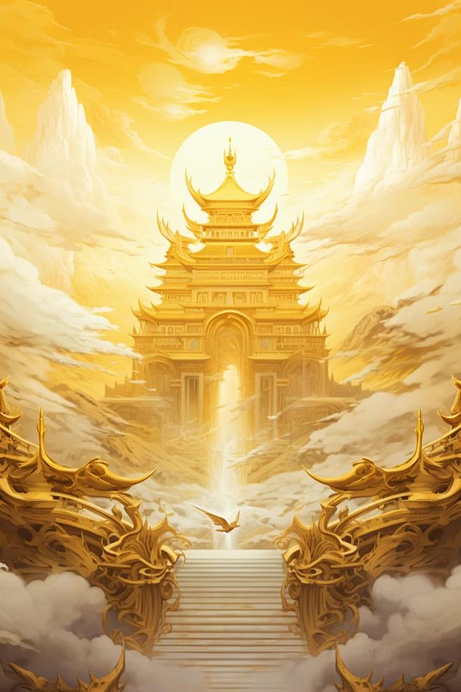

# 第九十四章　神王召見

召見的旨意，是在演武台一戰後的第三日清晨送到的。

來的不是神官，也不是護衛，而是一隻鳥。

一隻通體由九色星光凝成的小鳥，翼展不過一尺，停在客舍頂層的窗櫺上，歪著頭看了顧淵片刻，然後張開喙——吐出的不是鳴叫，而是一枚薄如蟬翼的金色玉箋。

玉箋落在顧淵掌心，上面只有一行神文，筆畫蒼勁而略顯遲緩，像是書寫者的手已經不太穩了：

「明日辰時，九曜天宮外殿。外界之客，請來一敘。」

沒有落款。

可玉箋的邊緣，烙著一道極其複雜的紋印——九道星芒環繞著一個混沌的圓，那是顧淵入城以來，在神殿廣場的「萬神歸一」匾額上見過的同一種紋印。

九曜共主之印。

星光小鳥完成了使命，在窗櫺上化作點點流光，消散在晨風中。

洛寒衣站在顧淵身後，看著那枚玉箋，沉默了片刻。

「神王？」

「嗯。」

「為什麼找我們？」

顧淵把玉箋翻過來，背面空白一片。他用指腹輕輕摩挲著那行略顯遲緩的筆跡，想起跨界那天，從九曜天宮方向落下的那道蒼老而疲憊的神念。

「也許，」他輕聲說，「他看了我們很久了。」

---

那一整天，客舍都不太平。

先是掌櫃戰戰兢兢地上樓，說樓下來了幾位雲闕的神裔，想要拜見「神殿廣場的劍仙」。顧淵讓洛寒衣不必理會，自己下去應付了一番，客客氣氣地把人送走。

午後，又來了一位自稱是水曜神系某商行管事的中年人，言辭恭謹，帶著一份厚禮——一匣子品相極佳的願晶，說是「久仰外界貴客風采，略表敬意」。

顧淵認出了他。那是兩天前，他在雲闕長街上看見的那間水曜商行——從側門抬出箱子、裝上無標記雲輦的那間。

他沒有收那匣願晶。

「無功不受祿。」顧淵溫和地笑著，將匣子推了回去，「貴商行的心意，顧某心領了。」

管事的笑容僵了一瞬，隨即又恢復如常，客套了幾句便告辭了。

臨走之前，他像是不經意地說了一句：「明日天宮之行，貴客若有什麼需要，水曜系隨時願意效勞。」

顧淵看著他的背影，若有所思。

明日天宮之行。

召見的旨意今早才到，連客舍掌櫃都不知道。一個水曜商行的管事，卻已經知道了。

「消息傳得真快。」洛寒衣在樓梯口冷冷道。

「不是傳得快。」顧淵說，「是有人一直在看著那隻鳥。」

傍晚時分，第三批人來了。

這一次，只有一個人。

白崢。

他依舊是那身素白常服，站在客舍門口，沒有進來，只是隔著門檻對顧淵說了一句話：

「明天進了天宮，少看，少說，少碰。」

說完，他轉身便走。

顧淵叫住他：「白巡察使。」

白崢停下腳步，沒有回頭。

「為什麼告訴我這些？」

白崢沉默了很久。

「蒼律是我的師兄。」他最終說，「昨天他醒了，跟我說了很多話。」

他頓了頓。

「他說，那是他三百年來，第一次覺得自己還活著。」

說完，他大步離去，再也沒有回頭。

---

辰時。

九曜天宮。

從太微玉京到九曜天宮，沒有任何階梯或升降台。前來迎接的是一架由九匹星光神駒牽引的雲輦，通體以白玉神格結晶雕成，輦頂懸著九盞代表九曜的小小神燈。

駕輦的是一位身著灰袍的老者，面容枯槁，額間印記黯淡得幾乎看不清屬於哪個神系。他一言不發地為兩人掀開輦簾，待他們坐定，便揮動韁繩。

雲輦騰空而起，穿過太微玉京上空的雲層，向著那片被九道光柱托舉的宮殿群飛去。

越往上，九曜的光芒越是強烈。

顧淵掀開輦簾向外看去。腳下的太微玉京已經縮小成一枚晶瑩的寶石，懸浮在無邊的雲海之上。而頭頂，九道巨大的光柱從九顆星辰上垂落，在雲層之上匯聚成一片璀璨的光海——九曜天宮，就漂浮在那片光海的正中央。

近看，它比遠望時更加宏偉。

那不是一座宮殿，而是一片宮殿群。數百座殿宇以某種精密的星辰陣列排布，每一座都對應著九曜的某一種神性：赤金的日曜殿高居最上，熾烈如火；銀白的太陰殿居於西側，清冷如霜；白金色的金曜殿方正森嚴，青碧色的木曜殿藤蔓纏繞……而在宮殿群的最中央，是一座通體混沌色、看不出材質的巨大圓殿，九道光柱的匯聚點，正正落在它的穹頂之上。

神王御座所在。

可雲輦並沒有飛向那座圓殿。

它在宮殿群的最外圍停了下來——一座看起來毫不起眼的偏殿前。

「外殿到了。」灰袍老者第一次開口，聲音沙啞，「陛下在裡面等。」

---

外殿很小，也很空。

沒有華麗的裝飾，沒有成群的侍從，甚至沒有點燈。只有一扇巨大的落地窗，窗外是九曜天宮的全景與浩瀚的星空。九種星光透過窗戶照進來，在殿內的地面上交織成斑駁的光影。

窗前，放著一張樸素的木椅。

椅上坐著一個老人。

他背對著殿門，面朝窗外，一頭白髮披散在肩頭，身上只穿著一件洗得發白的灰色長袍。若不是周身那若有若無、卻浩瀚如星海的神性氣息，顧淵幾乎要以為，這只是一個在窗前曬太陽的尋常老者。

「來了。」老人沒有回頭，聲音蒼老而溫和，「坐吧。」

殿內沒有第二張椅子。

顧淵環顧四周，最終在老人身側的窗台邊坐下，與他一同望向窗外。洛寒衣沒有坐，只是站在顧淵身後半步，右手虛懸在劍柄旁。

老人似乎察覺到了洛寒衣的戒備，低低地笑了一聲。

「姑娘不必緊張。」他說，「老夫這把年紀，已經打不動了。」

洛寒衣沒有說話，也沒有放下手。

老人也不在意。他慢慢轉過頭來，看向顧淵。

那是一張蒼老得驚人的臉。

皺紋如刀刻般深深地嵌在皮膚上，眼窩深陷，嘴唇乾裂。可那雙眼睛——那雙渾濁卻依舊清明的眼睛——裡面盛著的東西，讓顧淵想起了青玄界通天峰頂的雲海。

深，靜，望不到底。

「外界的年輕人，」老人說，「你叫什麼名字？」

「顧淵。」

「顧淵。」老人重複了一遍，像是在品味這兩個字，「老夫昊天。」

九曜神王，昊天神皇。

在位七千年的九曜共主。

就這樣坐在一間沒有點燈的偏殿裡，穿著一件洗得發白的灰袍，像一個尋常的老人一樣，自報了姓名。

---

「你進城那天，」昊天神皇說，「老夫看了你一眼。」

「我感覺到了。」

「你也看了老夫一眼。」

顧淵沒有否認。

昊天神皇看著他，渾濁的眼中閃過一絲光。

「看見了什麼？」

顧淵沉默片刻。

「一座宮殿，」他說，「很大，很古老，曾經很輝煌。」

「現在呢？」

「現在，」顧淵平靜地說，「處處都是裂痕。」

洛寒衣在他身後微微一僵。

昊天神皇卻沒有生氣。他只是靜靜地看著顧淵，看了很久，然後輕輕地、長長地嘆了一口氣。

「七千年了，」他說，「你是第一個當著老夫的面，說出這句話的人。」

他轉回頭，重新望向窗外。

「神殿的命數師們看得見，卻不敢說。各系神君心裡有數，卻不肯說。老夫自己……」他頓了頓，「老夫自己也不想說。」

「為什麼？」

「因為說出來，就得做點什麼。」昊天神皇的聲音很輕，「而老夫已經不知道，還能做什麼了。」

---

窗外，九曜天宮的宮殿群在星光中靜靜佇立。

昊天神皇抬起一隻枯瘦的手，指向窗外。

「你看那裡。」

顧淵順著他的手指看去。

宮殿群最高處，那座赤金色的日曜殿。殿頂的神火熊熊燃燒，光芒熾烈，將周圍的殿宇都映成了金紅色。

「赤炎天宮。」昊天神皇說，「日曜系的聖地。赤炎那孩子……現在應該正在殿裡，盤算著老夫還能活幾天。」

他的手指移動，指向西側那座銀白色的殿宇。

「太陰神宮在玉京的駐殿。玄月那丫頭，心裡什麼都明白，卻什麼都不說。她的弟子羲凰倒是個好孩子……可惜，太好了。」

手指繼續移動。

「金曜系，跟著日曜走。木曜系，老一輩快死光了，年輕一輩撐不起來。水曜系，」他頓了頓，嘴角浮起一絲意味不明的笑，「水曜系最聰明，誰也不得罪，誰的生意都做。」

「土曜系，只管種地，不問天下事。熒惑系，在打仗，一直在打，打了幾百年。計都系，」他的手指停在一片幾乎看不見的暗影上，「計都系只記錄，不干預。他們說，一切都是命數。」

最後，他的手指指向了另一片暗影。

那片暗影比計都系更深，更濃，幾乎與星空的黑暗融為一體。

「羅睺系。」昊天神皇的聲音低了下去，「老夫看不透他們。」

他放下手，靠回椅背上，閉上了眼睛。

「九曜在天，各司其職。」他喃喃道，「這是太初紀的話。那時候，九系是真的各司其職……現在，九系各懷心思。」

---

殿內沉默了很久。

顧淵沒有說話，只是靜靜地等著。

他知道，昊天神皇召他來，不是為了給他介紹九曜的政治版圖。

果然，過了一會兒，昊天神皇睜開眼，問了一個問題：

「你在泥巷待了一個下午。」

「是。」

「看見了什麼？」

顧淵想了想。

「看見了一座城的沉澱池。」他說，「所有神明不要的東西，最後都流到了那裡。」

昊天神皇點點頭，沒有反駁。

「你在神殿廣場，讓那位姑娘一劍點醒了蒼律。」

「是。」

「你怎麼知道該點哪裡？」

「看見的。」顧淵說，「他的神格被濁泥困住了，但最核心處還有一點清明。只要碰到那一點，他就能醒過來。」

昊天神皇的眼神微微一動。

「濁泥。」他重複了一遍這個詞，「你知道濁泥是什麼？」

「知道一些。」顧淵坦然道，「是下界眾生的七情六慾，混在願力裡，一起送上來的。神明吸納願力的時候，把它們也一起吸了進去，沉積在神格裡。」

「還有呢？」

顧淵沉默了一瞬。

「還有，」他慢慢說，「神域的教誨說，神明不能有七情六慾。所以神明不能承認自己有濁泥。所以濁泥只能越積越多，直到有一天，撐不住了。」

昊天神皇看著他，很久很久沒有說話。

然後，他笑了。

那是一種很奇怪的笑，蒼涼而疲憊，卻又帶著一絲如釋重負。

「三天。」他說，「你只用了三天，就看清了老夫七千年都不敢說出口的東西。」

---

「陛下，」顧淵輕聲問，「您為何不說？」

昊天神皇沒有立刻回答。

他望著窗外，望著那片浩瀚的星空，望著那九顆亙古不變的星辰。

「顧淵，」他說，「你知道老夫是怎麼成為神王的嗎？」

「不知道。」

「七千年前，上一任神王隕落。」昊天神皇的聲音平靜，像在說別人的事，「他是怎麼死的，你大概猜得到——濁泥。他的神格裂了，碎了，在議政廳上當著九系神君的面，失控了。」

洛寒衣的手指微微收緊。

「那時候，老夫還只是土曜系的一個五階神尊。」昊天神皇繼續說，「各系爭了三年，誰也不服誰。最後，他們選了老夫——因為土曜系最弱，最不會威脅到任何人。」

他低低地笑了一聲。

「一個妥協的結果。一個誰都可以接受的傀儡。」

「老夫一開始也想做點什麼。老夫見過上一任神王是怎麼死的，老夫知道問題出在哪裡。」他的聲音漸漸低了下去，「可是當老夫第一次在議政廳上提出『重新審視神明七情六慾之禁』的時候……你知道發生了什麼嗎？」

顧淵沒有說話。

「九系神君，八票反對。」昊天神皇說，「唯一沒有反對的，是計都系——他們棄權了，說這是命數。」

「日曜系說，承認七情六慾，就是承認神明與凡人無異，神權將不復存在。金曜系說，這違背了太初紀的律法。水曜系說，此事牽涉太廣，需從長計議。熒惑系說，戰神不需要那些軟弱的東西……」

他閉上眼睛。

「後來，老夫就不提了。」

「再後來，老夫自己的神格，也開始裂了。」

---

殿內一片寂靜。

窗外的星光依舊明亮，九曜依舊亙古不變地懸在天穹之上。

顧淵看著身側這個蒼老的神王，看著他那雙渾濁卻依舊清明的眼睛，看著他洗得發白的灰袍，看著他擱在扶手上那雙枯瘦得只剩骨頭的手。

他想起了跨界那天，破妄真視捕捉到的那一絲殘影——一座曾經輝煌、如今處處裂痕的宮殿。

那不只是一顆衰敗的神格。

那是七千年的無能為力。

「陛下，」顧淵輕聲說，「您召我來，是想讓我做什麼？」

昊天神皇睜開眼，看向他。

「老夫不知道。」他說，「老夫只是想見見你。」

「見見我？」

「見見一個……看得見，也敢說出來的人。」昊天神皇的聲音很輕，「七千年了，老夫一直在等這樣一個人。等得太久，久到老夫都快忘了自己在等什麼。」

他頓了頓。

「然後你來了。」

顧淵沉默了很久。

「陛下，」他最終說，「我不是神域的人。我來這裡，有我自己的目的。」

「老夫知道。」

「我不一定能幫您。」

「老夫也知道。」昊天神皇笑了笑，「老夫沒有要你幫忙。老夫只是……」

他停頓了很久，像是在尋找一個合適的詞。

「只是想在死之前，跟一個能聽懂的人，說說話。」

---

窗外，日曜的火紋流轉漸緩，太陰的銀輝漸漸漫上天穹。

顧淵在那間沒有點燈的偏殿裡，陪著昊天神皇坐了整整一個時辰。

他們沒有談論什麼大事。

昊天神皇說起了太初紀的傳說，說起了九位原初大神的故事，說起了他年輕時在土曜系的田野上，看著下界農人播種、收割，那些純粹而樸素的祈禱聲。

「那時候的願力，真乾淨啊。」他說，眼中帶著一絲懷念，「求豐收，就只是求豐收。沒有恨，沒有怕，只是希望明年的麥子長得好一點。」

顧淵靜靜聽著。

他說起了青玄界的通天峰，說起了柳清虛泡的雨前靈霧茶，說起了滄瀾界凌霄峰頂的雪。

昊天神皇聽得很認真，時不時問一兩句。

「那個叫柳清虛的姑娘，」他問，「是你的道侶？」

「是。」

「她泡的茶，好喝嗎？」

「很好喝。」顧淵笑了，「比神域的任何東西都好喝。」

昊天神皇也笑了。那是顧淵見到他以來，第一次看見他真正地笑——不是蒼涼的笑，不是疲憊的笑，只是一個老人，聽見年輕人說起心愛之人時，那種溫和而慈祥的笑。

「真好。」他說，「有人等你回去，真好。」

洛寒衣站在顧淵身後，一直沒有說話。

可她的手，不知什麼時候，已經從劍柄旁放了下來。

---

臨走之前，昊天神皇叫住了顧淵。

「年輕人。」

顧淵回頭。

昊天神皇依舊坐在窗前的木椅上，背對著他，面朝星空。

「這座神域，」他說，「快要亂了。」

「老夫的壽元，最多還有一年。也許更短。老夫死後，各系會爭奪神座，赤炎那孩子會第一個跳出來。濁泥會繼續爆發，越來越多的神明會撐不住。」

他頓了頓。

「還有一些東西，老夫看不清，但老夫感覺得到——有什麼別的東西，在暗處盯著這片神域。不是天行者，不是那些做生意的人。是更深的、更冷的東西。」

顧淵的眼神微微一凝。

「陛下指的是？」

「老夫不知道。」昊天神皇搖搖頭，「老夫只知道，它在等。等這片神域亂起來，等神座空出來，等所有人都顧不上看它的時候。」

他沉默了一會兒。

「年輕人，老夫不求你什麼。只是……如果你願意，就在這片神域多待一陣子吧。」

「看看它。」

「看看它還有沒有救。」

顧淵站在殿門口，看著那個蒼老的背影，沉默了很久。

然後，他深深地、鄭重地，向著那個背影行了一禮。

「我會的。」他說。

---

回程的雲輦上，洛寒衣一直沒有說話。

直到雲輦穿過雲層，太微玉京的燈火在腳下漸漸亮起，她才忽然開口：

「他很可憐。」

顧淵側頭看她。

「不是因為他快死了。」洛寒衣望著窗外，聲音很輕，「是因為他看得見，卻什麼都做不了。」

她頓了頓。

「我在滄瀾的時候，最怕的就是這個。」

「怕什麼？」

「怕有一天，我手裡有劍，卻不知道該砍向哪裡。」洛寒衣低聲說，「明明知道有東西是錯的，卻找不到它在哪裡，砍不到，也碰不著。」

她轉過頭，看著顧淵。

「那個老人，就是這樣過了七千年。」

顧淵沉默了很久。

然後，他伸出手，輕輕握住了她放在膝上的手。

「所以，」他說，「我們來替他找。」

洛寒衣看著兩人交握的手，沒有抽開。

「找到了呢？」

「找到了，」顧淵望向窗外那片繁華如夢的浮城，望向浮城之下那片看不見的淤泥，望向更遠處那九顆亙古不變的星辰，「就讓你砍。」

洛寒衣盯著他看了三息。

然後，她的嘴角，第一次在顧淵面前，毫不掩飾地揚了起來。

「好。」她說。

---

當夜，客舍。

顧淵在玉簡上寫下今日所見，寫了很久。

昊天神皇——土曜系出身，七千年前作為妥協人選即位。曾提議重審七情六慾之禁，八票反對，一票棄權。此後神格亦裂。壽元最多一年。

九曜政治版圖：
日曜（赤炎神君）——最強勢，覬覦神座，推動世襲。
太陰（玄月神母）——明白卻沉默。少宮主羲凰，「太好了」。
金曜——依附日曜。
木曜——老一輩凋零。
水曜——左右逢源，與天行者往來。
土曜——不問世事。
熒惑——戰事不休，數百年。
計都——只記錄，不干預。
羅睺——神王亦看不透。

暗處之物——「更深的、更冷的東西」，在等神域大亂。

他寫完最後一行，放下玉簡，在窗前坐了很久。

腰間的玉佩微微發熱。

「主人，」靈素輕聲說，「今天神王爺爺跟主人說話的時候……萬界樓沒有震。」

顧淵微微一怔。

「沒有震？」

「嗯。」靈素說，「跨界那天他掃過來一眼，樓就震了。可今天他跟主人說了一個時辰的話，樓一點反應都沒有。」

她頓了頓，聲音帶著困惑：「靈素想不明白。」

顧淵也沉默了。

跨界那天的神念，與今天的對話，有什麼不同？

那天，昊天神皇只是遠遠地看了一眼。而今天，他就坐在身側，說了一個時辰的話。

按理說，今天的接觸應該更深、更直接才對。

除非——

萬界樓感應的，不是昊天神皇本人。

而是那天，那道神念掃過時，所攜帶的某種東西。

某種……只在那一瞬間出現過的東西。

顧淵想起了白天，昊天神皇在提到「暗處之物」時的那句話——「它在等。」

又想起寒衣的劍意，在神殿廣場與演武台上，兩次剝離濁泥的瞬間。

神念掃過的那一刻。濁泥被剝離的那一刻。

萬界樓都震了。

也許，萬界樓感應的，從來不是神王，也不是寒衣。

而是濁泥。

或者說——是濁泥背後的某種東西，被觸動的那一刻。

顧淵站起身，走到窗前。

夜空中，九曜靜靜懸浮。在九顆星辰之間，羅睺與計都兩顆暗星，幾乎與黑暗融為一體。

他想起昊天神皇的話——「老夫看不透他們」。

想起演武台包廂裡，那道幾乎與陰影融為一體的隱晦氣息。

「靈素，」他輕聲說，「從明天開始，幫我記錄一件事。」

「什麼事？」

「每一次萬界樓震動的時候，」顧淵說，「附近有沒有羅睺系的人。」

靈素沉默了一瞬，隨即鄭重地應道：

「好。」

窗外，夜風吹過太微玉京的萬千燈火。

九曜天宮的方向，那間沒有點燈的偏殿裡，一個蒼老的身影依舊坐在窗前，望著星空。

他已經很累了。

可今夜，他的嘴角，帶著一絲七千年來從未有過的、淡淡的笑意。

---

第一篇　踏入神域　終

（第九十四章　完）
