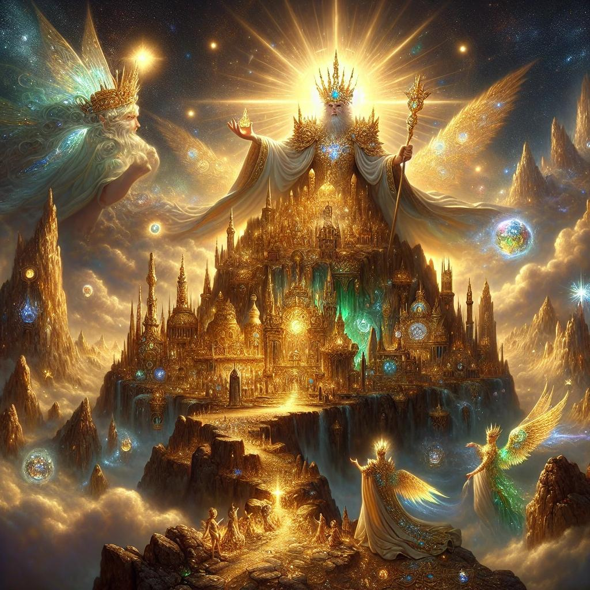

# 第九十五章　壽元將盡

九曜神王議會，百年一次大議。

可這一次，距離上一次大議，只過了四十七年。

召集令是在顧淵覲見神王後的第五日發出的。發令者不是昊天神皇，而是日曜神系——赤炎神君以「神王聖體違和，九曜國事不可久懸」為由，聯合金曜、水曜兩系，依照神王議會古律中一條數萬年未曾動用過的條款，強行召開了臨時大議。

「三系聯名，可請大議。」白崢站在客舍門外，面無表情地對顧淵說，「這條古律從太初紀就有，可從來沒人用過。用了，就等於當眾宣告——神王已經管不了事了。」

「神王怎麼說？」

「神王准了。」白崢頓了頓，「他還下了一道旨意。」

他從袖中取出一枚金色玉箋，遞給顧淵。

玉箋上，依舊是那蒼勁而遲緩的筆跡：

「外界之客顧淵，列席旁聽。」

顧淵看著那行字，沉默片刻。

「列席旁聽。」他輕聲重複，「九曜大議，有過外界人列席的先例嗎？」

「沒有。」白崢說，「從來沒有。」

他看著顧淵，眼神複雜。

「你知道這意味著什麼嗎？」

「知道。」顧淵收起玉箋，「意味著明天我走進議政廳的那一刻，九系神君都會盯著我。」

「不止。」白崢的聲音壓得很低，「意味著神王在告訴所有人——他選了你當他的眼睛。」

---

九曜天宮，神王議政廳。

這一次，雲輦沒有停在外圍的偏殿。它穿過層層疊疊的宮殿群，徑直飛向最中央那座通體混沌色的巨大圓殿。

圓殿內部，比外觀看起來更加宏大。

穹頂高不見頂，九道光柱自穹頂垂落，在殿中央交匯成一團緩緩旋轉的混沌光球。光球之下，是一座以九色神格結晶砌成的高台，台上設著一張古樸的御座——神王御座。

御座之下，九張石椅圍成一圈，每一張椅背上都鐫刻著對應神系的星辰圖騰。

再往外，是層層遞升的環形席位，坐滿了各系的神尊、神將與高階神官。

顧淵被引到最外圈的一個角落。那裡單獨設了一張小几，一個蒲團，與周圍那些華美的席位格格不入。

他剛坐下，便感覺到數十道目光從四面八方投來。

有好奇，有審視，有輕蔑，也有敵意。

顧淵神色如常地整了整衣袍，端坐於蒲團之上，目光平靜地望向殿中央。

洛寒衣沒有跟進來——外界人列席已是破例，隨從不得入殿。她此刻正在圓殿外的迴廊上等候，臨別前只說了一句：「有事叫我。」

顧淵知道，若真有事，她會在三息之內破門而入。

---

九張石椅，陸續有人落座。

第一個到的，是一位身著銀白長裙的女子。她面容清冷，眉目如畫，周身縈繞著淡淡的月華，額間是一道彎月形的神紋。她在太陰系的石椅上坐下，雙手交疊於膝上，目不斜視，像一尊玉雕的神像。

玄月神母，太陰宮主。

顧淵以破妄真視看去，她的神格是一輪銀白的滿月，表面光潔無瑕——可在那光潔的表面之下，顧淵看見了一層極其厚重的封印。那封印不是外人施加的，而是她自己親手刻上去的，像是把什麼東西牢牢地鎖在了神格深處。

第二個到的，是一位身材敦實、膚色黝黑的老者，衣著樸素得像個農夫，在土曜系的石椅上坐下後，便閉目養神，一言不發。

接著是木曜系——一位年輕得過分的青年，眉目溫潤，神色卻透著明顯的緊張與不安。顧淵記得昊天神皇說過，木曜系的老一輩幾乎凋零殆盡。這個青年，大概是被臨時推上來的。

金曜系的神君是一位面容方正、不苟言笑的中年男子，坐下時腰背挺得筆直，像一柄插在地上的尺。

水曜系的神君——顧淵多看了一眼——是一位面容溫和、笑容可掬的中年人，衣袍是深藍色的，袖口繡著流轉的水紋。他落座時，還特意向四周的神君點頭致意，一副人緣極好的模樣。

可破妄真視之下，他的神格是一團深不見底的漩渦，什麼都看不清。

熒惑系的石椅，空著。

「熒惑系在前線，」顧淵身旁一位低階神官小聲嘀咕，「說是軍情緊急，派不出人來……」

計都系的石椅上，坐著一個身形模糊的存在。說是「坐著」，其實只是一團淡淡的灰影，看不清面目，也看不清性別，像是一個還沒有完全凝聚成形的幻影。

而羅睺系——

顧淵的目光落在那張石椅上。

石椅上坐著一個女子。

她穿著一襲黑色的長裙，裙擺如流動的陰影，鋪散在石椅周圍。她的面容美麗而模糊，像是隔著一層薄霧，讓人看不真切。唯有一雙眼睛，清晰得驚人——那是一雙暗紫色的眼睛，瞳孔深處有某種東西在緩緩流轉。

她察覺到了顧淵的目光，微微側過頭，向他看來。

然後，她笑了。

那是一個很淺、很輕的笑，像是看見了一件有趣的玩具。

顧淵神色不變，平靜地收回了目光。

破妄真視之下，她的神格——

是一片空白。

不，不是空白。是一片「吞噬」了一切光線的黑暗，連破妄真視的視線都被那片黑暗吸了進去，什麼都映照不出來。

那不是白玉面具人那種「不可被觀測」。

那是另一種東西。

一種……餓。

---

最後一個到的，是赤炎神君。

他沒有走進來。

他是「降臨」的。

圓殿穹頂的一道光柱驟然亮起，赤金色的神火如瀑布般傾瀉而下，在日曜系的石椅前凝聚成一道高大的人影。神火散去，露出一個身披赤金神甲、頭戴日冕的男子。

他的面容剛毅而英俊，眉宇間帶著與生俱來的威嚴與傲慢，額間的日曜火紋熾烈如真正的太陽，周身散發的威壓讓整座議政廳的溫度都升高了幾分。

五階神尊巔峰。

距離六階神王，只差半步。

赤炎神君在日曜系的石椅上坐下，姿態從容而隨意，像是坐在自家的殿堂裡。他環顧四周，目光在每一位神君身上停留片刻，最後落在了最外圈角落裡的那個外界人身上。

他看了顧淵三息。

然後，他移開了目光，像是看見了一粒灰塵。

---

「神王駕到——」

一聲悠長的唱喏，在圓殿中迴盪。

所有人起身。

殿中央的混沌光球緩緩旋轉，光芒漸盛。一道蒼老的身影從光球中緩步走出，沿著九色結晶的台階，一步一步，走向那張古樸的御座。

昊天神皇。

他今日穿上了神王的正裝——一襲以九色星光織就的長袍，頭戴混沌神冠，手持九曜權杖。在那身華貴的裝束之下，他的身形顯得格外瘦削，像是一根被包裹在錦緞中的枯枝。

他走得很慢。

每一步都很慢。

顧淵看見他握著權杖的手在微微顫抖，看見他的腳步在台階上有一瞬間的踉蹌，看見他在終於坐上御座的那一刻，極輕地、幾乎無法察覺地，鬆了一口氣。

殿內數百位神明，沒有一個人說話。

可顧淵知道，他們都看見了。

「坐。」昊天神皇的聲音蒼老而平靜。

眾人落座。

---

「今日大議，」昊天神皇緩緩開口，「是日曜、金曜、水曜三系聯名所請。」

他看向赤炎神君。

「赤炎，你來說吧。」

赤炎神君站起身，向御座行了一禮——禮數周全，卻沒有半分敬意。

「陛下，」他的聲音洪亮，在圓殿中迴盪，「臣等請開大議，只為一事。」

他頓了頓，環顧四周。

「陛下聖體違和，已有數年。近一年來，陛下親臨議政的次數，不足十次。九曜國事，積壓如山。濁泥之患，日益嚴重——就在十日前，金曜系蒼律神官在神殿廣場當眾失控，險些釀成大禍。」

金曜系的神君臉色微微一沉，卻沒有說話。

「神域不可一日無主。」赤炎神君繼續道，「臣等懇請陛下，為九曜計，為萬民計——早日確立繼承之人。」

殿內一片寂靜。

這句話說得冠冕堂皇，可在場每一個人都聽得明白。

確立繼承之人。

在神王還活著的時候，在神王的面前，要求他指定繼承人。

這不是請求。

這是逼宮。

---

昊天神皇坐在御座上，沉默了很久。

「依古律，」他最終開口，「神王由九系共推，議會投票決定。神王不得指定繼承人。」

「臣知道。」赤炎神君微微一笑，「所以臣今日請開大議，正是要請九系神君共議此事。」

他轉向四周。

「臣提議——修改古律。」

殿內響起一陣低低的騷動。

「神域五萬年來，共歷八任神王。」赤炎神君的聲音不疾不徐，「每一任神王更替，都伴隨著數年乃至數十年的權力真空。各系爭奪，議而不決，國事荒廢，濁泥失控——上一任神王隕落後的三年，便是如此。」

他看了昊天神皇一眼。

「陛下應該最清楚。」

昊天神皇沒有說話。

「為避免重蹈覆轍，」赤炎神君繼續道，「臣提議——自下一任起，神王之位，由實力最強、根基最穩的神系世襲繼承。如此，可保神域長治久安，不再因神座更替而動盪。」

他沒有說「日曜系」。

可在場所有人都知道，九系之中，實力最強、根基最穩的是誰。

---

「荒謬。」

一個清冷的聲音響起。

說話的是玄月神母。

她依舊端坐在太陰系的石椅上，雙手交疊於膝，目光平靜地看著赤炎神君。

「九系共推，是太初紀九位原初大神共同定下的規矩。」她說，「你要改的不是古律，是神域的根基。」

赤炎神君看向她，笑容不變。

「玄月宮主，」他溫聲道，「太初紀已經過去十萬年了。十萬年前的規矩，未必適合今日的神域。」

「那你覺得，什麼適合今日的神域？」

「強者。」赤炎神君毫不猶豫地說，「能鎮住濁泥、能平定各系紛爭、能讓神域重歸秩序的強者。」

他頓了頓，意味深長地說：

「而不是一個……連自己的神格都保不住的老人。」

殿內的空氣，瞬間凝固了。

---

所有人都看向了御座。

昊天神皇依舊坐在那裡，握著權杖的手微微收緊，臉上卻沒有任何表情。

他沒有反駁。

也沒有發怒。

他只是靜靜地看著赤炎神君，看了很久很久。

那個眼神，顧淵在偏殿裡見過——深，靜，望不到底。

可此刻，那片深靜之中，多了一些別的東西。

一種疲憊到極點、卻依舊不肯閉上的倔強。

「赤炎，」昊天神皇最終開口，聲音很輕，「你說得對。」

赤炎神君微微一怔。

「老夫的神格，確實保不住了。」昊天神皇平靜地說，「這一點，在座的各位都知道。只是沒有人說出口而已。」

他環顧四周，目光從每一位神君臉上掃過。

「今天你說出來了。很好。」

他頓了頓。

「那麼，老夫也說一句實話。」

「老夫的神格，是被濁泥蛀空的。」

「上一任神王的神格，也是。」

「在座的各位——」他的目光再次掃過九張石椅，「你們的神格，也正在被蛀空。」

「區別只在於，老夫活得夠久，蛀得最深。」

---

殿內死一般的寂靜。

沒有人說話。

沒有人敢說話。

顧淵坐在最外圈的角落裡，看著御座上那個瘦削的身影，心中某處微微一動。

七千年來，這是第一次。

第一次有一位神王，在九系神君齊聚的議政廳上，親口承認了濁泥的存在。

承認了神明的神格，正在被自己吸納的信仰一點一點地蛀空。

承認了那個所有人都知道、卻沒有人敢說出口的真相。

「陛下！」金曜系的神君猛地站起身，臉色鐵青，「此言……此言有違神道！神明清明無垢，豈可與那些污穢之物相提並論！」

「有違神道？」昊天神皇看向他，「金峰，你的神格上，有多少道裂紋？」

金曜神君的臉色瞬間慘白。

「十日前，蒼律在神殿廣場失控。」昊天神皇的聲音依舊平靜，「他是你的弟子。你知道他的神格裂了多少年嗎？」

金曜神君張了張嘴，說不出話來。

「三百年。」昊天神皇替他回答了，「三百年前，他就來找過你。你告訴他什麼？」

「我……」

「你告訴他，那是修行不夠，是道心不堅，是他自己的錯。」昊天神皇輕聲說，「你讓他藏起來，不要讓任何人知道。」

他頓了頓。

「因為你自己，也是這麼藏的。」

金曜神君跌坐回石椅上，面如死灰。

---

赤炎神君的臉色，第一次變了。

他沒有想到，這個在他眼中早已是行將就木的老人，會在大議上做出這種事。

承認濁泥。

當眾承認。

這等於是把神域五萬年來最大的禁忌，赤裸裸地攤開在所有人面前。

「陛下，」赤炎神君的聲音冷了下來，「您這是要動搖神域的根基嗎？」

「根基？」昊天神皇低低地笑了一聲，「赤炎，神域的根基早就動搖了。從五萬年前諸神黃昏的那一天起，就在動搖。我們只是一直假裝它還穩固而已。」

他看著赤炎神君，目光平靜。

「你要世襲，老夫不攔你。你去問九系同不同意。」

「但在那之前——」

他的聲音忽然提高了幾分，那蒼老的嗓音中，竟透出了一絲久違的威嚴：

「老夫還是神王。」

「只要老夫還活著一天，神王御座上坐的就是老夫。」

「你要逼宮，等老夫死了再說。」

---

殿內一片死寂。

赤炎神君站在原地，臉色變幻不定。

他看著御座上那個瘦削的老人，看著他握著權杖的、微微顫抖的手，看著他那雙渾濁卻依舊清明的眼睛。

良久，他忽然笑了。

「陛下說得是。」他向御座躬身行禮，語氣恭謹，眼中卻沒有半分恭敬，「臣等……等。」

他直起身，轉身走回日曜系的石椅，坐下。

那一刻，顧淵看見他的嘴唇微微動了一下，無聲地說出了一句話。

破妄真視讀出了那句話：

「反正也等不了多久了。」

---

大議繼續進行。

可在昊天神皇那番話之後，整個議政廳的氣氛都變了。

各系神君或沉默，或低聲交談，目光不時投向御座，又迅速移開。赤炎神君的世襲提議被暫時擱置，金曜神君失魂落魄地坐在石椅上，一言不發。水曜神君依舊笑容可掬，卻不再主動開口。

而羅睺系的那個黑裙女子——

顧淵一直在用餘光留意她。

從頭到尾，她沒有說過一句話。

赤炎神君逼宮的時候，她沒有說話。玄月神母反駁的時候，她沒有說話。昊天神皇承認濁泥、整個議政廳陷入震動的時候，她依舊沒有說話。

她只是坐在那裡，暗紫色的眼睛饒有興致地看著每一個人，像是在看一場精彩的戲。

只有一個時刻，她的表情有了變化。

那是昊天神皇說出「你們的神格，也正在被蛀空」的時候。

所有人都在震驚、恐懼、憤怒。

只有她，嘴角微微上揚了一下。

很輕，很快，幾乎無法察覺。

可顧淵看見了。

那不是驚訝，也不是恐懼。

那是……愉悅。

---

大議在一個時辰後結束。

沒有任何決議。

赤炎神君的世襲提議被擱置，繼承問題留待「下次大議再議」。可在場所有人都明白，下一次大議，恐怕不會再等四十七年了。

神君們陸續離去。

赤炎神君在離開之前，特意繞到了最外圈的角落，在顧淵的小几前停下腳步。

他居高臨下地看著這個坐在蒲團上的外界人，目光如炬。

「外界人，」他說，「老頭子讓你來旁聽，是想讓你看什麼？」

顧淵起身，拱手：「神君以為呢？」

「我以為，」赤炎神君冷冷道，「他想找一個外人，替他說那些他自己不敢說的話。」

「可今天，陛下自己說了。」

赤炎神君的眼神微微一凝。

他盯著顧淵看了很久，忽然笑了。

「有意思。」他說，「我聽說，演武台那天，炎烈的神火被你身邊那個女劍修剝出了灰渣子。」

「是。」

「你知道那是什麼嗎？」

「知道。」顧淵平靜地說，「是日曜神火千百年來焚燒濁泥留下的焦化殘渣。」

赤炎神君的笑容僵了一瞬。

「神火至純，」他一字一句地說，「焚盡萬邪。」

「神火燒得掉濁泥的形，」顧淵說，「燒不掉它的根。燒完了，灰還在。」

他看著赤炎神君，目光平靜而清澈。

「神君的神火裡，灰比炎烈神將多得多。」

---

赤炎神君的臉色，在那一刻變得極其難看。

周圍還沒離開的神官們紛紛低下頭，假裝什麼都沒聽見。

赤炎神君死死盯著顧淵，周身的神火隱隱翻騰，議政廳內的溫度驟然升高。

顧淵依舊站在那裡，神色從容，不退不避。

三息之後。

赤炎神君收斂了神火，冷笑一聲。

「外界人，」他說，「你最好記住——老頭子護得了你一時，護不了你一世。」

「他死了以後，這座神域，是我說了算。」

說完，他拂袖而去，赤金色的神火在身後拖出一道長長的光痕。

顧淵看著他的背影，沒有說話。

「你膽子真大。」

一個慵懶而輕柔的聲音，在他身後響起。

顧淵回過頭。

羅睺系的那個黑裙女子，不知何時已經站在了他身後三尺之處。她的面容依舊隔著一層薄霧，看不真切，只有那雙暗紫色的眼睛，清晰得驚人。

「當著赤炎的面，說他神火裡有灰。」她輕笑一聲，「整個神域，敢這麼說的人，你是第一個。」

「閣下是？」

「影月。」她說，「羅睺系的。」

她歪了歪頭，打量著顧淵，像是在打量一件稀奇的寶物。

「你很有意思。」她說，「比那個老頭子有意思多了。」

顧淵靜靜看著她。

「閣下也很有意思。」他說，「今天大議上，所有人都在怕。只有閣下，在笑。」

影月的眼神微微一動。

然後，她笑得更深了。

「你看見了？」

「看見了。」

「那你覺得，」她湊近了一些，暗紫色的瞳孔深處，有某種東西在緩緩流轉，「我在笑什麼？」

顧淵沒有退，也沒有回答。

他只是看著那雙眼睛，看了很久。

影月似乎也不期待他的回答。她直起身，輕輕地、愉快地笑了一聲，轉身離去。

黑色的裙擺如陰影般在地面上流淌，所過之處，連九曜的星光都暗淡了幾分。

走到殿門口時，她回過頭來，留下一句話：

「外界人，神域快要變天了。」

「到時候，記得站在對的那一邊。」

---

議政廳外的迴廊上，洛寒衣靠著廊柱，抱著劍，看著顧淵走出來。

「怎麼樣？」

「很精彩。」顧淵說。

洛寒衣看了他一眼：「你的臉色不太好。」

顧淵沉默了一瞬。

「寒衣，」他輕聲說，「你在外面，有沒有感覺到什麼？」

洛寒衣想了想。

「剛才有個穿黑裙子的女人出來。」她說，「她從我身邊走過去的時候，我的劍……」

她頓了頓，低頭看向背後的斷星古劍。

「我的劍，在發抖。」

「不是怕。」她補充道，「是……厭惡。」

顧淵靜靜聽著，沒有說話。

腰間的玉佩微微發熱。

「主人，」靈素的聲音帶著一絲緊張，「剛才那個黑裙子的姐姐跟主人說話的時候——」

「萬界樓震了？」

「……震了。」靈素說，「跟之前三次一樣的位置。可這一次，震得比之前都要久。」

顧淵閉上眼睛，深深吸了一口氣。

羅睺系。影月。

那片吞噬一切光線的黑暗。那個在所有人恐懼時愉悅的笑容。那句「到時候，記得站在對的那一邊」。

他睜開眼，望向圓殿深處。

御座上，已經空無一人。

昊天神皇在大議結束後便離開了，沒有跟任何人說話。

可顧淵知道，他現在應該又回到了那間沒有點燈的偏殿，坐在窗前，望著星空。

一個人。

「走吧。」顧淵說。

「去哪？」

「回去。」顧淵望向九曜天宮外那片浩瀚的雲海，「這座神域的病，比我想的還要重。」

他頓了頓。

「我得好好想想，從哪裡下刀。」

（第九十五章　完）
