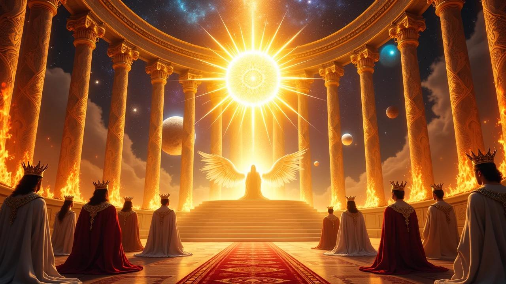

# 第一百章　月宮急報

從九曜祭天壇暗道歸來的第三日，九曜天宮又降下了一道召令。

但這一次，來的不是九色星光凝成的小鳥，也不是神王昊天神皇的玉箋。

來的是一隊身披赤金神甲、周身燃燒著熾烈火紋的日曜天宮禁衛，以及一張以太陽神金鍛造、燙手得幾乎能點燃凡俗紙張的赤紅拜帖——說是拜帖，口氣卻與傳訊令無異：

「赤炎神君於九曜天宮・赤陽偏殿設宴，邀外界貴客顧淵一敘。午時三刻，毋誤。」

客舍前廳裡，領頭的日曜禁衛將赤紅拜帖重重拍在茶案上，連半個禮字都沒行，轉身便帶著一隊人馬揚長而去，留下一屋子灼熱的焦糊氣息。

姬明月端著茶盞坐在主位上，連眼皮都沒抬一下，只淡淡吐出四個字：「好大的架子。」

洛寒衣站在窗邊擦劍，冷聲道：「不去。」

「為何不去？」顧淵拿起那張滾燙的太陽神金拜帖，指尖輕輕一拂，一縷清涼的混沌氣息便將上面的灼熱盡數壓平，「赤炎神君在議政廳剛被神王下過面子，又知道我這幾日在太微玉京四處走動。他既然肯按捺住殺意先發請帖，而不是直接派五階神尊來拆這座客舍，說明他想談。」

姬明月放下茶盞，鳳眸微瞇：「他是想收編你，或者逼你站隊。神王壽元將盡，大議雖然擱置了世襲之議，但九系現在都盯著神座。你在議政廳列席旁聽，在療養殿救了金曜老神尊，又在演武台讓寒衣掀了日曜系的臉面——在赤炎眼裡，你現在就是神王留給反對派的一枚棋子。」

「正是如此。」顧淵將拜帖收入袖中，神色從容，「他想摸我的底，我也想摸他的底。而且，九曜天宮裡現在風聲鶴唳，不去赤陽偏殿走一遭，怎麼知道日曜系究竟是單純想奪神座，還是也跟祭天壇下面那些東西有牽連？」

姬明月看著他，眼底閃過一絲瞭然：「也好。那我與寒衣留在太微玉京——你前腳進天宮，我正好借著『天曜神裔』的名頭，去查一查紫薇天關的動向與太微玉京的布防。」

顧淵點頭，轉向洛寒衣：「寒衣，你在客舍守著，順便盯緊水曜商行與黑市那邊的動靜。」

洛寒衣收劍入鞘，簡短應了一聲：「嗯。若他敢動手，捏碎玉符。」

顧淵微笑頷首，換上一襲素雅的青金長衫，手持竹骨折扇，獨自一人乘雲輦重登九曜天宮。

---

九曜天宮，赤陽偏殿。

與昊天神皇那間不點燈、只有一張木椅的樸素外殿截然不同，赤陽偏殿極盡奢華與威嚴。整座大殿以赤紅色的太陽晶石築成，十二根盤龍火柱支撐著高聳的穹頂，柱頂燃燒著永不熄滅的日曜神火，將整座大殿映照得金碧輝煌，熾熱逼人。

顧淵踏入大殿時，殿內並沒有什麼宴席。

沒有酒，沒有菜，甚至連一張客座都沒有。

大殿盡頭的高台之上，赤炎神君身披赤金神甲，並未戴冠，一頭暗紅長髮披散在肩頭，正負手立於一幅巨大的九曜星域堪輿圖之前。聽見腳步聲，他沒有立刻回頭，只是任由大殿中那股屬於五階神尊巔峰的熾熱威壓，如無形的火海般朝著殿門處的青衫客滾滾壓來！

若是尋常四階神將踏入此地，恐怕連站穩都難，額頭早已冷汗涔涔。

可顧淵步履平緩，青衫衣擺在熱浪中紋絲不動，手中素面折扇輕輕搖動，彷彿置身於三春微風之中。他走到大殿中央站定，拱手一禮，神色不卑不亢：

「神君相邀，顧某準時赴約。只是看這殿中陳設，似乎不太像設宴的模樣。」

赤炎神君這才緩緩轉過身。

他居高臨下地審視著顧淵，雙目如兩團燃燒的烈陽，見對方在自己的神火威壓下竟然連呼吸都沒有亂上一分，眼底不禁掠過一抹深深的忌憚與審視。

「本君不喜歡繞彎子。」赤炎神君邁步走下高台，沉重的戰靴踩在晶石地面上，發出悶雷般的回響，「顧淵，你在太微玉京做的每一件事，本君都知道。泥巷、神殿廣場、演武台、療養殿，還有昨夜天行者的黑市——你一個外界來客，手伸得未免太長了。」

「神域風景壯麗，顧某初來乍到，難免多看幾眼。」顧淵語氣平淡，「莫非九曜律法規定，外界之客連看都不能看？」

「看可以，但看過了，就得選邊站。」赤炎神君停在顧淵身前丈許處，高大魁梧的身軀帶著極強的壓迫感，「昊天老兒活不過今年了。他讓你列席大議，不過是想借一個外人的嘴，去噁心本君、動搖九系的軍心。你很聰明，應該看得出來——一個快死的老神王，護不住你，也救不了九曜神域。」

顧淵神色不變：「哦？那依神君之見，誰能救九曜神域？」

「我。」赤炎神君毫不猶豫，眉宇間透出的並非虛偽的野心，而是一種根深蒂固、近乎狂熱的信念，「九曜神域亂了五萬年，為什麼？因為九系各自為政，因為神王議會軟弱無能！太陰系只會悲天憫人地自我消耗，木曜系連老祖都死絕了，土曜系縮在田埂裡裝聾作啞，水曜系暗中做著見不得光的勾當，羅睺系更是藏頭露尾！」

他張開雙臂，周身赤金神火轟然暴漲，大殿內的十二根火柱同時發出低沉的共鳴：

「唯有日曜神系的光明與權威，唯有徹底終結軟弱的輪值議會、由日曜神系一統九曜、以鐵腕重塑神權秩序，才能鎮壓濁泥、掃清魑魅，讓九曜神域重回太初紀的輝煌！」

顧淵靜靜聽著，破妄真視在眼底悄然流轉。

他看清了赤炎神君的神格——那是一輪熾烈如真陽、磅礴浩瀚的五階巔峰神格。正如他當日在議政廳所言，神格表層雖然沉積著大量因焚燒濁泥而產生的焦黑殘渣，可神格最核心處，卻並沒有半點羅睺系的陰影氣息，也沒有任何諸天蝕者的冰冷觸鬚。

這意味著，赤炎神君雖然傲慢、專斷、野心勃勃，但他確實不是蝕者的走狗。他是一個真正相信「唯有集權與神火能拯救神域」的強硬派統治者。

看清這一點，顧淵心中便有了數。

「神君志向宏大，顧某佩服。」顧淵微微頷首，「不過，這似乎與顧某這個外界來客無關。神君今日喚我前來，究竟想要什麼？」

赤炎神君收斂了幾分熾熱的氣焰，雙目灼灼地盯著顧淵：「本君要你兩樣東西。」

「第一，你的『眼睛』，和你身邊那個女劍修的『劍』。」赤炎神君沉聲道，「你能在療養殿一眼看穿老神尊的神格死結，還能助他暫時壓住濁泥反撲；你身邊那個女劍修，一劍便能洗開日曜神火裡的焦化殘渣。這份本事，對即將一統九曜的日曜神系大有用處。」

「第二，站隊。」赤炎神君的聲音轉冷，帶著不容置疑的強硬，「三日後，日曜神系將聯合金曜、熒惑部分神將，再次提請召開神王大議，推動日曜繼承大統。本君要你在大議上公開表態——宣布先前在療養殿所見的濁泥爆發，乃是因神王昏聵、九系分散所致，唯有日曜神火統御九曜，方能根治神域之患。」

他頓了頓，拋出了極具誘惑力的籌碼：

「只要你點頭，赤炎天宮即刻封你為日曜神系首席客卿，地位等同四階神將。太微玉京的商路、天行者黑市裡你想要的東西、甚至神格封藏庫裡的遠古殘典，本君都可以對你敞開大門。你與你的同伴，將享有九曜神域最高的庇護。」

「若我不點頭呢？」顧淵平靜地問。

赤炎神君的眼眸驟然瞇起，大殿內的溫度瞬間攀升到令人皮膚刺痛的地步！

「那你就是日曜神系的敵人。」赤炎神君一字一句，聲如雷霆，「外界人，別以為有昊天老兒替你撐腰，或者有那個女劍修替你擋著，就能在九曜神域為所欲為。沒有九大星曜任何一系的庇護，在這片即將大亂的神域裡，你連明天太陽升起都未必看得到！」

熾烈的威壓如山崩海嘯般當頭壓下，大殿晶石地面甚至發出不堪重負的細微「咔嚓」聲！

面對五階神尊巔峰的赤裸威脅與政治綁架，顧淵卻連眉毛都沒有動一下。

他緩緩合上手中的竹骨折扇，在掌心輕輕一拍，抬起眼，清澈而深邃的目光平靜地迎上赤炎神君那雙燃燒著烈陽般的瞳孔。

「神君，」顧淵的聲音不高，卻像一盆清冽的雪水，硬生生穿透了整座大殿的熾熱火海，「你開的條件很豐厚，威脅也很直接。但我只能拒絕。」

赤炎神君臉色瞬間陰沉下來：「你再說一遍？」

「我拒絕替日曜神系站隊，也拒絕在大議上替任何人背書。」顧淵神色從容，字字清晰，「原因很簡單——第一，我從不與人做這種拿良心與眼界當籌碼的交易；第二，神君方才說，唯有日曜神火統御九曜，方能根治濁泥之患。可這句話，連神君自己心裡，恐怕都沒底吧？」

「放肆！」赤炎神君周身神火轟然炸開，赤金火浪席捲全殿，「本君的神火焚盡萬邪，豈容你這外來螻蟻妄議！」

「若真能焚盡萬邪，」顧淵寸步不退，語氣依舊平靜得令人心驚，「那神君神格深處那層越積越厚的焦黑殘渣，又是從哪裡來的？十日前演武台上，炎烈神將的神火被一劍洗出漫天黑灰，神君在包廂裡看得清清楚楚。靠一把已經燒出黑煙的火，去燒盡全神域積累了五萬年的濁泥——神君，你這不是在救九曜，你是在把整座九曜神域，架在火上一起燒成灰。」

「混帳東西！！」

赤炎神君徹底動了真怒！他右掌一翻，一輪宛如實質的小型赤金烈陽在掌心瞬間成形，狂暴的五階神尊法則鎖死了大殿內每一寸空間，眼看便要當場出手教訓這個不知死活的外來者！

顧淵神色依舊不變，左手卻已悄然覆在腰間的樓主玉佩之上——只要赤炎神君敢落掌，萬界樓的空間投影與樓主權能瞬間便會展開，他雖不以武力與五階神尊硬拚，但全身而退、順手掀翻這座赤陽偏殿，卻絕非難事。

就在大殿內的空氣緊繃到即將撕裂的那一剎那——

「嗡——！」

一聲清越、空靈、宛如銀盤落玉般的月鳴之音，驟然自九曜天宮西側的雲海深處傳來，穿透了赤陽偏殿那層厚重的太陽晶石壁障，清清楚楚地迴盪在整座大殿之中！

緊接著，一道潔白無瑕的銀色月華自殿外長驅直入，毫不客氣地衝散了大殿內翻騰的熾熱火浪，在顧淵與赤炎神君之間化作一片清冷如水的光幕。

一名身著月白宮裝、額間印著清晰銀月神紋的四階神女踏著月光步入殿中。她神色清冷端莊，絲毫不懼赤炎神君那幾乎要吃人的目光，先是向赤炎神君微微欠身，禮數周全卻透著拒人於千里之外的疏離：

「太陰神宮月衛統領清霜，見過赤炎神君。」

赤炎神君眼角一跳，強行壓下掌心翻騰的赤金烈陽，冷哼道：「清霜，這裡是赤陽偏殿，本君正在與外界來客商議要事。太陰神宮的人，什麼時候連規矩都不懂了，不經通傳便擅闖本君殿宇？」

名為清霜的月衛統領神色不變，聲音清冽如冰泉：「神君恕罪。非是太陰神宮不懂規矩，而是廣寒月宮突降急報——少宮主羲凰殿下親頒月諭，即刻召請外界貴客顧淵先生前往廣寒月宮一敘。月諭至急，清霜不敢耽擱，特來請人。」

說罷，她轉向顧淵，雙手奉上一枚流轉著柔和銀輝的彎月玉符，姿態極為恭敬：

「顧先生，少宮主已在廣寒月宮・月輪廣場恭候。不知先生可否隨清霜即刻動身？」

赤陽偏殿內，瞬間陷入一片死寂。

赤炎神君的臉色青白交加，死死盯著那枚彎月玉符！

太陰神宮少宮主，羲凰神女！

整個九曜神域三千年來最清聖、最孤高、從不介入任何神系政爭、甚至連神王大議都極少露面的太陰少宮主，竟然在這個節骨眼上，主動頒下月諭，指名道姓地請一個外界人去廣寒月宮？！

而且還偏偏選在自己向顧淵施壓、即將翻臉的這一刻！

這已經不是巧合了。這是太陰神宮明明白白地伸出手，當著日曜神系的面，把人保了下來！

「羲凰……」赤炎神君從牙縫裡擠出兩個字，眼中寒光閃爍，「玄月神母一向沉默寡言，她的寶貝弟子，什麼時候也開始管起閒事了？」

清霜神色平靜，不卑不亢：「少宮主行事，自有太陰神宮的道理，恕清霜無權置喙。神君若無他事，清霜這便帶顧先生覆命去了。」

顧淵看著眼前那枚流轉著清冷月輝的彎月玉符，又看了一眼臉色鐵青卻偏偏無法當場對太陰神宮發作的赤炎神君，唇角緩緩勾起一抹從容的笑意。

他伸手接過彎月玉符，指尖觸及玉符的瞬間，竟感覺到一絲極其細微、近乎顫抖的疲憊與清冷，彷彿這枚玉符的主人，正強撐著某種巨大的重擔。

「既然是太陰少宮主相邀，顧某自當從命。」顧淵收起玉符，轉向赤炎神君，微笑著拱了拱手，「神君，看來今日這場茶，是喝不成了。方才顧某那句話依然作數——火太旺了，容易燒到自己。神君保重。」

說完，他不再看赤炎神君那張陰沉得幾乎要滴出水來的臉，從容轉身，隨著月衛統領清霜，並肩踏入銀色月華之中，步出赤陽偏殿。

待二人身影徹底消失在殿外雲海，赤炎神君猛地一掌拍在身旁的盤龍火柱上！

「轟——！」

赤金神火炸裂，晶石火柱上赫然印出一道深達數寸的焦黑掌印。

「好一個太陰神宮……好一個外界來客……」赤炎神君站在空蕩蕩的大殿中央，望著西方那輪高懸天穹、皎潔清冷的銀月，眼底閃過一絲陰翳與冷笑，「以為躲進廣寒月宮就沒事了？三天後的大議，本君倒要看看，玄月和她那個神格早就撐不住的弟子，拿什麼來攔我！」

---

九曜天宮外，一葉通體如白玉雕琢的彎月飛舟靜靜懸停於雲海之上。

顧淵踏上飛舟，沒有急著催促啟程，而是先透過腰間的樓主玉佩，將方才赤陽偏殿的交鋒與太陰少宮主急召之事，簡短傳訊告知留在太微玉京的姬明月與洛寒衣。

玉佩那頭很快傳來姬明月沉穩而帶著一絲玩味的回訊：「赤炎果然急了。至於那位太陰少宮主……昊天神皇當日說她『太好了』，看來她是真的撐不住，主動找上門來求醫了。你放心去廣寒月宮，太微玉京這邊有我與寒衣盯著，天行者與羅睺系翻不出大浪。」

收起傳訊，顧淵這才抬頭望向飛舟正前方。

西方天穹之上，那輪巨大得彷彿觸手可及的銀色滿月，正散發著清冷而溫柔的光輝。越是靠近，便越能清晰看見月面之上那片連綿起伏、宛如冰雪雕琢而成的宏偉宮闕群——

廣寒月宮。

顧淵摩挲著掌心那枚微涼的彎月玉符，神色沉靜。

第二篇的風雲已然徹底揭開，諸神黃昏的序幕正在這座神域的每一個角落同時上演。而接下來，他要見的，是這片腐朽神域之中，最慈悲、也最遍體鱗傷的那位神明。

彎月飛舟破開雲海，化作一道銀色流光，直奔九天月輪之上而去。

---

第二篇　諸神黃昏　終

（第一百章　完）
