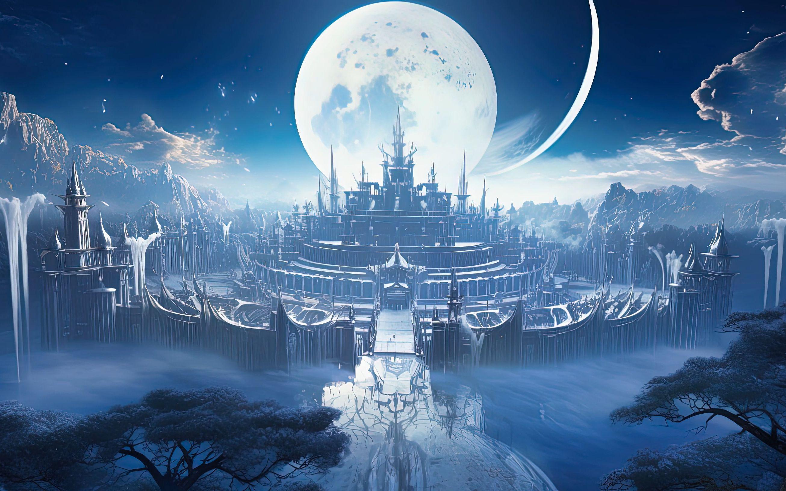

# 第一百零一章　廣寒求見

越靠近西方那輪高懸九天的銀色滿月，九曜神域的喧囂便越是退遠。

太微玉京的繁華燈火、九曜天宮的權謀暗湧、熒惑東南方的鐵血殺氣，甚至連空氣中那股令人胸口發悶的灰黑濁氣，都在彎月飛舟穿過一層如水波般清冽的銀色結界之後，被隔絕在了千里雲海之外。

這裡是廣寒月宮。

整個九曜神域最清靜、最孤高、也最接近太初星輝的地方。

飛舟緩緩降落在一片一望無際的銀白玉坪之上——月輪廣場。

廣場的地面並非太微玉京那種炫目的彩光結晶，而是整塊溫潤如脂的太陰月玉。抬頭望去，九曜之中唯有太陰銀月近在咫尺，彷彿觸手可及，清冷如水的月華自穹頂無聲傾瀉而下，落在重重疊疊、宛如冰雪與白玉雕琢而成的殿宇飛簷之上，折射出萬千道柔和而孤寂的銀輝。

沒有鐘鼓齊鳴，沒有香火鼎盛，也沒有神裔往來喧嘩。

整座廣寒月宮安靜得只能聽見星風拂過月桂林葉的細微沙沙聲，以及從極遠處某座神池裡傳來的、如潮汐呼吸般低沉而規律的水流聲。

月衛統領清霜率先步下飛舟，回身向顧淵微微一禮：「顧先生，月輪廣場已到。少宮主就在前方觀星台等候，請隨清霜來。」

顧淵步下飛舟，青衫衣擺在清冷的月風中輕輕晃動。他沿著白玉長階緩緩而上，目光平靜地打量著這座太陰聖地。

破妄真視並未刻意全開，可即便只是尋常感知，他也能清楚察覺到這座月宮的奇異之處——

這裡的空氣太乾淨了。

乾淨得幾乎有些不真實。

太微玉京裡處處可見滲透的灰黑絲線，九曜天宮裡也能看見各系神格殘留的焦渣與濁氣；唯獨廣寒月宮的外圍，彷彿被一股極其溫柔卻又極其固執的力量，日復一日、年復一年地反覆擦拭過，連一粒微塵般的雜質都不曾留下。

可是，當顧淵的視線越過重重潔白殿宇，落向月輪廣場盡頭那座高懸於星海邊緣的觀星台時，他的腳步微微頓了一瞬。

所有的「不乾淨」，都去了那裡。

---

觀星台上，立著一道身影。

清霜在十丈外的玉階前便停住了腳步，無聲欠身退去，將整座高台留給了那兩個人。

顧淵拾級而上，在距離那道身影三丈處停住。

女子緩緩轉過身來。

那是一張足以令星河失色的容顏。她身著一襲不染纖塵的月白長衣，腰間束著一條流轉著微光的銀月絲帶，長髮如墨瀑般垂落至腰際，足不染塵，彷彿隨時會隨風羽化於月色之中。她的眉眼生得極其清聖溫潤，面如滿月，鬢邊有著兩道天然生成、隨呼吸明滅流轉的淡銀色月華紋路；而那雙清澈的眼眸深處，常年泛著一層淡淡的月光，令人生出難以言喻的敬畏與安寧。

太陰神宮少宮主，廣寒月華神女——羲凰。

她站在那裡，周身並未刻意釋放五階神尊的威壓，卻自然而然地帶著一種歷經三千年歲月沉澱下來的神明威儀。那不是赤炎神君那種灼熱霸道的侵略感，也不是玄月神母那種拒人於千里之外的冰冷，而是一種高懸九天之上、垂眸俯視芸芸眾生的孤高與慈悲。

然而，在顧淵眼中，這份令人屏息的清聖背後，卻藏著觸目驚心的裂痕。

破妄真視無聲流轉。

他看見了羲凰的神格。

那本該是一輪圓滿無瑕、皎潔如霜雪的五階太陰滿月神格，底蘊之深厚、神性之純粹，甚至隱隱在赤炎神君之上。可此刻，這輪絕美的滿月之上，卻佈滿了密密麻麻、如同千年冰面被巨石砸碎般的裂紋！

最深的一道裂紋，幾乎貫穿了整個神格的核心。

數以萬計、本該屬於下界無數信徒的灰黑色信仰濁泥——貪婪、病痛、恐懼、喪親之慟、求而不得的執念——被無數條細密的太陰月華鎖鏈，硬生生從下界抽離出來，死死捆縛、封壓在這輪龜裂的滿月之中。每一息，太陰神火都在無聲燃燒，試圖洗滌這些濁泥；而每一息，濁泥都在反過來啃噬著她的神格裂口，讓那層本該光潔如玉的銀白光暈，不斷滲出極其細微的碎光。

這不是近幾年才出現的傷。

從裂紋邊緣那層近乎玉化的癒合又撕裂的痕跡來看，這輪神格已經這樣一寸一寸地碎裂、強行黏合、再碎裂，持續了至少一千年。

顧淵的心頭，微微一震。

他見過蒼律神官的三百年隱忍，見過金曜老神尊的三萬年崩潰，也見過昊天神皇的七千年無奈。可他們都是「被動承受」，是被制度推著走到了絕路。

唯有眼前這位太陰少宮主——她是清醒的、自願的、甚至帶著無比虔誠的慈悲，把千萬人的苦痛與污穢，全都攬進了自己一個人的懷裡，然後安安靜靜地，替他們爛了整整一千年。

---

羲凰靜靜打量著眼前這位青衫外客。

她沒有因為顧淵是外界人而顯出半分傲慢，也沒有因為自己剛才派清霜解了赤陽偏殿之圍而居功自傲。她只是以五階神尊對待同等存在般的莊重與平和，微微頷首：

「太陰神宮，羲凰。見過萬界樓主，顧淵先生。」

她的嗓音如月下清泉，柔和、空靈，卻在尾音深處，藏著一絲極其克制的、連她自己都早已習慣成自然的倦意。

「少宮主客氣了。」顧淵收回破妄真視，拱手一禮，語氣溫潤而平靜，「方才赤陽偏殿，多謝少宮主遣清霜姑娘解圍。」

「不必言謝。」羲凰輕聲道，目光清澈地望著他，「赤炎神君行事向來強硬，你方才若不肯屈從，他在赤陽偏殿裡未必不會借題發揮。我派清霜去請你，一來是不願見神域最後一點清醒的外界視角折損在內鬥之中；二來……」

她微微一頓，向顧淵伸出素手，做了一個請的手勢，指向觀星台邊緣的石案。案上早已備好一壺以廣寒月露烹煮的清茶，茶煙裊裊，在銀輝中散作淡淡的桂花冷香。

「二來，確實是我有事想請教先生。」

兩人於石案兩側對坐。

羲凰親自執壺，動作優雅而從容，為顧淵斟了一盞清茶。銀白的廣袖滑落半寸，露出一截纖細如玉的手腕——在常人眼中，那腕間肌膚潔白無瑕；可顧淵卻看見，在那層羊脂般的玉膚之下，一道極淡的裂紋銀光一閃而逝，隨即被她以神性強行壓了回去。

「先生來九曜神域不過十餘日，」羲凰將茶盞輕輕推至顧淵面前，開門見山，沒有半點迂迴試探，「卻做了許多九曜神明五萬年都不曾做過的事。你在泥巷待了一個下午，在神殿廣場點醒了蒼律，在療養殿看穿了信仰濁泥的三層因果，還在議政廳上當著赤炎的面，說破了日曜神火裡的焦化殘渣。」

她的目光靜靜落在顧淵臉上，眼底那層淡淡的月光微微流轉：

「九曜神域困在這套信仰制度裡太久了，久到連我們自己，都分不清這是天道，還是牢籠。我想見你，不是為了拉攏你對抗日曜神系，也不是為了向外界人求救。」

「我只是想聽聽——一個不屬於九曜神域、不受神權教條束縛的人，究竟看見了什麼。」

話說得極其坦蕩，極其清醒，帶著屬於五階神尊的尊嚴與主導權。她不是等待被拯救的弱者，而是一位走到了絕境邊緣、卻依然挺直脊背尋找答案的求道者。

顧淵端起茶盞，並沒有急著喝。

他看著茶水中倒映出的那輪銀色滿月，又抬起頭，靜靜地看著對面這位清聖如雪的神女。

他沒有談九曜天宮的權謀，沒有談信仰濁泥的三層因果，也沒有談太陰神系與日曜神系的利害。

他只是放輕了聲音，看著她的眼睛，問了一個與這一切都毫無關係的問題：

「少宮主，你上一次真正休息，是什麼時候？」

---

觀星台上的風，彷彿在這一瞬間停住了。

月桂林葉不再沙沙作響，遠處神池的潮汐低鳴也彷彿被拉得很遠很遠。

羲凰端著茶壺的素手，僵在了半空。

三千年。

自她凝聚太陰神格、接任太陰神宮少宮主之位以來，整整三千年歲月。

下界億萬信徒向她祈禱，求她賜福，求她消災，求她洗淨世間苦難；太陰神宮的長老與月衛敬她如神明，讚她仁慈清聖，視她為太陰神系最完美的繼承者；就連師尊玄月神母，每次見她，問的也只是「太陰神火可還穩固」、「本月洗滌之禮可還順利」。

從來沒有人問過她這個問題。

連她自己，都已經忘了「休息」這兩個字是什麼意思。

神明是不需要休息的。神明只要高懸天穹，承擔一切，燃燒自己，照亮眾生就好了。

可是，當這個陌生的外界男子用那樣平靜、那樣不帶半點憐憫與居高臨下、只是單純「看見了」的目光望著她，輕輕問出這句話時——

羲凰心底那道維持了三千年的、堅不可摧的清聖壁壘，忽然裂開了一道極細、卻無法忽視的縫隙。

一個連她自己都不敢承認的念頭，不受控制地從心底湧了上來：

——他看見了？

——他知道我在痛嗎？

一滴清茶從傾斜的壺嘴裡滑落，滴在白玉石案上，濺開一朵小小的、銀白色的水花。

羲凰猛地回過神來，垂下眼睫，將茶壺輕輕放回案上。她的手指收進月白廣袖之中，極輕微地顫抖了一下，隨即恢復了平日裡的端莊與平靜。

「……神明不眠，亦無需休息。」她輕聲回答，語氣依舊溫潤，卻少了一分方才的從容，多了一分連她自己都未察覺的防備，「顧先生似乎看出了什麼。」

「我有一雙能看見破綻的眼睛。」顧淵沒有逼近，也沒有趁機追問，只是如實相告，「方才走上觀星台時，我看見少宮主的神格了。」

羲凰的長睫微微一顫。

「裂了至少一千年。」顧淵語氣依舊平靜，像是在陳述一個再自然不過的事實，「而且每一道裂縫裡，都塞滿了本該屬於別人的濁泥。少宮主每個月都在替下界信徒洗滌信仰，卻沒有把它們排出去，而是全部轉移進了自己的神格裡，靠太陰神火硬生生扛著。」

「……先生的眼睛，比計都神系的命數師還要毒辣。」

羲凰沉默了足足十息，才緩緩抬起頭。

她沒有否認，也沒有像赤炎神君那樣惱羞成怒，只是望著顧淵，眼中那層淡淡的月光裡，浮現出一絲極其複雜的苦澀：

「既然先生已經看見了，那便也不必瞞著了。不錯，我的神格確實龜裂了一千兩百年。每一次月圓之夜的洗滌儀式，裂紋便會加深一分。」

「為何不停下來？」顧淵問。

「不能停。」羲凰的回答沒有半點猶豫，語氣裡甚至帶著一種令人心驚的溫柔與固執，「太陰神系執掌夢境、潮汐與慈悲。下界數十個小世界裡，每時每刻都有無數生靈在病痛、災厄與絕望中向明月祈禱。若太陰神宮停下洗滌，那些濁泥便會反噬回下界，化作瘟疫、夢魘與失控的狂潮。我多扛一分，他們便少受一分苦。」

「那你呢？」顧淵靜靜看著她，「等你這輪神格徹底碎裂、神火熄滅的那一天，下界那數十個小世界，又該由誰來扛？」

羲凰微微一怔，唇瓣輕啟，卻一時說不出話來。

她想起曾經有位年輕的月衛長老，也曾小心翼翼地問過她類似的問題——『少宮主，您的神格何時能痊癒？』

那時候，她站在月輪廣場上，望著漫天星河，平靜地回答：『等眾生的苦難止息之日。』

長老又問：『那要等到何時？』

她說：『我也不知道。所以我無法停。』

可此刻，面對眼前這個青衫客平靜的目光，這句她篤信了三千年的回答，卻忽然顯得有些蒼白。

「……我不知道。」羲凰垂眸看著自己茶盞裡微微晃動的月影，聲音輕得像一縷月煙，「所以我才請先生來廣寒月宮。」

她抬起頭，眼中重新凝聚起五階神尊特有的清澈與決意，定定望著顧淵：

「三日後，便是本月月圓之夜，太陰神宮的信仰洗滌儀式將如期在太陰神格池舉行。若先生不嫌叨擾，這幾日便請暫住廣寒月宮。」

「我希望先生能親眼看看我們的儀式，看看這套太陰神系運行了五萬年的法門——然後告訴我，除了這樣一點一點地燃燒自己，神明究竟還有沒有第二條路可走。」

顧淵靜靜看著她。

他看見這位清聖孤高的神女，在說出這句話時，眉宇間那抹壓抑了千年的孤寂，似乎終於找到了一個可以並肩而立的傾聽者。

沒有卑微的祈求，沒有交換條件的算計，只是一顆走到盡頭、卻依然不肯放棄眾生的神心，向他敞開了一道門。

顧淵端起案上那盞微涼的月露清茶，一飲而盡。

茶水清冽甘甜，入喉卻帶著一絲極淡的苦澀——正如這座廣寒月宮。

「好。」顧淵放下茶盞，對著她溫潤一笑，「這幾日，便叨擾少宮主了。」

羲凰看著他平靜而沉穩的眉眼，緊繃了千年的肩線，在無人察覺的瞬間，極其細微地鬆開了一寸。

「清霜已為先生備好靜室，就在月桂林旁的『聽潮閣』。」她站起身，月白神袍在星風中輕輕拂動，恢復了太陰少宮主的清聖儀態，「明日辰時，我帶先生去玄月殿見過師尊，再往太陰神格池一觀。」

說罷，她微微頷首，轉身步下觀星台。

看著那道清瘦而挺拔的月白背影漸漸融進銀白色的月華之中，顧淵獨自留在觀星台上，望著腳下浩瀚無垠的雲海星河，久久未動。

「主人，」腰間玉佩微微發熱，靈素的聲音輕輕響起，帶著少見的心疼，「這位月宮姐姐……看起來好累啊。比剛才那個壞脾氣的火神君好一萬倍，可是她身上……怎麼比誰都碎得厲害呢？」

「因為這世上，」顧淵輕聲道，眸光深邃，「最容易碎的，從來不是最硬的石頭，而是最捨不得放手的人。」

他合上折扇，轉身步下觀星台，走向月桂林深處的聽潮閣。

月色如水，廣寒宮的長夜，才剛剛開始。

（第一百零一章　完）
