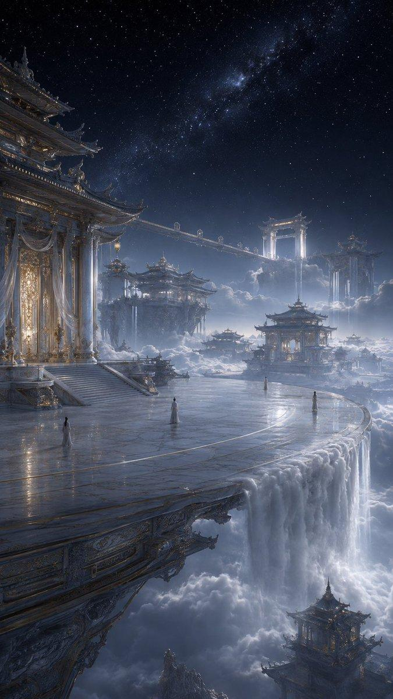

# 第一百零四章　自救之路

星河觀景台，建在廣寒月宮最高處的月輪之巔。

這裡沒有屋頂，也沒有雕樑畫棟，只有一方以整塊白玉雕成的圓形高台，懸空探出於無盡星海之外。站在台邊，腳下是翻騰流轉的億萬里銀色雲海，頭頂是浩瀚璀璨、觸手可及的諸天星河。

明日便是月圓之夜。

太陰銀月的光華已然圓滿至極致，如水銀般無聲傾瀉在玉台之上，將整個世界浸染得一片靜謐而空靈。

顧淵踏上玉台時，羲凰已經站在欄杆邊等候。

今夜的她沒有穿那身繁複沉重的少宮主禮袍，只著一襲素白輕紗長衣，外披一件薄如蟬翼的銀絲披帛。夜風輕輕拂過，衣袂與墨髮在星輝中微微揚起，令她看起來少了一分高不可攀的神明威儀，多了一分真實而易碎的清雅。

聽見腳步聲，她緩緩轉過身，望著顧淵走近。

經過昨日羲凰神殿那一場長談，兩人之間那層無形的隔閡已然消散了大半。

「這裡是廣寒月宮最安靜的地方。」羲凰輕聲道，「平時除了我，連清霜也不會上來。在這裡，沒有下界祈禱的雜音，也沒有神殿的規矩。」

顧淵走到她身側，抬頭看了一眼頭頂流轉的星河，溫聲道：「很美的地方。少宮主平時累了，便會來這裡？」

「以前不會。」羲凰垂眸看著玉台地面上的月影，極輕地笑了笑，「以前我總覺得，站在這裡看星河，是浪費時間。有這半個時辰，不如多煉化幾縷神池裡的濁泥。」

「現在呢？」

「現在……」她抬起眼，清澈的眸子在星輝下映出顧淵沉靜的輪廓，「我站了半個時辰，發現下界並沒有因為我停下來半個時辰，就天塌地陷。」

顧淵聞言，眼底漾開一抹溫潤的笑意：「這是個很好的開始。」

兩人於玉台中央相對盤膝而坐。

星風柔和，月華如水。

「少宮主，」顧淵神色漸趨鄭重，溫聲道，「待會兒我會以破妄真視，配合一縷神念，深入探查你這輪太陰神格的裂紋結構。神格是神明最私密、也最脆弱的核心，一旦敞開防禦，便等於將性命交到對方手上。若你此刻覺得不安，隨時可以叫停。」

羲凰靜靜看著他。

三千年來，從沒有任何存在觸碰過她的神格——即便是師尊玄月神母，也只在她初成神格時指點過一二。對神明而言，向一個外界男子敞開神格防禦，幾乎違背了所有刻在骨子裡的本能與神殿鐵律。

然而，望著眼前這雙深邃、平靜、毫無半分窺伺或佔有欲的眼睛，羲凰心頭竟沒有絲毫猶豫。

她緩緩閉上雙眼，主動撤去了環繞在神格之外的重重太陰防禦禁制，輕聲道：

「請吧，顧先生。」

---

顧淵深吸一口氣，緩緩抬起右手，食指與中指併攏，隔空輕輕點在羲凰眉心三寸之外。

並未觸碰肌膚，唯有一縷溫潤如春水、清澈如混沌初開的神念，隨著破妄真視的視野，悄無聲息地渡入了她的太陰神格之中。

一瞬間，兩人的感知彷彿同時墜入了一片廣袤無垠的銀白冰雪世界。

那是羲凰的神格內景。

本該是一片如明鏡般澄澈、倒映著萬千星河的太陰月海。可此刻，這片月海卻早已凍結成無數塊大小不一的碎冰，一道道深不見底的漆黑溝壑橫貫冰面！在每一道溝壑之下，濃稠如墨、滾燙翻湧的灰黑色信仰濁泥正不斷往上冒著氣泡，試圖沖毀搖搖欲墜的冰層。

而在冰海的最中央，一簇已經微弱到近乎熄滅的冰藍神火，正孤零零地燃燒著，每一次跳動都透出令人心碎的疲憊與劇痛。

顧淵的神念輕輕拂過那些冰層與裂紋。

破妄真視在這一刻運轉到了極致——他不再以九曜神域的「神性與信仰」去看待這一切，而是以萬界樓的「本源與因果法則」，將每一道裂紋的成因、每一縷濁泥的流向、以及太陰神火消耗的軌跡，逐一拆解、映照出來，同時透過神念，清清楚楚地同步給了羲凰自己！

羲凰在神念中「看見」了自己的神格。

即便她自己承受了一千兩百年的劇痛，可這卻是她第一次如此清晰、如此赤裸地從外部視角看見自己神格的真實模樣——

那根本不是什麼「清聖莊嚴的太陰神格」，而是一座千瘡百孔、隨時會徹底崩塌的冰城！

「少宮主，你看這裡。」

顧淵沉穩而溫和的聲音，直接響起在她的神念深處，帶著一種奇異的安撫力量，竟讓那些原本躁動不安的灰黑濁泥都稍稍平靜了幾分。

「你看每一道裂紋的邊緣。它們並不是被濁泥『咬』開的。」

羲凰在神念中微微一怔：「不是？」

「不是。」顧淵引導著她的感知，聚焦在最大那道貫穿核心的漆黑溝壑邊緣，「你仔細看——每一次濁泥湧入，你的太陰神火都本能地築起一道最硬、最冷的冰牆，試圖把它們徹底隔絕在你的神性之外。可濁泥是活著的情緒，是流動的潮汐。你築的牆越硬，它們撞上來時的反震就越猛。這一千兩百年來，震碎你神格的，一半是濁泥的重量，另一半……是你自己築起來、用來排斥七情六慾的『冰牆』。」

羲凰的神念劇烈震顫了一下。

在破妄真視那毫無保留的法則映照下，真相清晰得容不得半點辯駁——

每一次她默念太陰古訓、壓抑內心的悲憫與不忍、強行用冰冷的神火將眾生情緒封死在裂縫裡時，那些冰牆就會因為過度緊繃而崩裂出新的細縫！

「那……該怎麼辦？」羲凰在神念中低聲問，聲音裡第一次透出了一種毫無防備的迷茫，「若不築起冰牆，這些怨念與恐懼就會直接湧進我的神性本源裡。古訓說，一旦神性被濁泥沾染，我就會失去清明，徹底墮落……」

「那是因為你沒有給它們修『河道』。」

顧淵的神念緩緩向前，輕輕停留在那簇孤獨燃燒的冰藍神火旁。

他並沒有強行用混沌本源去替她抹平裂紋——他很清楚，外力強行修補的裂紋，只要她的神道觀念不變，下個月圓之夜照樣會重新裂開。

他只是用自己那縷帶著人間煙火氣、帶著溫熱與清醒的神念，輕輕引導著裂縫裡最邊緣的一縷灰黑濁泥——那是一位凡人母親對生病幼子的恐懼與牽掛。

顧淵沒有阻攔它，也沒有用火去燒它，而是讓這縷情緒，緩緩流過自己那縷溫潤的混沌神念。

接觸。感受。理解。

恐懼背後是愛，牽掛背後是不捨，悲傷背後是珍惜。

當這縷灰黑濁泥被真正地「理解」而非「恐懼排斥」的那一瞬間——

奇異的事情發生了。

那縷原本冰冷刺骨、充滿尖刺的灰黑濁氣，竟在顧淵的神念之中如春雪遇陽般悄然融化，褪去了所有灰暗與躁動，重新化作了一縷極其純粹、溫潤如玉的暖白色願力，緩緩飄散開來，反過來輕輕滋養了旁邊那簇疲憊的冰藍神火！

羲凰整個人猛地一震！

她在神念中清清楚楚地感受到了那一瞬的變化——不是焚燒後的焦渣，不是壓制後的隱患，而是真正的**轉化**！那縷本該刺痛她的濁泥，在流過之後，竟然讓她冰冷了千年的神格，感受到了一絲久違的、近乎淚目的溫暖！

「這就是『接觸、理解與轉化』。」顧淵緩緩收回神念，破妄真視徐徐收斂。

觀景台上，兩人同時睜開了雙眼。

銀白的月華靜靜灑在兩人之間。

顧淵收回手指，目光溫潤而平靜地看著眼前這位眼眸中滿是震撼的太陰少宮主：

「少宮主，濁泥無法被消滅，也不該被關在冰牆裡。你唯一能救自己、也真正能救下界眾生的辦法，就是在你的神格之中，拆掉那些用來恐懼七情六慾的冰牆，重新開闢出一條『轉化之河』。」

「可是，」顧淵神色鄭重，沒有半點隱瞞，「要開闢這條河，靠你一個人憑空想像凡人的喜怒哀樂，是做不到的。你必須自己先真正地活過、感受過七情六慾——有所愛，有所依戀，有所痛，有所喜悅，讓你的神格記住『真正的情緒流過神魂卻不迷失本心』究竟是什麼感覺。」

說到這裡，顧淵微微一頓，目光澄澈地直視著她的眼睛：

「我能以混沌本源與破妄真視幫你護住神格核心、替你引導最初的轉化路徑。我能幫你——但你需要先願意讓自己被幫助。」

---

觀景台上一片寂靜，唯有浩瀚星風輕輕拂過兩人的衣袂。

羲凰靜靜坐著，雙手交疊在膝上。

許久，許久。

這位在九曜神域高高在上三千年、面對五階神尊與億萬信徒從未動搖過半分威儀的太陰少宮主，忽然輕輕閉上眼睛，長長地、極其疲憊地吐出了一口氣。

彷彿壓在肩頭整整一千兩百年的無形巨石，終於在這一刻被人看見了，也被她自己暫時放下了。

當她再次睜開眼時，眉宇間那層常年緊繃的清冷與孤高徹底褪去，露出了一抹近乎脆弱、卻又無比真實的疲憊苦笑。

「我試過很多方法，」她的聲音很輕，輕得像是怕驚動這片寧靜的星河，「我翻遍了太陰神宮五萬年的古籍，試過以萬年玄冰鎮壓，試過向師尊求問，試過用太陰神火日夜自焚……都沒用。裂紋只會越來越多，痛只會越來越深。」

她抬起眸子，眼底那層淡淡的月光裡，第一次映出了一個具體而清晰的人影，帶著幾分卸下防備後的輕盈與試探：

「顧淵——你確定嗎？」

她沒有再叫他「顧先生」。

這是她第一次，直呼他的名字。

顧淵看著她那抹疲憊卻終於輕鬆下來的淺笑，心中微軟，神色卻依然坦誠得沒有半點虛言。

「不確定。」他如實道，「五萬年來沒人走過這條路，我也是第一次替神域的神尊修補神格。我不能向你保證萬無一失。」

他頓了頓，唇角勾起一抹溫潤而篤定的弧度：

「但我知道，你現在的方法，一定會失敗。」

羲凰聞言，怔了半息。

隨即，她真的笑了出來。

那不是端莊克制的神女微笑，也不是方才帶著苦澀的自嘲，而是一聲極輕、極清澈、彷彿卸下了三千年重擔後的釋然輕笑。她眼角微彎，鬢邊那兩道天然的銀色月華紋路，在這一刻竟奇異地亮了幾分，如星辰重煥生機。

「你這個人，」她輕聲說，語氣裡甚至帶上了一絲極難得見的柔和打趣，「明明在勸我走一條從沒人走過的險路，卻連一句哄人的保證都不肯說。」

「說了假話，就不是幫你了。」顧淵溫聲道，「少宮主是自己做決定的人，不需要別人用假話哄著往前走。」

羲凰凝望著他，靜靜看了很久。

三千年來，所有人都在仰望她、依賴她、要求她、或者像師尊那樣用沉默保護她。唯獨這個來自異界的男子，既不仰望她，也不憐憫她，只是平靜地坐在她對面，看穿她的痛，點破她的錯，然後坦坦蕩蕩地把選擇權放回她自己手裡。

她忽然明白了自己為何會在赤陽偏殿那一刻，破天荒地派出清霜去請他。

也許早在聽說他走進太微玉京泥巷的那一天起，她心底某個沉睡了三千年的角落，就已經在等這樣一個人了。

「明日，便是月圓之夜。」

羲凰緩緩站起身，走到玉台邊緣，仰頭望向那輪近乎圓滿、清輝萬丈的太陰銀月。

「按例，明日月圓之夜，我該獨自前往太陰神格池，繼續替下界眾生承受這一月的濁泥。」她轉過身，月白長衣在星風中輕輕飛揚，清澈的眼眸裡閃爍著前所未有的堅定與光亮，「但這一次，我不想再做那隻裝滿污穢的容器，也不想再做那盞只會冒煙的油燈。」

她看著顧淵，語氣莊重而溫柔，彷彿在許下一個震動三千年歲月的決定：

「顧淵，明日月圓之夜，來羲凰神殿吧。」

「這一次，不是請你來幫我洗滌神池——而是請你，與我一起，走這第一步。」

顧淵站起身，迎著她清澈如月華般的目光，鄭重頷首：

「好。明日月圓，我必如約而至。」

星河無聲流轉，廣寒月宮之上，千年的寒冰終於在今夜悄然解凍。

而在遙遠的玄月殿深處，始終閉目靜坐的玄月神母，彷彿感應到了月輪之巔那一縷久違的、不再冰冷死寂的太陰氣息波動，長睫極其輕微地顫動了一下。

她沒有睜眼，也沒有阻止。

只是在寂靜無聲的大殿裡，極輕、極緩地嘆了一口氣。

（第一百零四章　完）
