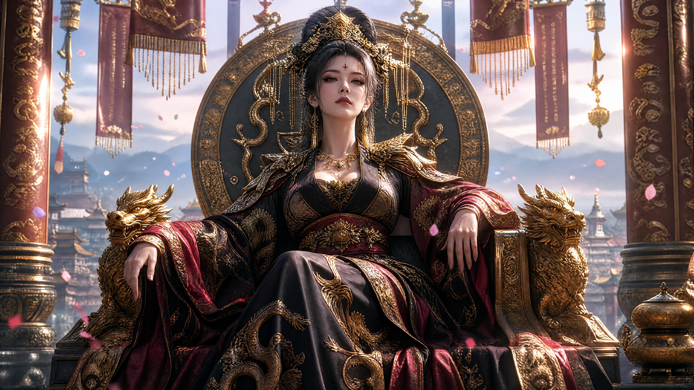

# 第一百一十六章　真龍歸位

## 一

當姬明月的掌心完全契合在神座印記上的那一瞬間，整座幽暗死寂的石室之內，時間的流速彷彿在剎那間陷入了停滯。

那不是尋常狂暴靈力衝入經脈時的撕裂與刺痛。

而是一種極為深沉、極為厚重、如同血脈歸宗一般的「靈肉對接」——就像是一柄流落在浩瀚諸天數千年的傳世皇道神劍，在歷經無數次風霜洗禮與血火淬煉之後，終於嚴絲合縫、分毫不差地插回了它原本所屬的至高劍鞘之中。

「昂————！！」

一聲高亢清越、穿透神魂與虛空維度的太古龍吟之聲，自神座最深處轟然響徹雲霄！

兩側扶手之上雕刻的兩條天曜紫龍，在此刻徹底化作了栩栩如生的真靈活物。長達數十丈的金色神龍虛影自玄石深處騰空而起，龍鱗熠熠生輝，帶著至剛至陽的至尊威儀，圍繞著姬明月的周身盤旋長嘯。

神座基台四周，原本被顧淵以混沌大陣死死壓制在邊緣的億萬信仰濁泥，在接觸到這股純正無暇的太古皇道神芒的剎那，如同滾燙烈陽下的殘冬積雪，發出無數聲微弱的嗤嗤輕響，迅速消融瓦解，化作了一縷縷被徹底淨化後的純白願力煙霞，繚繞在空曠宏偉的殿堂四周。

「轟隆隆——！」

一道直徑足有十丈的純金色神道光柱，自紫薇天關之頂破空而起！

這道光柱撕裂了天關厚重的萬載穹頂，洞穿了太微玉京上空那由九大星曜法則交織而成的厚重雲海，直插九天無垠星海，將整座懸浮於雲端之上的神話古城，映照得如同披上了一層璀璨奪目的金色霞衣。

整座太微玉京浮島地脈，在這一刻發出了歡欣鼓舞的長鳴！

「成了。」

顧淵立於階梯之下，長身玉立，目光清澈如深潭。

看著那沐浴在漫天金霞神光之中的女子，他的唇角泛起了一抹發自內心的釋然微笑。

石階之上，金芒漸漸向內收斂。

姬明月緩緩收回了自己的右手。

只見在她白皙如羊脂美玉般的右掌手心正中，一道極其精緻繁複、栩栩如生的金色真龍道紋悄然隱入皮下，化作了一枚散發著溫潤熱流的微小印記。

而她原本便冷峻高貴的絕美容顏之上，在此刻更是多了一種與整座神話文明底層法則水乳交融的厚重威儀。

那是天曜正統至高神座的權柄印記！

自這一刻起，她姬明月不再只是一位來自下界微末世界的人間帝王，而是真正手握九曜至高法理、位格等同於九大星曜神君的——**天曜神裔超然代表**！

---

## 二

金色天柱破空而起、撕裂神域天穹的浩瀚異象，根本無法遮掩，亦毋須遮掩。

整個太微玉京，在短暫陷入了一瞬極致的死寂之後，徹底爆發出了一場前所未有的滔天巨震！

太微玉京下層，繁雜喧囂的神裔市集之中。

數以萬計正在攤位前為了幾枚香火神晶爭得面紅耳赤的底層神裔商販、散修神官，在此刻齊刷刷停下了手中的動作，滿臉駭然地抬起頭，望向浮城第五層那道貫穿天地的真龍金柱。

「那……那是天曜神殿的真龍皇道金光？！」

一位活了近千年的龜族老神裔，嘴裡叼著的青玉煙斗啪嗒一聲掉落在石板地上，摔成碎屑，老臉上的皺紋因為極度的激動而劇烈抽搐著：

「三千年了！整整三千年了啊！

自從當年天曜神系在大戰中崩解覆滅，紫薇天關就徹底化作了生人勿進的絕命禁地……

歷代各大神系選拔了多少天驕神將前去叩門，無一例外皆被煞氣轟碎道心！

今天……今天到底是哪一位無上存在，竟然讓那座沉睡了三千年的神座真正認主了？！」

而在太微玉京最頂層的九曜天宮之內，氣氛更是壓抑沉重到了令人窒息的冰點。

日曜神殿最高處的議政高台上，赤炎神君猛地推開雕花玉窗，那一頭赤紅如烈火的長髮無風狂舞。

他那雙燃燒著暴虐神火的赤紅雙眸，死死鎖定在紫薇天關的方向，眼中滿是無法置信的狂怒與驚疑：

「紫薇天關重啟？神座認主？！

到底是誰？！玄水那老烏龜一直在本君眼皮底下，厚土神君昨夜才閉關，太陰宮的玄月更是從不插手外務……難道是廣寒宮的羲凰？！

不對！羲凰修的是太陰月華大道，純陰之體，絕無可能激發至剛至陽的真龍神印！」

站在身後瑟瑟發抖的神將統領噗通一聲跪倒在地，顫聲回報：

「回……回稟神君！方才守關神衛傳來絕密飛劍傳訊……大約一個時辰之前，廣寒宮的羲凰少宮主，曾親自陪同那幾位來自界外的人族修士……

其中，有一名身穿凡俗帝王服飾、自稱來自下界大乾皇朝的人間女帝，持有特殊血脈信物，踏入了紫薇天關的禁制走廊！」

「人間女帝？！大乾？！」

赤炎神君臉上的肌肉狠狠抽搐了一下，手掌猛地一捏，直接將窗欞上的萬載神玉捏成了一蓬齲粉：

「荒唐！簡直荒天下之大謬！

區區一個從蠻荒下界爬上來的凡胎肉體，連真神都不是的螻蟻，也敢染指我九曜神話文明的至高神座？！

傳我神君令！調集日曜先鋒衛八百精銳，立刻給本君封鎖紫薇天關唯一的出口！

本君要親自看看，到底是什麼樣的邪魔妖孽，敢在大議前夕動搖我神域乾坤！」

「赤炎神君，切莫自誤。」

一道幽冷莫測的聲音，突兀地自大殿角落的黑影中幽幽傳出。

羅睺神系的使者身披黑色斗篷，無聲無息地自陰影中浮現，那雙隱藏在兜帽下的眼眸泛著詭異的幽光：

「神座認主，乃是九曜底層天道法則的自主抉擇。天地共鳴，萬道來朝。

你現在調動私兵封鎖天關，豈不是當著整座神域諸神的面，公然蔑視天道法理？

更何況……昊天神皇陛下如今雖壽元將盡，但混元神目依然監察諸天。四日之後便是九曜神王大議，神君若在此時落下擅起私兵、圍攻同階的罪名，那神王之位，可就真與你日曜神系徹底無緣了。」

赤炎神君聞言，身軀猛然一僵。

他胸口劇烈起伏了數次，握著腰間神劍的手指指節泛白，發出咯吱咯吱的脆響。

良久，他才重重地冷哼了一聲，眼中的殺意卻愈發森寒：

「走！隨本君去紫薇天關廣場！本君倒要當面會一會，這位來自凡俗人間的『天曜新貴』！」

---

## 三

紫薇天關，古老石室之內。

漫天翻湧的金色神芒與紫氣，在此刻終於如同百川歸海般，盡數沒入了姬明月掌心那一枚細小的龍紋之中。

狂暴的法則波動平息了下來，整座石室重歸寧靜。

姬明月自高高的九級基台之上，邁著沉穩的步伐，一步一步緩緩走下。

她的鳳目微垂，雖然臉色依舊透著幾分神魂極度透支後的蒼白，周身氣息卻比進入石室之前凝練、厚重了不知多少倍。那是一種自骨髓深處散發出的超凡脫俗，隱隱與整座神域的大地深處產生著某種神秘的共振。

來到階梯下方，她停在了顧淵身前三步之處。

兩人的目光在昏暗的石室中交匯。

「感覺如何？」顧淵溫聲笑問，神態一如既往的從容不迫。

「很奇妙，」姬明月抬起右手，看著掌心那道微微發燙的真龍金印，輕聲說道：

「神座內部沉澱的力量，龐大得難以想象。我能清晰地感知到整座紫薇天關深處每一條地脈靈脈的流動，甚至……能隱約感應到太微玉京下方，那九條支撐著這座浮島的神系地脈。

這座神座留給我的權限，遠遠超出了我原本的預料。」

「天曜神系當年本就是神話文明之首，執掌至高裁決與秩序之權，」顧淵負手而立，眼中帶著洞悉萬古的通透：

「若非當年那一場神秘大劫將天曜一脈徹底打散，今日的神王殿，本該由天曜一脈入主。你得到了這座神座的完全認可，在法理與位格層面上，已經足以與太微玉京那九大正統神君平起平坐，甚至猶有過之。」

姬明月微微頷首。

她看著眼前這個始終面帶微笑、彷彿天塌下來也能一肩挑之的白衣青年，沉默了片刻。

隨後，這位向來殺伐果斷、威嚴莫測的人間女帝，忽然輕輕抿了抿唇，用一種只有兩個人才能聽見的聲音低語道：

「剛才在神座的心魔試煉裡……我看到安陽了。」

顧淵神色平靜，沒有打斷，只是溫柔地注視著她。

「我看見了許多我過去為了維持大乾江山社稷，不得不做出的那些冰冷決策。我看見了那些流淌的鮮血，看見了那些被我親手推入深淵的人，」姬明月眼簾微垂，唇角勾起一抹極淡、卻極其真實的苦澀：

「神座問我後不後悔。

顧淵……我告訴它，我後悔。

我每一天都在後悔，但我告訴它，即便如此，我也絕不會退縮半步。」

顧淵看著她那張在微光下明艷不可方物的面龐，伸出手，極其自然地替她輕輕撫平了被狂風吹亂的一縷鬢髮：

「能在至高力量的拷問面前，坦然承認自己的悔恨，卻依然有勇氣背負這一切罪孽繼續前行……明月，這正是我欣賞你的地方。

正因為你知道代價有多重，你才不會像這神域那些自命不凡的神明一樣，將凡俗當作冰冷的數字與芻狗。」

姬明月嬌軀微微一顫。

顧淵手指傳來的溫暖，順著她的鬢角肌膚，無聲無息地淌入了她冰封已久的心房。

登基十三年，天下萬民敬她、畏她、怨她、仰望她。

從來沒有人，能透過那件冰冷沉重的黃金龍袍，看到她心底那些經年累月結痂的傷口，更沒有人能以如此平等而包容的姿態，肯定她身為帝王所有的脆弱與堅持。

一抹極淡的緋紅，悄然自女帝晶瑩如玉的耳根處蔓延開來。

她極不自然地別開了目光，輕輕吸了口氣，強自恢復了大乾女帝的從容風度：

「走吧。外面的動靜鬧得這麼大，太微玉京那些高高在上的神明，恐怕已經按捺不住了。」

---

## 四

推開沉重封閉的石室大門，重新步入紫薇天關的外廊。

洛寒衣抱劍斜靠在斑駁的石壁邊緣，聽見腳步聲，緩緩睜開了雙眸。

她上下打量了姬明月一眼，目光在姬明月掌心那一抹若隱若現的金色龍紋上停頓了半息，那張向來冷若冰霜的俏臉上，難得浮現出一抹極淡的笑意：

「動靜鬧得挺大。剛才我在門外，感覺整座浮島都跟著晃了三晃。看來，是成了？」

姬明月對著洛寒衣微微欠身一禮：「洛前輩護法辛苦。」

「我不辛苦，拔劍的是顧淵，扛雷的是你，」洛寒衣懶洋洋地站直身子，抬手拍了拍腰間的斷星古劍，語氣帶著幾分戲謔：

「辛苦的是外面那群神棍。剛才至少有二十多道五階神魂的神念試圖強行滲透進來探查，全被我和這座古天關的被動防禦結界給生生彈回去了。

現在天關外面的白玉廣場上，黑壓壓圍了幾千號人，可都在等著看這位新任的『天曜之主』到底是何方神聖呢。」

顧淵與姬明月對視一眼，兩人皆是淡淡一笑。

「既然都等著，那便出去見見吧。」顧淵道。

三人並肩沿著長長的走廊，向著紫薇天關的大門走去。

當那一扇高達三丈、銘刻著無數太古神文的巨型石門被從內緩緩推開的剎那，午後無比耀眼灼熱的金色陽光，呼嘯著傾瀉而入！

在石階下方那片佔地數千丈的白玉廣場之上，早已被各色神光、戰旗與神衛軍團徹底填滿！

日曜神系的赤炎烈火衛、玄水神系的碧波神將、太陰神宮的月影使者……甚至還有無數來自太微玉京下層的散修神官與世家巨頭，將整個廣場圍得水洩不通！

而在人群最前方，赤炎神君一身刺目奪目的赤金戰鎧，手按腰間神火寶劍，大步邁出，五階神君的磅礴神威如同翻江倒海般，向著剛踏出門檻的三人轟然壓落！

「紫薇天關乃神話祖地，沉寂三千年不許生靈擅入！」

赤炎神君那洪鐘大呂般的暴喝聲，在神力加持下響徹九霄，震得四周空間嗡嗡作響：

「爾等何方妖孽，竟敢趁神皇陛下垂暮之際，竊取天曜神座道統？！

還不快快束手就擒，隨本君前往神王殿聽候發落？！」

面對那排山倒海般碾壓而來的神君威壓，換作尋常初入神域的凡夫俗子，早已雙膝碎裂、跪伏在地。

但姬明月只是神色自若地邁步上前。

她越過了顧淵的身位，孤身一人，站在了紫薇天關最高一級的漢白玉石階邊緣。

長風獵獵，將她那一襲暗底紫金雲紋帝袍吹拂得宛如一面獵獵作響的天子旌旗。她頭頂的金龍步搖在陽光下灑下萬道光斑，那一雙冰冷威嚴的鳳眸，居高臨下地俯視著階下怒氣衝衝的赤炎神君。

下一刻，姬明月抬起了右手。

「昂————！！」

掌心深處，那道真龍神印爆發出刺目欲盲的璀璨紫金神芒！

一條長達百丈、栩栩如生、周身繚繞著混沌雷火的天曜五爪真龍虛影，自她背後的天空轟然顯化！龍首高昂入雲，一雙金色的龍瞳漠然俯瞰著下方的諸神軍團，散發出一股源自太古原初、甚至超越了當代九曜神系的至高皇道法則！

「砰！」

赤炎神君釋放出的滔天火海威壓，在撞上這道真龍神芒的瞬間，宛如薄冰撞上了滾燙的沸水，瞬間崩碎湮滅！

姬明月俯瞰著階下數千名神色呆滯震撼的神域強者，清越威嚴的聲音，如同天道敕令般清晰落入每一個人的靈魂深處：

「大乾皇帝，姬明月。」

「朕承天曜神座正統，繼紫薇天關萬載大統！」

「大乾與天曜，世代一體；朕之神座，乃天地所授，萬道所歸！」

她鳳眸如刀，冰冷的目光直直刺入赤炎神君那陰沉無比的雙眼之中：

「四日之後，九曜神王大議，朕自會以天曜代表之身份，列席參政！」

「赤炎神君，你……有何資格，在此饒舌？！」

全場，一片死寂！

赤炎神君身軀劇烈顫抖，看著天空中那盤旋長嘯的紫金天龍，臉色紅一陣白一陣。

天道共鳴，神印天成！

在九曜神域傳承了數萬年的古老神聖律法之中，手握正統神座印記之人，其地位天然等同於各大星曜神系的神君至尊！

縱然他赤炎身為日曜之主、神王位最有力的競爭者，在全城神裔諸神的親眼見證之下，也絕無任何藉口與法理，敢向一位合法的神座之主強加罪名！

「……好！好一個大乾女帝！」

良久，赤炎神君從牙縫裡擠出幾句森寒入骨的話語，雙目噴火：

「既然閣下自詡天曜之主，四日之後的神王大殿之上，本君自會親自領教閣下的大道高論！我們走！」

赤炎神君猛然一甩猩紅戰袍，帶著麾下數百名精銳神將，面色鐵青地灰溜溜破空離去。

廣場之上，無數神官長老在敬畏與震撼中紛紛退避行禮。

太微玉京的天空在這一刻風雲變幻，所有人都在心頭明悟——四日之後的那一場九曜神王大議，因為這位突然自凡俗人間殺出的人間女帝，必將迎來一場將整座神話文明徹底洗牌的狂風暴雨！

---

## 五

回到客棧的頂層精舍之時，天色已近黃昏。

夕陽如血，將太微玉京那層層疊疊的浮島建築染成了一片蒼茫的暖金色。

洛寒衣獨自一人提了一壺神域烈酒，躍上了精舍屋頂的飛簷之上，背靠著雕花屋脊，一邊吹著高空的長風，一邊安靜地擦拭著她的斷星古劍。

屋內，姬明月站在寬大的紫檀書案前。

她將白日在紫薇天關石壁上親手拓印下來的二十七行太古銘文整齊鋪開，手持硃砂神筆，就著案頭搖曳的燈火，以大乾帝王的深邃視角，一行一行地推演著九曜神域與大乾皇朝未來的命脈走向。

顧淵端著一盞剛沏好的竹葉清茶走入屋內，輕輕放在她的几案之旁。

「赤炎神君此人暴烈自傲，今日當眾受辱，四日後的大議之上，他必定會聯合保守神系，對你的天曜代表身份與信仰份額發難。」顧淵溫和提醒道。

姬明月握筆的手未曾停歇，筆鋒在宣紙上帶起一道道金戈鐵馬般的凌厲線條：

「朕知道。他們爭的是誰能成為下一尊神王，爭的是如何瓜分眾生的香火份額；

而朕在大議上要做的，不是與他們搶食……

朕要告訴九曜這群自命不凡的神明——神王那個至高無上的寶座，從今往後，本就不該再有人坐上去！」

顧淵眼中閃過一抹由衷的讚賞之色：「這套三權分立、神道共治的體制，凡俗帝國走過，但這群活了幾萬年、高高在上的神明，可未必能聽得進去。」

「聽不進去，那便打到他們不得不聽，」姬明月擱下硃砂筆，揉了揉略顯疲憊的眉心。

她轉過身來，看著站在身前的白衣男子。窗外的落日餘暉灑在她身上，將她那清冷端莊的容顏襯托得柔美萬千：

「不過……在去應對那場風暴之前，有些事情，我想先在你的見證下，讓它真正地落穩。」

顧淵心神微動，笑問道：「什麼事？」

姬明月走到窗前，抬頭望向遠處天穹之上那一輪剛剛升起的太陰冷月，聲音很輕，卻帶著一種唯獨在顧淵面前才會流露出的繾綣與信賴：

「天曜神格雖然認主，但我體內的真龍血脈與神座大道，終究隔了一層三千年的隔閡……

今夜無外人，亦無大議喧囂。

紫薇天關內部的行宮秘境，是天曜一脈歷代至尊最私密的大道溫養之所……

顧淵……今夜，陪我走一趟。」

（第一百一十六章　完）
