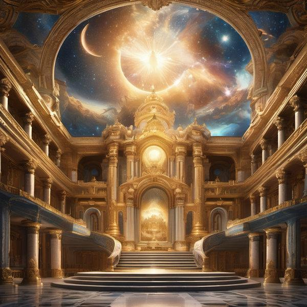

# 第一百一十七章　龍威卸防

## 一

紫薇天關深處，行宮秘境。

穿過那一扇鐫刻著太古九星運轉軌跡與周天星宿圖的重重青銅宮門，外界太微玉京的所有殺伐暗流、諸神爭吵與喧囂風暴，在這一刻被徹底阻隔於時空維度之外。

這是一處專屬於遠古天曜神系統御者的私密獨立浮島秘境。

門扉在兩人身後無聲合攏之際，沿途廊柱上沉寂了三千年的紫金星燈竟像是認出了歸來的主人一般，隨著姬明月掌心那枚微燙的真龍道紋一盞盞順次亮起，將這條通往秘境深處的玉石長階映照得流光溢彩。

長廊兩側的玄玉壁畫之上，雕刻著遠古天曜神裔馭龍巡天、立定乾坤的太古圖騰。當姬明月赤足走過壁畫前時，壁面那些原本暗淡失色的金紋龍睛竟同時微微一亮，彷彿跨越三千年的時空向這位流落人間、又憑一己意志重新走回高天之上的後裔無聲俯首。

姬明月的腳步在最後一幅壁畫前極輕地停了一瞬。那畫上刻著一位身披龍袍、卻孤身面向漫天星辰的背影——像極了大乾太祖留在皇陵深處的殘碑拓片，也像極了她自己十三歲登基以來的無數個長夜。

長階盡頭，是一方遼闊得令人屏息的天地。

天穹之上沒有九曜神域常見的那種暴烈刺目的九星光芒，只有一片宛如深邃紫玉雕琢而成的靜謐夜空。夜空的正中央，懸浮著一輪直徑百丈、散發著溫潤柔和微光的微縮太古暖陽。金色的霞光如細碎的碎金，靜靜灑落在一片方圓數百丈、由萬載溫玉無瑕鋪就的蓮池台閣之上。

池水清澈見底，散發著陣陣沁人心脾的甘冽幽香。

池中生長著早已在浩瀚諸天萬界絕跡的上古神植——**「紫金九品道蓮」**。每一朵道蓮的花瓣開合之間，皆吐納著一縷縷最為精純、最為純粹的乾坤原初本源靈霧。靈霧在台閣四周繚繞蒸騰，化作了一層如夢似幻的半透明輕紗，連呼吸都令人覺得四肢百骸輕盈通透。

整座行宮極其空曠遼闊，沒有任何侍從宮女，除了微風拂過玉樹青枝的沙沙輕響與池水叮咚的流水清音，再無任何俗世凡塵的雜音打擾。

姬明月屏退了白日裡那股連赤炎神君都要為之變色的鋒芒，在內殿偏閣親手褪去了那身莊重沉重、用以震懾滿朝神魔的暗金雲紋帝袍，以及那頂沉甸甸的九鳳金步搖。

當她再次步入蓮池台閣之時，只穿著一襲極為貼身、剪裁簡約素雅的淡紫金絲薄羅長裙。長裙薄如蟬翼，宛如天邊流雲般妥帖地包裹住她那曼妙修長的身段。腰間僅僅用一根纖細的明黃織錦絲帶輕輕挽起，將那盈盈一握的纖細柳腰與其下那驚心動魄、飽滿挺翹的曲線勾勒得淋漓盡致。

她未著羅襪，赤著一雙晶瑩剔透、足背白皙如羊脂美玉的纖足，輕輕踩在散發著微溫的暖玉地面之上，緩步走到了蓮池正中央那一座懸空的白玉軟榻之側。

行宮裡的夜風溫潤而微拂，將她原本高高盤起、象徵著無上皇權的帝王雲髻徹底吹散。

三千青絲如瀑布般披散在圓潤如削的香肩兩側，隨風輕輕拂動，愈發襯托得她那一張雪膚花貌清麗絕倫、不似凡塵中人。而在她光潔白皙的頸側與腕間肌膚之下，隱隱有一道道極其細微的淡金色真龍神紋正緩緩流動，宛如活物呼吸，散發著尊貴而危險的太古龍威。

「顧淵……你看這片蓮池，」

姬明月背對著身後的白衣男子，鳳眸望著池水中靜靜盛開的紫金道蓮，聲音輕柔如夜露滴落石階，透著一股在凡俗大乾十三年帝王生涯中從未顯露過的感慨與平靜：

「自朕十三歲那年臨危登基起，身邊便無時無刻不圍繞著無數雙眼睛。

宮女、太監、侍衛、內閣輔臣、各方藩王、世家家主……

他們在朕的面前跪伏於地，山呼萬歲，叩拜天子。

但在所有人的眼裡，坐在龍椅上的那個人，不能是個會流血、會疲憊、會痛楚的活生生女子。

朕必須是一尊神，必須是大乾這座龐大帝國的天，必須是一具不能有任何私心、不能有哪怕半點脆弱猶豫的黃金神像。

朕若是軟弱了一瞬，朝綱便會動搖；朕若是流了一滴眼淚，北方的蠻夷便會踏破邊關長城，將百萬生民屠戮殆盡。」

她頓了頓，伸出修長的手指，輕輕拂過蓮池旁一株溫玉雕欄上的太古龍紋——那是三千年前天曜支脈離開九曜前留下的最後印記。

「去年在承天京的攬月行宮裡，我被九幽濁煞與龍脈反噬逼到絕境，連劍都幾乎握不住，不得不向你低頭求救。」姬明月唇角勾起一抹既驕傲又溫柔的淺笑，「可這一次不同了。紫薇天關的七重禁制是你替我破的，神座裡的濁泥根源是你替我指明的——但最後踏上神座、頂住歷代殘念拷問、讓這座沉睡三千年的真龍神座俯首認主的，是我自己。」

姬明月緩緩轉過身來。

太古暖陽灑下的柔和金芒與蓮池水面的粼粼波光交相輝映，映照在她那一張美艷不可方物的絕美仙顏之上。

那雙平日裡俾睨天下、令無數皇圖霸業之輩膽戰心驚的威嚴鳳眸之中，此刻所有的冰冷、猜忌與帝王防備盡數融化消散，取而代之的，是一抹勝者凱旋般的澄澈明豔，以及深藏於靈魂深處、唯獨在眼前這個白衣青年面前才會毫無顧忌流露出的柔軟與依戀。

「今夜……在這座與世隔絕的天關行宮裡，沒有大乾，沒有江山，沒有九曜神王，更沒有皇帝。」

她抬起眼眸，目光清澈如水，熾熱而坦率地凝視著面前的顧淵，語氣堅定得宛如立下一道永不更改的誓言：

「這不是傷者的求援，而是朕……不，是我姬明月送給我們兩人的慶典。

顧淵，我用一生守護的江山與驕傲，走到這九天之上才發現，原來背後一直站著的，也是你。今夜，我只是姬明月——只屬於你的姬明月。」

---

## 二

顧淵靜靜地凝視著她。

眼前的女子，是他自踏入諸天萬界以來，所見過的最具風骨、最為驕傲的人間帝王。

她曾以十三歲稚嫩之軀斬殺權臣、力挽狂瀾於既倒；她曾以鐵血手腕整飭吏治、令天下世家望而生畏；在承天京最凶險的那一夜，她哪怕身中九幽濁毒、經脈幾近寸斷，也沒有失去過一絲傲骨；而在方才的紫薇神座考驗之中，她更坦然承認悔恨，卻敢於背負萬劫不復之因果強行破局。

正因如此，當這樣一位統御億萬臣民、如今更親手執掌天曜真龍神座的無上女帝，主動褪去身上所有的黃金龍鱗，帶著勝利者的坦蕩與卸甲後的柔情，站在他面前說出那番話之時……

那種自靈魂深處激盪而起的敬意、欣賞與憐惜，遠勝過世間一切魅惑與絕色。

「明月，」

顧淵邁開腳步，走到了她的身前半步之遙處。

他沒有先去觸碰那枚已經歸位的天曜神印，只是伸出修長溫潤的手臂，在姬明月微微顫動的目光注視下，將她那柔軟卻蘊含著驚人龍威的身軀，溫柔而有力地攬入了自己寬闊的懷抱之中。

「登基十三年，如今又要扛起一座天曜神座……做皇帝，很累吧。」

顧淵的聲音很輕，低沉而溫柔，宛如春日融化的初雪。

然而，就是這簡簡單單的一句話，卻如同天地間最鋒利的一柄心劍，瞬間穿透了姬明月披掛了整整十三年的厚重鎧甲，狠狠刺中了她心底最柔軟、最隱秘的角落！

做皇帝……累不累？

十三年來，全天下的文武百官都在向她索取功名利祿；全天下億萬黎庶都在向她索取庇護與公道；全天下的敵人和野心家都在盯著她的致命破綻；就連今日踏出紫薇天關時，九曜諸神都在等著看這位「凡俗女帝」到底有幾分斤兩……

何曾有一人，在萬眾山呼萬歲、連神明都對她的真龍虛影低頭之後，輕輕問她一句：你累不累？

姬明月渾身劇烈地顫抖了一下。

一滴滾燙晶瑩的淚珠，終於再也無法自持，自她那清冷如雪的臉龐上無聲滑落，砸在顧淵的白衣肩頭，暈染出一朵小小的淚花。

「……累，」

她將修長的手臂死死環住顧淵的脖頸，將那張傾國傾城的玉容深深埋進了男子的頸窩深處。

她的聲音帶著極度的壓抑與哽咽，指尖深深陷進顧淵結實的後背，卻在這一瞬終於卸下了連紫薇神座都考驗不動的鐵石心腸：

「真的很累……顧淵……

在承天京的時候，我每一天都在害怕自己走錯一步便萬劫不復；在紫薇天關的時候，我頂著三千年殘念壓下來的那一刻，手心全是冷汗。我不敢讓寒衣看見，不敢讓外頭那些神君看見，甚至不敢在史書上多停半息……

我好累……」

女帝卸防，心魔盡釋。

顧淵沒有急著說什麼空洞的安慰，只是抬起手，輕輕撫摸著她柔順如絲緞的長髮，將她緊緊擁在懷中，以自身那浩瀚博大的混沌本源，無聲無息地撫平著她體內那股剛剛認主神座、尚且帶著幾分躁動鋒芒的皇道龍氣。

「我在，」顧淵低頭，下巴抵著她的發頂，語氣溫潤如天道盤石：

「大乾的天塌不下來；這九曜神域的神座，也壓不倒你。

天關外頭有千萬神衛，大議上有無數算計，但只要你在這兒，天塌了有我頂一半，江山累了有我陪你分一半。

今夜，不必再去想天下蒼生，不必再去想四海社稷。今夜，你只需做你自己。」

姬明月深吸了一口氣，嗅著男子身上那股乾淨、寧靜而浩大的混沌青蓮氣息。那是一股能讓諸天萬界所有焦躁與恐懼都在瞬間平息的無上定力。

與上次在承天京攬月行宮那場在死神邊緣徘徊的救治不同——那一次，她是痛苦無助的傷者，在生死交關裡抓住他作為最後的浮木；而今夜，她是踏破萬古禁制的勝者，在最清醒、最平靜的時刻，心甘情願地把自己放回這個男人的懷抱裡。

她緩緩抬起頭來。

那雙含著淚光的鳳眸，在溫玉宮燈與暖陽霞光的微光下宛如璀璨的秋水星河。

她的玉頰之上染著動人的酡紅，沒有猶豫，沒有遲疑，她主動踮起纖細的腳尖，雙臂緊緊挽住顧淵的脖頸，將自己那一張溫潤嬌嫩、芬芳若幽蘭的櫻唇，深深地印在了顧淵的薄唇之上。

---

## 三

那是一個極盡繾綣、極盡深情，卻又帶著女帝獨有佔有欲的吻。

不同於初夜時的生澀與戰慄，經歷過生死別離與萬里跨界的重逢，此刻的姬明月主動而坦率。她的唇瓣溫熱而柔軟，先是極輕地描摹著顧淵的唇線，隨即微微啟唇，帶著一絲久別重逢後的思念與微弱的喘息，試探著探入青年的呼吸之間。

顧淵低低一笑，那沉穩有力的手掌輕輕托住她的後頸與纖腰，溫柔而強勢地接過了主導權，加深了這個吻。

舌尖相觸的瞬間，姬明月口中溢出一聲極輕微的嚶嚀。體內那股剛剛獲得認可、正隱隱躁動奔流的紫霄真龍神威，在接觸到顧淵那熟悉的純陽混沌氣息時，竟如同歸巢的幼龍般驟然發出愉悅的輕鳴，隨即化作無盡春水融化開來。她更加用力地攀緊了男子的肩背，笨拙卻極度熱烈地回應著對方的深情，彷彿要把分別這段時日所有未曾說出口的牽掛，盡數揉進這一場纏綿的唇舌交纏裡。

長達半炷香的纏綿深吻，直吻得姬明月呼吸微促，一雙鳳眸水霧迷濛，雙頰滾燙如火，原本威嚴挺直的脊椎也漸漸酥軟下來，整個人完全依偎在顧淵寬厚溫暖的懷抱之中。

淡紫金絲的薄羅長裙，在顧淵指尖的輕挑之下，如同春水破冰般自香肩滑落。

明黃的織錦腰帶委地無聲。

薄如煙雲的內襯羅衣層層剝落，堆疊在白玉軟榻的邊緣。

在太古暖陽灑下的朦朧柔光之中，一具較之昔日承天京時更添了幾分神聖光澤、完美無瑕的絕世仙軀，毫無遮掩地呈現在了顧淵的視線之中——

肌膚勝雪，白膩得宛如最高等的極品羊脂天玉，因為紫霄真龍血脈在神域徹底覺醒，肌膚表層竟泛著一層極其淡雅、令人目眩神迷的溫潤神光；

削肩若玉，修長的脖頸宛如優雅的天鵝，鎖骨精緻深邃；

胸前峰巒傲然聳立，飽滿挺拔，峰頂宛如冰雪初霽時綻放的兩點嬌艷紅梅，隨著她略顯急促的喘息而劇烈起伏顫動；

纖細柔韌的柳腰不盈一握，小腹平坦光滑，肚臍周圍那一圈曾只是微弱帝氣的紋路，此刻赫然化作了一道流轉不息、宛如天然神印般的紫金色龍紋，順著她修長緊緻的腰側與飽滿挺翹的玉臀曲線一路蔓延而下，與那雙筆直修長、晶瑩無瑕的雪白玉腿交相輝映，既有凡塵帝王的絕代風華，又帶著九曜天曜神尊獨有的神秘威儀！

「顧淵……」

哪怕兩人早已有過承天京的肌膚之親，可在這片只有太古暖陽與紫金道蓮見證的神域秘境裡，當身上那層由神座引動而出的金色龍紋毫無保留地暴露在他專注而灼熱的目光下時，向來高冷自持的大乾女帝依然感到耳根與脖頸瞬間滾燙如火。

她下意識地微微別開臉，纖細的手指輕輕揪住榻上的月白錦衾，長長的睫毛如同受驚的蝶翼般劇烈顫動著，低聲呢喃：「別……別這麼一直看著……這裡面的龍紋，跟在承天京的時候不一樣……」

顧淵俯下身，雙臂穩穩撐在她的身側。

他沒有急躁，目光中沒有半分粗俗的貪婪，唯有最極致的欣賞、疼惜與無盡的愛意。

「確實不一樣。」

顧淵低頭凝望著身下這位集人間皇氣與天曜神威於一身的絕代女子，聲音低沉而充滿磁性：「在承天京時，你像是一柄強行壓住鋒芒的劍，連皮膚底下都藏著傷；可今夜，你是真正屬於九天之上的真龍。」

話音未落，他低下頭，溫柔至極地吻去她眼角殘留的淚痕，隨後順著她滾燙緋紅的臉頰一路向下，吻過她修長白皙的玉頸，吻過她戰慄的精緻鎖骨，最後沿著她心口與腰側那道流轉著溫潤金芒的紫金龍紋，一寸一寸地落下細密而滾燙的親吻！

「呀……嗯……」

那些剛剛與神座共鳴覺醒的龍紋，此刻正是姬明月周身神性最敏銳之處！

每當顧淵溫熱的唇舌拂過一道金色龍紋，她體內的天曜神脈便像是被點燃了一道電流般劇烈震顫起來！一陣陣從未體驗過的、夾雜著神魂悸動與極致酥麻的浪潮瞬間席捲了她的四肢百骸！

「顧郎……那裡……好燙……」

姬明月遮擋在額前的手臂無力滑落，修長的身軀猛然緊繃弓起，十指深深抓緊了身下的錦衾。

顧淵的吻如同溫暖潮濕的春雨，耐心地安撫著她每一寸正在蛻變的神肌。他的掌心帶著混沌本源獨有的包容暖意，輕輕覆在她飽滿傲人的雪峰之上溫柔揉按，指腹緩緩摩挲著她腰腹之間流轉的龍紋，將這半個時辰的愛撫節奏控制得恰到好處——不急不躁，卻又讓她徹底沉淪在那股令人窒息的溫熱浪潮裡。

在男子充滿耐心、深情而沉穩的挑逗與愛撫之下，姬明月體內最後一絲帝王的自持徹底消融瓦解。她眼中的迷濛化作了濃得化不開的情慾秋水，主動伸出雙臂緊緊攀住顧淵寬闊結實的後背，主動將滾燙的身軀迎合上去，呼吸急促而熾熱：

「顧淵……進來……我的神脈快要撐不住了……」

---

## 四

蓮池微漾，暖玉生煙。

白玉軟榻之上，靈霧如紗般輕輕垂落，將這一場勝者的慶典包裹在最私密的溫柔之中。

顧淵凝望著身下主動迎合、眼波如水的女帝，心頭湧起無盡柔情。他低下頭深深吻住她的櫻唇，一手托住她盈盈一握的柳腰，在兩人呼吸徹底交融、神魂牽引到達極限的那一剎那，沉穩而有力地與她徹底契合！

「唔——！！」

就在乾坤相合、陰陽交泰的同一瞬間，姬明月的鳳眸驟然圓睜，修長的指甲猛地扣緊了顧淵古銅色堅實的肩背！

「好重……神座的龍威……」

一聲帶著劇烈震撼與滯澀感的低吟自她齒間擠出！

這不是承天京初夜時的肉身生澀，而是更深層次的碰撞——白日裡她剛剛認主的【天曜真龍神座】蘊含著三千年的太古皇道威壓，此刻正在她的凡俗帝軀與全新神脈之間瘋狂奔流，尚未與她真正圓融無間。當顧淵體內那浩瀚無垠的混沌本源驟然長驅直入時，那股沉睡三千年的天曜神脈本能地激起了一道剛烈霸道的反彈與雷鳴！

兩股皆足以撼動天地的至高本源在最深處轟然對撞！

「別緊張，別去硬壓它。」

顧淵立刻察覺到了她體內神脈的滯澀與緊繃，當即暫緩了所有的動作。他懸停在她上方，一手穩穩扶住她微顫的腰側，另一隻手溫柔地將她汗濕在頰邊的青絲撥開，俯下身，無比輕柔深情地吻上她微顫的唇瓣，將體內最溫和滋養的混沌原初氣息，化作一縷甘甜溫暖的泉流，順著兩人相交的脈絡與唇齒之間，源源不斷地渡入她的奇經八脈之中！

「放開對龍紋的控制，讓它隨著我的氣息一起走周天。」他在她耳畔低聲引導，嗓音沉穩得如同定海神針。

姬明月咬住下唇，努力平復急促的呼吸，依言撤去了帝王本能的防禦與掌控。

混沌本源入體，化作一股溫潤無比的暖流，如春霖般瞬間漫過她滯澀緊繃的四肢百骸！

那股剛烈狂暴、幾乎要撐裂她經脈的天曜神脈阻力，在混沌本源的包容與調和之下迅速消融退去！取而代之的，是一種自骨髓最深處炸開、宛如乾涸萬年的河床終於迎來江海灌注般的極致充實、舒暢與戰慄！

《太上玄奼真經》——陰陽交泰篇，在這一刻以前所未有的圓滿姿態，在這座神域行宮裡自發轟鳴運轉！

「昂————！」

行宮秘境的天穹之上，隱隱響起了一聲震撼九霄的紫金龍吟！

只見顧淵體內那磅礴無垠、純粹剛猛的至陽混沌本源，化作一條威嚴沉穩的混沌金龍，與姬明月體內那條沉澱了三千年、此刻終於徹底甦醒的天曜紫金神龍緊緊交纏共鳴！

而在這神聖的天曜秘境之中，萬般天地異象隨之齊鳴！

「轟隆隆——！」

蓮池之中，千萬朵早已絕跡諸天的「紫金九品道蓮」在這一瞬間齊齊綻放怒放！無數縷原初本源靈霧化作漫天飛舞的紫金光點，如同星河瀑布般湧向池心的白玉軟榻！

浩瀚的池水竟在無形法則牽引下化作一道巨大的太極陰陽神圖，緩緩旋轉；天穹之上那輪微縮的太古暖陽亦散發出億萬道柔金霞光，如同天道親自垂落的一層金色紗幔，將整座台閣徹底籠罩！

整座紫薇天關的太古法則，都在為這場跨越人間與神域的【天人合一】大共鳴而歡欣震顫！

「顧淵……顧淵……」

姬明月仰起修長白皙的玉頸，三千青絲如黑色錦緞般鋪散在素白錦衾之上。

在男子那沉穩有力、節奏分明、時而如春水漫堤、時而如驚濤拍岸般的深情律動之下，她體內原本滯澀的天曜神脈被一道道混沌暖流徹底打通、拓寬、重塑！白日裡鎮壓神座試煉所耗損的心神，登基十三年來壓在脊背上的億萬重重擔，在這一波又一波抵達靈魂最深處的撞擊與共鳴之中，被徹底洗滌、撫平！

再無半分痛苦，再無半分滯澀。

留下的，唯有令靈魂與肉身同時昇華到極致的歡愉與完整。

女帝不再壓抑自己，也不再顧忌什麼皇室威儀。她那雙修長健美、極富彈性與力量感的雪白玉腿，緊緊纏繞在顧淵精壯的腰腹之上；雙手在男子堅實的背脊上留下無數道情動的淺淺紅痕；她的肌膚泛著動人的霞紅，身上那些淡金色的真龍神紋隨著每一次深入而璀璨明滅，與顧淵身上的混沌星輝融為一體。

她時而如迎風搖曳的紫金道蓮，在狂風暴雨的浪潮中隨波逐流、低聲呢喃；時而主動挺腰迎合，迎著那一次次穿透靈魂深處的撞擊，發出一聲聲嬌媚入骨、令天地星辰都要為之失色的動人啼鳴。

沒有爾虞我詐，沒有朝政權謀，也沒有諸神之間的利益博弈。

在長達三個時辰的漫長征伐與深情纏綿之中，曾經高居龍椅之上十三年的無上女帝、剛剛掌執天曜真龍神座的神域新貴，在顧淵的懷抱之中徹底卸下了最後一重鎧甲，將自己自神魂到神脈、自過去到未來的一切，完完整整地與身上的男子融為一體。

神魂相融，生命烙印！

當最後一波如同九天銀河倒瀉、乾坤重鑄般的本源洪流在兩人的道基最深處轟然爆發之時——

姬明月發出了一聲長長而顫抖的嬌喘長吟，修長曼妙的身軀在極致的高峰之中劇烈戰慄，十指緊緊扣住顧淵的掌心。同一剎那，她體內那枚白日才剛認主的天曜真龍神格，終於徹底與她大乾皇室的人間真龍帝氣融會貫通，不再分彼此，臻至空前未有的「天人合一」圓滿無瑕之境！

---

## 五

風收雨歇，雲開月明。

蓮池之畔，漫天紫金光點與靈霧漸漸散去，化作細密溫柔的露珠落在盛開的九品道蓮花瓣上，折射出寧靜柔和的微光。

白玉軟榻之上，錦衾凌亂交疊，空氣中瀰漫著濃郁動人的石楠幽香與純陰神水甘洌的氣息。

姬明月宛如一隻慵懶至極的溫順貓兒，整個人緊緊蜷縮在顧淵的懷抱深處。她那一張傾國傾城的玉容之上，依舊泛著迷人的酡紅霞彩，眼角掛著歡好極致時留下的晶瑩淚痕，雙眸半闔，胸口微微起伏著，平穩而溫熱的呼吸輕輕噴灑在顧淵寬闊結實的胸膛之上。

顧淵一手攬著她纖細柔韌的腰肢，另一隻手溫柔地替她拂去汗濕在額前的幾縷青絲。

他低頭看向姬明月的眉心。

只見在女帝光潔飽滿的額頭正中，原本那一枚單純的紫霄真龍印記，此刻已然徹底昇華蛻變——化作了一朵九瓣綻放、通體如紫金琉璃般的「天曜混元神蓮印」。那枚印記內斂而不張揚，卻隱隱透出一股既屬於人間帝王、又執掌神話文明至高秩序的太古皇道道韻！

「感覺如何？」顧淵眼中滿是溫柔笑意，低頭輕輕吻了吻她微紅的眉心與唇瓣。

姬明月眼睫微動，緩緩睜開了那雙波光繾綣的鳳眸。

她將臉頰在顧淵胸膛上輕輕蹭了蹭，嘴角掛著一抹平日裡絕不可能在金鑾殿上見到的甜美淺笑，聲音微啞卻動聽至極：

「經脈……像是被九天神泉重新洗過一遍般通透。白日裡剛剛認主的時候，神座裡那股三千年的太古龍氣還總覺得像是一頭不肯輕易低頭的猛獸，處處跟我角力；可現在，它就像是我自己的手指一樣，念動即至，再也沒有半點隔閡。」

她微微頓了頓，伸出一根纖細玉指輕輕點在顧淵的心口，目光靜靜地看著他：

「顧淵……你還記得在承天京攬月行宮那一夜嗎？」

「怎麼會忘。」顧淵握住她的手，含笑低聲道，「那時候的大乾監國帝女，咬破了嘴唇也不肯求饒，最後還是閉著眼睛叫了一聲『顧郎』。」

姬明月耳根微微一紅，眼波橫了他一眼，卻並沒有否認，只是輕聲道：「那一夜，我以為自己這輩子就要靠著別人救活了；可到了今夜我才真正明白，我從來不是你的附庸，你也不是來替我打下江山的人。我們站在這裡，是各自走完了自己的路，再在山頂上遇見彼此。」

「我十三歲登基，執掌大乾社稷十三年。」她靠回他的肩頭，語氣柔得像一池春水，「我曾以為這天下萬物，皆在朕的算計與掌控之中。直到今夜我才確認……能將這顆心交到你的手裡，才是我姬明月這輩子做過的最正確的決定。」

兩人相擁靜默了一盞茶的工夫，誰也沒有說話，只聽著蓮池流水與彼此安穩的心跳。

過了片刻，姬明月忽然微微揚起頭，鳳眸裡重新閃過幾分屬於女帝的銳利與清醒，開始同他商議起四日後九曜神王大議的佈局：

「白日裡我在精舍推演那二十七行太古銘文時，已經想清楚了。大議之上，赤炎神君必然會拿『人間女子無資格代表天曜』和『神王世襲』兩件事發難。但我既然有了這枚天曜混元神蓮印，法理上便與他平起平坐——到時候，我不會只幫太陰和熒惑做證人，我要把大乾的《三省六部制》與皇朝律例改一改，直接搬到九曜天宮的大殿上！」

顧淵挑眉失笑：「你真打算在九曜神域推行治理、監督、執行三權分離？」

「有何不可？」姬明月眼神篤定，氣度從容，「神域五萬年的死結，不在於神明不夠強，而在於神王大權獨攬、信仰沒有去處、也沒有人敢監督神殿的帳目。治、監、行三權分立，就算一時讓那群老神君跳腳，只要太陰神宮和熒惑軍團聯手壓住場面，赤炎神君便掀不起風浪。」

顧淵看著她即便裸裎在懷、眼角還帶著春情餘韻，談起天下制度依舊條理分明、英氣勃發的模樣，心中愛意更深，伸手輕輕點了點她的鼻尖：

「說起大乾，你這次離宮這麼久，承天京那邊，老丞相和天策府真撐得住？」

「放心，」姬明月微微瞇起鳳眸，唇角揚起一抹篤定的弧度，「出門前我已把軍國密旨分作三封交給心腹，又留了十道真龍氣息鎮在紫宸殿裡。等這次九曜大議把神域新局定下來，我便帶一批不會引發凡俗失衡的星辰典籍回去，順道把大乾北疆的邊軍再往外推三百里——到時候，你若忙完了神域這頭的事，可記得來承天京的御花園裡尋我喝茶。」

「一定去。」顧淵低笑道，「到時候，大乾女帝可打算如何獎賞一直替你壓陣的顧某？」

姬明月身軀微顫，輕笑一聲，伸出玉臂重新環住他的脖頸，眼波如絲，唇角帶出一絲久違的嬌媚調侃：「那就要看樓主……今夜還有沒有力氣再戰一場了。」

笑語聲中，錦衾輕晃，太古暖陽的柔和金輝依舊靜靜守護著這一對神域裡最相稱的璧人，行宮之內再次盪起了一室溫存旖旎的春光。

---

而在這溫存徹底落幕、天光將曉的深夜極處。

太微玉京之外，遠在無盡虛空深處的萬界樓本源殿內，那一尊沉寂已久的八卦太極陣圖，悄然綻放出了一抹尊貴而深沉的紫金神芒！

顧淵枕畔的樓主玉佩極輕微地亮起一瞬，靈素那壓得極輕、帶著一絲由衷歡喜與敬意的軟糯嗓音，在神念最深處安靜響起：

「主人……紫霄真龍神格與混沌本源圓滿相契，心境已入天人合一之境……修復度已達四百二十，百分之四點二啦。明月姐姐的神印，真好看呢……」

玉佩光芒漸隱，行宮秘境內外一片安寧。

（第一百一十七章　完）
