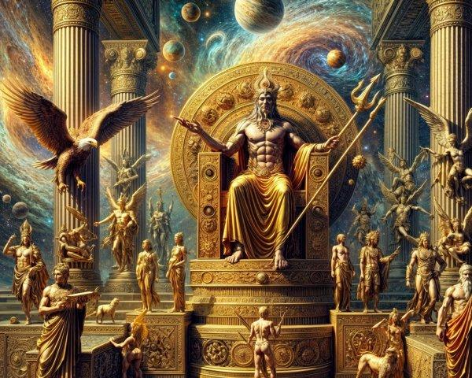

# 第一百二十二章　神王之擇

## 一

九曜祭天壇的裂谷深處，規則與神道的碰撞，已經進入了最慘烈、最驚心動魄的膠著階段。

那座昔日由太古九曜星輝托舉、象徵整個神話文明信仰中樞的白玉祭天台，此刻已在無聲無息的維度消融中崩塌了大半。殘存的幾根千丈白玉祭柱斜插在深淵邊緣，柱身上銘刻的億萬祈願神文正以肉眼可見的速度褪色、剝落，被拉扯進那片平整得令人窒息的灰黑色二維平面裡。

裂谷深處沒有半點岩漿滾沸的溫度，只有絕對的死寂與冰冷。

無數道規整、筆直、帶著冷酷幾何折角的灰黑色死線，如同從虛無深處瘋狂生長出來的金屬荊棘，不斷自那片二維天幕中抽打而出。每一次抽打，空間便發出一聲彷彿琉璃被生生壓扁的詭異輕響，原本三維立體的神域法則直接被抹平為一片沒有厚度的規則死斑。

「錚——！！」

一抹雪亮如霜的長虹自半空中橫斬而過，將七道同時合圍過來的幾何死線齊根斬斷！

洛寒衣身化萬千殘影，在崩塌的祭柱之間踏空而行。她手中那一柄來自滄瀾界、曾於百兵神宮重鑄器魂的斷星古劍，此刻正發出高亢而清冽的長鳴。每一劍揮出，皆帶起千丈澄澈純粹的無垢劍芒，與那些冰冷僵硬的幾何線條撞擊出漫天刺目的規則火星。

她的白衣長袍已被狂暴的空間亂流割裂出十餘道細密的血痕，鮮血染紅了冰藍色的劍穗，肩頭一處擦傷甚至泛著詭異的灰白平面化紋路——那是高維規則留下的侵蝕印記。可她那雙清冷如萬載玄冰的眼眸深處，戰意卻不僅未曾衰減半分，反而愈發純粹凌厲。

劍意不借香火，不假神權，對這套專門獵殺信仰文明的清理矩陣而言，每一劍都是無法解析的刺耳雜音！

而在戰場另一側，戰神巨戟已然通體化作了滾燙刺目的赤金琉璃之色！

「給我碎！！！」

伴隨著一聲震動裂谷的狂野怒喝，赫拉迪雅自九天之上凌空砸落！五階戰伐神格被這位熒惑女武神毫無保留地催動到了極致，狂暴的戰伐神火在她身後凝成一尊頂天立地的赤金戰神虛影。神血順著她修長緊繃、早已佈滿裂甲傷痕的手臂不斷滴落，落在腳下堅硬的玄冰與岩層上，瞬間燃起一簇簇不滅的金紅火苗。

她手中的丈二戰神巨戟舞成一團焚天烈輪，借著洛寒衣剛剛斬出的那一道空間空隙，順勢橫掃而出，將三根試圖從死角包抄這位劍修後背的幾何觸手生生砸成漫天齏粉！

「痛快！真是痛快！」

赫拉迪雅隨手抹了一把臉頰上的血漬與塵灰，戰袍獵獵作響，一雙燃燒著熒惑烈火的眼眸裡沒有半點畏懼，反而透出一種棋逢對手般的狂烈豪情，「打了五千年的仗，從前盡是在跟神殿那些滿口仁義的神棍勾心鬥角！今日才算真正明白，什麼叫與天鬥、與這見鬼的滅世天災鬥！」

「小心右側！」洛寒衣清冷的嗓音剛落，兩人已背靠背同時轉身！

幾乎在同一瞬，五道比方才粗壯十倍的灰黑稜柱從虛無平面裡無聲刺出，將她們方才立身的白玉平台連同百丈空氣一併抹成絕對的空白！洛寒衣劍鋒一轉，以一點極致的純粹劍意點在稜柱折角；赫拉迪雅則順著劍意劈開的縫隙一戟砸下，兩人一劍一戟，竟然在毫無言語溝通的情況下打出近乎天衣無縫的配合，硬生生將這輪致命合擊擋在了三十丈外！

然而，儘管前方兩人戰得如此慘烈驚豔，整座戰場的局勢卻依然如同一記記重錘，沉重地壓在後方所有人的心頭。

祭壇西側的高台殘垣之上，羲凰的臉色已經蒼白得沒有一絲血色。

「太陰新法……鎮！」

神女雙手結印，眉心那輪剛剛修復不久的弦月靈紋正劇烈閃爍著。她身後那輪碩大無朋的太陰月輪懸浮於裂谷上空，灑下萬丈如雪銀輝。與以往在廣寒月宮不同，此刻她不再築起冰牆去硬堵裂谷底層噴湧而出的濁泥黑潮，而是以「轉化之河」的心法為引，將那些從羅睺通道裡倒灌出來的億萬縷怨毒黑潮強行納入月輪之中，日夜不停地洗滌、疏導、化解其中的毀滅戾氣，替整個戰場切斷蝕者投影最核心的能量補給！

可這股自九曜祭天壇地脈深處積壓了五萬年的濁泥總量，實在太龐大了！

太陰月輪在連續數百次疏導與冰封之後，那晶瑩剔透的月盤表面，赫然再次浮現出了數道觸目驚心的細密裂痕！羲凰咬緊牙關，唇角不斷滲出泛著淡淡銀光的神血，卻死死不肯退後半步，不惜燃燒自身的本命太陰精血化作漫天飛雪，死死守住這道關乎全盤生死的防線。

而在祭壇正東方的天位之上，姬明月頭頂的紫霄真龍神座更是發出陣陣悲鳴！

為了以天曜神裔的皇道龍氣強行鎖住整座太微玉京浮島的九條支撐地脈，不讓高維黑潮將整座浮空都城生生切斷墜入下界，大乾女帝孤身立於狂風之巔。那尊百丈紫金神龍死死咬住崩裂的地脈星鎖，龍爪滲出金血，連帶著姬明月身後的紫金雲紋帝袍也被空間亂流撕扯得獵獵作響。她喉頭一甜，一抹殷紅鮮血沿著白皙的下頷緩緩滑落，卻被她抬手直接抹去，鳳眸依舊冷冽如刀，不肯鬆懈半分！

「顧淵！這東西的算力在幾何級暴增！！」

赫拉迪雅橫戟擋下一記擦肩而過的幾何死光，虎口崩裂得血肉模糊，戰甲碎片紛紛崩落，喘息聲如風箱般粗重：

「剛才被洛寒衣斬斷的第三節點，現在竟然已經衍生出了完全針對她無垢劍意的防禦頻率！

它在進化！只要這座深淵裂縫沒有合攏，只要這地底的維度通道還開著……我們就算殺它一萬次，它就能在第一萬零一次徹底適應我們的攻擊！！」

話音剛落，西側高台上的羲凰身軀猛然一晃！

「咔嚓——！」

一聲清脆得令人心驚肉跳的裂響在狂暴的風聲中傳開！

高懸於眾人頭頂的那輪太陰月輪，終於承受不住這五萬年濁泥與高維黑潮的雙重反撲，邊緣陡然崩開了一角缺口！狂暴失控的灰黑濁潮頓時如決堤洪水般從缺口處猛然反撲而出，眼看便要連羲凰與周邊地脈一併吞沒！

「羲凰！」姬明月失聲喝道，卻被地脈星鎖死死牽住，根本抽不開身！

就在那千鈞一髮的生死關頭——

「太清定星，四象歸位——鎮！！」

一聲清越沉穩、帶著修仙界道家正統肅穆道韻的嬌喝，毫無徵兆地自裂谷正北方的星門通道驟然響起！

一道素青色的身影如流雲般踏空而至！

正是剛剛在青玄界與沈玄清完成最後一道太古陣盤推演、不顧自身元嬰方才初成便再度穿過第三號星門趕來九曜的青雲掌門——柳清虛！

她手中托著一面流光溢彩、刻滿沈玄清親筆朱砂古紋的八卦星盤，足下輕點虛空，剛剛在廣寒月宮月輪之上凝成的初期元嬰在紫府之中驟然綻放出純淨耀眼的金色道光！

「嗡——！」

柳清虛素手十指翻飛如蝶，瞬間將三百六十枚青玄界極品靈玉化作漫天星辰光點，精準地打入太陰月輪與祭壇外圍的每一個陣法死角！青玄修仙界的《太清定星陣》與太陰月華在這一瞬竟然嚴絲合縫地扣合在一起——那是前兩日她在廣寒月宮早早預埋好的陣基此刻全面啟動！

修仙元嬰的磅礴靈力源源不斷地湧入陣眼，如同一道堅韌無比的青色絲網，瞬間將太陰月輪崩裂的那一角穩穩兜住、鎖死！反撲而出的濁泥黑潮撞在這座借九曜太陰法則共鳴而成的修仙大陣上，竟被硬生生壓回了裂谷深處！

「清虛！」羲凰微微睜大美眸，在最危急的一刻終於得以喘息一口，望向那名並肩落在月輪光幕旁的素青道袍女子，眼中滿是感激。

「沈太上把陣眼的最後三處誤差算出來了。」柳清虛站在陣盤之後，衣袂在狂風中獵獵飛揚，額角滲出一層細密汗珠，清冷的嗓音卻依舊穩如磐石，「我替你穩住月輪的外圍結構與靈力循環。太陰疏導，還得靠少宮主自己。」

「好！」羲凰重重點頭，不再有後顧之憂，立即雙手重結法印，重新引動轉化之河穩定戰局！

隨著柳清虛的青色星盤嵌入月輪陣基，這場原本幾乎瀕臨崩盤的苦戰竟奇蹟般地重新穩住了陣腳。柳清虛垂眸看著掌心微震的八卦盤，心中暗暗心驚——青玄界的西陵魔煞宗或枯骨老魔雖也兇險，卻總歸還算有跡可循；可眼前這片灰黑色的幾何平面，卻連仙道最穩固的靈力軌跡都險些被直接抹成死線，若非她在廣寒月宮及時成嬰、又帶著沈玄清推演出的定星盤趕來，恐怕剛一照面便要折損在這裡。

而不遠處，洛寒衣剛以一記雪亮劍芒劈開兩道斜刺過來的規則死光，手腕忽然極輕地震了一下。懷中斷星古劍的器魂在撞上那些高維線條的剎那，竟隱隱與祭壇最底層那片遺墟深處的古老波動再次產生了一絲微弱卻清晰的厭惡與共鳴——彷彿這柄劍在不知多少個紀元前，也曾見過類似的清理矩陣降臨人間。她沒有分神深究，只將劍意催至更純粹的一線，轉身再度替身側浴血奮戰的赫拉迪雅擋下一記致命背刺。

天位之上，姬明月借著這口喘息之機，抬頭與半空中的顧淵隔著漫天罡風遠遠對視了一眼。女帝唇邊血跡未乾，鳳眸卻亮得驚人——她腳下那尊紫霄真龍神座死死釘住九條震顫不已的浮島地脈，宛如替這座即將傾覆的天空都城立起了最後一根不倒的脊樑。

---

## 二

風暴最中樞的半空之中，顧淵凌空虛立。

他一襲白衣在毀滅亂流中翻滾如雲，雙手始終負於身後，神態平靜得近乎冷酷。

其實他的神魂早已經負荷到了極限。

破妄真視在這一刻運轉得雙眸隱隱泛出刺目的金芒，萬界樓主跨越維度的感知鋪天蓋地般籠罩了整座九曜祭天壇。在他眼前，所有的烈火、劍芒、月華與哀嚎全部褪去，化作億萬條交織纏繞、觸目驚心的因果絲線與法則結構。

整座戰場最底層、最殘酷的真實邏輯，正在他視野深處被清晰無比地一層層剝離開來——

諸天蝕者的這道規則投影，本質上根本不是有血有肉、懂得恐懼或憤怒的生靈，而是一道自至高維度貫穿而下的冰冷清理律法。

它之所以會精準地降臨在九曜祭天壇，絕非偶然，也絕不只是因為羅睺神系中幾個貪婪的激進派私通通道。

真正的原因，就埋在柳清虛帶來、沈玄清從青玄古仙遺卷裡破譯出的那句秘辛裡——

這裡，本就是太古諸天七界封魔鎖鏈的——**「天樞淨化之眼」**！

五萬年前那場諸神黃昏之後，這座淨化之眼便已出現了細微的裂痕；而後來的九曜神權制度為了維持虛偽的威嚴，強迫神明禁絕七情六慾、壓抑信徒願力裡的苦痛與怨念，任由無數濁泥堆積在這座「水閘」底部腐爛發酵。

久而久之，原本用來洗滌魔煞的淨化之眼出現了不可逆的因果死鎖，在濁泥與貪婪的澆灌下徹底腐敗變質，化作了一座在諸天維度裡散發著濃烈腐朽氣息、主動吸引蝕者降臨的滅世燈塔！

想要徹底擊退這道高維規則投影、拯救這座神話文明乃至保全青玄與滄瀾兩界的封魔鎖鏈節點，只靠外力斬斷觸鬚是遠遠不夠的。唯一的生路，就是徹底合攏這道維度裂縫，並將「天樞淨化之眼」重新錨定、激活重塑！

而要完成這場重塑與錨定，在天地法則的鐵律之下，卻必須同時滿足三個無比殘酷、無比苛刻、缺一不可的必然條件：

其一，諸天七界封魔鎖鏈的節點，必須由擁有九曜神域完整、無瑕、至高的核心混元神格權限重新錨定，方能得到這方神域九大星辰與天地萬道法則的共同認可，將被撕開的維度裂縫永恆焊死；

其二，放眼當前的整座九曜神域，五萬年神權紀至今，唯有一人的體內自受命登極以來便執掌著融匯九系本源的九曜混元正統完整權限——那便是壽元將盡、神格已經衰老到最後一刻的現任神王，昊天神皇！哪怕赤炎神君戰力強橫，他的日曜神格也只有單一星曜之權，根本承受不住九曜天樞的完整反噬；

其三，顧淵身為萬界樓主，其神魂格位超越諸界，唯有他能以破妄真視看穿蝕者規則投影的算力死角、強行撕破它的規則防護——但他終究是來自萬界樓的界外之人，沒有與九曜九星血脈相連的本土神格印記，無論如何也無法取代九曜神王，去完成這最後一道以身殉道的法則錨定！

這是一個無解的死局，也是一個殘酷到令人沉默的真相：

神話文明自己種下的數萬年苦果，終究需要它自己最尊貴、也肩負這份歷史重負最久的神明，去親手咽下！

就在顧淵看穿這三大必然條件、眼眸微微沉下的那一剎那——

「嗡——」

一陣宏大蒼茫、厚重得彷彿自太初紀穿越時空而來、響徹九天十地的遠古鐘鳴之聲，忽然自天穹正西方浩浩蕩蕩傳來！

原本被灰黑幾何天幕遮蔽得暗無天日、令人絕望窒息的太微玉京上空，在這一刻，忽然被一股漫天漫地、雖然帶著暮氣卻依舊溫暖莊嚴的九色混元道光徹底照亮！

---

## 三

昊天神皇來了。

他沒有乘坐平日裡象徵神王威嚴的九星雲輦，也沒有帶上任何禮儀官與儀仗隊。

這位老邁至極、已在九曜神王御座之上坐了整整七千年歲月的無上神王，身上不再是神王大議上那襲繁複華貴、繡滿日月星辰的紫金帝袍——他披上了一襲早已在偏殿深處蒙塵了五千年的太古征天神鎧。

神鎧殘破斑駁，胸甲與肩甲之上密布著遠古神戰紀留下的刀劈斧鑿之痕，每一道深陷的痕跡裡，皆泛著暗金色的乾涸神血。神皇頭戴九曜至高混元帝冕，手中握著那根陪伴了他七千年的混沌權杖，一步一步，沿著虛空凝聚而成的九色天階，緩緩踏步而下。

他走得很慢。

枯瘦如柴的身軀在那副沉重的太古神鎧之下顯得有些單薄，每一次邁步，似乎都在消耗著那具已經徹底枯竭的皮囊裡最後一點餘溫。可他每一步落下，天穹雲海深處那九顆原本黯淡無光的星曜，便隨之發出一聲低沉而莊嚴的共鳴！

而在他身後千餘里之外的雲端之上，還緊緊跟著幾十道氣勢洶洶趕來觀望或企圖渾水摸魚的各神系強者與精銳衛隊——為首的，正是滿臉陰鷙的赤炎神君、神色驚疑的玄水神君、以及緊繃著臉的金峰神君等人。

然而，當赤炎神君等人剛剛衝破雲海、真正看清九曜祭天壇核心那副足以將整個神話文明從根基上徹底抹去的灰黑深淵與猙獰幾何天災時——

這群在九曜天宮議政大殿裡為了神王世襲權爭得頭破血流、恨不得立刻拔刀相向的神君強者們，竟在這一瞬間同時駭然失色！

「這……這就是古籍裡記載的滅世大劫？！」

數十位平日裡高高在上、受萬界眾生膜拜的各系神尊、神將，齊刷刷地停在了千里之外的雲端之上。那股自幾何天幕裡透出來的冰冷清理意志，甚至讓他們的五階神格都在本能地發出哀鳴與戰慄！好幾名三階神君當場雙腿發軟，差點從雲頭栽落下去，竟然無一人敢再往前踏出哪怕一步！

赤炎神君死死握住手中的日曜神劍，那張總是帶著霸道與傲慢的臉龐此刻慘白得沒有一絲血色！他下意識地催動神力想要護體，可掌心中原本狂暴不可一世的日曜真火，在接觸到那股高維幾何陰影的壓迫後，竟然如風中殘燭般發出一陣滋滋輕響，本能地瑟縮熄滅了一半！

在這一刻，這位日曜之主終於徹底明白——

什麼世襲權柄，什麼九系排序，什麼與大乾女帝爭奪神域正統……在這場真正足以毀滅天地法則的諸天災劫面前，全是多麼可笑、多麼卑微的塵埃泡影！

他忽然想起千年前自己剛突破五階巔峰時，曾不止一次在赤炎天宮裡望著九曜天宮的御座冷笑，覺得昊天那個老頭子太過軟弱、只懂偏安一隅、連一個區區泥巷都懶得動用雷霆手段徹底焚毀。可直到今日親眼看見這片高維天幕撕開蒼穹，他才第一次聽懂了昊天神皇當年那句意味深長的「老夫的神格，是被濁泥蛀空的」背後，究竟壓著多少萬鈞重負——

坐在那張神王御座上，享的不只是九系朝拜，更得時刻用那枚九曜混元神格去頂住這座隨時會崩塌的天樞鎖鏈！

而大殿上那個曾被他們暗中嘲笑為「行將就木、連濁泥都鎮不住的老人」，又是頂著怎樣可怕的深淵壓力，孤零零地撐過了最後這數百年！

赤炎神君握劍的手指微微發抖，竟第一次生出了一絲無處安放的羞慚與震怖。

昊天神皇沒有回頭看他身後那些呆若木雞、膽戰心驚的臣子。

他只是安安靜靜地走下最後一級虛空天階，穿過赫拉迪雅燃燒的戰伐火海，穿過柳清虛與羲凰共同撐起的銀青兩色陣網，徑直來到了風暴最核心的顧淵身前半步之處。

兩位跨越了不同文明與身份的至高存在，在狂暴的滅世風暴之中，靜靜對視。

風暴吹動著顧淵雪白的衣袂，也吹動著老神皇鬢邊散落的幾縷雪白長髮。

「老夫方才走過偏殿的時候，又想了一遍那位大乾女帝在議政廳裡說的話。」

昊天神皇緩緩開口，嗓音沙啞、蒼老，卻異常地平靜，宛如一口歷經萬劫的古井終於停止了晃動：

「她說得對。七千年前，老夫剛接過這頂帝冕的時候，也曾發誓要終結神戰紀留下的亂象，要讓九曜九系重新回到太初紀的太平盛世。老夫自以為只要握緊九曜混元神格、以無上神威鎮壓九系、建立牢不可破的神王權威，便能庇護這方天地萬古長青。」

他低頭看了一眼自己佈滿老年斑與裂紋的手掌，嘴角泛起一抹極淡、極蒼涼的自嘲：

「結果呢？老夫享受著萬界眾生的朝拜，貪戀著神座之上的安穩，害怕一旦撕開制度的口子就會天下大亂。於是老夫把所有的醜惡、痛苦與濁泥統統踩在腳下，用神權把它們鎖進泥巷和祭天壇底，自欺欺人地維持著這座金碧輝煌的牢籠。」

老神皇抬起混濁卻異常清澈的眼眸，直視著顧淵，說出了那句藏在心底無數年的肺腑之言：

「顧先生，老夫在這個神座上坐了七千年，做了所有能做的事。但沒有一件，是真的改變了什麼……直到今天大禍臨頭，老夫才真正看明白——也許，不是神座的問題，而是坐上神座的人，始終以為自己能代表天道。老夫不是神域的救世主，老夫才是這座牢籠裡……最大、也最沉的那根鎖鏈。」

顧淵靜靜地聽著，沒有打斷他哪怕一個字。

看著眼前這位即將燃盡自己最後一滴神血的老人，顧淵的神色無比肅穆，對著這位被五萬年歷史與制度困住、卻在最後關頭依然願意挺直脊背的老神王，微微頷首致敬：

「神皇陛下有錯，卻也用七千年守住了這座天地最後的體面。如今大錯既明，這方天地……還有的救。」

「呵呵……還有的救就好。」

昊天神皇嘴角泛起了一抹真正釋懷而豁達的笑意。

在生命最後的這幾十息裡，這位老人緩緩轉過身，目光深深地、溫柔地掃過這片他統御了七千載的壯麗山河——

他看見了在狂風中咬牙苦撐、滿身是血卻豪氣不減的赫拉迪雅；

他看見了道心通透、終於不再以自我毀滅為慈悲、而是以新法全力疏導暴走願力的羲凰；

他看見了鳳眸含霜、以人間帝王意志與九曜地脈共擔因果的姬明月；

他看見了手托星盤、以修仙界元嬰陣法替這方神域穩住最後一線生機的柳清虛，以及在她身旁以純粹劍意一次次斬破規則觸鬚、絕不向天災低頭的洛寒衣；

他更透過雲海的縫隙，看見了遙遠的太微玉京市集與泥巷裡，那些在災難面前雖然恐懼哭泣、卻依然緊緊相擁、替彼此祈禱守望的無數平凡神裔……

「這才是神道該有的樣子啊……」

昊天神皇仰天長嘆，眼角悄然滑落一滴滾燙金色的神血，在風中化作一縷柔和的金光：

「神明不該高懸於眾生之上索取恐懼，也不該替眾生背負起所有不屬於他們的牢籠。這個神王寶座，老夫坐了七千年——今天，該徹底退位了。」

---

## 四

「轟————！！！」

話音落下的剎那，昊天神皇抬起雙手，猛地扯下了頭頂那頂象徵著九曜神域五萬年至高專制權力的九曜混元帝冕！

那頂重逾萬斤、曾令無數神君野心家為之瘋狂的帝冕被他隨手拋入虛空，在半空中轟然碎裂成無數道純粹的星辰光點，如一場黃金雨般散入天地之間，從此不復存在！

整座九曜神域的大地在這一瞬間劇烈震顫！

只見這位老邁神王的胸膛正中，一枚散發著九色混元道光、紋路繁複神聖到了極點的巨大神格，緩緩自他枯槁的體內升騰而起！

雖然因為七千年歲月與濁泥侵蝕，這枚【六階九曜混元神格】表面已經佈滿了暗淡的歲月傷痕，光芒也遠不如盛年時那般不可一世——可當它真正離體顯現於天地之間的那一刻，太微玉京上空那九顆星辰依然同時發出了如子女哀鳴般的震天長吟！

因為那是九曜神域自開闢以來，唯一一枚真正融合了九大星曜原初本源、執掌完整九曜天地法理的六階至高神王神格！

「神皇陛下！！不要啊！！」

千里之外的雲端之上，赤炎神君看見那枚混元神格破體飛出，終於發出一聲撕心裂肺、充滿震驚與懊悔的失聲驚呼！金峰、玄水等各系神君更是齊齊雙膝一軟，遙遙跪倒在雲海之中！

混元神格徹底離體，意味著這位統御九曜七千年的至高神皇，連一絲真靈轉世或神火重燃的機會都將徹底斷絕——這是真正的形神俱滅、道消身隕！

老神皇在漫天烈焰裡卻微微側過半張臉，望向遠處雲端跪伏的赤炎與諸位神君，聲音透過狂風遠遠傳了過去，不再是高高在上的斥責，只像是一位臨別的長輩留下最後一句叮囑：

「赤炎……玄水……老夫把這張壓了五萬年的神座拆了……往後的九曜……別再讓任何一個人……獨自去扛整片天……」

話音未落，他的目光重新收回前方，眼中再無半分悔恨與留戀，只有燃盡一切腐朽過去的狂烈與平靜。

「顧淵樓主！」老神皇滿頭白髮在九色神光中寸寸化作熊熊燃燒的金色神焰，整個人的氣息竟然在最後一刻返璞歸真，重新衝破了壽元衰敗的枷鎖，長嘯震動九霄，「替老夫……指引陣眼所在！！」

「請神皇隨我破妄而行！」

顧淵眼中金色道印璀璨大盛，不再保留半分萬界樓主的氣韻，青衫獵獵狂舞！

他凌空踏出一步，右手並指如劍，引動萬界樓深處那股沉睡萬古的混沌原初本源，隔空對著下方那片冰冷死寂、不斷擴張的灰黑二維平面狠狠一指點落：

「萬物破綻，混沌真視——天樞陣眼，現形！！」

「嗤啦————！！」

無形卻沉重到足以扭曲諸天因果的破妄劍氣直貫而下！

在那股超越這方世界規則維度的萬界樓主力量壓迫之下，那不可一世、連五階神尊攻擊都能迅速進化免疫的高維幾何天幕，竟然發出一聲極其刺耳的規則頓挫之鳴！在億萬重冰冷算力公式層層疊疊的遮掩深處，一枚不斷吞噬著地脈光線、正在扭曲整個鎖鏈結構的虛無核心原點，被顧淵以無上因果道力生生逼顯而出！

然而，原點剛剛顯形不到千分之一息，整片二維平面便彷彿察覺到了致命威脅，億萬道灰黑觸鬚與幾何死光瘋狂暴起，試圖在瞬間將原點重新吞沒並把在場眾人一併抹殺！

「就是現在！！」顧淵沉聲長喝，聲音清晰無比地撞進每一名同伴的識海之中！

「洛寒衣，赫拉迪雅——斬斷它的維度支點與核心力場！」

「鏗——！」

洛寒衣眼神冰寒如刃，人劍合一，將體內全部仙武合一的純淨武意灌入斷星古劍之中！一道長達千丈、彷彿能將天地一分為二的雪白無垢劍芒悍然斬下，精準無比地將護在原點左側的三根漆黑維度天柱當場齊腰斬斷！

「吼！！給老子開！！！」

赫拉迪雅不顧雙臂神血狂湧，借著洛寒衣斬出的那一道缺口狂暴衝入死光之中，五階戰伐神格全力爆燃！丈二戰神巨戟化作一輪遮天蔽日的赤金烈陽，挾著毀滅山岳的滔天神炎自九天狠狠砸落，硬生生將幾何矩陣那層最堅固的防禦力場轟出一道寬達百丈的巨大裂痕！

「柳清虛，穩住陣基共振！羲凰，月華引道，滌蕩最後一道濁潮阻隔！」

「太清定星，四極歸元——固！」柳清虛咬破舌尖，一縷本命元嬰精氣噴在八卦星盤之上，青色靈網驟然化作實質的八卦光壁，死死鎖住裂縫四周崩潰的空間餘波，令整座祭壇的法則波動維持在最穩定的頻率！

「太陰降世，萬物歸流！」羲凰雙手向上托舉，不惜燃燒三千年苦修得來的太陰本源，月輪爆發出冰封三千界而又純淨無瑕的銀輝光柱，順著赫拉迪雅砸開的裂痕狂湧而入，將原本阻隔在原點外圍的濃稠濁泥在一瞬間疏導淨化，強行替後方開闢出一條毫無阻礙的純淨光之通路！

「姬明月——真龍鎮乾坤！」

「真龍歸位，皇道定鼎！」

九天之上，姬明月鳳眸威嚴怒睜，眉心那朵九瓣紫金「天曜混元神蓮印」綻放出照亮八荒的萬丈神芒！千丈紫金真龍發出震動整座神域的太古龍吟，龍軀蜿蜒盤旋而下，四隻龍爪狠狠死扣住那條通往原點的裂谷通道兩側，以大乾萬民意志與天曜神座無上法理，硬生生定住了即將在下一息閉合崩塌的通道！

五位絕代女子各施不可替代的無上絕學，在顧淵那精準到毫釐的統御指引之下，硬是在高維天災的圍剿之中，合力撕開了一條僅存千分之一剎那的生路！

---

## 五

就在那一條通往天樞陣眼的純淨通路被眾人聯手撕開的千分之一剎那——

「九曜混元，以吾殘軀，重定天樞！！」

昊天神皇發出一聲彷彿釋放了七千年重壓的暢快大笑！

這位枯槁老邁的神王沒有半分遲疑，雙手托舉著那一枚燃燒至最極致、綻放出比恆星核心還要璀璨萬倍的六階九曜混元神格，整個人化作一顆劃破永夜、帶著無盡決絕與尊嚴的熾熱九色流星，迎著眾人拼死撕開的光之通道，義無反顧地撞入了那片冰冷死寂的高維二維平面正中央！

「轟隆隆隆隆隆————！！！」

那一瞬間爆發出的光芒，讓諸天星海都為之失色！

那是無法用任何言語形容的史詩碰撞！

一位六階神王賭上七千年道統與最後一滴神魂本源的自我獻祭，爆發出了甚至超越九顆星曜同時燃燒的浩瀚光熱！

至剛至正的九曜混元神光化作了席捲天地的滔天烈焰，將所有瘋狂蔓延、試圖反撲的灰黑幾何死線在一瞬間焚燒得乾乾淨淨！諸天蝕者那道高維的冰冷規則投影，在面對一個古老文明最頂點存在孤注一擲的法則錨定與法則反衝面前，其精密冰冷的清理矩陣終於在劇烈的過載震顫中寸寸崩潰！

「嗡——！！」

投影破碎，黑幕湮滅！

那片籠罩了九曜祭天壇上空數百里的灰黑色二維死域，如同被無形烈陽蒸發的殘冰般徹底消散於虛無！

而在那巨大的裂谷最深處，昊天神皇徹底燃燒化盡後留下的最純粹、最本源的混元神格精華，化作了一座巍峨如山岳、銘刻著九顆星辰永恆軌跡的九色神印，伴隨著整座九曜神域天地法則的隆重共鳴，深深地嵌入了七界封魔鎖鏈的節點樞紐之中！

「咔噠——！」

一聲清脆悠遠、彷彿跨越了太玄青玄、滄瀾與九曜無數維度阻隔的太古鎖鏈合扣之音，在天地最深處緩緩響起。

七界封魔鎖鏈的「天樞淨化之眼」節點，在被信仰濁泥污化腐蝕了數萬載之後，終於被一位看透了自己過錯的老人，用自己的生命與神格，徹底洗滌乾淨，重新嚴絲合縫地鎖死封閉！

維度裂縫，徹底合攏。

黑潮散去，鉛灰色的劫雲被一掃而空，重新露出了九曜神域清朗澄澈的天穹！

無數點溫柔細碎、不帶半點焦躁與戾氣的九色光雨，自九天之上緩緩灑落，如同春風化雨般無聲地滋潤著崩塌的祭天壇、破碎的太微玉京街道、以及每一名倖存神明與下界神裔的身心。

神皇隕落了。

沒有留下半片屍骨，沒有留下半座陵寢，只留下一座重新清明的九曜天地。

舊神權時代的最後一位主宰，用他這場無比壯烈而清醒的最後選擇，親手合上了屬於專制神王的那一頁歷史，也為這座飽經創傷的神話文明，換來了一線真正走向新生的曙光。

---

## 六

祭天壇的廢墟之上，狂風漸止，只餘下細碎柔和的九色光雨在靜靜飄落。

赫拉迪雅脫力地拄著戰神巨戟單膝跪倒在碎石之間，胸口劇烈起伏喘息著，任由神血混著溫熱的光雨從甲冑裂縫裡滴落；洛寒衣緩緩吐出一口濁氣，將滿身血跡與劍意收回鞘中，斷星古劍發出了一聲極輕微、帶著幾分敬意的嗡鳴；

柳清虛伸手收起靈光耗盡、出現了幾道細紋的八卦星盤，身形微晃了一下，隨即站穩，安靜地退到顧淵側後方三步處；羲凰雙目微紅，合十閉目，以最莊重的太陰清禮默默送別那道消散在九色光雨裡的老邁身影；姬明月則負手立於破碎的高階之上，紫金帝袍在微風中靜靜垂落，鳳眸之中既無勝者的狂喜，唯有見證一個時代落幕時的肅穆與悲憫。

不多時，千里之外雲端上的那群各系神君與強者，這才戰戰兢兢、臉色蒼白地飛掠而來。

當他們低頭看著那座雖然殘破卻再無半分蝕者黑氣、反而在九色神印鎮壓下散發出久違清明氣息的九曜祭天壇，又看見空空如也的天空裡再也沒有了那道坐了七千年的熟悉背影時——

數十位平日裡算計不斷、自命清高的神君長老們，膝蓋一軟，噗通一聲齊刷刷地跪倒在祭壇廢墟之上，不少老神官甚至失聲痛哭起來：

「神皇陛下……」

赤炎神君站在人群最前方，手裡還緊緊握著那柄光芒黯淡的日曜神劍。他呆呆地看著半空中那點尚未完全散盡的金色餘暉，高大魁梧的身軀劇烈地顫抖著，最終也重重地單膝跪下，深深低下了那顆不可一世的頭顱。

顧淵立於祭壇廢墟的最高處，一襲白衣也已沾染了不少塵灰，肩頭還落了一層細碎的金色神霞。

他看著滿地跪伏沉默的神明，沒有急著斥責，也沒有擺出高高在上的征服者姿態，只是在神雨徹底停歇之後，才用一種如晨鐘般平靜卻不容置疑的嗓音，清晰地傳遍全場：

「諸位請起。昊天神皇以六階混元神格重鎖天樞，這份代價，不是為了讓諸位跪在廢墟裡哭泣，更不是讓這場大劫過去之後，一切又回到原來的樣子。」

「神皇陛下臨終之際已經看明，神座之爭與舊制腐朽，才是今日險些招致滅頂之災的根源。舊的時代，已經隨神皇陛下一同落幕了。」

跪在地上的諸多神君身軀一震，紛紛抬起頭，目光複雜地望向這位在最後關頭力挽狂瀾的界外樓主，以及並肩站在他四周的幾位絕代女子。

姬明月緩步上前一步，掌心天曜真龍神印微亮，清越威嚴的聲音緊接著響起：

「神域不可一日無序，但制度尚未重立之前，絕不可由任何一系私自接管神王權柄！自此刻起，九曜天宮即刻依照各系殘存共識，成立**【臨時共同治理機制】**——」

「過渡期內，一切關乎九曜安危的重大危機，暫由太陰少宮主羲凰、熒惑統帥赫拉迪雅、天曜代表姬明月，連同金曜、玄水兩系長老共同作為臨時協調者召集處置，重大決策須經多數協商方可施行，待新制議會穩定之後，再行商議新任最高協調者之正式推選事宜！」

「各神系即刻收攏門下，停戰封壇，不得私自調兵！」

一番話說得脈絡極清、滴水不漏——既用大劫之後的現實威望鎖死了過渡期的秩序，又沒有強行一腳踩死其他神系的政治席位，給了所有神君一個看得見的體面與台階。

赤炎神君看著站在姬明月身旁手按戰戟的赫拉迪雅，又看了一眼氣息深不可測、剛剛破局的顧淵與一旁負劍冷立的洛寒衣，胸口起伏了兩下，終究是明白大勢已去。

這個時候誰若敢提反對，不等顧淵動手，在場剛剛從鬼門關前走回來的其餘六系神明就會先把他撕成碎片。

赤炎神君深吸一口氣，緩緩站起身，對著祭壇中心那枚已經化作天樞底座的九色神印最後拜了一拜，隨即轉向顧淵與姬明月、羲凰幾人，聲音低沉而沙啞地拱手一禮：

「日曜神系……同意成立臨時共同治理機制。大劫初定，三日後九曜天宮再開大議，我日曜一脈……絕不缺席。」

隨後，玄水神君、木曜青年、厚土老者與金曜神君對視一眼，紛紛肅然起身，齊聲應諾：

「我等附議！」

遠處天邊，初升的朝陽終於徹底破開了太微玉京的最後一絲陰霾，將溫暖明亮的晨光鋪滿整座劫後餘生、即將迎來萬年未有之大變局的九曜神域。

（第一百二十二章　完）
