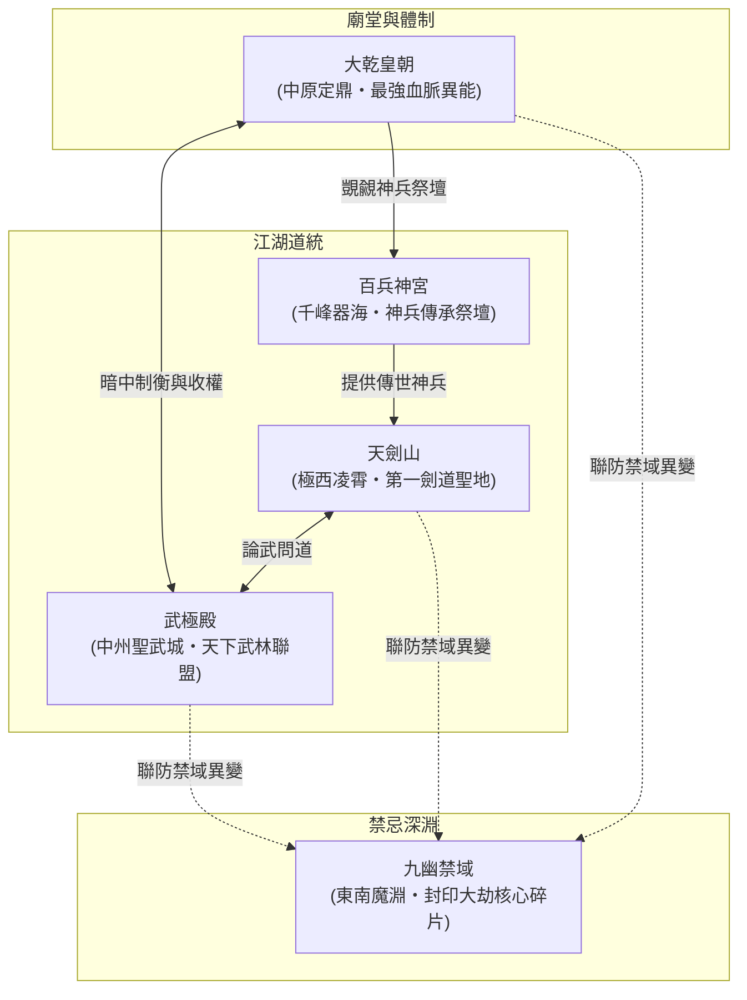

# 《萬界風月樓》第二卷世界設定｜滄瀾界（高武異能玄幻世界）

> **文檔定位**：第二卷《諸天第一步・滄瀾風雲》（ch017～ch052）之世界觀架構、歷史編年、天下格局與法則機制設定。  
> **世界編號**：02  
> **世界命名**：滄瀾界  
> **核心主題**：**天下第一，究竟由誰定義？**  
> **全書原則**：貫徹 R24「世界不因主角離開而停止，人物不因主角不在而停止成長，事件不因主角尚未抵達而延後發生」之諸天自主演化原則；落實 7.1～7.4 跨界通行與時空錨點層級體系。

---

## 一、世界文明定位與本質特質

滄瀾界並非傳統的「低武江湖」，亦非「換皮的修仙世界」，而是一個**擁有獨立成熟法則體系的高武異能玄幻文明**。

在滄瀾界中，修士不修五行靈氣，不煉金丹元嬰，而是將肉身氣血、天地內勁、心靈武意修煉到極致，並與天地初開時遺留的「異能血脈」與「傳世神兵」互相結合。頂尖武者一拳可斷江摧山，武意領域覆蓋數十里，武王武皇舉手投足牽動天地元氣，具有毀天滅地之威能。

* **社會風貌**：尚武成風，勝者為尊。武夫有傲骨，劍客重生死諾言。酒旗獵獵，烽煙四起；朝堂重權術血脈，江湖講快意恩仇。
* **核心衝突**：
  1. **名號之爭**：天下第一的頭銜百年空懸，天劍山、武極殿、皇室天驕皆欲問鼎。
  2. **道統之爭**：朝廷異能血脈欲削平江湖武道；武林巨擘誓死捍衛宗門道統。
  3. **存亡浩劫**：沉寂數千年的遠古魔網甦醒，九幽禁域崩裂，第二次天地大劫悄然降臨。

---

## 二、滄瀾界歷史編年史（四大歷史節點）

滄瀾界的歷史長河中，四個關鍵節點決定了當前世界的所有勢力格局與長線秘密：

```
三千年前（武神殉道・封印魔網）
  └── 一千年前（神兵失蹤・百兵隱退）
        └── 五百年前（九幽異變・武極殿立）
              └── 一百年前（最後武神隱世・大爭之世啟）
```

### 1. 三千年前：遠古武神「燕驚鴻」與幽冥魔網之戰
* **歷史真相**：三千年前，滄瀾界誕生了第一位真正「武道通神、超脫天地」的傳奇存在——武神燕驚鴻。彼時，域外黑手引動浩瀚的「幽冥魔網」企圖吞噬滄瀾界本源（此即遠古大劫在滄瀾界的具現）。
* **歷史反轉**：世人皆傳武神突破天門登仙而去，實則是燕驚鴻為了守護滄瀾萬靈，毅然放棄超脫機會，以自身神兵與武道法相為陣眼，將幽冥魔網的一處巨大核心節點強行鎮壓於東南大地，自身血肉兵解化為禁域封印。此地即今日之【九幽禁域】。
* **遺留伏筆**：第二塊萬界樓大劫核心碎片，正鎮壓在燕驚鴻的武神殘印中央。

### 2. 一千年前：天下第一神兵「太初玄天刃」失蹤之謎
* 滄瀾界太古神兵之首「太初玄天刃」在百兵盛會中突然發出悲鳴，自虛空崩裂遁走，下落不明。
* 隨後引發各大世家與宗門長達甲子的血腥爭奪，傷亡無數。百兵神宮心灰意冷，自此封閉千峰器海，立下「非神兵自主認主，絕不出世」的鐵律。

### 3. 五百年前：九幽禁域首次異變與【武極殿】建立
* 九幽禁域邊緣封印鬆動，黑煞魔潮席捲東南，三座武道大城一夜之間生機斷絕，化為死域。
* 滄瀾江湖各大門派意識到單打獨鬥無法抵禦禁域危機，遂在極道大宗師推動下，聯名成立**【武極殿】**，建立「天下論武大會」機制，統籌武林資源，防範禁域魔變。

### 4. 一百年前：最後一位武神消失，天下再無神話
* 一百年前，滄瀾界最後一位觸摸到武神門檻的絕頂強者在極北雪原留下一句「前路已斷，天地有鎖」，隨後神秘失蹤。
* 此後百年，世間再無人突破武王、武皇的極限成就武神。天下第一之位空懸，為當前各方強者的激辯與爭雄埋下了深厚伏筆。

---

## 三、天下格局與五大頂尖勢力

滄瀾界版圖廣袤，由五大維度的超級勢力共同瓜分與平衡：



### 1. 大乾皇朝（天下皇權・血脈異能）
* **地理位置**：坐鎮中原繁華之地，都城為【承天京】。
* **核心力量**：傳承自太祖的「紫霄真龍血脈」，族中強者天生具備引動九霄雷霆與威壓領域的本命異能。
* **代表人物**：
  * **當朝帝尊**：年邁病弱，深居宮闈，掌控帝國龐大暗衛「奉天巡察司」。
  * **監國帝女・姬明月（第二卷核心女主二）**：皇朝長公主，雍容冷豔、智計卓絕，掌管天策禁軍，粉碎兵變後加冕監國，與顧淵結締道侶同盟！
  * **太子與三皇子**：奪嫡激化，暗中勾結外部宗門與黑市世家，意欲染指神兵與禁域力量。
* **勢力特色**：秩序、規矩、集權。對江湖門派既拉攏又嚴厲防範。

### 2. 天劍山（劍道聖地・純粹極致）
* **地理位置**：西陲凌霄峰，萬仞絕壁直插雲霄，終年暴雪如刀。
* **核心理念**：「劍道無捷徑，天下第一當以手中三尺青鋒自取之。」
* **代表人物**：
  * **天劍山主（劍無塵）**：武王後期，當代天下第一劍客，長年閉關於問天絕頂。
  * **天劍山首徒・洛寒衣（第二卷核心女主一）**：天生「先天劍骨」，執掌傳承神兵「斷星古劍」，突破武王女劍仙，與顧淵雪峰立誓！
* **勢力特色**：孤傲、不涉俗務、極致好戰。

### 3. 武極殿（武道聯盟・群雄共治）
* **地理位置**：中州【聖武城】。
* **組織架構**：滄瀾界所有一品武道宗門、大宗師名宿組成的共同議事聯盟。設有三位輪值殿主與九大長老堂。
* **職能**：主持每十年一度的「天下論武大會」；評定「滄瀾天驕榜」與「大宗師宗師譜」；維持武林秩序。

### 4. 百兵神宮（神兵傳承・遠古祭壇）
* **地理位置**：南嶺【千峰器海】。地脈熔岩如沸，萬千神兵插滿劍塚刃壁。
* **核心秘術**：古法鍛兵、兵魂引導、血祭通靈。滄瀾界排名前一百的傳世神兵，半數出自百兵神宮。
* **代表人物**：百兵宮主（段百狂），性格怪癖古板，視兵如命。
* **隱秘任務**：世代守護神宮地底的「太古鑄兵星盤祭壇」（萬界樓昔日下界投影分殿）。

### 5. 九幽禁域（魔淵禁地・大劫源頭）
* **地理位置**：東南方黑沼盡頭，方圓萬里天色永夜，大地裂痕如蛛網，黑霧魔煞升騰。
* **內部威脅**：
  * **魔化古獸**：被魔煞污染異變的高階凶獸，具備宗師級以上撕裂力量。
  * **煞念幻象**：侵蝕武者神魂心智，令宗師大宗師陷入走火入魔癲狂。
  * **魔網第二節點**：幽冥魔網沉睡之核心，與青玄界沈玄清體內的遠古大劫殘念同源！

---

## 四、地理景觀與主要城鎮樞紐

| 地點 | 區域位置 | 地貌景觀與風土人情 | 關鍵劇情節點 |
| :--- | :--- | :--- | :--- |
| **天武城** | 中州平原樞紐 | 滄瀾界第一繁華雄城，街道開闊容八馬並馳，酒樓林立，比武擂台多達數百座 | 顧淵初入滄瀾落腳點（ch017～ch021）；天下論武大會初戰洛寒衣（ch022～ch027） |
| **凌霄天劍峰** | 西陲極寒高原 | 孤峰刺天，劍氣激盪如雷，風雪如刃，萬步寒冰階階皆劍痕 | 洛寒衣閉關悟劍之所；顧淵造訪論道，卷終雪峰盟誓（ch052） |
| **承天京（皇都）** | 中原龍脈交匯 | 城牆高百丈，通體以黑金玄石鑄造，九重帝闕，皇威森嚴，異能大陣籠罩 | 皇朝武道盛典、紫宸殿平叛、姬明月雙修合一（ch034～ch039） |
| **千峰器海** | 南方地火赤嶺 | 熔岩翻滾，黑煙蔽日，千萬柄刀劍矗立石林，夜半時分萬劍同鳴 | 百兵神宮大會（ch028～ch033）；祭壇萬界星盤修復 |
| **黑沼九幽隘口** | 東南死寂荒原 | 黑霧遮天，白骨露野，天地元氣在此化為刺骨寒煞，生靈絕跡 | 九幽魔變大戰爆發地（ch040～ch050） |

---

## 五、跨界出入機制與世界法則限制（遵循 7.1～7.4 規則）

### 1. 男主穿梭自如 vs 女主受限機制（通行權限不對稱性）
* **顧淵（樓主最高特權）**：
  * 顧淵享有在萬界樓與所有已定錨世界（如青玄界）之間**隨時隨地自由穿梭返回**的最高權限。
  * 顧淵隨時可以跨越萬界門返回青玄界探視柳清虛、沈玄清、慕容玥，亦可在萬界樓中召喚她們前來議事，進行跨界物資與情報調配。
* **青玄界三位女主（通行權限限制）**：
  * 柳清虛、沈玄清、慕容玥雖已建立深層陰陽共鳴並銘刻生命印記，享有自由進出萬界樓之權，但**尚無自主跨入其他陌生異界（如滄瀾界）的權限**。她們不能自行打開前往滄瀾界的大門，必須留守青玄界主持宗門與商盟大局。
* **滄瀾界初期本土坐標限制**：
  * 顧淵初臨滄瀾界時，萬界門僅連通天武城郊外荒谷單向出口。因尚未在滄瀾界建立本土紅顏錨點，顧淵初期若要返回萬界樓，需親身返回該荒谷坐標；直至在滄瀾界確立深層女主角認同並定錨，方能解鎖該界隨地召喚。

### 2. 天地法則的自然排斥與調和
* 滄瀾界的天地法則被氣血與武道意志充斥，天地靈氣極度稀薄。
* 顧淵初至時，直接催動青玄仙道大範圍法術，消耗增加三成以上，需轉向以肉身純力、神魂破妄為主，經歷實戰試錯後逐步修成「混沌仙武勁」。

### 3. 跨界聯繫的真實距離感與資訊落差
* 兩界各自獨立自主演化，嚴禁隨意無限制跨界聊天。
* 神魂微弱感應僅在天地極端同頻時出現（如沈玄清體內殘印與九幽魔網共振）。
* 物資調配需消耗萬界樓本源，保留時間差與懸念。

### 4. 生死防線與真死機制
* 萬界樓主在異界死亡，真靈亦會隨之消散，不存在任何無限復活特權。顧淵每一步落子皆依仗真材實料的謀略、實力與宿慧。
