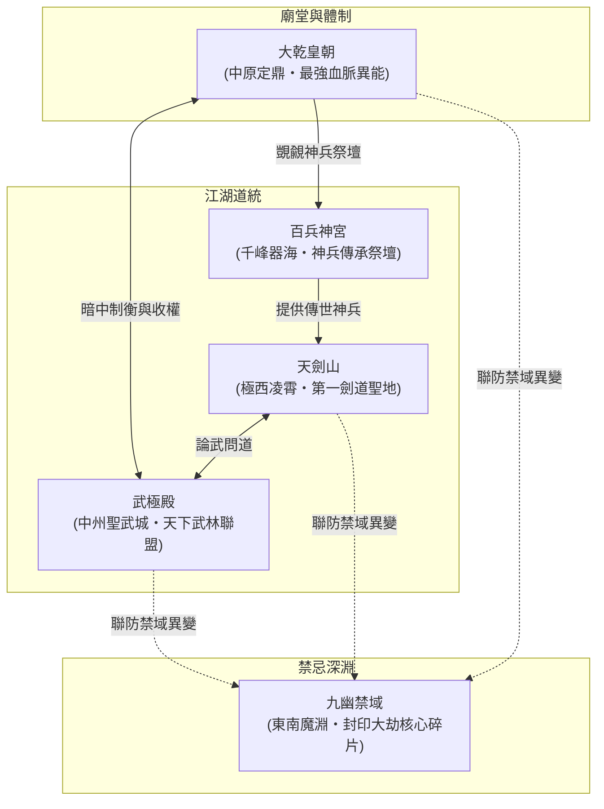
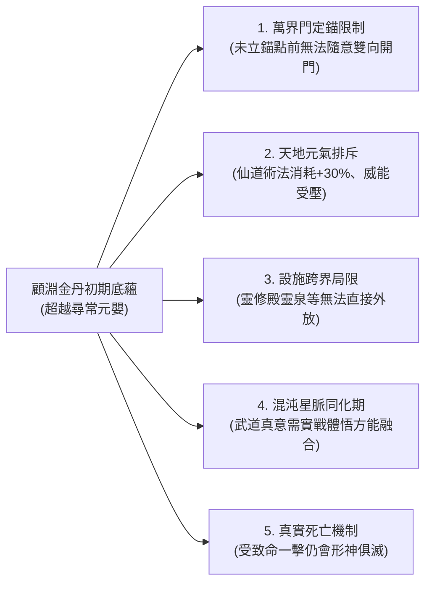

# 《萬界風月樓》第二卷世界設定｜滄瀾界（高武異能玄幻世界）

> **文檔定位**：第二卷《諸天第一步・滄瀾風雲》（ch017～ch052）之世界觀架構、歷史編年、天下格局與法則機制設定。  
> **世界編號**：02  
> **世界命名**：滄瀾界  
> **核心主題**：**天下第一，究竟由誰定義？**

---

## 一、世界文明定位與本質特質

滄瀾界並非傳統的「低武江湖」，亦非「換皮的修仙世界」，而是一個**擁有獨立成熟法則體系的高武異能玄幻文明**。

在滄瀾界中，修士不修五行靈氣，不煉金丹元嬰，而是將肉身氣血、天地內勁、心靈武意修煉到極致，並與天地初開時遺留的「異能血脈」與「傳世神兵」互相結合。頂尖武者一拳可斷江摧山，武意領域覆蓋數十里，武王武皇舉手投足牽動天地元氣，具有毀天滅地之威能。

* **社會風貌**：尚武成風，勝者為尊。武夫有傲骨，劍客重生死諾言。酒旗獵獵，烽煙四起；朝堂重權術血脈，江湖講快意恩仇。
* **核心衝突**：
  1. **名號之爭**：天下第一的頭銜百年空懸，天劍山、武極殿、皇室天驕皆欲問鼎。
  2. **道統之爭**：朝廷異能血脈欲削平江湖武道；武林巨擘誓死捍衛宗門道統。
  3. **存亡浩劫**：沉寂數千年的遠古魔網甦醒，九幽禁域崩裂，第二次天地大劫悄然降臨。

---

## 二、滄瀾界歷史編年史（四大歷史節點）

滄瀾界的歷史長河中，四個關鍵節點決定了當前世界的所有勢力格局與長線秘密：

```
三千年前（武神殉道・封印魔網）
  └── 一千年前（神兵失蹤・百兵隱退）
        └── 五百年前（九幽異變・武極殿立）
              └── 一百年前（最後武神隱世・大爭之世啟）
```

### 1. 三千年前：遠古武神「燕驚鴻」與幽冥魔網之戰
* **歷史真相**：三千年前，滄瀾界誕生了第一位真正「武道通神、超脫天地」的傳奇存在——武神燕驚鴻。彼時，域外黑手引動浩瀚的「幽冥魔網」企圖吞噬滄瀾界本源（此即遠古大劫在滄瀾界的具現）。
* **歷史反轉**：世人皆傳武神突破天門登仙而去，實則是燕驚鴻為了守護滄瀾萬靈，毅然放棄超脫機會，以自身神兵與武道法相為陣眼，將幽冥魔網的一處巨大核心節點強行鎮壓於東南大地，自身血肉兵解化為禁域封印。此地即今日之【九幽禁域】。
* **遺留伏筆**：第二塊萬界樓大劫核心碎片，正鎮壓在燕驚鴻的武神殘印中央。

### 2. 一千年前：天下第一神兵「太初玄天刃」失蹤之謎
* 滄瀾界太古神兵之首「太初玄天刃」在百兵盛會中突然發出悲鳴，自虛空崩裂遁走，下落不明。
* 隨後引發各大世家與宗門長達甲子的血腥爭奪，傷亡無數。百兵神宮心灰意冷，自此封閉千峰器海，立下「非神兵自主認主，絕不出世」的鐵律。

### 3. 五百年前：九幽禁域首次異變與【武極殿】建立
* 九幽禁域邊緣封印鬆動，黑煞魔潮席捲東南，三座武道大城一夜之間生機斷絕，化為死域。
* 滄瀾江湖各大門派意識到單打獨鬥無法抵禦禁域危機，遂在極道大宗師推動下，聯名成立**【武極殿】**，建立「天下論武大會」機制，統籌武林資源，防範禁域魔變。

### 4. 一百年前：最後一位武神消失，天下再無神話
* 一百年前，滄瀾界最後一位觸摸到武神門檻的絕頂強者在極北雪原留下一句「前路已斷，天地有鎖」，隨後神秘失蹤。
* 此後百年，世間再無人突破武王、武皇的極限成就武神。天下第一之位空懸，為當前各方強者的激辯與爭雄埋下了深厚伏筆。

---

## 三、天下格局與五大頂尖勢力

滄瀾界版圖廣袤，由五大維度的超級勢力共同瓜分與平衡：



### 1. 大乾皇朝（天下皇權・血脈異能）
* **地理位置**：坐鎮中原繁華之地，都城為【承天京】。
* **核心力量**：傳承自太祖的「紫霄真龍血脈」，族中強者天生具備引動九霄雷霆與威壓領域的本命異能。
* **代表人物**：
  * **當朝帝尊**：年邁病弱，深居宮闈，掌控帝國龐大暗衛「奉天巡察司」。
  * **帝女・姬明月**：皇朝長公主，智計卓絕，心思深沉，掌管天策禁軍半數兵符，主張「以武定國、借力破局」。
  * **太子與三皇子**：奪嫡激化，暗中勾結外部宗門與黑市世家，意欲染指神兵與禁域力量。
* **勢力特色**：秩序、規矩、集權。對江湖門派既拉攏又嚴厲防範。

### 2. 天劍山（劍道聖地・純粹極致）
* **地理位置**：西陲凌霄峰，萬仞絕壁直插雲霄，終年暴雪如刀。
* **核心理念**：「劍道無捷徑，天下第一當以手中三尺青鋒自取之。」
* **代表人物**：
  * **天劍山主（劍無塵）**：武王後期，當代天下第一劍客，長年閉關於問天絕頂。
  * **天劍山首徒・洛寒衣（第二卷核心女主）**：天生「先天劍骨」，執掌傳承神兵「斷星古劍」，大宗師巔峰、半步武王，當代年輕一代劍道魁首。
* **勢力特色**：孤傲、不涉俗務、極致好戰。只要有人展現高絕武道，天劍山必拔劍邀戰。

### 3. 武極殿（武道聯盟・群雄共治）
* **地理位置**：中州【聖武城】。
* **組織架構**：滄瀾界所有一品武道宗門、大宗師名宿組成的共同議事聯盟。設有三位輪值殿主與九大長老堂。
* **職能**：主持每十年一度的「天下論武大會」；評定「滄瀾天驕榜」與「大宗師宗師譜」；維持武林秩序。
* **勢力特色**：名宿雲集、派系紛繁。既有德高望重的武道巨擘，亦有名利薰心、自視甚高的老牌宿老。

### 4. 百兵神宮（神兵傳承・遠古祭壇）
* **地理位置**：南嶺【千峰器海】。地脈熔岩如沸，萬千神兵插滿劍塚刃壁。
* **核心秘術**：古法鍛兵、兵魂引導、血祭通靈。滄瀾界排名前一百的傳世神兵，半數出自百兵神宮。
* **代表人物**：百兵宮主（段百狂），性格怪癖古板，視兵如命。
* **隱秘任務**：世代守護神宮地底的「太古鑄兵星盤祭壇」（後文證實與萬界樓鑄造體系有深層關聯）。

### 5. 九幽禁域（魔淵禁地・大劫源頭）
* **地理位置**：東南方黑沼盡頭，方圓萬里天色永夜，大地裂痕如蛛網，黑霧魔煞升騰。
* **內部威脅**：
  * **魔化古獸**：被魔煞污染異變的高階凶獸，具備宗師級以上撕裂力量。
  * **煞念幻象**：侵蝕武者神魂心智，令宗師大宗師陷入走火入魔癲狂。
  * **魔網節點**：幽冥魔網沉睡之核心，與青玄界沈玄清體內的遠古大劫殘念屬於同一根系！

---

## 四、地理景觀與主要城鎮樞紐

| 地點 | 區域位置 | 地貌景觀與風土人情 | 關鍵劇情節點 |
| :--- | :--- | :--- | :--- |
| **天武城** | 中州平原樞紐 | 滄瀾界第一繁華雄城，街道開闊容八馬並馳，酒樓林立，比武擂台多達數百座 | 顧淵初入滄瀾落腳點（ch017～ch021）；天下論武大會初戰洛寒衣（ch022～ch027） |
| **凌霄天劍峰** | 西陲極寒高原 | 孤峰刺天，劍氣激盪如雷，風雪如刃，萬步寒冰階階皆劍痕 | 洛寒衣閉關悟劍之所；顧淵受邀造訪交流劍意 |
| **承天京（皇都）** | 中原龍脈交匯 | 城牆高百丈，通體以黑金玄石鑄造，九重帝闕，皇威森嚴，異能大陣籠罩 | 皇朝武道盛典（ch034～ch039）；姬明月權謀交鋒與秘庫之約 |
| **千峰器海** | 南方地火赤嶺 | 熔岩翻滾，黑煙蔽日，千萬柄刀劍矗立石林，夜半時分萬劍同鳴 | 百兵神宮大會（ch028～ch033）；祭壇大劫銘文破解 |
| **黑沼九幽隘口** | 東南死寂荒原 | 黑霧遮天，白骨露野，天地元氣在此化為刺骨寒煞，生靈絕跡 | 九幽魔變大戰爆發地（ch040～ch052） |

---

## 五、顧淵進入滄瀾界後的五大世界法則限制

為嚴格維持小說的冒險張力，顧淵作為萬界樓主，進入新世界並非「無限制開掛」，必須受到嚴謹的世界法則約束：



1. **萬界門定錨限制**：
   * 萬界門在滄瀾界初始僅為一處單向旋渦出口（天武城郊外隱秘山谷）。
   * 顧淵不能隨心所欲地在任何地方瞬移回萬界樓，必須在滄瀾界建立第一枚**【紅顏時空錨點】**（與洛寒衣建立深層神魂認同），方能解鎖該世界的受控自主召喚。
2. **天地法則的自然排斥**：
   * 滄瀾界的天地法則被氣血與武道意志充斥，天地靈氣極度稀薄。
   * 顧淵初至時，直接催動青玄仙道大範圍法術，會受到滄瀾界天地大道的壓制，靈力消耗增加三成以上，且容易引起天地元氣震盪。因此，顧淵需更多運用肉身力量、神魂洞察（破妄真視）以及以力御氣。
3. **仙道設施無法直接顯化**：
   * 青玄界的靈脈、萬界樓的靈泉靈池等仙道設施，在滄瀾界無法直接召喚落地，只能在萬界樓內部進行調配。
4. **混沌星脈需實際「觸碰與感悟」**：
   * 混沌星脈雖能容納萬道，但不會憑空複製他人的武學。
   * 顧淵必須透過與武道強者正面交鋒、切磋、感悟武道真意，甚至同調神兵器魂，混沌星脈才能將滄瀾氣血與真意轉化熔煉為自身的仙武底蘊。
5. **生死防線與真死機制**：
   * 萬界樓主在異界死亡，真靈亦會隨之消散，不存在任何無限復活特權。
   * 顧淵在面對武王、武皇或九幽魔網本體時，必須依靠真材實料的謀略、實力與宿慧從容應對。
